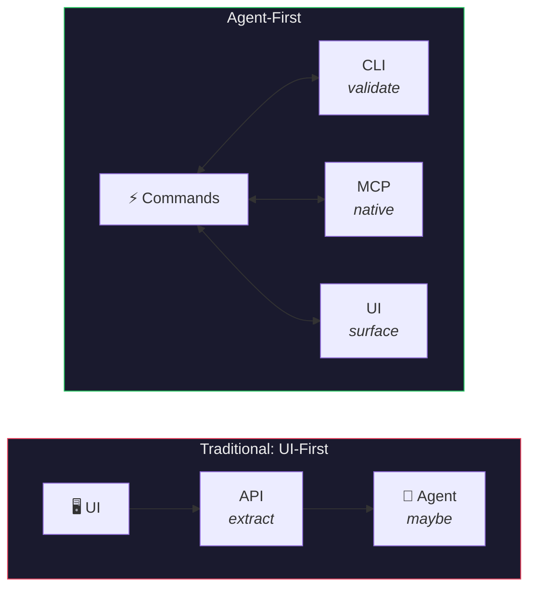
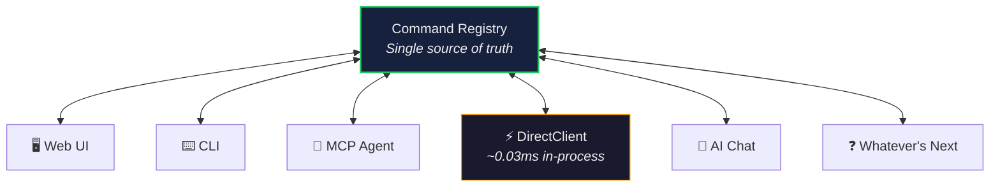
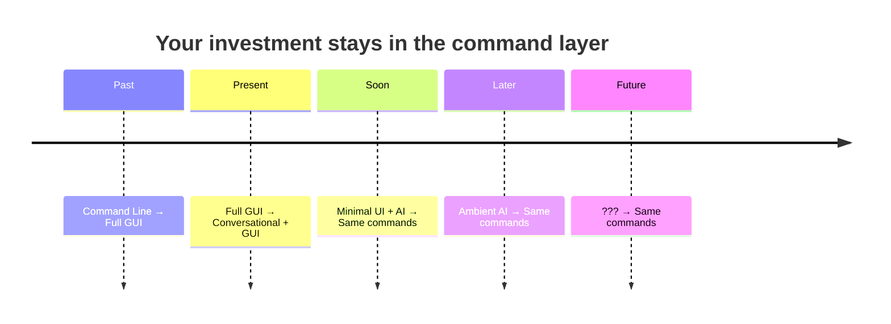
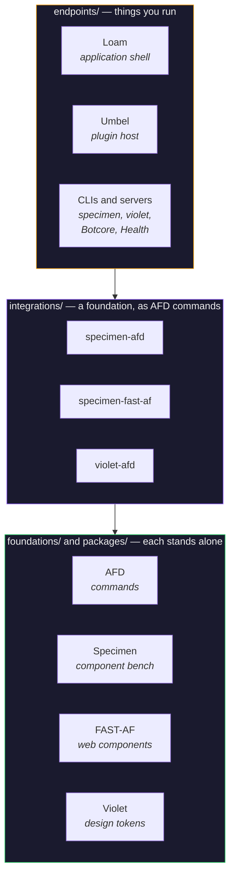

# AFD — Agent-First Development

[](LICENSE)
[](#)
[](#)
[](#)
[](#)
[](#)
[](#)
[](https://afd.dev)
[](https://github.com/sponsors/Falkicon)

| Implementation | Package | Latest release | Status | Contract |
|---|---|---|---|---|
| TypeScript | [`@lushly-dev/afd-core`](https://www.npmjs.com/package/@lushly-dev/afd-core) and 8 more `@lushly-dev/*` packages | [](https://www.npmjs.com/package/@lushly-dev/afd-core) | 🟢 Beta | [1.0-rc](./spec/CHANGELOG.md) |
| Python | [`afd`](https://pypi.org/project/afd/) | [](https://pypi.org/project/afd/) | 🟢 Beta | [1.0-rc](./spec/CHANGELOG.md) |
| Rust | [`afd`](./packages/rust) crate | [](https://crates.io/crates/afd) | 🟡 Preview | [1.0-rc](./spec/CHANGELOG.md) |
| C++ | [`afd-cpp`](./packages/cpp) | [](https://github.com/lushly-dev/afd/tags) | 🟡 Preview | [1.0-rc](./spec/CHANGELOG.md) |


> 🟢 **Beta:** stable and in active use across multiple projects. APIs are mostly stable; expect targeted iterative improvements. 🟡 **Preview:** tested, but not yet proven in production; the API may change in a minor release before 1.0. **Contract** is the version of the shared AFD contract in [`spec/`](./spec/CHANGELOG.md) that each implementation implements; each package keeps its own version. Feedback welcome!

> **More than the libraries.** This repository also holds the projects that grew up around AFD: a component bench, a web component runtime, a design token engine, a plugin host, an application shell and shared agent tooling. [The rest of the repository](#the-rest-of-the-repository) says what each one is and how far along it is.

**What if we applied UX design thinking to AI agents?**

For decades, UX designers have reduced friction between people and software. Every button, menu and form is friction. Necessary friction, thoughtfully designed, but friction all the same. The ideal interface is *invisible*.

AI agents don't need visual affordances. They need clear capabilities. Structured inputs. Predictable outputs. And rich feedback when things go wrong. AFD applies the same rigor designers bring to human experiences, but pointed at the agents working alongside us.

The result: software where **commands are the product**, portable across any environment, with UI as a swappable surface. Humans and agents share the same language.

---

## The Problem: Your App Is Opaque to AI

Traditional applications are perfectly usable by humans and nearly opaque to machines. An LLM with terminal access is like a brilliant engineer forced to interact through a keyhole. It can read your code, but it can't *experience* your application.

Capabilities are locked behind visual interfaces. State lives in UI components. Features only work through mouse clicks. And when you finally build an API, it's a translation layer, a second-class view of what the UI already does.



## The Inversion: Commands Are the Product

AFD flips the development model. Define commands first. Validate them through the CLI. *Then* build UI as a thin surface over proven logic. The command layer is the single source of truth, and the UI is just one possible rendering.

> **The Honesty Check:** *"If it can't be done via CLI, the architecture is wrong."*

This one rule prevents UI-only code paths, forces proper abstraction, and gives agents 100% functional parity with humans.



A React app, a CLI session, an MCP agent, an in-process LLM. They all call the same commands, get the same `CommandResult`, and benefit from the same validation, error recovery and observability.

Because commands carry no UI dependency, they're portable. The same command set can run on a cloud server, a mobile app, an IoT device, or a self-service kiosk. You write the logic once and swap the surface for each environment. The business logic travels with the commands, not the presentation layer.

## What Makes This Different

Most tools give agents data. AFD gives agents **judgment**.

Here's the same operation — fetching a user — from a typical MCP tool versus an AFD command. Look at what the agent has to work with in each case:

**Typical MCP tool response:**
```json
{
  "id": 42,
  "name": "Jane Doe",
  "email": "jane@example.com",
  "role": "admin"
}
```

The agent got data. But now it's on its own. Was the lookup reliable? Is this from a cache or a live query? Should it do something next? If the user wasn't found, it gets a generic error string and has to guess what went wrong. Every decision after this response requires the agent to *infer* context the system already had.

**AFD command response:**
```json
{
  "success": true,
  "data": {
    "id": 42,
    "name": "Jane Doe",
    "email": "jane@example.com",
    "role": "admin"
  },
  "confidence": 0.85,
  "reasoning": "Matched by email (case-insensitive). 2 accounts share this domain.",
  "warnings": [{ "message": "User has elevated privileges — mutations require confirmation" }],
  "suggestions": ["Use user-permissions to review role assignments"]
}
```

Same data. Completely different agent experience. Now the agent knows:

| Metadata | What the agent learns |
|----------|----------------------|
| `confidence: 0.85` | "This match isn't certain — I should verify before acting on it" |
| `reasoning` | "It matched by email, not exact ID — and there are similar accounts" |
| `warnings` | "This is an admin user — I need to be careful with mutations" |
| `suggestions` | "There's a logical next step the system is recommending" |

And when things fail, the difference is even more dramatic:

```json
{
  "success": false,
  "error": {
    "code": "NOT_FOUND",
    "message": "No user with email 'jdoe@example.com'",
    "suggestion": "Use user-search with partial match — try 'jane' or 'doe'"
  }
}
```

Instead of a 404 and a blank wall, the agent gets a specific recovery path. It doesn't have to reason about *what to try next* — the system already knows.

This is `CommandResult`:

```typescript
interface CommandResult<T> {
  success: boolean;
  data?: T;
  error?: CommandError;

  confidence?: number;      // Should the agent trust this result?
  reasoning?: string;       // What happened and why?
  suggestions?: string[];   // What should the agent do next?
  warnings?: Warning[];     // Side effects to be aware of
  sources?: Source[];       // Where did this data come from?
  plan?: PlanStep[];        // What steps were or will be taken?
  alternatives?: T[];       // What other options exist?
}
```

Confidence calibration, transparency, plan visibility, actionable error recovery — the same principles that build trust in human UX, expressed as structured data that agents can act on. Not "API-first with a new name." A fundamentally different contract between your software and the agents using it.

## Riding the Wave

The interaction paradigm keeps changing. The command layer doesn't.



By designing for agents first, your software automatically becomes API-first (agents need APIs), well-documented (agents need schemas), testable (agents need predictable behavior), and automatable (agents *are* automation). You're not betting on a specific protocol. MCP is today's standard, function calling is another, and future protocols will emerge. The command layer outlasts all of them.

## What's in the Toolkit

AFD ships as packages across **TypeScript, Python, Rust, and C++**. All four share one contract, written down in [`spec/`](./spec) with golden wire fixtures, and pass the same todo conformance suite. Their language-specific APIs differ, and so does their scope. TypeScript and Python include MCP servers and clients; Rust has an optional MCP server; C++ is an in-process library. See [Language Parity](./docs/language-parity.md) for the capability matrix and known gaps.

| Package | What it does |
|---------|-------------|
| **@lushly-dev/afd-core** | Core types — `CommandResult`, `CommandError`, batching, streaming |
| **@lushly-dev/afd-server** | Zod-based MCP server factory with middleware (logging, timing, rate limiting, telemetry), plus a browser-safe in-process registry |
| **@lushly-dev/afd-client** | MCP client over Streamable HTTP + `DirectClient` for ~0.03ms in-process execution |
| **@lushly-dev/afd-testing** | JTBD scenario runner, surface validation, coverage analysis, MCP agent integration |
| **@lushly-dev/afd-cli** | CLI for connecting, calling, validating, and exploring commands |
| **@lushly-dev/afd-auth** | Provider-agnostic auth adapter — middleware, commands, session sync, React hooks, adapters for Mock/Convex/BetterAuth |
| **@lushly-dev/afd-view-state** | UI view state (panels, selections, tool modes) managed through commands, so agents and tests can see and drive it |
| **@lushly-dev/afd-adapters** | Frontend adapters for rendering `CommandResult` → styled HTML with CSS variable theming |
| **@lushly-dev/local-db** | Async data adapter with swappable backends (memory, HTTP) for command storage |
| **afd** *(Python)* | Idiomatic Python AFD: `CommandResult`, MCP server/client, middleware, validation, telemetry, batch, pipelines, stream types, testing, handoff |
| **afd** *(Rust)* | `CommandResult` types, validating `CommandRegistry`, batch and pipeline execution, stream types, bootstrap commands; WASM-compatible; an MCP server behind the optional `server` feature |
| **afd-cpp** *(C++20, published preview)* | [`packages/cpp`](./packages/cpp): `CommandResult` types, validating `CommandRegistry`, middleware, `DirectClient`, batch/pipeline/stream execution; engine-free, builds without exceptions or RTTI and for WebAssembly |

AFD stays framework-agnostic at the command layer. React or browser integrations belong in examples and in the projects around AFD, not in the core parity target.

Features like [command trust config](./docs/features/complete/command-trust-config/), [exposure & undo](./docs/features/complete/command-exposure-undo/), [command pipelines](./docs/features/complete/command-pipeline/), [real-time handoff](./docs/features/complete/handoff-pattern/), and [middleware defaults](./docs/features/complete/middleware-defaults/) (zero-config observability) are already shipped.

**[Read the full philosophy →](./.claude/skills/afd/references/philosophy.md)**

## Development Workflow

A feature starts from the jobs it serves. Write each job as a short scenario file first; a job you can't write with the commands you drafted is a gap in the design, found before any code exists ([jobs first](./.claude/skills/afd/references/jobs-first.md)).

**Per-Command Workflow** (repeat for each command):

```
┌─────────────────────────────────────────────────┐
│  Step 1: DEFINE                                 │
│  • Create command with schema                   │
│  • Register in command registry                 │
│  • Document inputs, outputs, side effects       │
├─────────────────────────────────────────────────┤
│  Step 2: VALIDATE                               │
│  • Test via CLI: afd call <command>             │
│  • Cover edge cases and error states            │
│  • Add automated tests (Vitest)                 │
│  • Do NOT proceed until CLI works            │
├─────────────────────────────────────────────────┤
│  Step 3: SURFACE                                │
│  • Build UI component that invokes command      │
│  • UI is a thin wrapper, not business logic     │
│  • Integration test (Playwright)                │
└─────────────────────────────────────────────────┘
```

> **Note**: This is the per-command workflow. For the full 4-phase **project implementation roadmap** (Foundation → Expansion → Refinement → Ecosystem), see [Implementation Roadmap](./docs/whitepaper/AFD-Whitepaper.md#7-implementation-roadmap) in the whitepaper.

## Quickstart

Five minutes from an empty folder to a command that a terminal, a test and an agent can all call. You need Node.js 22.12 or later.

The TypeScript packages are published on npm at 2.x. Install the published server and CLI for this quickstart.

### 1. Create a project

```bash
mkdir todo-afd && cd todo-afd
npm init -y && npm pkg set type=module
npm install -D tsx
npm install @lushly-dev/afd-server@^2 @lushly-dev/afd-cli@^2 zod
```

To try unreleased source, with pnpm installed, build a source checkout inside the project and install its local packages:

```bash
git clone https://github.com/lushly-dev/afd.git .afd-source
pnpm --dir .afd-source install --frozen-lockfile
pnpm --dir .afd-source build
npm install ./.afd-source/packages/server ./.afd-source/packages/cli zod
```

The source-install route links to the workspace's built files, so keep the checkout in place while using it. Use it for development against unreleased changes; new projects can install the published npm packages directly. Both routes make `npx afd --version` print 2.x. The rest of this walkthrough uses the same commands with either route.

### 2. Define commands and serve them

Create `server.ts`:

```typescript
import { createMcpServer, defineCommand, failure, success } from '@lushly-dev/afd-server';
import { z } from 'zod';

const todos = new Map<string, { id: string; title: string; done: boolean }>();

const createTodo = defineCommand({
  name: 'todo-create',
  description: 'Create a todo item from a title',
  category: 'todo',
  expose: { mcp: true, cli: true }, // remote surfaces are opt-in
  mutation: true,
  input: z.object({ title: z.string().min(1, 'Title is required') }),
  async handler({ title }) {
    const todo = { id: crypto.randomUUID().slice(0, 8), title, done: false };
    todos.set(todo.id, todo);
    return success(todo, { reasoning: `Created "${title}"`, confidence: 1 });
  },
});

const getTodo = defineCommand({
  name: 'todo-get',
  description: 'Get a todo item by its id',
  category: 'todo',
  expose: { mcp: true, cli: true },
  input: z.object({ id: z.string() }),
  async handler({ id }) {
    const todo = todos.get(id);
    if (!todo) {
      return failure({
        code: 'NOT_FOUND',
        message: `No todo with id "${id}"`,
        suggestion: 'Call todo-create first, then use the id it returns',
      });
    }
    return success(todo);
  },
});

const server = createMcpServer({
  name: 'todo',
  version: '0.1.0',
  commands: [createTodo, getTodo],
  transport: 'http',
  port: 3100,
});

await server.start();
console.log(`AFD server running at ${server.getUrl()}`);
```

Start it:

```bash
npx tsx server.ts
```

### 3. Validate from the terminal

In a second terminal, connect once, then call commands the way an agent would. Try the failure first:

```bash
npx afd connect http://localhost:3100/mcp
npx afd call todo-create '{"title":""}'
```

```
✗ Failed

Error: [VALIDATION_ERROR] Input validation failed

Suggestion: title: Title is required. Expected fields: title
```

Then the happy path, and a lookup that fails with a recovery path:

```bash
npx afd call todo-create '{"title":"Buy groceries"}'
npx afd call todo-get '{"id":"nope"}'
```

```
✓ Success

Data:
{
  "id": "e9867058",
  "title": "Buy groceries",
  "done": false
}

Confidence: ██████████ 100%
```

```
✗ Failed

Error: [NOT_FOUND] No todo with id "nope"

Suggestion: Call todo-create first, then use the id it returns
```

`npx afd tools` shows what an MCP agent sees. By default commands are grouped by category, so both appear as one `todo` tool with `create` and `get` actions, next to the built-in `afd-call`, `afd-batch`, `afd-pipe` and `afd-detail` tools.

### 4. Test the job

Create `scenarios/todo-lifecycle.scenario.yaml`. Step 1 uses the id step 0 returned:

```yaml
name: Create and fetch a todo
description: As a user, I can create a todo and fetch it back
job: todo-lifecycle
tags: [smoke, step-refs]

steps:
  - command: todo-create
    description: Create a todo
    input: { title: Buy groceries }
    expect: { success: true }

  - command: todo-get
    description: Fetch it by the id step 0 returned
    input:
      id: ${{ steps[0].data.id }}
    expect:
      success: true
      data: { title: Buy groceries }
```

```bash
npx afd scenario run scenarios/ --server http://localhost:3100/mcp
```

```
▸ todo-lifecycle
  As a user, I can create a todo and fetch it back
  ✓ [1/2] todo-create 3ms
  ✓ [2/2] todo-get 2ms

✓ todo-lifecycle (7ms)
  2 passed, 0 failed, 0 skipped

Summary
  1 passed, 0 failed

✓ All scenarios passed!
```

### 5. Lint the surface

Surface validation checks the command set the way an agent will meet it: names, descriptions, overlapping schemas, injection risks and schema complexity.

```bash
npx afd validate --surface
```

```
Surface Validation Results:

  Grouped tools expanded into their commands: todo
  Built-in AFD tools skipped: afd-batch, afd-pipe, afd-call, afd-detail

ℹ INFO (2):
  missing-output-schema: Command "todo-create" has no output schema — agents cannot predict response shape
    Commands: todo-create
  missing-output-schema: Command "todo-get" has no output schema — agents cannot predict response shape
    Commands: todo-get

Summary:
  2 commands analyzed
  12 rules evaluated in 2.02ms
  0 errors
  0 warnings
  2 info

✓ Surface validation passed!
```

It validates your commands, not AFD's built-in tools, and expands grouped tools into the commands inside them. The two info items are the next improvement: add an `output` schema to each command so agents know the result's shape before they call it.

### 6. Hand it to an agent

The server speaks MCP, so any MCP client can use it. In Claude Code:

```bash
claude mcp add --transport http todo http://localhost:3100/mcp
```

For an agent that runs inside your own app, skip the network: `createDirectRegistry` and DirectClient run the same commands in-process (see [afd-directclient](./.claude/skills/afd-directclient/SKILL.md)).

### Next steps

- **Teach your coding agent AFD:** `npx degit lushly-dev/afd/.claude/skills/afd .claude/skills/afd` (also `afd-typescript`, `afd-python`, `afd-rust` and others in [`.claude/skills`](./.claude/skills)).
- **Add agent-UX metadata:** `destructive` and `confirmPrompt`, `undoable`, `requires`, `examples` and output schemas. See the [command schema guide](./.claude/skills/afd/references/command-schema.md).
- **Scale the tool list:** `toolStrategy: 'lazy'` for large command sets, and `bootstrap: true` for `afd-help`, `afd-docs` and `afd-schema` ([MCP integration](./.claude/skills/afd/references/mcp-integration.md)).
- **Go deeper on linting:** the [surface validation guide](./.claude/skills/afd/references/surface-validation.md) covers every rule and how to configure them.
- **Build a UI on top:** call the same commands from the browser with `createClient` from `@lushly-dev/afd-client`.

### Working on AFD itself

To build the packages and CLI from source:

```bash
git clone https://github.com/lushly-dev/afd.git
cd afd
pnpm install    # Also installs Lefthook git hooks
pnpm build
node packages/cli/dist/bin.js --help
```

> `pnpm check` runs the TypeScript quality gate (lint, build, typecheck, tests) over the packages your change affects. The Python, Rust and C++ implementations and the families below have their own suites; [SETUP.md](./SETUP.md) gets a machine ready and [CONTRIBUTING.md](./CONTRIBUTING.md) says which commands go with which area.

## CLI Reference

| Command | Description |
|---------|-------------|
| `afd connect <url>` | Connect to an MCP server |
| `afd disconnect` | Disconnect from server |
| `afd status` | Show connection status |
| `afd tools` | List available tools |
| `afd tools --category <name>` | Filter tools by category |
| `afd call <tool> [args]` | Call a tool with JSON args |
| `afd validate` | Validate the tool listing (`--execute` also calls read-only tools) |
| `afd validate --surface` | Run cross-command surface validation |
| `afd batch <commands>` | Run several commands in one request |
| `afd stream <tool> [args]` | Stream a command's results |
| `afd scenario run <path>` | Run JTBD scenario files against a server |
| `afd replay <file>` | Replay a command journal in-process and diff the results |
| `afd shell` | Interactive mode |

The [CLI's README](./packages/cli/README.md) covers every option.

## The Rest of the Repository

AFD started as a method and a set of libraries. Then the method got used, and the same question kept coming back one layer higher. If commands are the product, what does a component library look like when an agent is the one reading it? A design system? A server that gives a model knowledge and memory? A whole application?

Each answer became a project, and those projects now live here, next to the libraries. They share the idea behind AFD: a capability should be reachable as a command, so a person, a test and an agent all get the same software.

The repository is laid out by what a thing is for:



- **Foundations** stand on their own. Specimen, FAST-AF and Violet have no dependency on AFD, so you can adopt one without the rest.
- **Integrations** bind a foundation to AFD: the same operations, exposed as validated commands that return a `CommandResult`.
- **Endpoints** are what you install and run: a CLI, an MCP server, a host, an app shell. They compose the layers below.

### The families

| Family | What it is | Where it stands |
|--------|-----------|-----------------|
| [**Specimen**](./foundations/specimen/README.md) | A component observation bench. It renders a component in Chromium and records what actually happened: geometry, computed styles, native control state, open shadow DOM and ARIA snapshots. Two renders can then be compared on evidence, including changes that identical markup would hide. It runs stories written in Storybook's format, with their plays and accessibility checks, and needs no Storybook installed. | Preview, on npm under the `preview` tag, with its [CLI](./endpoints/specimen-cli/README.md), [AFD commands](./integrations/specimen-afd/README.md) and [FAST-AF plugin](./integrations/specimen-fast-af/README.md) |
| [**FAST-AF**](./foundations/fast-af/README.md) | A web component runtime (`@lushly-dev/fast-element`) and a component library built on it (`violet-elements`). Every component's stories run on Specimen, and each component carries a record of what an agent writing a page needs to know about it. | The runtime is a preview on npm; the components are in the repository only |
| [**Violet**](./foundations/violet/README.md) | A design token engine. Tokens live on nodes in a tree; each node inherits from its parent and adds, overrides or removes. It exports CSS, SCSS, TypeScript, Swift, Kotlin, Dart, Tailwind and more, and ships a browser runtime for loading tokens and switching themes, a [`violet` CLI](./endpoints/violet-cli/README.md) and an [MCP server](./endpoints/violet-server/README.md). | In the repository; not published from here yet |
| [**Umbel**](./endpoints/umbel/README.md) | An empty Rust host for capability plugins, reachable over MCP and as a CLI. It ships with no capability of its own: knowledge, memory, context and tools arrive as plugins, and one deployment can hold several isolated spaces. The model calling it does the reasoning; Umbel keeps it informed and remembered, with every answer traceable to its source. | In development, unpublished. The host, the plugin contract, knowledge, memory and context, and the curator are done; sign-in and hosting are in progress ([status](./endpoints/umbel/docs/STATUS.md)) |
| [**Loam**](./endpoints/loam/README.md) | An application shell: one chrome into which many apps land as plugins, sharing sign-in, projects, documents, settings and a command palette. The shell's own state is commands, so agents and tests drive it the way people do. Its chrome is FAST-AF components on a Violet theme. | In development, unpublished. The kernel and chrome, the app contract, and projects and documents are done; identity and hosting are in progress ([status](./endpoints/loam/docs/STATUS.md)) |
| [**Botcore**](./endpoints/botcore/README.md) | Shared agent tooling for the repositories you work in: commands, skills, configuration and plugins from one `pip install`, so every repository's agent has the same tools. | `lushly-botcore` is on PyPI, published from this repository |
| [**Health**](./endpoints/health/README.md) | Repository health audits you point at explicit targets, with a versioned JSON report and a [static dashboard](./endpoints/health-dashboard/README.md) to read it. The audited repository needs no AFD dependency. | In the repository only |
| [**Alfred**](./alfred/README.md) | This repository's own quality bot: architecture lint, cross-language parity and command description quality, through CLI and MCP. | In the repository only |

### How they fit together

The projects were built separately, and each one is used by the others:

- **FAST-AF's components are tested on Specimen.** Specimen is their only story runner.
- **Loam is built from the others.** Its chrome is FAST-AF components, its theme is a Violet token tree, its fixtures run on Specimen, and its kernel is AFD's in-process registry running in the browser.
- **Umbel and Loam share one plugin manifest.** Its host-neutral core is specified in [`spec/plugin-manifest.md`](./spec/plugin-manifest.md), with a profile for each host, so an Umbel plugin and a Loam app are described the same way. Loam's test suite mounts a stock `umbel` and drives it from the shell.
- **What they needed went back into AFD.** MCP authorization, output budgets, resources and long-running tasks joined the shared contract in [`spec/`](./spec) because Umbel and Loam needed them, usually with Rust implementing them first.

### What "in the repository" means

Bringing source into this repository does not publish it. [`scripts/release/inventory.json`](./scripts/release/inventory.json) lists every releasable unit, and a unit publishes only once it has been explicitly admitted there; everything else is held back. So a package can be built, tested and used inside the workspace long before you can install it from a registry. The table above says which is which, and [platform releases](./docs/operations/platform-releases.md) describes the process.

## Documentation

| Guide | Description |
|-------|-------------|
| [Philosophy](./.claude/skills/afd/references/philosophy.md) | **Why** AFD — UX design for AI collaborators |
| [Command Schema Guide](./.claude/skills/afd/references/command-schema.md) | How to design commands that enable good agent UX |
| [Jobs First](./.claude/skills/afd/references/jobs-first.md) | Starting a feature from the jobs it serves, written as scenarios |
| [Optimistic UI](./.claude/skills/afd-directclient/SKILL.md#optimistic-ui-in-an-app-client) | How to use optimistic updates in interactive AFD clients without moving business logic out of commands |
| [The AFD contract](./spec) | The shared specification every language implements: wire format, error codes, metadata, authorization and more |
| [Language Parity](./docs/language-parity.md) | What each language implements, and the known gaps |
| [Whitepaper](./docs/whitepaper/AFD-Whitepaper.md) | The full argument, including [trust through validation](./docs/whitepaper/AFD-Whitepaper.md#6-trust-through-validation), an [implementation roadmap](./docs/whitepaper/AFD-Whitepaper.md#7-implementation-roadmap) for AFD projects and [production considerations](./docs/whitepaper/AFD-Whitepaper.md#11-production-considerations) |
| [Docs index](./docs/README.md) | Feature proposals and their status, operations notes and reviews |

## Examples

| Example | Description |
|---------|-------------|
| [Todo App](./packages/examples/todo) | Multi-stack example with 4 backends (TypeScript, Python, Rust, C++) and 2 frontends (Vanilla JS, React). Features shared storage, trust UI, remote change detection, and full MCP integration |
| [Todo with DirectClient](./packages/examples/todo-directclient) | An AI copilot calling the same commands in-process, with no network hop |
| [Chat](./packages/examples/chat) | The handoff pattern: a command returns a WebSocket URL and a short-lived token, and the client talks to the socket directly |
| [Feature Showcase](./packages/examples/showcase) | Runnable demos of auth, default middleware and surface validation |

## Testing

Because commands carry no UI, they can be tested at every layer without a browser:

| Layer | What it proves | How |
|-------|----------------|-----|
| **Unit tests** | A command's logic, and that it returns a well-formed `CommandResult` | Vitest, next to the command (see the Todo example's [`commands.test.ts`](./packages/examples/todo/backends/typescript/src/commands/__tests__/commands.test.ts)) |
| **Performance tests** | Response time against a threshold, with no network or database in the way | The Todo example's [`performance.test.ts`](./packages/examples/todo/backends/typescript/src/commands/__tests__/performance.test.ts) |
| **Scenarios** | A whole job, step by step, the way a user or agent would do it | `afd scenario run` |
| **Surface validation** | The command set as an agent meets it: names, descriptions, overlap, injection risks | `afd validate --surface` |
| **Conformance** | That four languages behave as one | A shared suite run against the TypeScript, Python, Rust and C++ todo backends in [`conformance.yml`](./.github/workflows/conformance.yml) |

In this repository, `pnpm test` runs the TypeScript suites.

## What's in Flight

Work is planned in the open, and every project keeps a status file that says exactly what is done and what is not:

- **AFD itself:** the [feature index](./docs/features/README.md) lists what is proposed, active and shipped, and [Language Parity](./docs/language-parity.md) tracks the gaps between languages.
- **Umbel:** [status](./endpoints/umbel/docs/STATUS.md) and [architecture](./endpoints/umbel/docs/architecture.md).
- **Loam:** [status](./endpoints/loam/docs/STATUS.md) and [architecture](./endpoints/loam/docs/architecture.md).
- **Specimen:** [status](./docs/features/active/specimens/STATUS.md).
- **Bringing the families into one repository:** [platform monorepo status](./docs/features/active/platform-monorepo/STATUS.md).

## Community

- Read [CONTRIBUTING.md](./CONTRIBUTING.md) before opening a PR
- Review [CODE_OF_CONDUCT.md](./CODE_OF_CONDUCT.md) for community expectations
- Report vulnerabilities via [SECURITY.md](./SECURITY.md)

For AI agents contributing to this repo, see [AGENTS.md](AGENTS.md).

## Author

**Jason Falk** · [GitHub](https://github.com/Falkicon) · [Sponsor](https://github.com/sponsors/Falkicon)

Principal Design & UX Engineering Leader at Microsoft. Currently manages the central design team for Azure Data (including Microsoft Fabric) and leads AI adoption across the studio. Design Director for Microsoft Fabric through its v1 launch. Co-creator of [FAST](https://github.com/microsoft/fast) (7,400+ GitHub stars), an open-source web component system used in Edge, Windows, VS Code, and .NET.

AFD grew from 30 years of building interfaces — and the realization that the most durable layer isn't the UI, it's the commands underneath.
