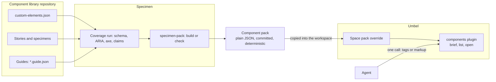

# Component Briefs: proposal and plan

One call that tells an agent what it needs to use every component on a page:
Specimen builds a compact, evidence-labelled pack per component library, and an
Umbel plugin serves it in batches.

## Status

- **State:** active, with phase 0 and steps A1 and A2 done.
  Written 2026-11-09 against `main` at `cfb70942`, and revised the same day
  after the author's own review, two independent reviews (each: revise) and a
  focused check of the fixes. Step A1 put the pack format's version 0 in
  Specimen (2026-11-10, #949). Step A2's specifications were written
  and approved by the owner 2026-11-10 (#964): the
  [`components` plugin specification](../../../../endpoints/umbel/docs/plugins/components/spec.md)
  and Specimen's [T12](../specimens/implementation.md#ordered-implementation-queue).
  Nothing else is implemented, and nothing is approved beyond the owner's
  decision to go on to phase A. [STATUS.md](STATUS.md) tracks progress.
- **Verified:** the facts in [What exists today](#2-what-exists-today) were
  read on `main` at `cfb70942`. The numbers in [Baseline](#3-baseline) are
  printed by [`baseline.mjs`](./baseline.mjs) on that commit. Phase 0 ran:
  [`baseline.md`](./baseline.md) is step 0.1's record and
  [`prototype.md`](./prototype.md) is the record of steps 0.2 and 0.3.
- **Not verified:** whether records are identical on macOS and Linux, the
  half of step 0.3 that was not run (it is tested at step B3's exit).
  Everything measured was measured at `cfb70942`. One fact has changed
  since: Specimen now snapshots an open modal dialog (#915), where step 0.3
  found the snapshot empty. Step 0.3 was not run again.
- **Progress:** by the rules fixed beforehand, phase 0's result was "go, the
  brief as planned", on thin evidence: a brief cost about a fifth fewer
  tokens than today's route and did not make pages measurably more correct.
  The owner decided **go** on 2026-11-09 (step 0.4) on that understanding.
  Step 0.3 changed three things below: roles need a capture change first
  (step B2a), examples are checked by mounting them again, and records take
  less from an observation. Phase A has started: steps A1 and A2 (the
  specifications) are done, and phases B and C can start.
- **Owner's decisions:** given 2026-11-09 ([For the owner](#13-for-the-owner)).
  Phase A's specifications were approved 2026-11-10 (#964, step A2), with the
  owner's answer to the plugin specification's section 13: a call touching a
  bad library fails, and the failure is handled gracefully.

| Field | Value |
| --- | --- |
| Units touched | `foundations/specimen`, `integrations/specimen-afd`, `endpoints/specimen-cli`, `integrations/specimen-fast-af`, `foundations/fast-af/packages/violet-elements`, `endpoints/umbel` (a new plugin crate), `endpoints/loam` (its design record) and `.claude/skills/loam-design` (step C5) |
| Related | [Specimens status](../specimens/STATUS.md), [Umbel status](../../../../endpoints/umbel/docs/STATUS.md), [Umbel architecture](../../../../endpoints/umbel/docs/architecture.md), [Output budgets](../../../../spec/output-budgets.md) |

## 1. Problem and goal

An agent building a page with a component library has to learn each component
it uses: its attributes and allowed values, slots, events, and the
accessibility and usage rules. Today it learns them one component at a time,
from sources written for other readers. A page with 20 components means 20
lookups, and rules that many components share (how a field is labelled, how a
popup handles focus) are read again for each.

**Goal.** An agent names the components on a page, or hands over the markup,
and gets back in one call, inside one output budget:

- a short entry per component;
- each shared rule once;
- every tag the library does not know, named as unknown;
- for every statement, how it is known: checked by a test, seen in a browser,
  declared by the schema, or only written by a person.

**Non-goals.** Replacing component documentation for people. Generating
components or pages. Searching for "which component should I use" with
ranking (a plain filter is in scope; ranked search is the knowledge plugin's
job). Serving any library's content from inside the Umbel binary.

## 2. What exists today

Specimen:

- `specimen-inspect` returns a component's schema (properties, attributes,
  slots, events, CSS properties, commands, and an `unknown` list), but it is
  keyed by a story id, not a tag, and it starts the native host and renders
  the story to answer (`foundations/specimen/src/bench-runtime.ts`, `inspect`).
  It has no batch form.
- `specimen-coverage` already works per tag. It runs the selected cases and
  reports each component's obligations at a level earned from what a run
  observed: `verified`, `asserted`, `represented`, `missing`, `unknown`.
  Claims (`coverage` on a native specimen, `claim()` in a retained story's
  play) are what raise a level to `verified`.
- Captures hold Chromium's ARIA snapshot, and `specimen-a11y` and the settled
  accessibility check record axe's findings per case.
- A plugin can add to the schema (`schema`), themes, token maps and command
  runners: four plugin points. There is no place for guidance.
- Specimen is a published npm preview. Its API can still change.

FAST-AF (`foundations/fast-af/packages/violet-elements`):

- `custom-elements.json` describes 77 elements. 71 have a description, 50
  list slots, 44 list events. `violet-combobox` has an empty description and
  no slots listed.
- `specimen.config.json` names no plugin, so the FAST-AF plugin's additions
  (finite values, `@command` commands) are not in the schema Specimen reads
  for this package. Step B4 confirms whether that is deliberate.
- Accessibility behaviour is not data anywhere. It is in tests (two
  `*.a11y.spec.ts` files) and in what the 79 story files show.
- `attribute-taxonomy.jsonc` already states what each shared attribute name
  means across the library, with `useFor` and `doNotUseFor`. It is the
  nearest thing to shared rules, and nothing serves it to an agent.

Umbel:

- A plugin can ship a **pack**: a directory of data, reference material and
  rules (D46). A space can replace a plugin's default pack whole with its own
  directory, `spaces/<space>/packs/<plugin>/<pack>/`. The `packs` grant reads
  the call's space's effective copy and nothing else.
- Limits: 1 000 files and 64 MiB per pack; 16 MiB of pack bytes read per
  call. An override is found and checked against those limits when the host
  seals, so a new override directory needs a restart. Its files are read
  from disk on each call (`src/plugins/packs.rs`, `PackCopy`), so new
  contents in an existing override are served at once, unchecked against the
  limits, and a call can land in the middle of a copy.
- Per-command output budgets work for **compiled** plugins. A component
  plugin cannot declare one: the WIT world `umbel:plugin/plugin@1.0.0` call
  context does not carry a budget, and the manifest reader refuses it,
  naming world 1.1.0 (`src/plugins/manifest.rs`, `output_budget`).
- The `context` plugin's `context-bundle` is the nearest existing command:
  one budgeted answer assembled from several sources, with everything in it
  labelled as content (D67). It selects by a task's terms, not by an exact
  list, so it does not answer this need.
- AFD's batch (`umbel batch`, `afd-batch`) runs N commands in one request. It
  returns N whole answers, repeats shared rules in each, and each answer has
  its own budget.
- First-party plugins are compiled crates linked by `umbel-first-party`. The
  stock `umbel` binary compiles in none (D48, D57). "Further first-class
  plugins" each get their own specification (D18); `content-design`, the
  planned pack exemplar, is not started.

## 3. Baseline

Measured on `main` at `cfb70942` by [`baseline.mjs`](./baseline.mjs), which
reads the repository and writes nothing; [`baseline.md`](./baseline.md) is
the record, with how each number is counted. Bytes are UTF-8 bytes of
compact JSON unless a file is named.

| The whole library, 77 elements | Bytes | Median per element | Largest |
| --- | --- | --- | --- |
| `custom-elements.json`, the file | 1 219 709 | | |
| The declarations | 422 127 | 3 700 | 53 762 |
| Cut to public API, with its prose | 97 293 | 1 044 | 5 889 |
| Brief floor: API with no prose and no guidance | 33 181 | 390 | 1 102 |

The pages. A component counts when the page's sources name its tag as a
whole name. That is an upper bound: Loam `chrome` names 22, of which 12 are
written as markup, 2 are only created in code (`violet-menu-item`,
`violet-tree-item`), and 8 are only named, some in a lazy-loading table and
some in a comment that says the component is not used.

| Page | Components | Declarations | Public API (one `specimen-inspect` and a browser render each) | Brief floor | Their source and stories |
| --- | --- | --- | --- | --- | --- |
| Loam `chrome` | 22 | 99 146 | 26 330 | 9 379 | 364 180 in 64 files |
| Loam `console` | 8 | 48 848 | 13 433 | 4 478 | 151 798 in 17 files |
| Loam, every package and app | 24 | 101 293 | 27 246 | 9 826 | 413 233 in 71 files |
| Twenty components across form, overlay and layout | 20 | 103 351 | 26 672 | 8 879 | 370 617 in 40 files |

None of today's three routes carries an accessibility rule, a usage rule or
an evidence level. The brief floor is the least a brief could say from the
manifest alone, so the room between it and a target is what guidance may
use.

## 4. Design



- **Specimen builds the pack, ahead of time.** It already knows how to run
  every story in Chromium and what each one showed. The pack is plain JSON,
  committed beside the library, byte-stable, and checked for drift in CI. A
  change to a component then shows, in the same pull request, what agents
  will be told about it. The drift check is a coverage run, and FAST-AF's
  stories job today runs the story contract, not coverage
  (`scripts/run-stories.mjs`), so step B3 either shares one browser run
  between the two or records the added time.
- **The pack is the only contract between the two.** Specimen owns the
  format, as the one that writes it: the schema and a fixture pack ship in
  its package, and the format's version stays 0 until the exit. Umbel's
  plugin is a reader. It keeps a copy of the fixture pack as its default
  pack, and a test fails when the copy differs. Specimen takes no Umbel
  dependency and Umbel takes no Specimen dependency.
- **Umbel serves it.** A `components` plugin reads the space's pack through
  the `packs` grant and assembles the answer. It holds no library's content
  of its own beyond a small example.

## 5. Decisions made in this plan

Technical choices, settled here so the specifications start from them. Each
is recorded with what it rules out.

| # | Decision | Instead of | Why |
| --- | --- | --- | --- |
| 1 | A purpose-built `components-brief` command | AFD batch over a per-component command | Only a command that sees the whole request can state a shared rule once and fit all of it to one budget |
| 2 | Packs built ahead of time | Umbel mounting Specimen's MCP server and asking it live | A live mount needs the library's checkout and Chromium beside every Umbel host, and renders per lookup, which a hosted deployment should not have to carry; it would also expose every `specimen-*` command |
| 3 | A dedicated plugin | Component docs as knowledge documents read by `knowledge-open` or `context-bundle` | Those read one document or rank by terms; neither takes an exact list, removes repeats, or reports an unknown tag as unknown |
| 4 | One assembler, in the Umbel plugin | A second one in Specimen's CLI for use without Umbel | Two implementations of the selection and budget rules would drift. A local Umbel over stdio is one binary |
| 5 | Specimen owns the pack format: schema, description and fixture packs in its package. The format's version is 0 through phases B and C and becomes 1 at the exit. Umbel's plugin holds a copy of the fixture pack, checked equal by a test | The format in `spec/` with vectors; or version 1 fixed before anything has used it | `spec/` is AFD's contract across four languages: and no AFD implementation reads a pack. `alfred parity` fails on a vector in `spec/vectors/` that Python and C++ do not load; a file can sit beside that directory instead (`spec/vectors/README.md`), but that still puts Specimen's format in AFD's contract. Specimen has no AFD dependency and is used outside this repository, where a library author needs the schema from its package. Fixing version 1 first would lock in guesses that phases B and C are there to test |
| 6 | Guides are data files, not modules | Guidance exported from story modules | Specimen's rule is that listing never executes unrelated modules; data is schema-checked and each statement can be addressed by id |
| 7 | The plugin ships no real library | Seeding it with FAST-AF's components | The host owns nothing domain-specific (principle 1) and its first-party plugins carry no company content. The default pack is a small example library |
| 8 | The committed records carry no package version, no digest and no Git revision. Those are stamped when the pack is exported for a deployment | A committed catalog with the version and input digests | A release's version bump or an edit to any story would otherwise change the committed pack, fail the drift check and conflict between branches. A committed file also cannot name the commit that contains it |
| 9 | The plugin is written once against `umbel-sdk`, shipped compiled in `umbel-first-party`, and its component build follows when the WIT world carries a budget | A component-only plugin now | A component cannot have an output budget in world 1.0.0, and the budget is the point of the command. The source stays free of anything a component may not use, and CI compiles it for `wasm32-wasip2` from the first step |
| 10 | Everything read from a pack is content, never instructions, and the plugin scans the statements it serves | Trusting first-party text | D67: labelled on read, scanned on write. Pack text appears only inside the part of the answer labelled `trust: "content"`. Outside it, an answer, warning or error may carry only identifiers the reader has checked against a pattern (a custom-element name, a library id, a statement or rule id, a version, a digest), and a record whose identifiers fail is refused. A pack is written outside Umbel, so no write passes through the host: the plugin runs `umbel-scan` over each statement it is about to serve and labels a flagged one with `flags`, as knowledge results are labelled. It flags and does not block, as D67 decided for a deployer's content. A plugin cannot add to `plugin-show` or doctor (the SDK gives it a manifest, assets and a handler), so the flags are in its own answers |
| 11 | A throwaway prototype is measured before any format or specification is written | Specifying first and comparing with and without briefs afterwards, as a record | The whole plan rests on a brief making an agent's work better or cheaper. That is cheap to test and has not been tested |
| 12 | Guide statements are their own obligation set, `guides@1`, reported beside `schema-partitions@1` | Adding `guide:` obligations to the existing set | A component's existing coverage result must not change because someone wrote a guide for it |

## 6. The component pack format

Described in step A1 in Specimen's documentation, with its schema and
fixture packs in Specimen's package. Its version is 0, and any step may
change it, until it becomes 1 at the exit (step C4). The shape below is the
starting point, and the values in the examples are illustrative. Step A1's
[description](../../../../foundations/specimen/docs/pack-format.md) is now the
format; where the two differ, it holds.

```text
packs/library/                    # the plugin's one pack, id "library"
├── pack.toml                     # D46; Umbel's file, written by the deployer, not by Specimen
├── data/<library>/library.json   # written at export: identity, stamp, the catalog of tags
├── data/<library>/components/<tag>.json   # committed
└── rules/<library>.json          # committed: shared rules, each stated once
```

**Two forms.** The committed form is the records and the rules. They carry
no package version and no digest, so a version bump changes none of them, and
two branches that change different components change different files.
`specimen-pack-export` writes the exported form from the committed records,
without a browser: it adds `library.json`. The exported form is what a
deployment copies, and it is not committed. Export writes to a temporary
directory beside the target, with the other libraries' files copied in as
they stand, and swaps the two directories. A call that lands inside the swap
can still read files from both, and the plugin's digest check answers that
call with `PACK_INCONSISTENT` rather than a mixed brief.

One deployment can hold several libraries side by side in one pack. Export
replaces only its own library's files and keeps the others, so a team with a
design system and an application library composes them by running it twice.
`pack.toml` is Umbel's file and the deployer's: it describes the
deployment's pack, not a library. Specimen does not write it. The plugin's
README gives its six lines and step C5's setup writes it. The layout itself
(`data/` and `rules/`) follows D46, and that much of Umbel's rule the format
takes on knowingly.
The 1 000-file cap
allows about 990 components per space; a library set beyond that is a later
format version's question, named in the specification.

`library.json` holds the format's version, the library's id, title (text,
so it is served inside the content part), package name and version, the
pack's digest, the tag prefix, and one line per tag: summary, status and
the record's digest. It names no tool version, so the fixture pack's export
changes only when the fixture or the format does, not with each Specimen
release. `components-list` reads only this file.

A component record:

```jsonc
{
  "tag": "violet-combobox",
  "summary": "Editable field with a filtered popup list; submits the committed value.",
  "status": "stable",                       // stable | preview | deprecated (with "replacedBy")
  "import": "…",                            // the specifier that registers it
  "api": {
    "attributes": [
      { "name": "invalid", "property": "invalid", "type": "boolean", "default": false,
        "rules": ["attr.invalid"], "basis": "verified" }
    ],
    "slots": [{ "name": "", "accepts": ["violet-option", "violet-option-group"], "basis": "observed" }],
    "events": [{ "name": "change", "basis": "declared" }],
    "commands": [],
    "form": { "associated": true, "basis": "observed" }
  },
  "a11y": {
    "role": [{ "state": "default", "role": "combobox", "name": "from the label attribute", "basis": "observed" }],
    "statements": [
      { "id": "combobox.label-required", "text": "Set label; a placeholder is not a name.", "basis": "authored" }
    ],
    "axe": { "violations": 0, "exceptions": [] }   // counts of cases go in the report, not the record
  },
  "usage": [{ "id": "combobox.when", "text": "Use when the list is long enough to filter.", "basis": "authored" }],
  "rules": ["field.labelling", "popup.focus-return"],
  "examples": [{ "from": "components-combobox--default", "html": "<violet-combobox label=\"Supplier\">…</violet-combobox>" }],
  "detail": "…",                            // long form, served only by components-open
  "gaps": ["no keyboard statement"]
}
```

**Basis.** Every fact in a record carries one of four words, and the first
three come straight from Specimen's coverage levels. (An answer does not
repeat the word on every fact; see [the answer's shape](#9-umbel-the-components-plugin).)

| Basis | Meaning | From |
| --- | --- | --- |
| `verified` | A claim's expectations ran and held, about this, in this state. For a guide statement: the check its claim carries ran and held (section 8) | Coverage `verified` |
| `observed` | Specimen saw it in a case that passed: an attribute state, a role in the ARIA snapshot, an axe result, the markup of an example | Coverage `represented` or `asserted`; captures |
| `declared` | The manifest or a plugin's schema says so; nothing ran it | Schema sources |
| `authored` | A person wrote it; nothing checks it | Guides |

**What a record is built from.** Coverage gathers evidence for a tag from
every case that renders it, not only that component's own stories
(`coverage.ts`, `componentCoverage`): `violet-option` is observed inside
combobox, listbox and select stories. A record follows the same rule, so a
basis in the pack equals the level coverage reports, for the kinds coverage
has: the default state, a property's finite values, slots, events, commands
and form behaviour. An open-ended attribute is never more than `declared`.
Roles, accessible names, axe results and examples come from captures and
have no coverage level; they are `observed` when a passing case showed
them. It also means a
story edit can change the record of every tag that story renders, when it
changes what was observed. Counts that would change with every added story
are kept out of records.

**Examples** are taken from the DOM a passing story mounted, normalized as
Specimen normalizes captures, so each is markup that rendered. Only a story
that names the tag as its component supplies an example. They are the first
thing dropped when a budget is tight.

**What step 0.3 found,** on the library's own 407 stories
([record](./prototype.md#step-03-the-four-unknowns)):

- **Roles cannot come from the ARIA snapshot as it is.** It is one string
  for the page. A counting rule ties a role to its component in 54 % of
  instances; 15 stories had an empty snapshot, among them the plain
  checkbox, switch and radio-group stories, and so did any page with a
  modal open (Specimen has since fixed the modal case, #915); and five
  components set their role through `ElementInternals`, where no
  attribute shows it. So `a11y.role` is `observed` only once a capture
  records each element's computed role and name (step B2a). Until then it
  is written by a person and labelled `authored`.
- **Examples mostly reproduce.** Mounted again from its own markup, a story
  gave the same ARIA snapshot and component attributes in 77 % of cases:
  88 % of stories with no play and 64 % with one. Those that did not are
  mostly components fed by properties (data grid, gantt, file explorer). So
  the build mounts each example again and leaves out any that differs.
- **Observations are not byte-stable even on one machine.** Two passes
  agreed on the ARIA snapshot in 406 of 407 stories and on every element's
  attributes in 392. The differences are generated ids, object URLs and one
  story whose state depends on timing. A record therefore takes only the
  states of declared attributes, never ids, inline styles or URLs, and a
  case that differs between two passes contributes nothing and is reported.
  macOS against Linux is still untested; step B3's exit tests it.

**Deterministic.** Keys sorted, no timestamps, no absolute paths, no Git
revision, no version. Two builds from the same inputs are byte-identical;
step B3 tests that.

## 7. Specimen: building the pack

- **Three commands,** because a command's `mutation` flag is fixed
  (`specimen-profile` and `specimen-baseline` are split the same way):

  | Command | Does | Mutation |
  | --- | --- | --- |
  | `specimen-pack` (`bench.pack()`, `specimen pack [--library ID] [--component TAG]`) | Builds the records and writes them | yes |
  | `specimen-pack-check` (`specimen pack-check`) | Builds everything, writes nothing, and fails when the committed records differ, naming the records that changed | no |
  | `specimen-pack-export` (`specimen pack-export DIR`) | Writes the exported form from the committed records, with no browser | yes |

  The first two run on the coverage host, so they see what coverage sees: the
  manifest, the plugins' schema additions, each case's observation, claims,
  and the accessibility check's findings.
- **One component at a time.** `--component TAG` rewrites one record without
  running every story. This is not free. Coverage's `component` option
  narrows which tags are reported, not which cases run
  (`coverage-run.ts`), and the cases that render a tag are only known once
  they have run. So step B3 has to give the command a way to find them: an
  index from tag to case that each full run writes (and that is not
  committed), or a search of story and component sources for the tag's name.
  When it cannot show the selection is complete, it runs everything and says
  so. CI's check always builds everything and is the authority. Rules
  written in guide files rebuild with no browser.
- **Retry as a run does.** The check retries a failed case once, as
  `specimen-run` does, and a case that passes on its retry contributes. A
  load-sensitive story would otherwise fail the check for reasons that have
  nothing to do with the pack.
- **Export checks what it can.** It needs no browser, so it cannot tell
  whether what was observed is still true; only the check can. It does
  rebuild what comes from files alone, the facts the manifest declares and
  the statements in guide files, and refuses, naming the records, when they
  differ from the committed ones. Facts a plugin adds to the schema, and
  rules from a guide source that runs in the page, are computed in the
  browser, so export cannot recheck them either. For those and for
  everything observed, the check in CI is the only guard.
- **Upgrades rebuild the pack.** A new Chromium, Playwright or axe can change
  an ARIA snapshot or a finding, and so a record. The pull request that
  upgrades one rebuilds the pack, as it would refresh a capture baseline.
- **The report** lists, per component, what is missing: no summary, no
  accessibility statement, no example, a member the manifest declares that no
  case showed. Guidance coverage is then a number that can be tracked, the
  way story coverage is.
- **A failed case contributes nothing,** as in coverage. A pack is not
  written from a run with failed cases unless `--allow-failed` names them,
  and the report lists what they would have shown.
- **Size discipline at the source.** Summaries are capped at 160 characters
  and statements at 240, checked at build. The plugin can then fit a budget
  by dropping whole facts, never by cutting text.

## 8. Authored guidance, and how it becomes verified

- **Guides.** `"guides": ["src/**/*.guide.json"]` in `specimen.config.json`.
  One file per component, validated against a JSON Schema: `summary`,
  `status`, `usage[]`, `a11y[]`, `detail`, each statement with a stable `id`.
  A shared-rules file states a rule once and says what it applies to: tags,
  or any component with a named attribute.
- **Static checks** in `specimen-validate`, with no browser: a guide for a
  tag the manifest does not describe, a statement naming a member that does
  not exist, a duplicate id, an over-long statement.
- **A fifth plugin point, a guide source.** A plugin can contribute shared
  rules from data its library already keeps. The FAST-AF plugin turns
  `attribute-taxonomy.jsonc` into rules, so "what `appearance` means" is
  stated once for every component that has it. The point is designed in step
  B4, against that taxonomy, not ahead of it in B1: Specimen is a published
  preview, and a plugin point shaped before its first user is a guess. One
  thing B4 has to settle: today's plugins are modules bundled into the page
  (`src/config.ts`), so a guide source either runs there, and those rules
  need a browser to rebuild, or is the first plugin point that runs in Node.
- **Verification reuses claims.** A statement's id is an obligation,
  `guide:<id>`, in an obligation set of its own, `guides@1` (decision 12).
  Today's set, `schema-partitions@1`, and every result computed from it stay
  as they are: each set has its own counts, its own list of invalid claims
  and its own `complete` (today there is one of each, `coverage.ts`), so an
  unclaimed statement never makes a component's existing coverage
  incomplete. A claim names the statement, and when the claim's check runs
  and holds, the statement's basis becomes `verified`. A claim naming a
  statement that does not exist is an invalid claim, as today. An authored
  statement with no claim stays `authored` and is counted in the report.
- **A guide claim carries its check.** A native specimen's declared claim
  names `expect` steps, and Specimen records each with its target. A story
  is different: Specimen does not record a play's own `expect()` calls, and
  today's `claim()` writes its own passing record about the element it is
  given (`src/browser/index.ts`). A `guide:` claim made that way would be
  `verified` on the author's word alone. So step B2 gives a story's guide
  claim a fourth argument, the check itself, which `claim()` runs. A
  `guide:` claim without one is an invalid claim, counted in `guides@1`
  only. With a check, `claim()` returns a promise: it awaits the check,
  records the claim only when the check holds, and rethrows when it does
  not, so the story fails. Outside Specimen, where `claim()` does nothing
  today, it still runs the check, so the story keeps its assertion under any
  other runner.

  ```ts
  await claim(combobox, 'guide:combobox.label-required', 'named-by-label', () =>
    expect(input).toHaveAccessibleName('Supplier'));
  ```

  `verified` then means "the check tied to this statement ran and passed in
  the run that built the pack". Whether the check tests what the statement
  says is still the author's judgement, as with any test, and the format's
  description says so.

This is what owning both ends buys: guidance an agent reads can be tied to a
check that fails when the component stops behaving that way.

## 9. Umbel: the `components` plugin

A new crate, `endpoints/umbel/plugins/components`, plugin id `components`
(D4: a plain name for what it does). Grants: `packs`, `config`, `log`, and
`random` as hello declares it. No store grant, no network, no write. Every
command has effect `inspect` and is journaled as a digest, so neither the
markup nor the answer enters the journal.

| Command | Input | Answer |
| --- | --- | --- |
| `components-brief` | `tags` (1 to 64) and/or `source` (up to 256 KiB of the page's markup or code); optional `library`, `detail` (`brief`, `api`, `full`), `sections`, `known` (rule ids the caller already holds), `versions` (the package versions the caller has installed), `render` (`text` for a compact quoted block, as `context-bundle` offers), `maxBytes` (a smaller budget for a caller with no budget ask of its own, such as the command line, as `context-bundle` has) | One entry per component, the shared rules they reference once, `unknown` tags with the nearest known names, `omitted` with reasons, the libraries' versions and digests |
| `components-list` | optional `library`, `prefix`, `contains` | Libraries and their tags with one-line summaries; paged by the budget |
| `components-open` | `tag`, optional `sections` | One whole record with its long form and every example. A record that does not fit the budget is answered section by section: the answer names the sections it left out |

`components-brief` is suggested as first-class.

**Reading source.** The plugin looks for the tag names its catalog knows,
anywhere in the text, as whole names: `violet-option-group` is not also a
hit for `violet-option`. That finds a component written as markup, created with
`createElement`, or named in a template string, in any framework, with no
parser. A name that only appears in a comment or a selector gets an entry
too, which costs a little budget and misleads no one. Separately, a name in
element position (`<violet-…`) that starts with a served library's prefix and
is not in the catalog is reported in `unknown`. The plugin reads names only;
it does not judge the source (that is `components-check`).

**The answer's shape.** Labels must not spend the budget they protect.

- Every piece of text read from a pack sits inside one part of the answer,
  labelled `trust: "content"` once. Outside it, the answer carries only
  identifiers checked against a pattern when the pack is read: library ids,
  tag names in
  `unknown`'s suggestions and `omitted`'s calls, statement and rule ids,
  versions in a warning, digests. A record with an identifier that fails
  its pattern is refused, so no free text can ride in one.
- A statement the scan flags keeps its place and carries `flags`.
- Each section of an entry states its basis once, and only a fact that
  differs carries its own. The pack's records keep a basis on every fact;
  the answer does not repeat it.
- `render: "text"` returns the same content as a compact block with every
  content line quoted.

Step 0.3 measured the three forms on the three task pages. A basis per
section is 85 % to 87 % of the bytes of a basis on every fact, and text is
67 % to 73 %. So the JSON answer states its basis per section, and
`render: "text"` is the form to inject into a session.

**Fitting the budget.** The declaration is
`output_budget = { default_bytes, max_bytes }`, at 40 000 and 96 000. Step
0.2 measured about 1 500 bytes a component with guidance, so the default
holds a twenty-component page in full (the 24 000 first proposed held 14 to
16), and the maximum holds a whole library only once sections have left.
The plugin fits structurally, in a fixed order, and
never cuts a value:

1. Every requested tag is answered or listed in `unknown`. None is dropped
   silently.
2. Sections leave in this order, for every component at once so entries stay
   comparable: examples, CSS properties, event detail, `declared`-only
   attributes with no finite values, usage statements, events, form facts
   and roles, slots, the text of shared rules (their ids stay), accessibility
   statements, and last the remaining attributes. What is then left is each
   tag's name and summary. Step 0.2 could check this order only in part
   ([record](./prototype.md#what-the-briefed-pages-used)): its pages named
   about 29 % of the attributes a brief offered and 6 % of its slots and
   events, which fits attributes leaving last, and a session does not show
   whether an agent used a statement. Step C5 checks the order again, on
   real briefs that shed.
3. What left is listed in `omitted`, with the `components-open` call that
   returns it.
4. If the names and summaries alone do not fit, the answer is the failure
   `OUTPUT_BUDGET_EXCEEDED` with the number of tags that would fit. AFD's
   check after the handler is the backstop, as for `knowledge-open`.

**Staleness.** Every answer names each library's version and pack digest,
both read from the stamp the export wrote.
When the caller passes `versions` and one differs from the pack's, the answer
carries the warning `LIBRARY_VERSION_MISMATCH` with both versions. The pack
is still served: an agent with a slightly newer package is better served by a
labelled answer than by none.

A version does not catch everything. A workspace package's version rarely
moves while its components change, so an export made last week is stale with
no warning. Export needs no browser, so step C5's setup runs it each time
it starts Umbel, and a hosted deployment runs it when it deploys. Export
refuses records that no longer match the manifest and guides (section 7).
What it cannot see is a record whose observed facts are out of date; only
`specimen pack-check` sees that, and it runs in CI, so an export made from a
commit on `main` is current and one made from a working tree with unbuilt
changes may not be. Separately, the plugin checks each record it reads
against its digest in `library.json` and answers `PACK_INCONSISTENT` when
they differ, which is what a hand-edited or half-copied export looks like.

**Deployment settings** (`[plugins.components.config]`): `minimum_basis`
(default `authored`; `observed` serves only what Specimen saw or checked) and
`default_library`.

**A skill, `components-guide`,** teaches the loop: brief once for the whole
page, write, open a component only when the brief says something was
omitted.

**Default pack.** Four example components built by Specimen from its own
fixtures, exported, and copied into the plugin's crate. Specimen's test
proves it writes that export; an Umbel test fails when the copy differs
from Specimen's, and the plugin's tests prove it reads it. The Umbel
workflow's paths and its affected gate include Specimen's fixture pack, so a
change there reruns the Umbel side.

**Where its specification lives.** `endpoints/umbel/docs/plugins/components/spec.md`,
in D24's shape (status block, principles served, decisions, trajectory
rows). D18 says each further plugin gets its own specification and no plugin
had taken that path, so step A2 recorded the location as a decision (D150).
The [specification](../../../../endpoints/umbel/docs/plugins/components/spec.md)
is exact where this section is a sketch, and holds where the two differ.

## 10. Measurement and exit criteria

The feature is done when all of these hold on `main`, each with a committed
test or record:

1. **One round trip.** `components-brief` answers 20 of FAST-AF's tags in
   one call inside the default budget, from an override that also holds the
   example library, and no requested tag is missing from both `components`
   and `unknown`. (A second real library is step D3.)
2. **Smaller than what it replaces.** For each page of the baseline, the
   brief is at most half the bytes of the same components' manifest
   declarations. Step 0.1 had set a fifth; step 0.2 reset it, because a
   brief with guidance as actually written came to 30 % to 42 %
   ([record](./prototype.md)). At that size a brief is larger than the same
   components' public API alone (about a quarter of the declarations),
   since it adds the rules the public API lacks. What it replaces in
   practice is reading source and stories, and criterion 10 measures that.
3. **It still answers.** A committed fact fixture, about 40 questions with
   the JSON value that answers each (for example: the allowed values of
   `violet-button`'s `appearance`; the role `violet-combobox` exposes), plus
   tags that do not exist. Every fact is in the `brief` answer, or the answer
   names the exact `components-open` call that holds it; every non-existent
   tag is in `unknown`. This is deterministic and needs no model.
4. **Honest labels.** No fact is `verified` without a claim that ran and
   held in the run that built the pack. A test breaks a claim and sees the
   basis fall.
5. **Drift fails CI, and only drift.** Changing an attribute in a component
   without rebuilding the pack fails `specimen pack-check` in the stories
   job. A version bump alone does not, in the library or in Specimen. A
   story edit can change only the records of the tags that story renders.
6. **Byte-stable.** Two builds from the same inputs are identical.
7. **Ships empty.** `umbel-first-party` with no override serves only the
   example library, and a space override replaces it for that space alone.
8. **Content stays content.** A pack whose statements contain instructions
   produces an answer where that text appears only inside the part labelled
   `trust: "content"`, carries `flags`, and is in no message, warning or log
   line. A pack with instruction-like text in a tag name, an id or a version
   is refused when read.
9. **Used.** An agent working in this repository can call it, and one real
   Loam change has been made with it and recorded (step C5).
10. **It helps.** Phase 0's tasks, rerun against the real plugin, do no worse
    than the prototype did on the thresholds step 0.1 set.

Criteria 1 to 8 are deterministic tests. Criteria 9 and 10 are records: a
model's run is not repeatable, so each task runs several times and the
record gives the median and the range.

## 11. Steps

Each step is one pull request unless it says otherwise. "Gates" are what to
run beyond `pnpm check`.

### Phase 0. Prove it

Nothing is specified until this phase's record says go. It changes no
package: no Specimen change, no Umbel change.

| Step | Deliverable | Exit |
| --- | --- | --- |
| 0.1. Baseline, tasks and rules | A committed script and a record, `baseline.md` in this folder: the fixed page set (Loam `chrome`, Loam `console`, a 20-component page across form, overlay and layout components), with Loam's tags counted by name; bytes and call counts for today's three routes. Three page-building tasks and their acceptance checks, all frozen before any guidance is written and none depending on it (see below). What each arm's agent can see and use. The thresholds for step 0.4 | The targets in section 10 confirmed or reset with numbers; default and maximum budget chosen; tasks, checks, arms and thresholds committed. Done 2026-11-09: [`baseline.md`](./baseline.md) |
| 0.2. Prototype | A hand-built pack for the whole library: the API of all 77 components by script from the manifest, and guidance for the tasks' components written from the library's sources by an agent that is shown neither the tasks nor the acceptance checks. Two scripts standing in for `components-brief` and `components-check`. Each task run five times per arm. Per arm: input and output tokens for the whole session, tool calls, acceptance results, which sections of a brief the agent used, median and range | `prototype.md` in this folder. Where the scripts live is wherever the repository's lint, file-size and orphan-file checks accept them, named in the record. Done 2026-11-09: [`prototype.md`](./prototype.md), with the scripts in `prototype/`. Which sections an agent used was recorded only as what its page names, since a session does not show what an agent read of an answer |
| 0.3. Four unknowns | (1) Can a role and name in Specimen's ARIA snapshot, which is one string for the page, be tied to one component's element in a story that wraps it? (2) Does markup taken from a mounted story, mounted again, reproduce the state? (3) Are the observations a record is built from byte-identical on macOS and on Linux? The Linux side is a manual run of the Specimen workflow on the prototype's branch. (4) Which form of answer costs least on the page set: a basis on every fact, a basis per section, or text? | Each answered by a test or a number in `prototype.md`. A "no" to (1) or (2) changes section 6 as it says; a "no" to (3) names what is normalized or left out of records. Done 2026-11-09 for (1), (2), (4) and the one-machine half of (3); macOS against Linux moved to step B3's exit |
| 0.4. Decision | The record's conclusion, by the rules below | The owner decides. Decided 2026-11-09: go, the brief as planned (rule 3), with `components-check` left in phase D |

**Acceptance checks.** Each is mechanical or uses a rubric that exists
today, so the guidance cannot be written to the test. A run scores one point
for each that passes:

1. The mounted page has every part the task asked for, found by accessible
   role and name. (Added in step 0.1: without it an empty page passes the
   rest.)
2. The page mounts in Specimen with no console error.
3. The settled accessibility check (axe) passes.
4. Every tag, attribute and value the page uses exists in the manifest; a
   script counts the ones that do not.
5. A fresh reviewer, given only the page and `attribute-taxonomy.jsonc`,
   counts uses the taxonomy's `doNotUseFor` rules out. The reviewer is not
   told which arm produced the page.

**The arms.** Every run uses the same harness, model and effort (recorded),
the same task text, a fresh worktree at the same commit, and no Umbel. That
commit is `main` as it stood before this phase: the tasks, the acceptance
checks, the pack and the scripts are kept outside the worktree until every
run has finished, and are committed with the record afterwards. So no agent
in any arm, and not the agent that writes the guidance, finds the checks or
another arm's material in what it is given. (As run, that was not a wall: a
session told only its own arm's path could still have read another's, and
by the author's check of the sessions none did.) Every agent can read the
repository as an agent
can today: sources, stories, the manifest. The arms differ only in what is
added:

| Arm | Added |
| --- | --- |
| a | Nothing |
| b | The path of the whole pack as one file, and the instruction to read it first |
| c | The brief script, and the instruction to call it once for the page before writing |
| d | The check script, and the instruction to run it on the page after writing |
| e | Both scripts and both instructions |

**The rules.** [Step 0.1's record](./baseline.md) fixes the numbers: an arm
is better at 8 or more points of 75, and cheaper at 20 % fewer tokens with
no more tool calls. One arm **beats** another when it is better and not
costlier, or as good and cheaper. The first rule that matches decides.

1. **Stop** when none of b, c, d and e beats a.
2. **The serving half changes** when b beats a and none of c, d and e beats
   b. Selection and budget fitting are then not earning their place: phase C
   is redesigned before it starts, and phase B still stands. This is also
   the evidence for [the owner's second question](#13-for-the-owner).
3. **Go, the brief as planned,** when c beats a. `components-check` joins
   phase C and the exit when e also beats c.
4. **The check leads** when d beats a and e does not beat d. The plan is
   redrawn around `components-check`, with the brief after it or not at all.
5. **Both together** when e beats a. The brief and the check are specified
   and shipped as one, and neither is claimed to help alone.
6. **No clear result** otherwise. The record says so, and the owner chooses
   between more runs and stopping.

### Phase A. Specify

| Step | Deliverable | Exit |
| --- | --- | --- |
| A1. Pack format, version 0 | In Specimen: the format's description, its schema exported from the package, and fixture packs (the valid example library in both forms, and each invalid case named, including an identifier that fails its pattern). A changeset. Gate: `pnpm test:specimen`, since the package's files and exports change and its packed-artifact consumers must still pass | The fixtures validate against the schema in Specimen's browser-free tests. Done 2026-11-10: [the format](../../../../foundations/specimen/docs/pack-format.md), `@lushly-dev/specimen/pack` and its JSON Schema files, and `foundations/specimen/fixtures/pack/` with 25 invalid cases that cover all 16 problem codes `checkPack` reports. The example has four components, one deprecated with its replacement and no summary, so a reader has a valid record of each kind |
| A2. Specifications | The Umbel plugin's specification with its decisions in the Umbel decision log; a Specimen workstream entry (T12; T09 to T11 are taken) in the [implementation plan](../specimens/implementation.md) and status; this folder moved to `active/` with a `STATUS.md`. Each gets an independent review and a revision before the owner's approval | Approved by the owner by pull request (D24). Written 2026-11-10: the [plugin specification](../../../../endpoints/umbel/docs/plugins/components/spec.md) with D150 to D156, [T12](../specimens/implementation.md#ordered-implementation-queue) in the Specimens plan and status, and this folder in `active/` with [STATUS.md](STATUS.md); approved 2026-11-10 in #964 |

### Phase B. Specimen builds packs

| Step | Deliverable | Gates | Exit |
| --- | --- | --- | --- |
| B1. Guides | The `guides` configuration key, the guide schema, the loader, the static checks in `specimen-validate` | `pnpm test:specimen` | A fixture guide loads; each static failure has a test |
| B2. Guide obligations | The `guides@1` obligation set in coverage, with its own counts, invalid claims and `complete`; `guide:` accepted as an obligation id (`src/browser/expectations.ts`); a story's `claim()` taking and running a check; levels reported per statement | `pnpm test:specimen` | A claimed statement whose check holds reaches `verified`; a check that throws fails the story and the statement stays `authored`; a story's `guide:` claim with no check is invalid, in `guides@1` only; the check runs when no Specimen hook is present; an unknown id is an invalid claim; every existing `schema-partitions@1` result, with its `complete`, is unchanged when guides are added |
| B2a. Roles in a capture | Specimen's capture records, for each accessible element, its computed role and accessible name, so a role can be tied to the component that owns it, including roles set through `ElementInternals`. A new capture version. Until it lands, roles in a record are authored | `pnpm test:specimen` | The fixtures' roles are read per element, a role set through `ElementInternals` included; every recorded role has one owning component, by its reference. (Amended at step B2a, 2026-11-11: this read "the stories whose snapshot was empty in step 0.3 yield their roles", but those stories have nothing accessible at capture; see the [status](STATUS.md#session-log)) |
| B3. `specimen-pack` | The bench methods, the three AFD commands and CLI verbs, `--component` and how it finds a tag's cases, the gap report; the fixture pack built and exported equal to step A1's fixture; the drift check's place in a stories job, sharing the contract's browser run or with its added time recorded | `pnpm test:specimen`; packed-artifact consumers | Byte-identical rebuild, on macOS and in Linux CI, of FAST-AF's records as well as the fixture's; a case that differs between two passes contributes nothing and is reported; each example is mounted again and left out when it differs; export refuses, naming the record, when a fact the manifest declares or a guide file's statement has changed since the records were built; the check fails on a changed fixture and passes after a version bump of the library or of Specimen; a one-component rebuild of a tag that another component's story renders equals that record from a full build |
| B4. FAST-AF's pack | The FAST-AF plugin wired into `violet-elements`' configuration; the guide-source plugin point, designed here against the attribute taxonomy; guides for the components Loam uses (step 0.1's list) and the form controls; the six missing descriptions and `violet-combobox`'s slots fixed in source; the records committed; `specimen pack-check` in `test:stories` | `pnpm test:specimen`, `pnpm test:fast-af`, `pnpm test:stories` | The pack covers all 77 tags; the gap report is committed as the backlog for the rest |

A1 and B1 to B4 change published preview packages (`@lushly-dev/specimen`,
`-afd`, `-cli`, and in B4 `-fast-af`), so each needs a changeset. Edits to
imported files update their family's record
(`foundations/specimen/provenance/adaptations.json`,
`foundations/fast-af/provenance/adaptations.json`); that includes step A2's
edits to the Specimens status and implementation plan, which Specimen's
record lists.

### Phase C. Umbel serves them

| Step | Deliverable | Gates | Exit |
| --- | --- | --- | --- |
| C1. Plugin skeleton | The crate, manifest, schemas, the default pack copied from Specimen's fixture with the test that it is equal, the pack reader tested against Specimen's fixture packs, the identifier patterns, the digest check, the scan of served statements, `components-list`, `components-open`; the crate added to the workspace, to `umbel-first-party`, to the `wasm32-wasip2` clippy and build lists in `umbel.yml` and in `scripts/affected/suites.mjs`, and to the Umbel commands in `AGENTS.md`; Specimen's fixture packs added to `umbel.yml`'s paths and the affected gate | The Umbel gate from `AGENTS.md`; the `wasm32-wasip2` build of the crate, which also shows whether `umbel-scan` builds for that target | Every invalid fixture is refused with the code the specification names |
| C2. `components-brief` | Tag and source input, shared rules stated once, the answer's shape, `render` and `maxBytes`, budget fitting, `unknown`, `omitted`, `versions` | The Umbel gate | On the example pack and synthetic packs: section 10's criteria 7 and 8, and a 20-tag request answered in one call |
| C3. Skill and surfaces | `components-guide`, the first-class suggestion, a test of how the plugin and an override appear in the host's `plugin-show` and doctor as they are, the README and the status | The Umbel gate | The skill is served on all three delivery paths |
| C4. Exit tests (needs B4) | The fact fixture, the size test against step 0.1's page set using B4's pack, the end-to-end test (a pack Specimen built and exported, loaded as a space override, answering a brief); the format's version becomes 1, with a changeset; the prototype's hand-built pack and stand-in scripts deleted (the tasks and their acceptance checks stay for C5) | The Umbel gate; `pnpm test:specimen`; `pnpm test:stories` | Section 10's criteria 1 to 8 |
| C5. First consumer (needs B4) | `umbel-first-party` set up as an MCP server for agents working in this repository, with FAST-AF's pack exported as a space override each time it starts (no agent configuration here starts an Umbel today); Loam's design record (`endpoints/loam/docs/design.md`) and the `loam-design` skill telling an agent to brief before it writes Loam markup; the setup written up with its cost, a local build of the first-party binary; one real Loam change made with it and recorded: calls, bytes, what the brief left out or got wrong; phase 0's tasks rerun against it, in a checkout without this folder, which holds the tasks and what is counted; which sections the agents' pages used, against the order sections are shed in | The Umbel gate; `pnpm check:skills` | Section 10's criteria 9 and 10 |

### Phase D. After the exit

Each is its own decision, not part of the exit.

| Step | What | Depends on |
| --- | --- | --- |
| D1. `components-check` | A static check of source against the pack: unknown tag or attribute, a value outside a finite set, a missing required slot or name, a deprecated component. It says plainly that it read text and rendered nothing, and points to Specimen for a real check. Step 0.4 can move this into phase C | C4 |
| D2. Component build | The same plugin as a sandboxed WebAssembly component for the stock `umbel` | The WIT world carrying the output budget (world 1.1.0, an Umbel decision; today it is scoped to store imports as well) |
| D3. A second library | Lushly's components beside FAST-AF's in one deployment | Lushly's move to Specimen ([lushly#2116](https://github.com/lushly-dev/lushly/issues/2116)) |
| D4. Pack delivery | A pack inside a library's npm package; a new override taken up, and a changed one checked against the pack limits again, without a restart | C4; a host change |

## 12. Risks and open points

| Risk | Handling |
| --- | --- |
| A brief does not help an agent, or a plain file helps as much | Phase 0 measures it first and its record decides (decision 11) |
| Nobody calls it | Step C5 and exit criteria 9 and 10. An agent here needs a locally built first-party binary. Phase 0 does not weigh that cost, since no arm runs Umbel; step C5 records it, and it is part of the owner's second question |
| The committed pack churns, or conflicts between the many branches in flight | Decision 8: records hold no version, digest or case count and are one file per component; exit criterion 5 tests that a version bump changes nothing. A story edit can still change the record of each tag it renders, and two branches that both do so to one tag conflict in that one file |
| Rebuilding the pack slows every component change | `--component` rebuilds one record; only CI builds all. Finding a tag's cases without a full run is step B3's design question, with a fallback to a full run |
| The drift check doubles the stories job | Step B3 shares the contract's browser run or records the added time before B4 turns the check on |
| A Chromium, Playwright or axe upgrade changes records | The upgrade's pull request rebuilds the pack; the check names the records that moved |
| Records differ between two passes, or between macOS and Linux | Step 0.3: 15 of 407 stories differed between two passes on one machine, in ids, object URLs and one timing-dependent state. Records take declared attribute states only, and an unstable case contributes nothing. Across systems it is untested until step B3's exit |
| Roles and examples cannot be taken from a run reliably | Step 0.3: roles cannot, until step B2a; until then they are authored and labelled so. Examples can for about three stories in four, and the build checks each by mounting it again |
| `verified` is read as proven | It means a check the author tied to the statement ran and passed. Whether the check tests what the statement says is the author's judgement, as with any test; section 8 and the format's description state that limit |
| Guides are new writing for 77 components | The pack is useful from schema and observation alone; the gap report makes the backlog visible; B4 writes guides only for the components in use first |
| A stale pack misleads quietly | `specimen pack-check` in CI, an export on each start, export's refusal of records that no longer match the manifest and guide files, and the version warning on every brief |
| A pack is a route for injected instructions | Decision 10: the label, checked identifiers, and the scan whose flags ride on each served statement; exit criterion 8; a deployer's override is theirs to review, and `plugin-show` already names an override as one. The scan is English-only and can be evaded (D75 says so), so it is a net, not a guarantee |
| Budgets are guessed | Step 0.1 measures before anything is built; the budget is a manifest value, not code |
| The component build has no budget | Decision 9; D2 waits for the host rather than giving the component a different contract |
| A new override needs a restart; a changed one is served at once and unchecked | Export renames a finished directory into place; the plugin checks each record against the catalog's digest; stated in the plugin's README; D4 |
| Umbel's phase 5 is in flight and phase 6 is next | The plugin is a crate of its own and needs no host change: no store, no auth code, nothing added to `plugin-show` or doctor. Step A2 checked phase 5 as merged: there is no per-command scope rule. Scopes are resolved per call and never declared (D112; manifest version 5 keeps `scopes` reserved), so the plugin declares none and its `inspect` commands need `umbel:read` (D155) |
| Wiring the FAST-AF plugin into `violet-elements` changes what coverage and the story contract see | It adds finite values and commands to the schema of every component a story names, so `test:stories` results can move. Step B4 does the wiring as its own commit and records what moved before any pack is built |
| Evidence labels may not matter to an agent | Phase 0 tests whether a brief helps, with hand-written labels. It does not test whether labels earned from a run serve an agent better. That stays an assumption; phase B's value that does not rest on it is that what agents are told cannot drift from the code unnoticed |
| Specimen's preview API changes under consumers | Additions only: a new command, a new configuration key, a new obligation set beside the existing one, and a plugin point added with its first user |

## 13. For the owner

Decided by the owner, 2026-11-09:

1. **What agents are told when a statement is unchecked.** Briefs include
   what a person wrote and nothing has tested, marked as `authored`, and a
   deployment can switch them off (`minimum_basis`). The choice not taken:
   agents only ever see what Specimen saw or tested, which is safer and says
   much less at first, since most usage advice cannot be tested.
2. **Briefs only through Umbel.** Left open until phase 0, and settled by
   the owner's go, which takes the plan as written: briefs are served
   through Umbel. An agent in a repository with no Umbel running gets no
   briefs until someone builds and starts one locally; in exchange there is
   one place that decides what an agent is told, and it works the same for a
   hosted workspace. What phase 0 adds: the whole pack handed over as a file
   served an agent worse than today's route, and a selected brief served it
   better than the file. A local script did the selecting, so the runs show
   that selecting matters, not that Umbel must be what selects.
3. **Where this sits in the queue.** Phase 0 touched no package and is
   done. From here the work adds a first-class Umbel plugin beside phase 5
   (in flight) and phase 6 (next), and a Specimen workstream beside the
   optional ones (T09 to T11) and Lushly's cutover. Phase B needs only
   Specimen and FAST-AF. Steps C1 to C3 need only Umbel and can run beside
   phase B; C4 and C5 need B4's pack.

Not a question: FAST-AF's pack is public, like its source. Specimen, FAST-AF,
Violet, Umbel and Loam were all brought into this public repository between
2026-10-29 and 2026-10-31, so a pack committed beside `violet-elements` is
readable by anyone, as the components already are. The package stays
unpublished on npm, and the pack is not in the Umbel binary.

## 14. Out of scope

Ranked search over components. Design tokens and theming guidance (Violet's
context work, T09). Generating markup. Screenshots in briefs. Any hosted
service. Publishing the plugin or the pack.
