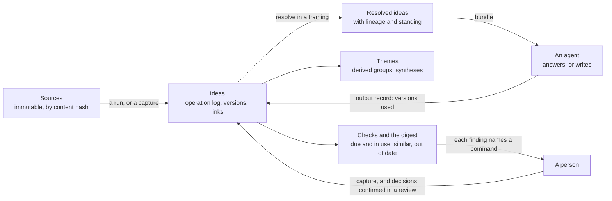

# Ideas: proposal and plan

A store of ideas instead of documents. Each idea is a few sentences, typed, linked to other
ideas, traceable to the sources it came from, and kept current. Agents in any harness reach it
over hosted MCP, answer questions from it and write documents from it on demand. It is an Umbel
plugin, with a hierarchy engine shared with Violet. The engine writes no text and makes no
judgment: models and people extract, judge and write, and it validates, matches, resolves and
records.

Its working name is Ideas, and the plugin id is `ideas` ([section 11](#11-for-the-owner)).

## Status

- **State:** active, with phase 0 under way. Progress is in [STATUS.md](STATUS.md), which is the
  ledger; read it first. Written 2026-11-11 against `main` at `8ef7aa68`, from a design
  discussion with the owner on 2026-11-10 and 2026-11-11, and revised three times the same day
  ([Revision](#revision-of-2026-11-11)), the third time against `main` at `069af7b6`. The owner
  merged the third revision, answered the questions that stood before phase 0, and directed that
  the work carry on through its phases ([section 11](#11-for-the-owner)). Nothing is implemented.
- **Verified:** the facts in [What exists today](#2-what-exists-today) were read on `main` at
  `8ef7aa68` in the files each row names, and in `lushly-dev/violet` at `c4e8663` for Violet's
  web interface and plans. The rows on the person page, the tool list, guidance, loading
  sources, erasure, retries and what a refusal can carry were read on `main` at `069af7b6`. No
  Rust, TypeScript or Python was built or run. A status file's "exit criterion met" is reported
  as recorded, not re-run.
- **Not verified:** whether tantivy 0.27, as pinned, offers a more-like-this query; which local
  embedding model suits statements of a few sentences
  ([P3](#6-what-ideas-needs-from-the-platform)); whether a managed PostgreSQL reached over direct
  connections can meet the phase 6 backend's requirements (P10); how far Violet's engine is
  generic beyond a line-count estimate; which harnesses offer URL-mode elicitation, which every
  person-only call over hosted MCP needs (phase 0.9); whether a model with no skill picks the
  right command from Umbel's tool list (phase 0.10); whether a rule of whole sentences works on
  real notes and transcripts (phase 0.4); every number in
  [section 7](#7-measurement-and-exit-criteria), which phase 0 sets. The scenario files parse
  and pass the runner's dry-run validation but have never been run, since nothing is built. The
  external claims in [Evidence](#3-evidence) come from the sources listed there, each with its
  limit.

### Revision of 2026-11-11

The first version was rated against one user: someone collecting, organising and using a large
number of ideas that change over time. It was weakest where "large" and "change" bite. The owner
agreed these changes, and said an instance runs as a hosted MCP server on Umbel's stateless MCP:

| Weakness | Change |
| --- | --- |
| Duplicate refusal and retrieval rested on word overlap, and ideas are short and paraphrased | Matching by meaning from the start, measured against word overlap in phase 0 (P3, 4.4) |
| Nothing usable until a new engine and several host changes landed | A thin slice first, on one flat set ([section 9](#9-steps)); the third pass narrowed what ships first to a daily loop (decision 19) |
| Review by calendar does not scale to thousands of ideas | Review driven by use, and a standing between seed and affirmed for a person's own words (4.3) |
| Nothing above the single idea | Derived themes, and syntheses that pin what they summarise (4.7) |
| Links stated only at capture | Link candidates at capture and for older ideas (4.5) |
| Merging was a workaround and splitting was missing | Both are operations (4.8) |
| Nothing told the person what needs them | A digest (4.9) |
| Where an instance runs was unstated | Hosted, over stateless MCP (4.11) |

A second pass the same day wrote the plan's jobs as AFD scenario files and used them as a
benchmark ([Jobs to be done](#jobs-to-be-done)). Writing them found what the plan was missing:

| A job could not be written because | Change |
| --- | --- |
| A hosted instance had no way to receive a source's content, and a web page or a book has no bytes to hash | `ideas-source-add`, for content sent over MCP and for reference sources (4.9) |
| Nothing flagged an idea that rests on one that changed | A link remembers the versions it was stated against (4.5) |
| Ideas could not be found by where they had been used | Finding by use, and a channel on an output record (section 5) |
| A book had nowhere to live between a single idea and a one-off output | Works: lasting, ordered arrangements of ideas (4.9) |
| Voice and structure for a format had no home | A format in the pack carries guidance, returned with a bundle (4.11) |
| Keeping material out of public work waited for the whole hierarchy | One level of framings that can leave ideas out (4.6); the third pass added restriction and release |
| Review by use could not be shown without waiting years | Checks and the digest can be read as of a date (4.9) |

A third pass, proposed by the owner, checked the plan before any code exists. The scenarios had
passed their checks, but each runs once, on a small fixture, with a caller that does everything
right. Readers who had not written the plan walked its paths from three seats:

- **The person**, through a first week from nothing, an ordinary day, a sitting of many
  decisions, a year in, and things going wrong.
- **The job list**, drafted from the owner's own words before this plan's list was read.
- **The calling agent**, with Umbel's specifications in hand, counting calls, tokens and
  interruptions for each job at volume.

What a reader said about the host was checked in the host's own specifications and code
([section 2](#2-what-exists-today)). The first three readers agreed that the jobs were mostly
the right ones and that the plan did not yet deliver them. The changes that followed added jobs
and commands, so three new readers walked the paths again, and found faults in what the first
walk had produced. The table gives each finding with the change as it now stands. The last
column says which walk found it.

| The walks found | Change | Walk |
| --- | --- | --- |
| Review did not fit the person page. Each person-only call over hosted MCP is a fresh login that covers one call, and the page shows 6,000 characters, so a sitting of 150 ideas was about twenty logins. Once decisions were gathered into a review, the review had no size, and its preview could not be the command the plan named | Decisions are staged with no login, in a review divided into parts the page can show. A call applies a part, and one call applies the whole once the host can show it (4.14, P15) | 1, 2 |
| Attested trusted a collection that the caller named, so an agent's turns in a transcript, a document a model drafted, and a clause lifted from "I no longer think X" would all have been attested. Narrowed to confirmed sources, it could still rest on text a model had typed into a call | Attested means exactly whole sentences, in the person's own part, of a source that is theirs and that reached the store without a model. It does not come due, and carries its date (4.3, 4.9) | 1, 2 |
| Private material stayed out only when the caller named the public framing, and then only when it named a channel. A synthesis of an omitted idea was not omitted, and a restriction could not be added afterwards | A restriction is inherited, anyone can add one, and restricted material is returned only to a call that asks for it by name, never to one that names a channel (4.6) | 1, 2 |
| Affirming named an idea, so it could adopt a rewording the person had not seen | A decision names a version (4.3, 4.14) | 1 |
| An archive passed through the model byte by byte, nothing read a source back or said what had been mined, an interrupted run could not be resumed, and the first week had nothing in it | Files on the instance's disk are mined in the loop, and uploads follow, on one ticket for many files. A stored source is read back as numbered sentences. A run closes naming what it finished (4.9, P17) | 1, 2 |
| Asking a question, goal 2, had no job, and a captured question could never be closed | `ideas-ask`, and a link that answers a question (job 21, 4.5) | 1 |
| An agent with no skill would not find the commands, the plan's sentence about an AFD context was wrong for stateless MCP, the guide was reachable only after a refusal, and a pasted instructions text would have removed AFD's own | Three first-class commands, a guide, refusals that list what is valid, a paragraph that keeps AFD's default sentences, and no AFD context (4.16, P18) | 1, 2 |
| "No" could not be recorded, so findings could never be cleared, and a published piece could not be left as it is | Decline, a judgment on any finding, and a state on an output record (4.14, [section 5](#5-commands-draft)) | 1, 2 |
| Nothing could be undone. Once some things could, three of the person's decisions still had no way back, reverting a run left its attested captures and links behind, and the loop had no reversal and no copy | A run is reverted with everything it did that nobody relied on. `undo` names any earlier decision but an erasure, or a whole review. Both are in the loop, with export (4.15) | 1, 2 |
| Drafts of one document were strangers, and nothing known about a source could be corrected | A source knows its earlier drafts, and what is known about it can be amended (4.9) | 1, 2 |
| The digest's "since last time" had nowhere to live, since a read cannot write | A cursor the person acknowledges, stored for them (4.9) | 1 |
| Use was whatever a model reported. A handle that sealed what a read returned was not possible on the host, and would have counted every idea returned as used and every draft as published | A read returns its position. An output is recorded with it and the ideas the draft used, and use on a channel counts published records (4.9) | 1, 2 |
| A merge lost where an idea had been used, placed and left out. A split dropped the links to the original and left its parts unreviewed | A merge carries them. A split places every link, and its parts are affirmed when a person confirmed them (4.8) | 1, 2 |
| A retried write was refused against its own first attempt, or written twice | Idempotency keys ([section 5](#5-commands-draft)) | 1 |
| Nothing could be erased. Once it could, erasure stopped at the one file named, and a source's id was its content hash | Erasure is a person's decision. The review lists what else holds the text, ids are not derived from content, and a keyed digest keeps erased content out (4.15, P16) | 1, 2 |
| Changing a tag reset standing | The type and the tags are labels, not part of a wording (4.3) | 1 |
| The thin slice was 18 of 20 jobs, with asking and drafting in its last step. The steps that replaced it were out of order | A daily loop first, hosted from its first step, in steps where no scenario needs a later one ([section 9](#9-steps)) | 1, 2 |
| Export and import had no command, and as one value an archive would not fit the host's limits | Export and import in pages, in the loop (job 28) | 1, 2 |
| A refusal cannot carry stored text, so each refused capture cost a read and mining a file again cost more than the first time | Ids in the refusal's details, and one read that checks any number of statements (4.4) | 2 |
| A seed, including one the person said, could be reworded, merged or split by any agent, and nothing told the person | What the person said is held, and the digest lists what agents changed (decision 32, 4.9) | 2 |
| Three things the owner asked for had no job: tracing an idea to its passage, a catalogue by label, and few calls | Trace steps in jobs 2 and 3, a catalogue in the guide and job 27, and a measure of calls ([section 5](#5-commands-draft), measure 18) | 2 |

The first walk also found errors in the scenario files, corrected here: a count that disagreed
with its own description; two slice jobs that called a command outside the slice; findings that
fired before a new wording had standing; a job about review before use that asked afterwards; a
job about inheritance that never changed the root; a split that assigned no sources; a job that
showed only its best case; a description that contradicted its steps; and expectations that
used step references, which the runner resolves only in a step's input.

The owner agreed the five design decisions behind the first walk's changes on 2026-11-11
([section 11](#11-for-the-owner)). What the readers proposed and the plan declines:

- **Lowering the assurance of an affirmation** on a personal instance, in place of the review.
  A fresh login with user verification is what makes "affirmed" mean that a person saw the
  wording. Without it an agent holding a session could affirm, and affirmed and seed would
  differ in name only.
- **Dropping attested and affirming a whole source at once.** Affirmed means "I hold this now".
  Applied to every sentence of a document that may be years old, it would say more than the
  person knows. Attested says less, and what it says can be checked.
- **Cutting jobs.** The two job-list readers between them would cut or demote fourteen of the
  jobs as rare, repeated, features, constraints or upkeep. They stay in the list, because
  cutting is the owner's decision (question 11). The second reader's point that jobs 17 and 18
  are a mechanism the owner did not ask for is question 14.
- **Recording "not now".** A decision put off leaves no mark. Review is driven by use, so an
  idea that nobody reaches for is not waiting, and the guide does not count it as if it were.
- **A command to withdraw one seed.** A wrong capture in conversation is declined in the next
  review, or reworded. Letting any caller withdraw any seed would let an agent remove what the
  person said.
- **A job for finding something new**, such as an idea for a product. The store already reports
  tensions, open questions and neighbours that are not linked, and a brief is a format. Whether
  that deserves a job of its own is question 15.
- **Requiring an idempotency key on every write.** Every write takes one and none requires it,
  since a model that retries with a fresh key gains nothing from the rule. A capture refused
  against an identical statement from the same caller says so.

The second walk's changes added five commands and one job, so what they touched was walked a
third time, by one reader taking all three seats, who also reviewed the revision as a whole and
checked the host claims again. That reader found six faults that would have blocked the plan,
corrected here:

- A job was assigned to a build step that came before the commands its scenario calls.
- A scenario expected a bundle to return a seed, against the bundle's own rule.
- The exit could not be checked, because a person-only call on a hosted instance needs a login
  that no runner can give ([section 7](#7-measurement-and-exit-criteria)).
- What attests could still be moved by what a caller says a source is. The deployer's setting
  or the person's confirmation now fixes that (4.9).
- Reverting a run could withdraw the person's own words, and nothing took a revert back (4.15).
- Three inputs had no stated meaning when left out: the position of an output record, the
  sources a run finished, and the part of a review ([section 5](#5-commands-draft)).

It also asked for, and the plan now has: a statement taken from the sentences cited, so that no
model retypes the person's words; a whole collection added in one call; a restriction that can
cover a collection or an upload; what a review shows of restricted subjects; a refusal for a
channel that no framing claims; near copies of erased files kept out; what agents changed
listed in the loop, in the guide; and an exit for phases B and F. A focused pass then checked
those corrections and found one more contradiction, in job 17: a framing's wording that the
person had affirmed could be dropped by a plain write. It is now declined in a review. No
command or job was added by any of this, so the walking stops here.

## 1. Problem and goal

Working knowledge is usually kept as documents, and the document is the wrong unit:

- **Ideas are buried.** One document holds many ideas wrapped in framing, history and
  qualification. Finding the idea means reading the document.
- **Copies drift.** The same idea is restated in several documents and versions. Nothing says
  which wording is current.
- **Overlap is invisible.** Two long documents that share a third of their ideas cannot be merged
  or even compared without reading both.
- **Context has to be carried.** To give an agent the background for a task, a person ports
  documents between tools.
- **Updates are heavy.** Where a knowledge base is curated, a change is a pull request and a
  pipeline, so small corrections are not made.
- **Origins and uses are lost.** It is hard to say where an idea came from, whether it is the
  person's own thinking or a research finding, and which published pieces have used it.

**Goal.** A person, or a team, keeps a body of ideas that grows without duplicating and without
going stale, and works with it through agents:

1. Capture an idea from a conversation in one call. A near-duplicate is refused with the idea it
   resembles, even when the wording differs.
2. Ask a question from any harness and get an answer built from current ideas, each with its
   sources.
3. Generate an article, a thread, a script or a chapter from a selection of ideas, and keep a
   record of which ideas it used.
4. Keep the source files, load them without passing them through a model, and mine them again
   when better models arrive, reviewing only what is new.
5. See the shape of thousands of ideas: the themes they form, and what is thought about each.
6. Be told what needs attention: what is new, what is about to be used and has not been looked
   at, what may be a duplicate, what a change has left out of date. Settle each item with a yes
   or a no, or leave it for later, many in one sitting.
7. Hold one body of ideas in several framings, such as a public one and a book's, without
   copies. Material marked private is returned only to a call that asks for it, and never for
   publication, until the person releases it.
8. Preview what a change would touch before making it.
9. Take back a mistake, and erase what should never have been kept.
10. Leave with everything: one archive of the ideas, their history and their sources.

**Not goals.** A document repository. A browsing interface as the main way in. A language model
inside the request path.

### Jobs to be done

The goal is held to twenty-nine jobs. Each is a scenario file for AFD's scenario runner
(`packages/testing`) in [`scenarios/`](scenarios/), written against the draft commands of
[section 5](#5-commands-draft): a `job`, steps that call commands, and what each must return.
They are the plan's benchmark now and its acceptance tests later. They are drafts for the owner
to cut and add to, since only the owner knows which jobs are frequent and which hurt.

The last column says when a job is served. **Loop** is what is built and hosted first: the six
jobs of an ordinary day, two that fill the store, and six that make daily use safe. **Slice** is
the rest of what one flat set of ideas can do. **Whole** needs the hierarchy of framings.

| | When | I want | Scenario | In |
| --- | --- | --- | --- | --- |
| 1 | An idea surfaces mid-conversation | It saved in one step and checked against what I have | `01-capture-in-flow` | loop |
| 21 | I have a question | An answer from what I hold, marked by how far I stand behind it, and to keep the question when nothing answers it | `21-ask-a-question` | loop |
| 2 | I finish a brainstorm or a voice memo | The raw session kept, its ideas pulled out and traceable to what was said, and my words told apart from the agent's | `02-keep-a-brainstorm` | loop |
| 22 | Many ideas wait for me | To say yes, no, not now or "in these words" in conversation, confirm the set, and take back a yes given too fast | `22-review-a-batch` | loop |
| 8 | I write an article, a script or a thread | A draft built only from views I hold | `08-draft-from-what-i-hold` | loop |
| 6 | My view changes | To change it once and see what rested on it | `06-change-my-mind` | loop |
| 4 | I start with years of my own documents | Them mined once without a mountain of review | `04-mine-an-archive` | loop, fills the store |
| 3 | I finish research | Findings stored as evidence, traceable to their passage, apart from my positions | `03-file-research` | loop, fills the store |
| 13 | I hold material that must never appear publicly | It returned only to a call that asks for it by name, and never for publication | `13-keep-private-out` | loop, guard |
| 14 | I switch harness or device | The same ideas after signing in | `14-reach-from-any-harness` | loop, guard |
| 15 | An agent or a new run touches what I affirmed | My wording to stand until I say otherwise | `15-protect-affirmed` | loop, guard |
| 24 | I, an agent or a bulk run gets something wrong | To take it back | `24-take-it-back` | loop, guard |
| 25 | I am an agent with no skill installed | One call that tells me the vocabulary and the way to work | `25-find-your-way` | loop, guard |
| 28 | I want a copy of everything | One archive of ideas, history, sources and uses, that restores | `28-leave-with-everything` | loop, guard |
| 23 | I bring several hundred files | Them loaded without passing through a model, later drafts recognised, a wrong date corrected, and mining able to resume | `23-load-an-archive` | slice |
| 12 | Weeks pass, or a better model arrives | A briefing since I last looked, and to review only what is new or better put | `12-catch-up` | slice |
| 5 | I look at an area I have thought about for years | To see what I think now, what is contested and what is unsupported | `05-see-what-i-think` | slice |
| 7 | Two ideas are one, or one is two | To fix it without losing where they came from, what links to them or where they were used | `07-refactor-ideas` | slice |
| 9 | I need something to post today | Ideas I hold and have not used on that channel | `09-find-what-to-share` | slice |
| 10 | I work on a book for months | An outline that lasts, shows thin chapters and which drafts my thinking has moved on from | `10-keep-a-long-work` | slice |
| 11 | I have published | To know which pieces no longer match my thinking, and to stop hearing about the ones I dealt with | `11-spot-stale-outputs` | slice |
| 16 | An idea I affirmed long ago is never used | Not to be asked about it until it is | `16-stay-quiet-about-unused` | slice |
| 19 | I explore without a question | To follow what supports what and what leads where | `19-explore-connections` | slice |
| 20 | The store has grown | Older ideas that belong together offered for linking, and a pair judged apart never offered again | `20-connect-older-ideas` | slice |
| 26 | Something was captured that never should have been | It gone, to be shown what else holds it, and it kept out if it comes in again | `26-erase-for-good` | slice |
| 27 | I want to see how my ideas are labelled, or the labels have drifted | The catalogue in one read, and to rename, merge or correct a label once, without disturbing what I hold | `27-keep-labels-in-order` | slice |
| 29 | I am saving some ideas for a book | Them left out of one setting once, and back in when I say | `29-leave-out-of-a-setting` | slice |
| 17 | I write for a particular audience | My ideas in its wording, with no second copy | `17-frame-for-an-audience` | whole |
| 18 | I am about to retire or rewrite an idea | To see what the change would touch first | `18-preview-a-change` | whole |

Jobs 15 and 16 are things the store must never do, written as jobs. Job 25 is the calling
agent's. Jobs 21 to 28 came from the first walk and job 29 from the second.

**What the files show.** All twenty-nine parse and pass the runner's dry-run validation: 369
steps. Every one of the 51 draft commands is used by a job, every error code the draft names is
shown by a job, and no file calls a command the draft does not have. The fourteen loop files use
31 commands, the rest of the slice adds 17, and the two whole jobs add 3. Not every reason for a
refusal has a step. Not shown: content over the size cap, a statement over the length limit, a
match on a retired idea, an idea whose sources the caller cannot read, a merge or split of a
seed recorded as the person's own words, and a change to what an attesting source is.

**What a scenario cannot show.** A scenario checks what commands return. It cannot judge whether
a model extracted the right ideas or wrote a good draft, so each job splits: the engine's part is
the scenario, with the model's output written into its steps, and the model's part is measured in
phase 0. Scenarios 1, 12, 15 and 22 expect a paraphrase to be refused. They pass only if matching
by meaning works, which makes them its benchmark. A scenario also runs once, on a few ideas, with
a caller that does everything right. What a sitting of 150 decisions costs, what several hundred
files leave to review, how many calls a job takes and what an agent with no skill does are
measures in [section 7](#7-measurement-and-exit-criteria).

**What these files leave unshown**, each said at the top of its file:

- That an agent is refused where a person is allowed, and a review of more than one part (22).
  Every step runs as one test actor.
- A source that is the person's own (4, 8, 12, 23). The runner cannot set up a workspace's
  collections, so each file says in a comment what its fixture holds.
- The upload of a file (23). It is a request between two steps.
- What a refusal carries in its details (1, 25).
- Time passing (16). It is written with reads as of a date.
- The same ideas from two harnesses (14), and an archive restored into an empty instance (28).
  One run has one caller and one store.
- That erased bytes are gone from the stores (26). A scenario sees only what commands return.

**What the runner cannot yet do** (P14):

- Assert anything but `success`, `data`, `reasoning`, `confidence` and an error's code, message
  and suggestion. A result's warnings and an error's details are out of reach, so "the refusal
  names the idea it matched" cannot be checked.
- Run a step as a different actor.
- Move the clock between steps.
- Use a step reference in an expectation. The runner resolves references only in a step's input
  (`packages/testing/src/runner/scenario-runner.ts`), so "the survivor is the idea from step 3"
  is written as "a survivor exists".
- Set up a workspace's collections, make a request that is not a command, or hold two stores in
  one run.

## 2. What exists today

### In this repository

| Need | Existing piece | Where |
| --- | --- | --- |
| A host over MCP and a CLI, with plugins, spaces, a journal and events | Umbel. Phases 0 to 4 record their exit criteria as met; phase 5 (auth and hosted) is mostly built; phase 6 (PostgreSQL) is specified, not built | `endpoints/umbel/docs/STATUS.md` |
| Stateless MCP | MCP 2026-07-28 over stdio and Streamable HTTP, with no in-memory sessions (principle 11) | `endpoints/umbel/docs/architecture.md` |
| Provenance on every record | The envelope: origin, principal, agent, session, validity, confidence, `sources`, `generated`, `contentHash`, `derivedFrom`, access | `endpoints/umbel/store/src/envelope.rs` |
| A plugin's own data in its own shapes | The `records` grant: any kind, free JSON, compare-and-set. Listed by kind and id only, 2 MiB a record, no field query, no delete | `endpoints/umbel/src/plugins/store_services.rs` |
| A person-only action | `knowledge-approve`, with `confirm = "require-human"` and `person = { cli = "terminal", mcp = "verified" }`, and the host's person page | `endpoints/umbel/plugins/knowledge/umbel-plugin.toml` |
| What the person page asks of a person | A fresh login at the identity provider, with user verification, for each call. One decision covers one call of one command, a step of `afd-batch` or `afd-pipe` cannot carry one, and it lapses 10 minutes after it is begun. The page shows the command's `confirm_preview`, which must be a command of its own that changes nothing and returns one string, cut at 6,000 characters. The decision stores only the properties the preview declares: at most 16, each an id of at most 512 characters or 100 items, or text of at most 2,000 characters that the person is shown as written. A person may begin 30 an hour. A client without URL-mode elicitation is refused by the host, before the plugin is reached | `endpoints/umbel/docs/phases/5-auth-hosted/spec.md` (2.3, 7.2, 7.3), `endpoints/umbel/src/person/service.rs`, `endpoints/umbel/src/plugins/manifest/v4.rs`, `spec/command-metadata.md` |
| What an agent sees first | The tool list is five meta-tools and at most eight first-class commands. With the first-party plugins seven places are taken, `memory-remember` among them, and a deployer's `mcp.first_class_tools` replaces the list. A first-class tool lists its full description. When any plugin declares an AFD context, three context tools are listed as well, and on stateless MCP the active context is an input of each request and is never stored | `spec/tool-strategies.md`, `endpoints/umbel/docs/phases/0-host-skeleton/spec.md`, the first-party manifests |
| Guidance for an agent | `mcp.instructions` is one string that the deployer sets, and a non-empty value replaces AFD's default text whole. Skills travel by the Skills over MCP extension, as resources, or by `skill-export` at the CLI. The architecture records that Claude, Claude Code, Cursor and VS Code do not yet support the extension | `endpoints/umbel/docs/architecture.md`, `endpoints/umbel/docs/phases/1-plugin-contract/spec.md` |
| Getting files onto an instance, and off it | `sources-sync` reads files under a collection root on the host's own disk. `sources-import` is an operator's command in phase 6, not started. No command takes an upload, and a request body is capped at `http.max_body_bytes`, 1 MiB by default. `memory-export` is the precedent for getting data out: a CLI-only read in pages, which an adapter writes to files | `endpoints/umbel/plugins/sources-filesystem`, `endpoints/umbel/docs/phases/6-backends/spec.md`, `endpoints/umbel/docs/phases/0-host-skeleton/spec.md`, the memory manifest |
| Erasure | Memory has it whole: forget destroys a record's own key and then its bytes (D82), and `memory-erase` lets a listed, verified person remove another's records after a dry run, with the residue disclosed (D85, D118). A plugin's records can be put, read and listed, and not deleted. A compiled plugin can overwrite one, have the change log forget the hashes of its earlier versions, and truncate the write-ahead log, as knowledge's redaction does. Records are in no index, vectors or graph yet, so nothing removes them from one. A plugin holds no key. A command with a digest journal is journaled with no text (D72) | `endpoints/umbel/docs/decisions.md`, `endpoints/umbel/sdk/src/store.rs`, `endpoints/umbel/sdk/src/cx.rs` |
| Retries, and a remembered position | An `idempotency_key` input on `knowledge-propose` and on memory capture; `event-ack` for a position in the event stream (D31) | The knowledge and memory manifests, `endpoints/umbel/docs/decisions.md` |
| A verify-by date | `verified`, `stale_after`, `knowledge-stale`, for documents | `endpoints/umbel/plugins/knowledge` |
| Recorded background runs | The curator: a settling window, candidates, conflict sets, locked runs with reports. A schedule is a cron line that runs a command | `endpoints/umbel/plugins/curator`, `endpoints/umbel/docs/phases/4-curator/spec.md` |
| Source files and their metadata | `sources-sync`, `umbel-scan`, `umbel-okf` and the OKF frontmatter | `endpoints/umbel/plugins/sources-filesystem`, `endpoints/umbel/okf`, `endpoints/umbel/scan` |
| Text search | A tantivy BM25 index with fields, phrases, ranges and filters, one writer | `endpoints/umbel/store/src/index.rs` |
| A place for embeddings | Named, not built: an optional lane behind a provider trait, a local model or an endpoint, enabled on an instance only by evidence (decision D65, open decision O4) | `endpoints/umbel/docs/architecture.md`, `endpoints/umbel/docs/decisions.md` |
| A graph | A per-space graph with neighbours, related, path and outline. Contributions belong to a stored document, and `knowledge-index` rewrites them with eight fixed edge kinds | `endpoints/umbel/store/src/graph.rs`, `endpoints/umbel/plugins/knowledge/src/graph.rs` |
| Budgeted context for a task | `context-bundle` | `endpoints/umbel/plugins/context` |
| Capture from a harness session | The `umbel-hook` adapter | `endpoints/umbel/adapters/hook` |
| Results that explain themselves | `CommandResult`: `sources`, `reasoning`, `alternatives`, `suggestions`, `plan`, `warnings`, undo; shared codes including `ALREADY_EXISTS` and `CONFLICT`. A failure carries a code, a message, a suggestion and details, and no data; Umbel's SDK documents that the details hold no content | `spec/error-codes.md`, `packages/rust/src/result.rs` |
| Several commands in one call | The hybrid strategy with `afd-batch` and `afd-pipe`; pipelines shipped as data | `spec/tool-strategies.md`, `spec/pipeline-variables.md`, `spec/plugin-manifest.md` |
| Long jobs, bounded reads | MCP Tasks and output budgets, in Rust | `packages/rust/src/server/tasks.rs`, `packages/rust/src/output_budget.rs` |
| A hierarchy with inheritance | Violet's engine: a tree of nodes, five operations (add, override, subtract, reset, copy), shared sets, an operation log, resolution, lineage, compare, drift, and a dry run over a read-only overlay | `foundations/violet/packages/core/src/engine`, `foundations/violet/packages/core/src/db/overlay.ts`, `integrations/violet-afd/src/commands` |
| A health report shape | Stable check ids, severity, evidence, remediation and a verdict | `endpoints/health/src/lushly_health/schemas/report-1.2.json` |
| A precedent for a further plugin | The `components` plugin: a specification approved before code, then one pull request a step | `endpoints/umbel/docs/plugins/components/spec.md` |
| An interface, later | Loam mounts an Umbel instance and renders its commands as forms. Its agent surface is not started | `endpoints/loam/docs/STATUS.md` |

What no part of the repository has:

- An idea as a unit, with typed many-to-many links between ideas.
- Near-duplicate detection. Duplicate checks are exact hashes and idempotency keys.
- A built embedding lane.
- A hierarchy engine in Rust. Violet's is TypeScript, and a plugin must be a compiled crate to
  reach the stores, since a component gets six grants and a mounted server gets none
  (`endpoints/umbel/wit/umbel-plugin-1.0.0/world.wit`, `endpoints/umbel/sdk/src/mounted.rs`).
- Pinned copies or a reading of the hierarchy as it stood at an earlier moment. Violet's copies
  are always live.
- A registry of sources keyed by content hash.
- A record of which ideas an output used.
- A way for a plugin to learn what was read or what was asked and not found.
- A way to gather a person's decisions and confirm them once.
- Deletion of a plugin's records.
- A way to put a file on a hosted instance that passes through neither a model nor the host's
  own disk.
- Guidance that a plugin contributes to what an agent is told when it connects.

### Outside it

The practices this draws on are in [Evidence](#3-evidence). The owner's experience with an
earlier, document-based knowledge system set what to keep and what to leave: a graph that
describes the data, signals of what is asked for and missing, and composition of several queries
in one call were worth keeping; updates by pull request, documents as the unit, and duplicate
avoidance by guideline were not.

## 3. Evidence

Read on 2026-11-10. Each row says what the source supports and where it stops.

| Source | What it supports | Limit |
| --- | --- | --- |
| Evergreen notes | One idea a note, organised by concept and not by source, titled as a claim, densely linked | A practice described by its author. No single right size for a note |
| Discourse graphs | Questions, claims, evidence and sources as separate nodes joined by supports and opposes, so a claim and its evidence are judged apart | Developed for research synthesis. Read from an interview and a paper abstract |
| The LLM wiki pattern | Immutable raw sources, a maintained layer of pages, a schema file; ingest, query and lint; an agent does the upkeep. Reported at about 100 sources | An idea file, intentionally abstract. It defines no citation format and does not address duplicates |
| Create once, publish everywhere | A content model kept apart from its presentations | Vendor and practitioner articles |
| Early MCP knowledge servers | Claims with per-claim provenance over a markdown vault | Prereleases, not evaluated here. None describes near-duplicate handling |
| Violet's interface walkthrough | Tracing one value through the hierarchy was the clearest moment; findings were hard to find and could not be acted on | Four model personas, not people (`lushly-dev/violet`, `docs/features/active/violet-ux-sessions.md`) |

Two gaps recur across these: nothing settles how duplicates are kept out, and nothing ties a
generated document back to the ideas it used. Both are central here.

## 4. Design

### 4.1 Decisions made in this plan

Each can be revisited by the owner.

1. **The idea is the unit.** A document is either a source that ideas came from or an output
   made from ideas. Neither is stored as knowledge.
2. **Sources are kept and never changed**, so they can be mined again.
3. **The record is an operation log.** Current state is computed from it. History, and the reason
   for each change, come with it.
4. **One body of ideas, several framings.** A framing inherits from its parent and may state,
   reframe, omit, restore or borrow ideas. Nothing is copied to make a variant.
5. **Capture is immediate; standing is earned.** A captured idea is durable at once and is a
   *seed*. Only a person affirms it. Agreed by the owner on 2026-11-11.
6. **Standing belongs to a wording.** It attaches to the version of an idea that a framing
   resolves to, not to the idea in general. A reframed wording starts again. Tags are labels on
   the idea and not part of a wording, so relabelling changes no standing.
7. **A person's own words stand between seed and affirmed.** A statement that is exactly whole
   sentences of a source that is the person's own, in their own part of it, and that reached
   the store without passing through a model, is *attested*. No model's judgment is involved,
   and no model's typing. It says the person wrote this on that date, and no more.
8. **Review is driven by use.** An idea is put in front of the person when it is about to be
   used, not because a date passed.
9. **Links are authored, and candidates are offered.** A link is stated by whoever states the
   idea and is inherited through framings. The engine proposes which ideas might be linked; it
   never links them.
10. **A near-duplicate is refused at capture, matched by meaning as well as by words.** The
    caller then records another sighting of the existing idea, reframes it, or declares the new
    one distinct with a reason.
11. **A source is recognised by its content hash**, so a second copy is the same source, and it
    knows the earlier drafts of the same document. Its id is its own, so that erasing it leaves
    nothing derived from its content.
12. **Extraction is a recorded run.** A run names its sources and its extractor. It captures,
    records sightings, links and proposes rewordings. It cannot change a version that has
    standing, and what it did can be taken back whole.
13. **Outputs are not stored; their use of ideas is.** An output record pins the versions it
    drew on, by the position the store was read at and the ideas the draft used.
14. **Themes are derived, and a synthesis is an idea.** Groups of ideas are computed, never
    filed. What is thought about a group is an idea of its own that pins the versions it
    summarises, so it shows when they have moved on.
15. **Merging and splitting are operations**, recorded with their reason like any other.
16. **The plugin's vocabulary is a pack.** Types, link kinds, review intervals, thresholds and
    output formats are not in its code.
17. **The hierarchy engine is shared with Violet** through one written semantics and one set of
    vectors ([P7](#6-what-ideas-needs-from-the-platform)).
18. **Every finding names the command that acts on it.**
19. **The daily loop ships first, hosted.** Capture, ask, keep a brainstorm, review a batch,
    draft and change my mind, on one flat set, served over hosted MCP from its first step,
    with what makes daily use safe: starting from the files already there, private material
    kept out, a way to take things back, and a copy that restores. The rest of the flat set
    follows, then framings. All of it writes the same operation log, so nothing is migrated.
    Agreed by the owner on 2026-11-11.
20. **An instance is hosted.** It is reached over Umbel's stateless MCP from every harness the
    person uses. Directed by the owner on 2026-11-11.
21. **Jobs are the benchmark.** The plan serves the [jobs](#jobs-to-be-done), each a scenario
    file. A command that no job uses has to justify itself, and a job that cannot be written as
    steps is a gap in the plan.
22. **A work is a lasting arrangement.** A book, a course or a series is an ordered outline of
    ideas that persists and is edited over months. It holds no prose.
23. **What a caller must act on is in the data.** Counts and lists of what needs attention are
    returned as data, not only as warnings, so an agent and a scenario can both read them.
24. **A person decides in conversation and confirms once.** Whatever gives, changes or removes
    standing is staged as a decision in a review, by ordinary calls, with no login. A
    person-only call applies it, and applies exactly what the person was shown: one call for a
    review once the host can show it whole, and one for each part until then. Agreed by the
    owner on 2026-11-11.
25. **A decision names a wording.** An affirmation or a decline names an idea and a version.
    None is ever read as "whatever is latest".
26. **Private by inheritance, and returned only when asked for.** A restriction is set on a
    source or at capture, or added later by anyone. Every idea taken from a restricted source,
    and every idea derived from a restricted idea, is restricted. A read returns restricted
    material only when the call asks for it by name, and never when it names a channel. Only a
    person releases one. Agreed by the owner on 2026-11-11.
27. **"No" is an answer the store keeps.** A person declines a wording; a judgment settles a
    finding. Neither is offered again until something it rested on changes.
28. **A mistake can be taken back, and content can be erased.** A run is reverted, and a
    person undoes any earlier decision but an erasure. Erasure removes content for good, leaves
    a marker, and keeps the same content out. There is no general undo. Agreed by the owner on
    2026-11-11.
29. **A file does not pass through a model.** Bytes reach an instance by an upload or from the
    host's disk. Content as a command argument is for what was said in the conversation: it is
    capped in size, and nothing taken from it is attested.
30. **The store explains itself.** One command returns the vocabulary and the way to work, every
    refusal the plugin makes names the next command and what is valid, and every finding
    carries the call that clears it. Nothing depends on a skill having been installed.
31. **A write is safe to send twice.** Every write takes an idempotency key.
32. **What the person said is held like what the person affirmed.** A seed recorded as the
    person's own words is not reworded in place, merged or split by an agent. A new wording
    waits, as it does for an idea with standing.

### 4.2 Shape

Three kinds of thing, and only the middle one is curated:

- **Sources** come in: notes, transcripts, research reports, readings.
- **Ideas** are what is kept.
- **Outputs** go out: answers, articles, threads, scripts, chapters, briefs. They are made when
  asked for and can be made again.

### 4.3 Ideas, versions and standing

An idea has an id, a type, tags and one or more versions. A version has the statement, a number,
the operation that created it, and its standing. The type and the tags are labels on the idea:
changing one creates no version and changes no standing.

| Standing | Meaning | Set by |
| --- | --- | --- |
| `seed` | Captured, durable, labelled as not yet looked at in every answer | Any capture or reframe |
| `attested` | The statement is one or more whole sentences of a source that is the person's own writing and that no model has handled. The person wrote it, on that source's date; they have not said they still hold it | The engine, which computes it from the sentences cited and the source ([4.9](#49-sources-runs-outputs-and-the-digest)). Nothing a caller says gives it |
| `affirmed` | A person has said this wording is what they hold. Carries the date | A person, through a review |
| `declined` | A person has said no to this wording. It stays in the history and is not offered again | A person, through a review |
| `retired` | No longer held. Stays readable and names what superseded it | A person, through a review; or a merge or split of seeds |

Attested is computed, not stored. When a person confirms an uploaded source as theirs, the seeds
that cite whole sentences of it become attested with nothing captured again, and if the
confirmation is undone they are seeds once more. It does not come due, since it never claimed to
be current. It carries its source's date wherever it is returned.

**What an idea resolves to.** The *held* version is the latest one that is attested or affirmed.
When none has standing it is the latest seed recorded as the person's own words, and failing
that the latest seed. A later seed is the idea's *pending* wording. A wording that is affirmed,
attested or recorded as said by the person is never displaced without a decision: a change is a
new version, which starts as a seed and waits, and the idea is merged or split only through a
review. The held version stays what every read returns, and nothing that rests on it is
disturbed, until a person affirms the pending one. A decision always names a version (decision
25), so an affirmation can never adopt a wording that arrived after the person looked. Declining
a pending wording leaves the held one in place. Declining an idea's only wording declines the
idea.

**What a read returns.** Unless a call asks otherwise, a read returns seeds, attested and
affirmed ideas, each labelled, and leaves out what is declined, retired, withdrawn or erased.
`ideas-bundle`, which is for writing, returns affirmed and attested ideas unless the call asks
for seeds as well, and says how many it left out.

**Review by use.** A type has a review interval in the pack, and an affirmation older than it is
*due*. Being due costs nothing until the idea is used. `ideas-ask` and `ideas-bundle` mark each
idea they return as seed, attested, affirmed or due. They list the due ones, and the attested
ones whose source is older than the interval, as worth a look before the answer or the draft is
written. `ideas-output-record` says when an output pins an idea that is a seed or due. The digest
lists what is due and has been used in an output, most used first. An answer given in
conversation is not an output and is not recorded. The person decides on many in one review
([4.14](#414-review-in-conversation-confirmed-once)). Ideas nobody reaches for can stay due.

The default pack's types, which an instance replaces with its own: position, principle, model
(a distinction or a named structure), evidence, example, question and synthesis. A question an
agent could not answer is captured as a question, so gaps in the store are ideas too. A question
stays open until an idea is linked to it as its answer.

### 4.4 Matching

Matching does three jobs with one mechanism: refusing duplicates, offering link candidates, and
finding ideas for a question. It has two lanes, fused as Umbel's retrieval design fuses them:

- **By words.** The lexical index. Always present.
- **By meaning.** An embedding of the statement. Short statements are often paraphrases of one
  another, which words alone miss.

The scores sort candidates into three bands, with thresholds in the pack that phase 0 sets from
labelled pairs: *same*, which refuses a capture; *related*, which is offered as a link candidate;
and *unrelated*. The engine only scores. Whether a candidate in the same band is the same idea is
the calling model's judgment, and the person's when they disagree: a capture can be repeated with
the matches declared distinct and a reason, which is recorded and listed for review.

A refusal can carry no stored text. An AFD failure has a code, a message, a suggestion and
details, and the host keeps content out of all four. So a refused capture names what it matched
by id, version and standing in its details, and the caller reads the wordings with
`ideas-match`. That command takes any number of candidate statements and returns, for each, the
ideas in the same band and in the related band. An extractor calls it once for a document before
it writes anything, then sends what is new and the sightings of what is not as one batch. The
refusal's suggestion gives the rule for what comes next: the same idea in the same words is
another sighting; the same idea in better words is a rewording, which waits for the person; a
different idea is captured again with the match declared distinct and a reason.

What a capture is matched against depends on what became of the earlier idea:

| The earlier idea is | A capture in the same band |
| --- | --- |
| A seed, attested or affirmed | Is refused, naming it |
| Declined | Is refused, naming it, so what a person said no to is not offered again. Another sighting may be recorded and asks nothing of the person |
| Retired | Is refused, naming it and its successor |
| Withdrawn by a reverted run | Is admitted. A withdrawn idea takes no part in matching |
| Erased | Takes no part in matching by words or meaning. The identical statement is refused, by the digest kept of it ([4.15](#415-taking-back-and-erasing)) |

The embedding lane is the one place a model runs inside a request. It writes no text, it is
pinned by name and version, and vectors are rebuilt when it changes. Umbel's architecture already
names this lane as optional and gated by evidence; this plan builds it and applies that gate to
an instance's own labelled pairs.

### 4.5 Links

A link is `(from, kind, to)`. The default kinds are supports, challenges, refines, depends-on,
example-of, summarises and answers, which joins an idea to the question it answers. Supersedes is
not a link: it is recorded by retiring. A link is stated in a framing, inherited by its
descendants, and can be withdrawn in one of them. It resolves only where both ends do. A link
carries who stated it, and the version of each end it was stated against. When the held version
of an end changes, or an end is retired, an idea that depends on it, or was supported by it, is
reported as resting on something that changed. The report clears when the dependent is reworded,
or when a judgment that it still holds is recorded with `ideas-settle`, which states the link
again against the present versions.

Links are kept up as the store grows:

- **At capture.** A capture can state the links its caller already knows. Its answer lists the
  related band, so the caller can state the rest in the same exchange.
- **For older ideas.** `ideas-link-candidates` lists pairs in the related band that have no link,
  for a model to judge outside the request path. The digest counts them. A pair judged not to
  belong together is settled as unrelated and is not offered again until one of the two changes.

### 4.6 Framings

A framing is a node in a tree inside one space. The root holds what is held generally. Children
hold what differs for a setting: a public voice, a book, a product.

| Operation | In plain words | Effect in the framing |
| --- | --- | --- |
| state | states | A new idea exists here and in descendants |
| reframe | reframes | The statement differs here; a new version, which waits here as it would at the root |
| omit | leaves out | The idea does not resolve here or below |
| restore | restores | Local changes are dropped; the ancestor's version resolves again |
| borrow | uses the idea from | An idea from another framing resolves here, following its source |
| include | applies the set | Every idea of a shared set resolves here, by a merge or an override policy |

Three structural kinds of framing: standard, shared set, and pinned. The plain words in the
second column are used in every surface, and the command names keep the precise terms, as
Violet's interface does (`lushly-dev/violet`, `packages/web/src/app/vocabulary.ts`).

**Keeping material out.** Two different things keep an idea out. *Restricted* is for what must
never appear publicly. *Omitted* is for what is fine to share and is not for one setting.

- **A restriction is inherited.** A source or a capture can be marked restricted, a collection
  or an upload can carry the mark for everything in it, and any caller can add the mark later
  with `ideas-restrict`, since tightening needs no one's permission. An idea taken from a
  restricted source is restricted. So is an idea derived from a restricted idea: a rewording of
  it, a synthesis that summarises it, the survivor of a merge that includes it, and each part
  of a split of it. One case does not restrict the idea: when an idea that is already
  unrestricted is merely sighted again in a restricted source, the sighting is restricted, and
  the idea is not.
- **Restricted material is returned only to a call that asks for it.** A read that says nothing
  returns unrestricted ideas and says how many restricted ones it left out. A read that passes
  `includeRestricted` returns them, marked. A read or an output record that names a channel
  never does, and asking for both is refused. A restricted source's title and text follow the
  same rule, and so does matching: a capture that matches a restricted idea is refused naming
  its id and that it is restricted, and its wording is returned only to a call that asks for
  restricted material. So an agent that knows nothing about privacy, calling the first tool it
  sees with a question, gets nothing private.
- **Only the person lifts a restriction.** Releasing an idea, or everything from a source, is a
  decision in a review ([4.14](#414-review-in-conversation-confirmed-once)).
- **A channel is where other people read.** An output names the channel it went to. An output on
  a channel that pins a restricted idea is recorded, flagged in the result, and reported until
  the piece is withdrawn or superseded or the idea is released. Refusing the record would only
  hide what happened.

That is all the loop has, and it needs no framings. The slice adds the other kind:

- **Omitting.** Any caller may omit an idea from a framing with `ideas-omit`. Putting it back is
  the person's, as a release to that framing. A framing names the channels that publish from
  it, and a channel belongs to one framing. A read or an output record that names a channel
  resolves in the framing that claims it, and naming a different framing beside it is refused.
  Until some framing claims a channel, a channel is only a label on an output. Once one does, a
  channel that no framing claims is refused, with the list of those that exist, so a misspelt
  channel cannot fall through to the root. A published output that pins an idea left out of
  its channel's framing is recorded, flagged and reported, like one that holds restricted
  material. The slice has the root and one level beneath it.

**What this guarantees, and what it does not.** A call gets restricted material only by asking
for it by name, and a call for a channel never gets it. That does not stop an agent which asked
for private material, for the person's own use, from then writing it somewhere public. For that
case every result marks which of its ideas are restricted, and an output recorded on a channel
is checked.

The full hierarchy has to carry one addition for this: an idea held back from every framing
until it is released (P7).

### 4.7 Themes and syntheses

With thousands of ideas, the single idea is too small a unit to think with.

- **A theme is derived.** Ideas are grouped by the links between them and by the related band of
  matching. Themes are computed when asked for and never stored as a filing structure, so they
  follow the ideas. `ideas-themes` lists them with their size, their most central ideas, the tags
  they share, and their synthesis if they have one.
- **A synthesis is an idea.** Its statement says what is thought about a theme. It has
  summarises links to its members and pins their versions, as an output does. A model writes it
  and it starts as a seed. When the held wording of a member changes, a member is retired, or
  new ideas join the theme, the synthesis is reported as out of date, with the members that
  moved. A synthesis that summarises a restricted idea is restricted.

A synthesis can summarise syntheses, so the store can be read at several heights. A question
about a whole area is answered from the synthesis first, with its members beneath it.

### 4.8 Merging and splitting

Ideas are refactored as thinking matures.

- **Merge.** Several ideas become one. The survivor keeps every source, sighting and link of the
  others, every output that used them and their places in works. If any of them was restricted,
  or omitted from a framing, so is the survivor. The others are retired naming it. Links that
  would now join an idea to itself are dropped.
- **Split.** One idea becomes several. The split gives each part its sources, and places every
  link and every place in a work that the original had on one of the parts, or drops it by
  name. A split that leaves one unplaced is refused. Each part inherits the original's
  restriction and omissions. The original is retired naming all of them and keeps its own
  record of use, since nothing can say which part an output drew on.

Both are single operations with a reason. An agent may merge or split seeds directly, except a
seed recorded as the person's own words. When a version involved has standing, the direct
command is refused and the same operation is staged as a decision in a review
([4.14](#414-review-in-conversation-confirmed-once)), which shows what it would touch. The parts
of a split that a person confirmed are affirmed, since the person was shown their wordings. A
merge or a split can be undone ([4.15](#415-taking-back-and-erasing)).

### 4.9 Sources, runs, outputs and the digest

- **Source.** A document, with an id of its own and the SHA-256 of its bytes, a kind, the kind of
  thinking it holds (the person's own, a conversation, research, a reading), and the date the
  thinking happened as distinct from the date it was filed. It keeps what is known about the
  file: its name and path, its dates, and every place a copy of it was seen. A second file with
  the same hash is the same source. One that matches after line endings and trailing space are
  normalised is reported as a near copy. A web page or a book is a *reference* source: a URI or
  a citation, the date it was read, and the passages relied on. A reference source can back
  evidence and can never attest a statement.
- **How a source arrives.** In one of three ways, and the way decides whether it can attest:
  - *By upload.* A command issues a ticket: one short-lived address that takes any number of
    files from a shell or a browser. The address is the credential, the host computes each
    file's digest, and no model handles a byte (P17).
  - *From the host's disk*, as a document in a synced collection, one at a time or a whole
    collection in a call. A one-machine instance can do this today.
  - *In the call*, as content, for what was said in the conversation. It is capped in size. A
    model typed it, so nothing taken from it is ever attested, however it is quoted. Its ideas
    are seeds, affirmed in a review like any other.

  Each is journaled as a digest. `ideas-source-open` reads a stored source back in windows, as
  numbered sentences, so mining again never needs the file a second time.
- **Whose words.** An uploaded or synced source is the person's own when the deployer has
  configured its collection as theirs, or when the person confirms it in a review. Either one
  also fixes what the source is: the person's own prose, or a transcript and the label of the
  speaker who is the person. The deployer's setting says it for a collection. A confirmation
  says it for a source, and the person is shown it with the name, date, size and opening lines
  and the number of statements that would become attested. What a caller says a source is, is
  a claim, and decides nothing about what attests. In a transcript only the turns of the
  speaker who is the person are theirs, and a capture's result says whose turn it cited. A
  document that a model drafted is not the person's until they say so, and a collection
  configured as the person's own must not hold such files; that is the deployer's to get
  right.
- **Sentences.** The engine divides a source into sentences by one fixed rule and numbers them. A
  capture that cites numbers and gives no statement takes the sentences as its statement, so
  the person's own words are never retyped by a model. A capture may give its own statement and
  cite the sentences it rests on, which is a restatement and a seed. A quote may be given in
  place of numbers and must be found in the source, or the capture is refused. A statement is
  attested only if it is exactly the sentences it cites, so a clause lifted out of "I no longer
  think that ..." is not. The capture's result says whether it attests.
- **Earlier drafts.** A source can supersede another, as a later draft of the same document. The
  caller declares it, or the engine reports a source that largely overlaps an existing one as a
  likely version, for a judgment to be recorded. Sightings in drafts of one document count as
  one document. An idea attested only by a sentence that a later draft dropped is reported, so
  an abandoned view does not pass as the person's. What is known about a source is corrected
  with `ideas-source-amend`: its title, and the date the thinking happened, which is marked as
  supplied when it did not come from the file. What a source is, and who its speaker is, decide
  what attests, so on a source that can attest they change only through a review. Its bytes
  never change.
- **Run.** A record of one extraction: the sources read, a label for the extractor (the model and
  the prompt version, supplied by the caller), and the time. The captures, sightings, links and
  proposed rewordings made under a run carry its id. Closing a run names the sources it
  finished, and a source counts as mined by an extractor once a run of that extractor has
  finished it. `ideas-source-list` says what is left, which runs are still open and which
  extractor labels are in use, so work that stopped is picked up where it stopped and the label
  is the same from one session to the next. A run's report says what was new, what matched an
  existing idea and was recorded as another sighting, what it proposed as a rewording, and what
  was refused. A run can be reverted ([4.15](#415-taking-back-and-erasing)), and its sources
  then count as unmined by that extractor again.
- **Output.** A record with a title, a format, a channel and the idea versions it used.
  `ideas-ask` and `ideas-bundle` return the position of the log they read at. An output is
  recorded with that position and the ideas the draft used, and it pins the versions those
  ideas had there. The model lists ids, which is the honest signal of use, and repeats no
  wording. Nothing is stored when a read is answered. A record made with no position, as when a
  piece was written without a bundle, pins what is held at the moment it is recorded, and says
  so. An output record has a state: draft,
  published with where and when, superseded by another, or withdrawn. An idea is *in use* once
  any record pins it, and *used on a channel* once a published record there does. The drift of
  an output is the difference between its versions and what resolves now. It is shown for any
  record, and reported in the digest and the checks for published ones.
- **Work.** A named, ordered outline of sections, each holding ideas. It lasts and is edited a
  section at a time as the work develops. An output can be recorded against a section, which
  pins what that draft used. The work reports sections with too few ideas or no evidence, ideas
  of the same themes that are not yet placed, and drafted sections whose ideas have since moved.
- **Digest.** One read that says what changed since a cursor and what needs the person: new ideas
  by run and source; rewordings proposed for ideas with standing; ideas due and in use; pairs
  that may be the same idea; link candidates, ranked, with a count; syntheses out of date;
  questions still open; published outputs that have drifted or hold restricted material; what
  agents changed, such as merges, splits, omissions, restrictions, reverts and settlements; and
  what is staged. The cursor is the person's. `ideas-digest-ack` records how far they have read,
  and a digest that names no cursor starts from there, so a new chat carries on where the last
  one stopped. The platform has no scheduler, so a cron line or a harness's scheduled task runs
  it, as the curator's runs are scheduled. The digest, the health report and a bundle can be
  read as of a date, to see what will be due.

Mining a source again with the same extractor adds nothing. Mining it with a better one adds
seeds and sightings, proposes better wordings, and changes no version with standing. How often an
idea is sighted across documents is a signal worth showing. Every read that returns a list is
paged inside a budget and returns a total, so none grows with the store.

### 4.10 What is deterministic

| The engine does | The calling model does | A person does |
| --- | --- | --- |
| Identity, hashing, validation | Reads sources and proposes ideas and links | Affirms, declines and retires |
| Dividing a source into sentences, and checking the sentences a capture cites and how the source arrived, for attested standing | Judges whether a candidate is the same idea as a match | Confirms which uploaded sources are theirs |
| Matching scores and bands, and the refusal | Judges link candidates and likely earlier drafts | Merges and splits ideas with standing |
| Resolution, lineage, compare, drift, and what is restricted | Judges whether an idea still holds after what it rested on changed | Releases restricted material |
| Themes | Writes syntheses and outputs | Erases, and reverses a decision |
| Rule checks, the health report and the digest | Chooses a selection and an angle for an output | Chooses what to publish |
| Selection for a question or a bundle, and its budget | Stages the person's decisions as they are given | |
| The digest of a review, and applying exactly that set | | |
| The preview of a change | | |

### 4.11 The plugin and an instance

| The plugin ships | An instance supplies |
| --- | --- |
| The record shapes, the engine, the commands | Its sources and ideas |
| A default pack: types, link kinds, review intervals, matching thresholds, and a few output formats, each with guidance on structure | Its own pack, replacing the default whole, with its formats and guidance on voice |
| The guide command, a paragraph for the server's instructions, and a recommended first-class list ([4.16](#416-how-an-agent-finds-its-way)) | Its first-class list, and in the slice its framings and the channels that publish from each |
| A skill that teaches capture, asking and writing, for harnesses that can load one | Which collections on its disk are the person's own |
| | Its backend, its embedding model and its identity provider, chosen by the deployer |

A plugin cannot choose or contribute a backend (decision D132), which is the separation wanted
here: the same plugin runs for one person on one machine or behind an enterprise identity
provider on a shared backend, with no change.

**An instance, hosted.** An instance is an Umbel deployment with this plugin, serving MCP
2026-07-28 over Streamable HTTP with no sessions, so any harness that speaks MCP reaches the same
ideas. What that takes:

- **Sign-in.** Phase 5's hosted profile: `auth.mode = "oauth"` behind an authorization server, or
  `gateway`. The person-only command goes through the host's person page, which a harness
  reaches only if it offers URL-mode elicitation. One that does not confirms at the CLI (P15).
- **One machine or several.** A `single` deployment keeps the embedded store on that machine's
  disk and needs only phase 5's exit. A `shared` deployment, several machines behind one address
  or a platform that starts a process per request, keeps its state on PostgreSQL with a key
  service and waits for phase 6 (decisions D145 and D149).
- **Direct connections.** Phase 6's doctor fails a transaction-pooling proxy, because rotation
  leases and the index writer hold session locks. A managed PostgreSQL has to be reached over its
  direct endpoint (P10).
- **Backup.** `store-backup` makes a consistent copy of a space's stores today; restoring from
  one arrives with phase 6. Until then the copy that restores is the plugin's own export. An
  instance is not trusted with a person's thinking until an export has been read into an empty
  instance and found whole (measure 12).

### 4.12 Trust

- Stored text is untrusted input. A statement mined from a source can carry instructions. It is
  labelled content, scanned and flagged, and never placed in a message, warning or log.
- Standing is shown wherever an idea is returned, and so is whether it is restricted. Restricted
  material is returned only to a call that asks for it by name.
- One command is person-only over MCP, `ideas-review-apply`. It uses the host's existing rule:
  `confirm = "require-human"` with `person = { cli = "terminal", mcp = "verified" }`, and its
  `confirm_preview` is `ideas-review-preview`. The decision stores the review's id, the part
  and its digest, which are ids and not text.
- Nothing an agent can call affirms or declines a wording, confirms a source as the person's,
  releases restricted material or erases.
- Commands that carry text are journaled as digests (D72), so the journal holds ids and no
  statements.
- Nothing crosses spaces. A framing tree lives in one space.
- An idea whose only sources the caller cannot read is denied, as derived content is today.

### 4.13 Beside memory and knowledge

Umbel has two stores with two write paths (principle 8, decision D9). Ideas is a third. It is not
the knowledge plugin with another schema.

| | memory | knowledge | ideas |
| --- | --- | --- | --- |
| Unit | A record of a session, a fact someone asserted, a note on how something is done | A document | An idea, with versions |
| Who writes | Agents | A proposal that a person or a policy approves | Agents and people, at once |
| Standing | None: nothing in memory is verified | Verified, with a verify-by date | Seed, attested, or affirmed by a person |
| Lifetime | Expires | Durable | Durable |
| Removal | Forgotten or erased | Deprecated by a proposal | Retired, or erased by a person |
| Relations | None of its own | Derived from structure: hierarchy, headings, links, tags, owners | Authored and typed: supports, challenges, refines |
| Variation | By scope: space, project, actor, session | By collection and access | By framings that inherit |
| The record | Bitemporal records | The current document and its changes | An operation log; state is computed |
| What it is for | Remembering | Reference that an agent reads | A body of thinking that an agent answers and writes from |

What the three share is the host: the stores behind the traits, the index, the graph, the
envelope, events, sign-in and spaces. Ideas brings no database of its own. It does need the host
to offer more than it does today, which is P1 to P5, P13 and P15 to P17.

Where they meet:

- A knowledge document, or any file in a collection, can be a source. An idea cites it, and with
  P4 that citation is an edge in the graph.
- Memory that has settled could become seeds, as the curator turns it into knowledge proposals
  today.
- An affirmed idea that an organisation wants as reference is proposed to knowledge like any
  other change.
- With P9 a context bundle can carry ideas beside knowledge and memory.

### 4.14 Review: in conversation, confirmed once

A person-only call over hosted MCP takes the person out of the conversation: a fresh login with
user verification, for one call, at a page that shows 6,000 characters
([section 2](#2-what-exists-today)). That is the right price for a decision that carries the
person's authority, and the wrong one to pay for each idea. So decisions are gathered first and
confirmed afterwards.

- **Staging.** As the person answers in conversation, the agent records each answer with
  `ideas-review-stage`, an ordinary call that changes nothing in the store. A person has one
  review open, unless a caller opens another by name, as a background run does so that it does
  not disturb a sitting. Each decision has a subject: a version of an idea, a source, a run that
  was reverted, or, for a merge or a split, the ideas it names. A second decision about the same
  subject replaces the first, and the result says so. The result also gives the first part's
  digest, so a small review is applied without another read. `ideas-review-unstage` takes
  decisions out, one or all. "Not now" is a decision taken out. It leaves no mark, and the idea
  comes up again when it is used.
- **The set.** `ideas-review-show` returns the review in pages: every decision with the wording
  or the source it concerns, when it was staged and by whom, counts by kind, what else each
  decision would touch, and the parts with their digests. The digest of the part being shown,
  the first unless the call names another, is at the top of the result, beside a digest of the
  whole review. For a source to be confirmed it shows
  the name, date, size and opening lines, what the source is, and how many statements would
  become attested. For a whole upload it shows the file names, in as many parts as they need:
  the person is confirming that these files are their writing, by name. For a change of
  wording it lists what rests on the wording being left. For an erasure it lists copies, other
  drafts, the ideas quoted from the source and the ideas derived from them.
- **Parts.** The engine puts a review's decisions in a fixed order, which is confirmations of
  sources, undos, affirmations and declines, retirements, merges and splits, releases, and
  erasures last and in a part of their own, and then divides it into parts, each small enough
  for the person page to show and each with its own digest. Parts are applied in order: a part
  is refused while one before it has been neither applied nor taken out.
- **Applying.** `ideas-review-apply` names the review, a part, which is the first when none is
  named, and that part's digest. The person page shows that part as text, through
  `ideas-review-preview`: the host requires a preview to be a command of its own that returns
  text and nothing else. The store applies exactly what was shown. If a decision in that part
  was staged or removed after its digest was taken, the call is refused and the review is shown
  again. A decision whose subject changed in the meantime, such as an idea that was merged away,
  is skipped and reported, and the rest apply.
- **What is private.** `ideas-review-show` gives the wording of a restricted subject only to a
  call that asks for restricted material, and otherwise names it by id and kind. The preview
  shows everything, because only the person sees it: it is served to the person page and at
  the CLI, and not over MCP.

| Decision | What the person is saying |
| --- | --- |
| affirm | This wording, by its version, is what I hold |
| decline | No to this wording. It stays in the history and is not offered again |
| retire | I no longer hold this idea, and optionally this one replaced it |
| merge, split | As [4.8](#48-merging-and-splitting), when a version involved has standing |
| own | This source, or everything in this upload, is my writing |
| release | This restricted idea, or everything from this source, may be returned; or this omitted idea may resolve in these framings |
| erase | Remove this idea's or this source's content for good |
| undo | Take back an earlier decision, named by its review and its subject, or a whole applied review; or something an agent did directly: a merge or split of seeds, or a revert of a run |

A review is also where the person rewords. The agent records the new wording with
`ideas-reframe`, which is a seed, and stages an affirmation of that version.

**What the host has to change** (P15). Until it does, each part is one login. A sitting of 150
decisions is staged in full in conversation and then confirmed in five to eight logins,
depending on how long the wordings are. With a preview in pages and an approval bound to a
digest of all of them, it is one: `ideas-review-apply` then takes the whole review and the
digest of the whole. A decision also lapses 10 minutes after it is begun, which is
too short for a person to read a long review. A harness that cannot open the page is refused by
the host before the plugin is reached, so `ideas-review-stage` and `ideas-guide` say where a
staged review can be confirmed.

### 4.15 Taking back, and erasing

**Taking back.** There is no general undo. These reversals cover the mistakes the walks found:

- **A run.** `ideas-run-revert` withdraws what a run did that no person has decided on and no
  output has used: its seeds and attested captures, the sightings and links it recorded, and
  the rewordings it proposed. Three things are kept and listed: what a person has since decided
  on, whether with a yes or a no, what an output has pinned, and a seed recorded as the
  person's own words. A
  withdrawn idea takes no part in matching, so the right idea can be captured afterwards, and
  the run's sources count as unmined again. Any caller may revert a run, one run at a time,
  because nothing is destroyed: the person can undo a revert, and the guide and the digest list
  the reverts that agents made.
- **A decision.** `undo`, as a decision in a review, names an earlier decision by its review and
  its subject, or a whole applied review, and returns each subject to the version and standing
  it had. That covers an affirmation, a decline, a retirement, a release and a confirmation of
  a source. It can also name a revert of a run, which returns what was withdrawn. An erasure
  cannot be undone.
- **A merge or a split.** Undoing a merge returns the retired ideas and takes back from the
  survivor what they brought: sources, sightings, links, uses and places. Undoing a split
  returns the original. Its parts remain, to be kept or declined.

A link is withdrawn with `ideas-unlink`, and a judgment is reopened with `ideas-settle`.

**Erasing.** Retiring keeps the text. Erasing destroys it. The statements of an idea, or the
bytes of a source, are removed from the plugin's records, the index, the vectors and the graph.
What stays is a marker: the id, the kind, who erased it, when, and a reason that must not repeat
the content. A source's id is not derived from its content, so a marker reveals nothing. It is
a person's decision in a review. The review lists what else holds the same text, so that the
person can add it to the decision or leave it: copies and near copies of a source, its other
drafts, the ideas quoted from it, and the ideas derived from those. An idea that cited an erased
source keeps its wording, says that a source was erased, and is a seed again if that source was
what attested it. So that erased content stays out, a digest of each erased source, in its
exact and its normalised form, and of each erased statement, is kept under a key that only the
host holds. The same file, a near copy of it, or the same statement is refused if it comes in
again, as it would when an archive is loaded a second time. The key is the instance's, so an
export carries the markers and not the block: another instance that reads the archive does not
refuse that content, and the export's manifest says how many markers it holds.

Erasure does not reach back in time. A backup taken earlier holds the content until the
deployer's retention removes it, and an output already written is outside the store. The host
has to offer what is missing (P16).

### 4.16 How an agent finds its way

A person asks an agent to save an idea, or asks it a question, in a harness where no skill was
installed. What the agent has is Umbel's tool list: five meta-tools and up to eight first-class
commands ([section 2](#2-what-exists-today)). With the first-party plugins seven of the eight
places are taken, `memory-remember` among them, so "save this idea" would land in memory, which
expires. The plugin suggests three commands, and by the host's default order only the first of
them would be listed. So an Ideas instance sets the list, and four things make the store
findable:

- **Three first-class commands.** `ideas-capture`, `ideas-ask` and `ideas-guide`, in the list the
  plugin's documentation gives for `mcp.first_class_tools`, ahead of `memory-remember`. A
  first-class tool lists its full description. Those of the first two say what an idea is, when
  memory is the right place instead, which read is for an answer and which for a draft, and
  that the guide holds the vocabulary.
- **A guide.** `ideas-guide` returns in one call what a skill would have taught: the types, link
  kinds and standings; the formats; the framings and channels, where an instance has them; the
  catalogue of types and tags with counts; the limits; the extractor labels in use and the runs
  left open; what needs the person, which is the decisions staged and the seeds and due ideas
  that outputs have used, apart from plain totals; what agents have changed since the person
  last confirmed a review, such as rewordings, restrictions, reverts and settlements; where a
  review can be confirmed; and a short account of how to capture, ask and review.
- **Refusals that say what is valid.** A refusal carries no stored text, and it can carry
  vocabulary. A capture with a type the pack does not have lists the valid types in its
  details, so the second call is right without the guide.
- **A paragraph for the server's instructions.** The plugin ships it. A deployer's
  `mcp.instructions` replaces AFD's default text whole, so the paragraph includes the default's
  sentences about `afd-discover` and `afd-call`, which are how the other commands are reached.
  Today the deployer pastes it. P18 lets a plugin contribute it.

The plugin declares no AFD context. Declaring one makes the host list three context tools, two
of which can only fail over stateless HTTP. The plugin still ships a skill, for harnesses that
can load one. Nothing depends on it.

## 5. Commands (draft)

All in the `ideas` domain. Names and inputs are settled by the plugin's specification. The third
column says when a command arrives: with the loop, with the rest of the slice, or with the whole
plan. Every write takes an `idempotency_key`, and a write sent again with the same key returns
its first result, marked as a replay. Every read that returns a list is paged inside a budget
and returns a total.

| Command | Kind | In | What it does |
| --- | --- | --- | --- |
| `ideas-capture` | write | loop | States a new idea as a seed, with type, statement, tags, the sentences of the sources it cites, links, whether the person said it, and whether it is restricted. Refuses a match in the same band with `ALREADY_EXISTS`, naming what it matched by id in the details, with the three ways forward. A capture that cites sentences and gives no statement takes them as its statement. One that succeeds returns the idea's version and standing, whether it attests and is restricted, the related band as link candidates, and any existing label that one of its tags nearly repeats |
| `ideas-match` | read | loop | Takes any number of candidate statements and returns, for each, the ideas in the same band and in the related band, with their wordings; a restricted idea's wording only to a call that asks for restricted material. What a caller reads after a refusal, and what an extractor calls once for a document before it writes |
| `ideas-observe` | write | loop | Records another sighting of an existing idea, in a source or in conversation |
| `ideas-reframe` | write | loop | A new wording: a new version, which is a seed and waits |
| `ideas-link`, `ideas-unlink` | write | loop | State or withdraw a typed link |
| `ideas-restrict` | write | loop | Marks an idea or a source restricted. Any caller may; lifting it is a release, in a review |
| `ideas-settle` | write | loop | Records a judgment on a finding, with a reason: a pair is distinct, a candidate is unrelated, an idea still holds, a challenge or a published piece stands, two sources are one document. It is pinned to the versions it was made against and reopens when one of them changes |
| `ideas-review-stage`, `ideas-review-unstage` | write | loop | Add decisions to a review, or take them out. Nothing in the store changes |
| `ideas-review-show` | read | loop | A review in pages: its decisions with what each concerns and would touch, counts by kind, its parts and their digests, and the digest of the part shown and of the whole. A restricted subject's wording only to a call that asks for restricted material |
| `ideas-review-preview` | read; the person page and the CLI | loop | One part of a review as text, in full. Not served over MCP |
| `ideas-review-apply` | write, person only | loop | Applies a part of a review, the first when none is named, whose digest is given; or the whole review by its digest, where the host can show it whole (P15). Refuses with `CONFLICT` if that part has changed since the digest was taken, or if a part before it is still waiting |
| `ideas-source-add` | write | loop | Adds a source by a document in a collection, or every document of a collection not yet added; by an upload ticket; as a reference; or by content sent in the call. Reports copies, near copies and likely earlier drafts, how it arrived, whether it can attest, and whether it is restricted. Refuses content that was erased |
| `ideas-source-open`, `ideas-source-list` | read | loop | Read a stored source in windows, as numbered sentences; list sources by collection, kind, arrival and restriction, with what each extractor has and has not mined, the runs left open and the extractor labels in use |
| `ideas-run-open`, `ideas-run-close` | write | loop | Open a run over sources with an extractor's label; close it, naming the sources it finished. The naming is required, and a source that is not named is not marked as mined |
| `ideas-run-show` | read | loop | What a run captured, observed, proposed and was refused |
| `ideas-run-revert` | write | loop | Withdraws what one run did that nobody has relied on, and says what it kept. The person can undo it ([4.15](#415-taking-back-and-erasing)) |
| `ideas-ask` | read | loop | A question in the person's words, for an answer. Returns the ideas that bear on it, a synthesis where one fits, what supports and challenges them, their sources and standing, which of them are unreviewed, due or dated, how many restricted ones were left out, and the position it read at. Says so when nothing bears on it |
| `ideas-bundle` | read | loop | The same for a piece of writing: a selection by ids or criteria, a format whose guidance is returned, and a channel. Affirmed and attested ideas unless seeds are asked for, with a count of what was left out for its standing. An id the call may not see is `NOT_FOUND`, as if it did not exist |
| `ideas-output-record` | write | loop | Records an output by the position it was written at and the ideas it used, or with no position, as of the moment it is recorded: its title, format, channel and state, and the work and section it belongs to. Returns the seeds and due ideas among those it pinned, and any that are restricted or left out of the channel's framing |
| `ideas-output-show` | read | loop | An output's state, what it pinned, and how far the present has moved from it |
| `ideas-output-update` | write | loop | Marks an output published, with where and when, superseded by another, or withdrawn |
| `ideas-find` | read | loop | Ideas by meaning and words, and by type, standing, tag, source, run, link, restriction, whether a question is open and, in the slice, by framing and by where they have and have not been used. Returns held and pending version numbers |
| `ideas-open` | read | loop | One idea: its held version, any pending one, its history, links both ways, sources, sightings and the outputs that used it |
| `ideas-check` | read | loop | The health report: counts and findings by check. Each finding carries the calls that clear it, ready to send |
| `ideas-guide` | read | loop | [4.16](#416-how-an-agent-finds-its-way) |
| `ideas-export`, `ideas-import` | read, write; CLI only | loop | The operation log, the sources and the output records, in pages that an adapter writes to files, with a manifest and its digest on the last. Reading pages in adds what is missing and says whether the store matches |
| `ideas-source-upload` | write | slice | Issues a ticket and one address that takes any number of files |
| `ideas-source-amend` | write | slice | Corrects a source's title and the date its thinking happened, marking a date as supplied. What a source is, and its speaker, change only through a review once the source can attest. Never its bytes |
| `ideas-tag`, `ideas-tag-rename` | write | slice | Add or remove labels on ideas and correct a type; rename a label everywhere, or merge it into another. Neither creates a version |
| `ideas-merge`, `ideas-split` | write | slice | [4.8](#48-merging-and-splitting). Direct for seeds. Refused with `FORBIDDEN` when a version involved has standing, naming `ideas-review-stage` |
| `ideas-framing-create`, `ideas-framing-update` | write | slice | A framing beneath the root and the channels that publish from it; add or remove a channel |
| `ideas-omit` | write | slice | Leaves an idea out of a framing. Putting it back is a release, in a review |
| `ideas-work-create`, `ideas-work-arrange`, `ideas-work-show` | write, read | slice | A lasting outline, edited a section at a time, and what it says about thin, unplaced and moved ideas |
| `ideas-related` | read | slice | Neighbours by link kind to a depth, and paths between two ideas |
| `ideas-themes` | read | slice | The derived themes, each with its synthesis and whether it is out of date |
| `ideas-link-candidates` | read | slice | Pairs in the related band with no link and no judgment, ranked |
| `ideas-digest`, `ideas-digest-ack` | read, write | slice | [4.9](#49-sources-runs-outputs-and-the-digest): the digest, and the person's mark of how far they have read |
| `ideas-restore` | write | whole | Drops a framing's own wording that has no standing, so the ancestor's resolves again. Refused with `FORBIDDEN` when it has standing; declining that version in a review does it then |
| `ideas-compare` | read | whole | Two framings |
| `ideas-preview` | read | whole | What a set of proposed operations would change, where, and which findings it would add or clear, with the commands that apply it |

That is 51 commands, 31 of them in the loop. The other framing operations of
[4.6](#46-framings), borrowing and shared sets, are drafted with the hierarchy's specification,
when jobs for them are written.

**How an agent reaches them.** Umbel's tool list is fixed: the meta-tools and the first-class
commands. `ideas-capture`, `ideas-ask` and `ideas-guide` are first-class on an Ideas instance,
and every other command is found through `afd-discover` or named by `ideas-guide`
([4.16](#416-how-an-agent-finds-its-way)). `ideas-review-apply` is the only command that asks
for a person, and it is never a step of `afd-batch` or `afd-pipe`. Everything else can be: an
extractor sends a document's captures and sightings as one batch.

**How many calls a job takes.** Needing many calls for one task was a fault of what came
before. Three things keep the count down: `ideas-find` takes its criteria together
in one call; `ideas-ask` and `ideas-bundle` return ideas with what supports and challenges them,
their sources and their standing in one call; and `ideas-match` with a batch turns a document
into about four calls, where a capture for each statement and a read for each refusal would be
about twenty-six. [Section 7](#7-measurement-and-exit-criteria) holds each job to a number.

**What is refused.** Every refusal's suggestion names the next command, and where a value was
not valid its details list the ones that are.

| Code | When |
| --- | --- |
| `ALREADY_EXISTS` | A capture in the same band as an idea that is a seed, attested, affirmed, declined or retired |
| `CONFLICT` | An apply whose part changed after its digest was taken, or with a part before it still waiting; a source or a statement that was erased |
| `FORBIDDEN` | A direct merge or split of an idea with standing, or of a seed recorded as the person's own words; a restore of a framing's wording that has standing; a change to what a source is, once it can attest |
| `NOT_FOUND` | An id that does not exist, or that the call may not see: a restricted idea when restricted material was not asked for, an idea left out of the channel's framing, an erased source |
| `VALIDATION_ERROR` | A type, link kind or channel the instance does not have; a decision that names no version; a quote that is not in its source; a split that leaves a link or a place unplaced; a channel named with a different framing, or with the ask for restricted material; content over the size cap; a statement over the length limit |

**Every finding names what clears it, and "no" is always one of the answers:**

| Finding | Cleared by |
| --- | --- |
| An idea is due and in use | Affirm, decline or retire it in a review |
| A seed that an output has used | Affirm or decline it, or supersede the output |
| An idea rests on one that changed | Reword it, or settle that it still holds |
| A synthesis is out of date | Reword it, or settle that it still holds |
| A pair in the same band with no declared relation | Merge them, or settle them as distinct |
| A link candidate | Link the pair, or settle it as unrelated |
| A position with no supporting evidence; an idea with no link and no use; a theme above a set size with no synthesis | Add what is missing, or settle it as accepted |
| An idea with a standing challenge | Reword or retire one of the two, or settle that the challenge stands |
| A likely earlier draft of a source | Settle the two as one document, or as separate |
| An idea attested only in a draft that a later one dropped | Affirm or decline it |
| A link whose end no longer resolves | Unlink it, or settle it as accepted |
| A published output that pins a retired or reworded idea | Supersede or withdraw the output, or settle that it stands as written |
| A published output that holds restricted material, or an idea left out of its channel's framing | Withdraw or supersede the output, or release the idea |
| A section of a work that is thin or has moved | Edit the work or record a new draft, or settle it as accepted |
| With framings: a reframe equal to what it inherits | Restore it, or decline it in a review if it has standing, or settle it as accepted |

## 6. What Ideas needs from the platform

The owner's direction is to improve the platform where that makes the whole stronger, and not to
work around a limit that a general change would remove. Each row is a change that serves more
than this plugin. The last column says what happens if it is declined.

| | Change | Why it is general | If declined |
| --- | --- | --- | --- |
| P1 | **Standing for durable records.** Amend principles 8 and 9 and decisions D9 and D98: a plugin may hold durable, agent-writable records that carry their standing, are left out for a caller that asks for verified content only, and gain standing only from a person, a declared policy, or a check against a source that is the person's own | Today there are two stores and two write paths, memory that expires and knowledge that changes by proposal. A third pattern, durable but not yet affirmed, is what capture needs, and it keeps the intent of both rules | The plugin cannot offer immediate capture |
| P2 | **Indexed records.** A plugin declares record kinds and fields for the search index, and the host indexes them as it indexes documents and removes them when a record is erased | Records are listable by id only. Any plugin with its own shapes needs to find them by field and text | The plugin loads every record and filters in memory |
| P3 | **Matching, with two lanes.** A query on the index trait that returns the stored items most like a given text, by words and by meaning. This builds the embedding lane the architecture names, behind its provider trait, and applies decision D65's gate to an instance's own labelled pairs. It answers open decision O4 for spaces of short records | Proposal validation lists a duplicate check and has only exact hashes. Knowledge proposals, curator candidates and memory would all use it, and knowledge search gains the lane it was designed to take | The plugin matches by words only, over its own records, and paraphrased duplicates get through |
| P4 | **A graph with more than one writer.** Contributions are held per contributor and origin; an origin may be a record; a plugin declares its edge kinds | One writer and eight fixed kinds mean no plugin can add meaning to the graph. With this, an idea links to the document it came from, and an output to the ideas it used, in one graph | Links live in plugin records and are invisible to `knowledge-neighbors` and the rest |
| P5 | **Content identity for documents.** Find a document by content hash, and report copies that differ only in line endings and trailing space | Duplicate source files are a problem for knowledge collections too | The plugin keeps its own hash table |
| P6 | **Shared run and proposal shapes** in the SDK | The curator, knowledge proposals, this plugin's runs and the Agent Engine proposal describe the same loop with different records | Each keeps its own |
| P7 | **One hierarchy semantics.** A written specification of the tree, the operations, resolution, lineage and the preview, with vectors, as AFD does for its contract. A Rust engine for it in `foundations/`, with no AFD dependency. Violet's TypeScript engine is held to the same vectors. The semantics gains what both lack: pinned copies, reading the tree as of a moment, changes to one field of a value, a preview of a batch across nodes, and a value held back from descendants until it is released | Violet has no pinning, compares values whole, and cannot stage a batch. A second engine written without a shared specification would drift from the first | The plugin ports Violet's engine privately, and the two diverge |
| P8 | **A preview convention in AFD.** A standard way for a write command to answer with what it would do | Violet's `changes.impact`, `knowledge-proposal-preview` and this plugin's preview are three shapes for one thing. Only `plan` is shared today | The plugin defines its own |
| P9 | **Bundle sections from indexed records**, so `context-bundle` can include ideas without depending on this plugin | A harness asking for context should get relevant ideas with the rest | A caller asks both plugins |
| P10 | **A managed PostgreSQL, over direct connections, in phase 6's certification targets**, and a decision on the key service a one-person deployment needs | Whether a managed service satisfies phase 6 is unknown, and a hosted instance on several machines depends on it | A hosted instance stays on one machine with the embedded store |
| P11 | **A lens kit in Loam**: tree, matrix, health and compare views over the hierarchy commands | Violet's interface is outside the repository. Tokens and ideas would both get an interface from one kit | No interface beyond console forms |
| P12 | **A `tokens` plugin**: Violet's tokens served through Umbel on the shared engine | Agents in any harness would reach design tokens as they reach component briefs | Violet stays reachable only through its own server |
| P13 | **Demand signals a plugin can read.** Per record, how often it was returned; per command, the queries that returned nothing. Opt-in for a space, with retention, since a query is content | A read cannot write, and a plugin cannot read the journal, so no plugin can learn what is used or what is missing. Knowledge would rank stale documents by use and find its gaps the same way | Use is known only from recorded outputs, and gaps only when an agent captures a question |
| P14 | **A fuller scenario runner.** Expectations on alternatives, warnings, sources and an error's details; an actor for a step; a way to move the clock between steps; a step reference in an expectation; fixtures for a plugin's records and a workspace's collections | The runner can check only part of the result that AFD defines, and cannot script a person-only command. Every command set with refusals and gated steps has the same limit | The scenarios check less than the jobs say, and person-only rules are tested elsewhere |
| P15 | **A review on the person page.** A preview in pages, with the approval bound to a digest of all of them; a decision lifetime long enough to read them, set for a command up to a host limit; and a list of a person's pending decisions on the page, so one can be confirmed from a browser when the harness cannot open a link. The last changes AFD's relay, which today refuses such a client before any decision exists | A person who decides on many things at once meets the same wall in any plugin: knowledge approvals and the curator's proposals are confirmed one call at a time. URL-mode elicitation is new in MCP 2026-07-28 and Umbel's trajectory notes that it may change | Each part of a review is one login, so a sitting of 150 decisions is five to eight. A harness without URL-mode elicitation confirms at the CLI |
| P16 | **Erasure for a plugin's records.** Deletion of a record, where today a plugin can only overwrite it and forget its history; removal of its index entries, vectors and graph contributions, which P2 to P4 add and nothing yet takes out; a digest under a key that only the host holds, so that erased content is recognised without being kept; and the `erase` scope of phase 5 for a plugin's command | A plugin's records cannot be deleted, a plugin holds no key, and once records are indexed nothing removes them. Memory already has the whole model | The plugin overwrites a record with a marker and forgets its history, as knowledge's redaction does. It cannot recognise erased content that comes in again, and says so |
| P17 | **Bytes without a model.** An upload ticket a plugin can issue: one short-lived address that takes any number of files from a shell or a browser and is itself the credential, with the host computing each file's digest and the plugin reading each file once. And a file drop on the person page, for harnesses with no shell | Hosted knowledge has the same gap: `sources-sync` reads the host's own disk and `sources-import` is an operator's command | Files reach a hosted instance through the operator, on the host's disk. Whatever is sent through a model is kept as a source and never attests |
| P18 | **Guidance from a plugin.** A plugin's manifest carries a paragraph for the server's instructions, which the host composes in instance order, after AFD's default text and under the deployer's control, beside the first-class suggestions a manifest already makes (D45) | A plugin can describe its own first-class commands. It cannot tell an agent how they relate to another plugin's, or anything about its commands that are not first-class, and a deployer who writes any instructions loses AFD's default text | The deployer pastes the plugin's paragraph, and AFD's default sentences with it, into `mcp.instructions` by hand |

P1 to P3 come before the loop, and P14 beside it. P15 and P18 make the loop better and each has
a fallback it can start with. P17 comes before the step that takes uploads and P16 before the
step that erases. P4 to P8 and P13 come with the rest of this plan. P9 to P12 follow its exit.

On the word connector: in AFD it wraps a command-line tool, in Botcore it is typed commands over
an external service, and in Umbel it binds a plugin to an external source. The abstraction that
keeps the database out of a plugin is the store traits and their backends. Sources are where a
connector belongs.

## 7. Measurement and exit criteria

The plan is done when every scenario in [`scenarios/`](scenarios/) passes and the measures below
hold on the phase 0 corpus and a seeded fixture. Phase 0 sets every threshold. The scenarios
show that each job works once. The measures show that it keeps working at size, with a caller
that does not do everything right, and on a hosted instance.

**How the scenarios are run.** In the plugin's own tests, in process, as
`packages/view-state` runs its scenarios. There the test actor stands in for the person at
`ideas-review-apply`, the operator's commands can be called, and a fixture workspace supplies
the collections. They are not run against the hosted instance: a person-only call there needs a
real login, which no runner can give. The hosted instance is held to measures 11, 13 and 14,
which are shown by hand, over MCP, with a person confirming on the person page.

1. Capture refuses the labelled duplicate pairs, paraphrases among them, and admits the labelled
   distinct pairs, at the rates phase 0 fixes.
2. Mining a source again with the same extractor creates nothing. Mining it with another changes
   no version with standing.
3. Every idea has a source, or the record of the conversation it was captured in: who, through
   which agent, when, and whether the person said it. Every attested statement is exactly whole
   sentences, in the person's own part, of a source that is theirs and that no model handled.
   In a labelled sample of attested statements, the share the person disowns is below the rate
   phase 0 fixes.
4. For a seeded set of questions, asking returns the labelled ideas inside the default budget,
   and for a question about a whole area it returns the synthesis.
5. Every seeded change to a member reports its synthesis as out of date.
6. A merge keeps every source, sighting, link, use, place in a work, omission and restriction of
   the ideas merged. A split leaves no link or place unplaced. Undoing either returns what was
   there before.
7. The health report and the digest find every seeded fault. Each finding carries a call that
   clears it, and a recorded "no" clears it too. An idea that is due and unused appears in
   neither as needing action.
8. The Rust engine and Violet's TypeScript engine pass the same vectors.
9. For any set of proposed operations, the preview equals the effect of applying them.
10. Nothing is returned across spaces. For a seeded set with restricted ideas, no read returns
    a restricted idea, its source's title or its text unless the call asks for restricted
    material by name, and no call that names a channel returns one whatever else it passes.
    Every idea derived from a restricted one is restricted.
11. Two different harnesses capture and ask against one hosted instance over stateless MCP,
    after signing in, each in one call once the vocabulary is known and in two the first time.
12. An export read into an empty instance reproduces every idea, version, source and output
    record. Where the host can restore, which arrives with phase 6, an instance is also backed
    up and restored with no loss.
13. A review of 150 decisions is staged without a login and confirmed with one where P15 is
    built, and with one for each part, in order, where it is not. What is applied is what was
    shown: a decision staged after a digest was taken is never applied.
14. An agent with no skill installed, given only the instance's tool list and instructions,
    saves to Ideas and asks Ideas for a seeded set of everyday requests, and passes no
    restricted idea into a draft for a channel, at the rates phase 0 fixes, in each harness the
    owner uses.
15. A file loaded by upload has the digest of the file on disk. For a seeded archive of several
    hundred files, later drafts are recognised, confirming the upload as the person's takes no
    more logins than its file names need parts, and a run that stops is picked up without
    mining a finished source twice.
16. After a run is reverted, nothing it withdrew refuses a capture. After an erasure, no command
    returns the erased text, the stores, the index and the vectors hold none of it, and the same
    file, a near copy of it and the same statement are refused.
17. Every write sent twice with one key has the effect of one.
18. Each job stays inside the number of calls phase 0 fixes for it at the volume of this
    section. Mining one file is at most a handful of calls, and mining it again costs no more
    than the first time.

The loop is done when every scenario tagged `loop` passes, it meets 1 to 4, 10, 12 for an
export, 16 for a run and 17, the hosted instance meets 11, 13 and 14, and the owner has used
it daily. The
slice is done when every scenario tagged `loop` or `slice` passes, and it meets 1 to 7 and 10
to 18.

## 8. Phase 0: measure before specifying

No production code. A real corpus chosen by the owner, with a sample labelled by hand.

| Step | Question | Method | Output |
| --- | --- | --- | --- |
| 0.1 | Is the unit right, and are the types enough? | A model extracts ideas from the corpus into a flat file. The owner reviews a sample | Counts, a revised type list, examples of ideas that were too large or too small |
| 0.2 | Can matching be trusted to refuse? | Label about 200 pairs, with paraphrases and near misses. Score them by words, by meaning with two or three local embedding models, and by both | A method, a model, the same and related thresholds, and their error rates |
| 0.3 | Can questions be answered from ideas? | Twenty real questions, answered from bundles | Missing link kinds, a default budget, what retrieval missed |
| 0.4 | How much review is there, and can attested be trusted? | Count seeds, attested statements and the decisions the corpus needs. Time a sitting of decisions, staged and confirmed. In a sample of attested statements, the owner marks any they would disown. Try the rule of whole sentences on notes, lists and transcripts | Review intervals; the size of a sitting; whether whole sentences in confirmed sources carry enough of the load, how often they mislead, and where sentence boundaries cannot be found |
| 0.5 | Do derived themes match how the owner groups ideas? | Compute themes two ways and compare with the owner's own grouping of a sample | A grouping method, and a size above which a theme wants a synthesis |
| 0.6 | Does a hierarchy of framings fit ideas? | Load the ideas into Violet as it is, as composite values, with three or four framings. Exercise each operation, lineage, compare and the dry run | What fits, what breaks, which operations are used |
| 0.7 | Records or documents? | Compare the two against what 0.1 to 0.6 found | A recommendation for question 2 of [section 11](#11-for-the-owner) |
| 0.8 | Are these the right jobs? | The owner walks each job on the corpus by hand, with a model doing the model's part, after the readers' walk recorded in the [Revision](#revision-of-2026-11-11) | Jobs cut, added and ranked; the model's part of each job judged; the loop's scope confirmed |
| 0.9 | Can a person confirm from the harnesses the owner uses? | A stub person-only command on Umbel's phase 5 host, called from each harness | Which harnesses complete it, and what the others fall back to |
| 0.10 | Does an agent with no skill find the store? | The draft tool list, descriptions and instructions paragraph, with a model in each harness given everyday requests to save and to ask | The descriptions and the paragraph that work, and whether `memory-remember` stays first-class on an Ideas instance |

Results are recorded in [`prototype/`](prototype/README.md) and their state in
[STATUS.md](STATUS.md). Steps 0.1, 0.2, 0.6 and 0.7 ran on 2026-11-11, and 0.3, 0.4, 0.5 and 0.10
in part. Step 0.2 found that
refusing a capture cannot be trusted across documents and that offering the nearest ideas to the
calling model can; the plugin's specification takes that up in place of the refusal in
[4.4](#44-matching).

If 0.6 shows that framings do not fit, the plan keeps the flat set of the loop and the slice,
and P7 narrows to what Violet needs. If 0.9 shows that a harness the owner relies on cannot reach
the person page, P15's list of pending decisions moves ahead of the loop.

## 9. Steps

Each step is one pull request unless its specification says otherwise. A step ends with the
scenarios it names passing, and no scenario needs a later step.

| Phase | Work | Needs |
| --- | --- | --- |
| 0. Prove it | [Section 8](#8-phase-0-measure-before-specifying), recorded beside this file | A corpus |
| A. Specify | A1: P1 as amendments to Umbel's architecture and decision log. A2: P2, P3 and P15 to P18 as host specifications. A3: the plugin's specification for the loop and the slice at `endpoints/umbel/docs/plugins/ideas/spec.md`, in the shape decision D150 sets, with the scenarios moved beside it. A4: P14, and the part of P15 that changes AFD's relay, as AFD changes, specification first | Phase 0; the owner's answers |
| B. Matching in the host | P2 and P3 in the store traits, the embedded backend and the conformance suite. Done when the suite passes and the labelled pairs of phase 0.2 meet measure 1 | A2 |
| C. The loop, hosted | Served over stateless MCP on one machine, with sign-in, from the first step. C1: the crate, pack and records; capture with the refusal, match, observe, link and unlink, find and open; the guide, the instructions paragraph and the first-class list; export and import, shown to restore into an empty instance before the owner relies on it (jobs 1, 14, 25). C2: reviews through the person page, in parts, with reframe, affirm, decline, retire and undo (22, 15). C3: sources from a synced collection, in the call and as references, read back as numbered sentences; runs that close as they go and can be reverted; attested standing (2, 4, 24). C4: ask, bundle and output records with their states (21, 8, and 28, whose archive holds a history and a use). C5: restriction, release, the checks the loop needs and settle (13, 3, 6). The owner uses each step as it lands | A3, B; phase 5's exit |
| D. The rest of the slice | D1: upload, confirming an upload as the person's, earlier drafts, amending a source (23). D2: the digest with its acknowledged cursor, the full report, link candidates (12, 11, 16, 20). D3: merge and split, themes, related (5, 7, 19). D4: works, finding by use, tags, one level of framings with channels and omit (9, 10, 27, 29). D5: erasure, the skill, the hook capture (26) | C; P17 for D1, P16 for D5 |
| E. Specify the rest | E1: the hierarchy semantics and its vectors (P7). E2: P4 to P6 and P13 as a host specification. E3: P8 as an AFD proposal, specification first. E4: the plugin's specification amended for the full hierarchy, compare and preview | 0.6; what the loop and the slice taught; the owner's answer to question 14 |
| F. Engine and host | The Rust engine and the vectors, with Violet's engine run against them and each difference fixed or recorded. P4 to P6 and P13 in the host. Done when measure 8 holds and each host change passes its conformance tests | E1, E2 |
| G. The plugin, whole | The framing operations and lineage on the engine; compare; preview; links and themes on the host graph; demand signals in the digest and the report (17, 18) | E4, F |
| H. After the exit | P9 to P12; a code mode when Umbel has one | G |

Phases B and C1 can overlap once A2 is approved. E can start while the loop is in use. Jobs 17
and 18 are the only two that need phases E to G.

## 10. Risks and open points

| Risk | Handling |
| --- | --- |
| The unit is wrong: ideas come out as paragraphs or as fragments | Phase 0.1 settles the size before anything is specified. The statement has a length limit |
| Matching refuses ideas that are distinct, and capture becomes a fight | The caller may declare an idea distinct with a reason, which is recorded. Phase 0.2 sets the thresholds from labelled pairs. The report lists declared-distinct pairs for review |
| Matching admits duplicates | The report and the digest find pairs in the same band after the fact, and merge is one operation |
| An embedding model changes or is withdrawn | It is pinned by name and version, vectors are rebuilt on a change, and the lexical lane works without it |
| An embedding endpoint would send a person's ideas off the machine | A local model is the default. An endpoint is the deployer's choice |
| Everything stays a seed | Attested standing covers a person's own words once their sources are known to be theirs, which is one setting for a collection or one decision for an upload. Review is asked for at the moment of use, and many decisions are confirmed in one sitting |
| Derived themes do not match how the person thinks | Phase 0.5 compares methods with the owner's own grouping. Themes are never stored, so a better method costs nothing to adopt |
| A synthesis reads as settled when its members have moved | It pins member versions and is reported out of date; a bundle says so when it returns one |
| The digest becomes noise | It lists only what was used or is new since its cursor, ranked, with counts for the rest |
| Framings do not fit ideas | Phase 0.6 tests it on real content, and the slice works without them |
| Host changes widen Umbel's surface | Each is specified on its own, with its own conformance tests, and each serves a plugin that already exists |
| Two engines drift | P7's vectors, run in both languages on every change |
| A source carries instructions that reach an agent through an idea | Labelled content, scanned and flagged; statements are never used as messages |
| A harness cannot open the person page | Phase 0.9 finds out before anything is specified. A review can be confirmed at the CLI, and P15 lets it be confirmed from a browser |
| A person approves a long review without reading it | No design prevents that. Each part says at its top how many decisions of each kind it holds, erasures come last and in a part of their own, what is applied is exactly what was shown, and every decision but an erasure can be reversed |
| An attested sentence is one the person wrote and no longer believes, or wrote in order to reject it | It claims only that they wrote it. It carries the source's date wherever it is returned, a read lists the old ones before a draft is written, a later draft that drops it reports it, and phase 0.4 measures how often it misleads |
| An agent reads private material for a private purpose and writes it somewhere public | The store cannot prevent this. Restricted material is returned only to a call that asks for it by name, a result marks which of its ideas are restricted, a read for a channel never returns one, and a published output that holds one is flagged until it is dealt with |
| An agent settles findings to keep the digest quiet | A settlement records who made it and why, the digest counts those that agents made, and any can be reopened |
| Erased content survives in a backup | Stated to the person, with the deployer's retention as the limit |
| The command list has grown to 51, and the loop to 31 of them | Each walk found that daily use over hosted MCP is unsafe without something more: a way back, a copy, a read before a write. Each command is used by a job, and the owner's cut of the jobs cuts commands with them |
| The best ideas are consolidated restatements, and those are always seeds | Attested covers only the person's own sentences, word for word. A restatement is shown in review beside the sentences it cites, which makes a yes quick, and review is asked for at the moment of use |
| Two agents stage into one review during a sitting | The digest changes, the apply is refused and the review is shown again. A background run opens a review of its own |
| A hosted instance waits on unfinished phases | One machine needs only phase 5's exit, of which steps 10 to 12 remain. The loop is developed over stdio until then, and is not called done before it is hosted |

Open points:

- Whether a shared set is a framing or a separate thing.
- Whether a link needs standing of its own, or its author is enough.
- Whose affirmation counts when a space is shared by a team, and whether a review can be handed
  to someone else. The jobs assume one person.
- Whether the block on an erased source can be lifted, and by whom.
- Whether a declined idea should be offered again when a new source states it.
- How sentence boundaries are found in sources that are not prose, such as lists and tables.
- Whether people, organisations and products that ideas are about need to be more than tags.
- How an Ideas bundle relates to the `context` plugin's bundles before P9.
- Whether Violet moves onto the Rust engine later. This plan holds both to one semantics and
  leaves that choice open.

## 11. For the owner

Directed or agreed on 2026-11-11, to be recorded when this plan is approved:

- The standing rule (decision 5, P1).
- The changes in the [Revision](#revision-of-2026-11-11): matching by meaning, the thin slice,
  review by use, themes and syntheses, link upkeep, merge and split, and the digest.
- Jobs to be done, as AFD scenarios, are the plan's benchmark.
- An instance runs as a hosted MCP server on Umbel's stateless MCP (decision 20).
- The platform's existing plans may change where a change makes the whole stronger.
- The five decisions that came out of the walk:
  - Decisions are staged in a review and confirmed once, with a change to the person page
    (decision 24, P15). The alternative, a lower assurance for affirming, was declined.
  - Attested is kept and narrowed to whole sentences in the person's own sources (decision 7).
    The alternative, affirming a whole source at once, was declined. The second walk narrowed
    it once more, to sources that no model has handled.
  - Private by inheritance (decision 26). The form agreed had a channel fix a framing. The
    second walk showed that this still depended on the caller, so restricted material is now
    returned only to a call that asks for it.
  - Erasure and a limited undo now, as platform work (decision 28, P16).
  - The daily loop first, hosted from its first step (decision 19). The second walk added what
    daily use needs to be safe, so the loop is larger than the six jobs agreed: fourteen
    scenario files and 31 commands ([section 9](#9-steps)). That is the owner's to cut.

### The owner's answers of 2026-11-11

After merging the third revision the owner answered what stood before phase 0, and gave a
direction for the rest of the plan. "Agreed" below means in his words. "On recommendation"
means he was not asked that question by itself: the recommendation is acted on under his
direction, it is listed in [STATUS.md](STATUS.md) for him to confirm, and he can overturn it.

- **Direction.** Carry on from one phase to the next without stopping for his confirmation.
  Questions are queued in [STATUS.md](STATUS.md) and put to him when the work cannot go on
  without an answer. Changes that do not wait on him are committed, reviewed and merged.
- **The second walk's changes.** Agreed: restricted material is returned only to a call that
  asks for it by name; only a source that no model has handled can attest; and the loop is the
  larger one, fourteen scenario files and 31 commands.

| Question | Answer | Basis |
| --- | --- | --- |
| 7. The first instance | One machine with the embedded store and a persistent disk. Which authorization server, and which directory holds the first archive, had no recommendation and are still open; they are needed at step C1 | Agreed, for the part that had a recommendation |
| 9. The phase 0 corpus | The question carried no recommendation, so this one was made after his answer: the owner's own archive of source material on one subject, in his private repository, measured where it lies. Only counts, rates and the tools leave it. A model drafts every label and the owner checks a sample of each kind in one sitting | On recommendation |
| 11. The jobs | All twenty-nine are kept, ranked in the order of the [jobs table](#jobs-to-be-done). Job 11 is the first to go if the list must shrink | Agreed |
| 14. The hierarchy | Decided after phase 0.6 and some weeks of the loop | Agreed |
| 1. The wording of P1 | As recommended, to be written out in step A1 | On recommendation |
| 2. Records or documents | Records, indexed through P2, unless phase 0.7 finds otherwise | On recommendation |
| 3. The name for the hierarchy | Framing | On recommendation |
| 4. The embedding lane | Yes, with a local model by default, chosen in phase 0.2 | On recommendation |
| 5. The shared engine | Yes, as a foundation, with Violet held to the same vectors. Nothing is built before question 14 is answered | On recommendation |
| 6. The host changes | All as host work, each specified in phase A or E | On recommendation |
| 8. The plugin id | `ideas` | On recommendation |
| 12. First-class places | `ideas-capture`, `ideas-ask` and `ideas-guide`, with `memory-remember` kept and `workspace-show` and `event-list` left out. The recommendation was to leave `memory-remember` out; a probe in phase 0.10 found that requests to remember then reach no tool, so it was changed | On recommendation, changed by phase 0.10 |
| 13. Who may settle a finding | Any caller, recorded, counted and open to reversal | On recommendation |
| 15. A job for finding something new | Added once the loop is in use | On recommendation |
| 10. Scope of P9 to P12 | Open. It carried no recommendation and nothing before phase H needs it | Open |

### The questions as they were put

Each carries its recommendation. The table above records what became of it.

1. **The wording of P1.** Recommended: durable records may be written by agents where a plugin
   declares it; they carry their standing; a caller may exclude those without it; only a person,
   a policy the deployer declares, or a check against a source that is the person's own gives
   standing.
2. **Records or documents.** Recommended: ideas are plugin records, indexed through P2. As
   documents they would gain search and the verify-by date at once, and lose immediate capture,
   typed links and their own shape.
3. **The name for the hierarchy.** "Context" is taken twice: AFD contexts scope visible
   commands, and Umbel has a `context` plugin. Recommended: **framing**. It says what the thing
   is, the same ideas framed for a setting, it gives "reframe" for the override, and it is not
   used as a term anywhere in the repository. Alternatives: *perspective*, which can be read as
   someone's opinion, and *edition*, which suggests a sequence in time and is Cargo's word.
   "Frame" is Loam's word for its editor frame.
4. **The embedding lane (P3).** Whether an embedding of the incoming statement is within
   principle 4, as the architecture's optional lanes imply. Recommended: yes, with a local model
   by default, chosen in phase 0.2.
5. **The shared engine (P7).** Recommended: yes, as a foundation with its own name, with Violet
   held to the same vectors and not moved onto it yet.
6. **The host changes (P2 to P6, P13 and P15 to P18).** Recommended: all as host work. Each has
   a fallback inside the plugin, and each fallback leaves the limit in place for the next
   plugin.
7. **The first instance.** It is needed at step C1 now, not after the slice. Recommended: one
   machine with the embedded store and a persistent disk, which needs only phase 5's exit.
   Several machines, or a platform that starts a process per request, wait for phase 6 and P10.
   Also: which authorization server it signs in through, and which directory on that machine
   holds the first archive, since the loop mines files from the instance's own disk.
8. **The plugin id and domain.** Recommended: `ideas`.
9. **The phase 0 corpus**, and who labels the samples.
10. **Scope.** Whether P9 to P12 belong to this plan's last phase or to plans of their own.
11. **The jobs.** Which of the twenty-nine to cut, which are missing, and which matter most.
    The order of the loop in the [jobs table](#jobs-to-be-done) is the recommended ranking. Both
    job-list readers proposed cuts, and the recommendation is to keep most:
    - 14 and 25, called exit criteria. Keep: reaching the store from any harness, with no skill
      installed, is what the owner asked for, and both are guards on the loop.
    - 15 and 16, called constraints. Keep: what the store must not do is a job.
    - 19, called a command dressed as a job by the first reader and a real job by the second.
      Keep: exploring how ideas connect is in the owner's words.
    - 10 and 11, called rare, or tracking the owner did not ask for. Keep 10, since a book is in
      the owner's brief. 11 is the one to cut if the list must shrink.
    - 9, 12, 20, 23 and 27, called a filter, two jobs in one, supply for 19, transport and
      upkeep. Keep: each ends in something the person gets.
    - 18, called a feature, and 17, called a mechanism. See question 14.
12. **First-class places on an Ideas instance.** Recommended: `ideas-capture`, `ideas-ask` and
    `ideas-guide` in the deployer's list, and `memory-remember` out of it on an instance whose
    purpose is ideas, settled with phase 0.10's result.
13. **Who may settle a finding.** Recommended: any caller, recorded with who and why, counted in
    the digest and open to reversal, since these are the judgments the plan already leaves to a
    model. The alternative sends every judgment about an idea with standing through the review.
14. **Whether the hierarchy is wanted.** Jobs 17 and 18 are the only two that need phases E to G
    and the shared engine (P7). The second job-list reader pointed out that a stored wording
    for each audience is a small leaf document again, where the owner asked for documents made
    on demand. Recommended: decide after phase 0.6 and some weeks of the loop. Nothing before
    phase E depends on the answer, and one level of framings, for leaving things out, stays in
    the slice either way.
15. **A job for finding something new.** The owner's request included forming ideas for new
    products, and every job that uses ideas is about writing. Recommended: add it once the loop
    is in use, as one call that returns tensions, open questions and neighbours not yet linked
    for an area.

## 12. Out of scope

- An interface. Loam is where one would land (P11).
- Choosing or calling a language model.
- Publishing an output anywhere.
- A scheduler. A cron line or a harness's scheduled task runs the digest.
- Ideas shared between spaces.
- Importing other note-taking formats.
- A general undo.
- Removing erased content from backups already taken.
- Reviews shared between people.

## Sources

- Andy Matuschak, "Evergreen notes should be atomic" and "Evergreen notes should be
  concept-oriented": <https://notes.andymatuschak.org/zNUaiGAXp21eorsER1Jm9yU>,
  <https://notes.andymatuschak.org/Evergreen_notes_should_be_concept-oriented>
- Protocol Labs, "Discourse Graphs and the Future of Science":
  <https://protocol.ai/blog/discourse-graph-qa/>
- Joel Chan and others, "Steps Towards an Infrastructure for Scholarly Synthesis":
  <https://arxiv.org/abs/2407.20666v1>
- Andrej Karpathy, "LLM Wiki", 2026-04-04:
  <https://gist.github.com/karpathy/442a6bf555914893e9891c11519de94f>
- Lullabot, "Understanding Create Once Publish Everywhere":
  <https://lullabot.com/articles/understanding-create-once-publish-everywhere-cope>
