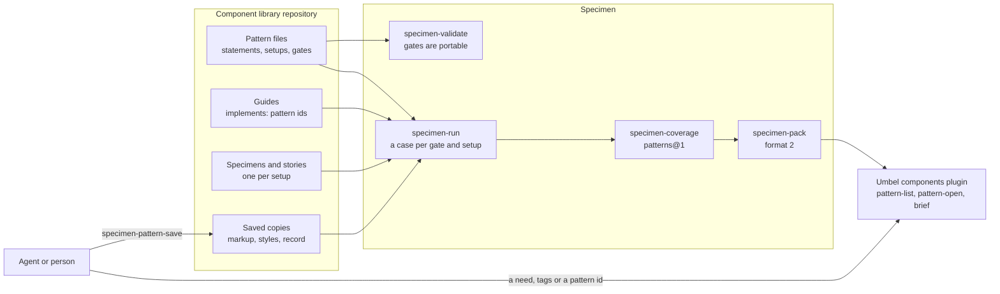

# Patterns: proposal

A pattern says what a recurring piece of interface is for, what every
implementation of it must keep, what may change, and how to test what must be
kept. Components and saved regions of screens are implementations of patterns.
Specimen runs a pattern's tests against each implementation, the component pack
records which hold, and Umbel serves the result.

## Status

- **State:** active (Phase 0 step 0.5 **go with changes** approved 2026-11-22 on
  [#1966](https://github.com/lushly-dev/afd/issues/1966); promoted from `proposed/` to `active/`).
  Drafted 2026-11-12 against `main` at `d152f3dc`; revised 2026-11-21 against `main` at `9e2aff933`
  ([#1133](https://github.com/lushly-dev/afd/issues/1133)); Phase 0 measured 2026-11-22
  ([#2122](https://github.com/lushly-dev/afd/pull/2122)); Phase A specification opened 2026-11-22
  ([#2133](https://github.com/lushly-dev/afd/issues/2133)) in [`spec.md`](spec.md) and
  [Umbel Amendment A31](../../../../endpoints/umbel/docs/plugins/components/spec.md#amendment-a31-patterns-and-saved-copies-1073).
  Phases B–D remain gated on Phase A exit approval. [STATUS.md](STATUS.md) tracks progress.
- **Verified:** the facts in [What exists today](#3-what-exists-today) were
  read on `main` at `d152f3dc` and re-verified at `9e2aff933`. Phase 0 steps 0.1–0.4 were measured
  live in Chromium, Specimen, Umbel, and 15 builder sessions ([STATUS.md](STATUS.md#phase-0-findings)).
  All ten jobs are written as scenario files aligned to Phase A contracts and pass the checks in
  [STATUS.md](STATUS.md#how-the-jobs-were-checked).
- **Normative specification:** [Design](#5-design) and [Drafted commands](#6-drafted-commands)
  below are the proposal's original draft; exact Phase A wire contracts, Pack Format 2, and all
  seven Phase 0 adjustments live in [`spec.md`](spec.md) and
  [Umbel Amendment A31](../../../../endpoints/umbel/docs/plugins/components/spec.md#amendment-a31-patterns-and-saved-copies-1073).
- **Evidence this rests on:** Phase 0 measurements ([STATUS.md](STATUS.md#phase-0-findings)):
  10/10 seeded faults caught on real `violet-*` components (18/20 shared), 15/20 saved regions
  faithfully reproduced with 0/20 false `complete`, 43%–54% median token reduction with 100% pass
  rate on the builder experiment ($2.89 of $25 cap), and Loam `chrome` briefs smaller than post-A24
  baseline at both 96k and 40k budgets once `customize` sheds before `usage`.

| Field | Value |
| --- | --- |
| Epic | [#1073](https://github.com/lushly-dev/afd/issues/1073) |
| Specification | [`spec.md`](spec.md), [Umbel Amendment A31](../../../../endpoints/umbel/docs/plugins/components/spec.md#amendment-a31-patterns-and-saved-copies-1073) |
| Units touched | `foundations/specimen`, `integrations/specimen-afd`, `endpoints/specimen-cli`, `integrations/specimen-fast-af`, `foundations/fast-af/packages/violet-elements`, `endpoints/umbel` (its `components` plugin), `endpoints/loam` (its specimens and design record) |
| Related | [Specimens status](../../complete/specimens/STATUS.md), [Component Briefs status](../../complete/component-briefs/STATUS.md), [Design Decisions](../../complete/design-decisions/design-decisions.proposal.md) ([#1108](https://github.com/lushly-dev/afd/issues/1108)), [Screens from Jobs](../../complete/screens-from-jobs/screens-from-jobs.proposal.md) ([#1109](https://github.com/lushly-dev/afd/issues/1109)), [Pointing](../../complete/pointing/pointing.proposal.md) ([#1110](https://github.com/lushly-dev/afd/issues/1110)), [Scales](../../complete/scales/scales.proposal.md) ([#1111](https://github.com/lushly-dev/afd/issues/1111)), [pack format](../../../../foundations/specimen/docs/pack-format.md), [`components` plugin specification](../../../../endpoints/umbel/docs/plugins/components/spec.md), [Loam design skill](../../../../.claude/skills/loam-design/SKILL.md) |

## 1. Problem and goal

Four things are hard today.

1. **Guidance is tied to one implementation.** A guide file is keyed by a
   tag. Its statements mix what any implementation needs ("unchosen text is
   discarded on Tab, Escape or an outside press") with one implementation's
   API ("call `selectValue(optionValue)`"), both in
   `violet-elements/src/combobox/violet-combobox.guide.json`. The checks
   reach inside the implementation: the button's plays find the inner
   `button` through `shadowRoot` (`violet-button.stories.ts`, lines 95 and
   146). A second implementation, in another library, another framework or
   for another device, starts with nothing that says what it must keep and
   nothing that can test it.
2. **A region that works cannot become a reference.** The only saved markup
   is a pack's examples: at most three per component, 4 000 characters each,
   taken from that component's own stories. Loam's screen specimens
   (`endpoints/loam/packages/chrome/specimens/`) are written by hand.
3. **Reuse has one mode.** A maintained component earns its upkeep when
   central updates and verified behaviour matter. Most compositions do not
   need that. An agent can copy and adapt one cheaply, but nothing records
   where the copy came from or what must survive the adaptation.
4. **Nothing answers "what should I use here".** Component Briefs left it
   out of scope: `components-list` filters by tag and summary text.

**Goal.** A person or an agent can:

- find a pattern by what a region must do, and be told plainly when nothing
  fits;
- get what must be kept and what may change, stated once per pattern;
- build a new implementation and hold it to the same tests as the original;
- save a working region of a screen as a reference, told what could not be
  saved;
- copy and adapt a saved reference while keeping provenance and verifiable
  invariants;
- learn which saved references a component change has made stale.

**Non-goals.** Removing components. Inserting a pattern into a page: an agent
writes the code and Git keeps the history. Pattern inheritance or nesting.
Ranked search (the knowledge plugin's job, as Component Briefs decided).
Replacing a component's own stories. Changing how tokens are named or scaled
([Scales](../../complete/scales/scales.proposal.md), [#1111](https://github.com/lushly-dev/afd/issues/1111)).
A review surface for people: [Design Decisions](../../complete/design-decisions/design-decisions.proposal.md)
([#1108](https://github.com/lushly-dev/afd/issues/1108)) owns the single
Specimen review surface and confirmation-gated MCP host; Patterns adds neither.

## 2. Terms

| Term | Meaning |
| --- | --- |
| Pattern | An implementation-independent description of a recurring piece of interface: a control (a select, a modal dialog) or a composition (an empty collection, a grouped settings form). It has an id, statements, setups and gates |
| Statement | One sentence with a stable id, of four kinds. `useWhen` and `avoidWhen` are for choosing. `keep` is a requirement on every implementation. `customize` is what an implementation or a copy may change |
| Gate | An executable test of one `keep` statement, written only against roles, accessible names, focus, standard form behaviour and geometry, so it runs unchanged on any implementation |
| Setup | A named arrangement a gate starts from, described in a sentence, such as "three options, none chosen, labelled Fruit". Each implementation supplies its own way to mount it |
| Implementation | Something that realises a pattern: a **component** (a custom element in a library) or a **copy** (the saved markup and styles of a region) |
| Linkage | How an implementation is reused. A component is used by **instance**: a consumer imports it and takes its updates. A copy is used by **copying**: the consumer owns the result and nothing updates it |
| Revision | The `sha256:` digest of a copy's canonical deliverable content (its saved `.html` and `.css` bytes only, never its `fingerprint` or verification `basis`) |
| Fingerprint | A digest of the manifest's declarations of the components a copy uses. It changes when one of their APIs does |
| Provenance marker | A short text on a copied region's root naming the copy it came from and that copy's revision |

The word follows the WAI-ARIA Authoring Practices, where a pattern states
roles, states and keyboard behaviour and example implementations follow it.
The pack format already uses "pattern" for an identifier's regular
expression; this proposal calls those "identifier forms" in prose (confirmed
by the owner on 2026-11-21).

## 3. What exists today

Specimen (`foundations/specimen`):

- **Guides.** The `guides` key finds one file per component (`tag`,
  `summary`, `status`, `replacedBy`, `usage` and `a11y` statements with
  optional `members`, `roles`, `detail`) and rules files whose rules say what
  they apply to (`tags`, `attributes`). A guide source, a Node module, adds
  rules from data a library already keeps.
- **Guide obligations.** `specimen-coverage` reports each statement in its
  own set, `guides@1`: `verified` when a claim's check ran and held,
  `authored` otherwise. It changes nothing in `schema-partitions@1`.
- **Native specimens and `specimen-run`.** A target is `{ role, name }`, found
  through Chromium's accessibility tree across open shadow roots, or a
  selector. Actions are click, focus, hover and fill. An `expect` step checks
  an event, a property or attribute, a `FormData` entry or `checkValidity()`
  (`src/types.ts`, lines 43 to 106). There is no keyboard action, and no
  expectation on a role, a name, focus or geometry. Today `specimen-run` runs
  retained stories only (`src/bench-runtime.ts:552-555` refuses native
  specimens), its outcome schema requires `play` and `a11y` with status
  `passed | failed | skipped | excluded` (`src/schema.ts:276-291`), and
  `capture: all | failed | none` (`src/schema.ts:274`) is allowed only on
  suite runs (`integrations/specimen-afd/src/commands.ts:312`).
- **Captures.** Each element carries its box, scroll and client extents,
  selected computed styles, live state, and its computed role and accessible
  name (`ElementObservation`, `src/types.ts` line 572; capture 0.9). ARIA
  states such as expanded are in the snapshot's text, not on the element.
- **Remounting.** An entry can carry `remount`, markup the page mounts after
  loading a module. A pack's examples use it: one is kept only when it is
  the same in both passes and, mounted on its own, shows the same elements,
  states and roles.
- **Declared limits.** An entry declares the themes it supports with a
  reason, and `specimen-themes` reports `declared` or `contradicted`.
- **Suggestions.** `specimen-suggest` proposes native specimens and claims,
  all unverified. What only a person knows is a placeholder that fails
  until replaced.
- **Pack format, version 1, fixed** on 2026-11-12. A reader refuses a key it
  does not know, so any addition is a new version.
- **Drift.** `specimen-pack-check` rebuilds the records and names the
  committed files that differ.
- **Command hosting.** `integrations/specimen-afd` defines 19 commands with
  `expose: { mcp: true, cli: true }`, run through `specimen-cli` and hosted
  over stdio by `endpoints/specimen-server` (`#1320`, without human
  confirmation policy, which Design Decisions phase 5 adds to that single
  host). `specimen-list` takes `{}` with no filters today and returns
  `{ specimens: [...] }` (`commands.ts:253`).

FAST-AF (`foundations/fast-af/packages/violet-elements`): 77 elements, 407
stories, 46 guides, and a committed pack of 77 records and 153 rules.
`pack/GAPS.md` is the backlog.

A second library exists in this repository. `foundations/specimen/fixtures/pack-library`
is the format's example library: `example-field`, `example-option`,
`example-select` and a deprecated `example-dropdown`. Lushly's pack is also
under way as a second real library ([Component Briefs status](../../complete/component-briefs/STATUS.md),
`#1156` closed on the AFD side).

Umbel (`endpoints/umbel`, the `components` plugin):

- Exposes four read-only (`inspect`) commands: `components-brief` (first-class,
  40 000 B default / 96 000 B max), `components-list` (16 000 / 64 000 B),
  `components-open` (32 000 / 96 000 B) and `components-check` (A30,
  16 000 / 64 000 B). `umbel-first-party` uses 7 of its 8 first-class tool
  slots; non-first-class tools are called via `afd-discover` and `afd-call`.
  A shared rule is sent once, `known` skips rule text the caller holds, and
  `source` finds tags in markup. Every call reads and hashes every file of
  each touched library (host caps: 1 000 files/pack, 16 MiB/call, 1 MiB/file),
  and overrides load on server start.
- **Component Briefs completed on 2026-11-13** ([STATUS](../../complete/component-briefs/STATUS.md)):
  step C5 landed, amendment A24 slimmed the default brief (omitting CSS
  properties and attribute-taxonomy rules by default), A28 added deployment-level
  `content.guidance` (up to 24 statements / 4 096 B, never shed), A30 added
  `components-check`, the Claude Code brief hook (`#1117`) and named consumers
  (`#1292`) shipped, and the owner reset criterion 2 to "default brief smaller
  than the same components' declarations; API alone at most half". On the
  post-A24 baseline (`fast_af.rs`), whole default briefs are 76 % to 93 % of
  declarations and `detail: "api"` is 33 % to 37 % (down from the pre-A24
  step C4 reading of 88 400 bytes / 89 % for Loam's `chrome`).
- **Boundary with `content.guidance` (A28):** `content.guidance` carries
  deployment-specific authoring policy for a consumer (such as Loam's local
  import/token overrides), whereas `content.patterns` carries library-level
  reusable pattern contracts (`keep` and `customize`) shared across
  implementations.

Loam (`endpoints/loam`): 123 native screen specimens (`Shell`, `ListEmpty`,
`ListFailed`, `Modal` and others), built mostly through `shellFixture`
(`endpoints/loam/packages/chrome/specimens/support.ts:61-90`), which makes
real kernel calls, alongside a few hand-built fixtures. Its design skill holds
a checklist of eight things a component's pull request must show. Loam is an
application and has no Custom Elements Manifest of its own.

Violet (`foundations/violet`): constraints on token values (`enum`, `range`,
`pattern`, `scale`, `contrast`, `reference`). This proposal does not use them
in its first version; see [Later](#later).

## 4. Jobs

Each job is a scenario file in [`scenarios/`](scenarios/), written against
the drafted commands in [section 6](#6-drafted-commands). The data is
invented, on the format's `example` library. Across Jobs 3, 4 and 9, the
canonical `example/select` `keep` statement order is `0: named`,
`1: escape-closes`, `2: shows-choice`, `3: fits-narrow`.

On 2026-11-21 the owner kept all nine initial jobs, confirmed Jobs 1 to 5 as
**Slice 1** (`slice` tag) and Jobs 6 to 9 as **Slice 2**, and set the build
ranking: **(1) Jobs 5 + 4** → **(2) Jobs 2 + 1** → **(3) Job 3** →
**(4) Jobs 6 → 7 → 8** → **(5) Job 9**. The three-seat reader walk on
2026-11-21 identified one missing Slice 2 job directly tied to Problem #3
(copying, adapting and verifying a saved copy), added as **Job 10** at Rank 4
(Slice 2).

| # | Rank | Job | Sentence | Slice |
| --- | --- | --- | --- | --- |
| 1 | 2 | `find-by-need` | When I know what a region must do but not what it is called, I want the patterns that fit and what implements each, so that I reuse what exists and am told plainly when nothing fits | Slice 1 |
| 2 | 2 | `brief-with-patterns` | When I write a page with a library's components, I want what each must keep and what I may change, stated once per pattern, so that I adapt freely without breaking a requirement | Slice 1 |
| 3 | 3 | `derive-an-implementation` | When no implementation suits my framework or device, I want the pattern's requirements, its gates and a reference to port, so that what I build is held to the same tests as the original | Slice 1 |
| 4 | 1 | `hold-to-its-pattern` | When I change a component, I want its patterns' gates run against it, so that a broken requirement fails before anyone reviews it | Slice 1 |
| 5 | 1 | `refuse-an-unportable-gate` | When I write a gate that names one implementation's tag, attribute or structure, I want it refused, so that a gate stays a test any implementation can take | Slice 1 |
| 6 | 4 | `save-a-working-region` | When a region of a screen works well, I want to save it as a reference and be told what could not be saved, so that the next screen starts from it and nothing about it is invented | Slice 2 |
| 7 | 4 | `see-what-went-stale` | When a component's API changes, I want the saved references that depend on it named and a way to refresh them, so that I re-check those and no others until the pack is clean again | Slice 2 |
| 8 | 4 | `find-outdated-copies` | When a page holds regions copied from references, I want each copy's source named and whether it still matches, so that a fixed defect can be repaired where it was copied | Slice 2 |
| 9 | 5 | `stay-out-of-context` | When an implementation is for some devices only, I want its gates elsewhere reported as out of context with the reason, so that a skipped test is never read as a pass | Slice 2 |
| 10 | 4 | `copy-and-adapt-a-reference` | When I start a new screen region from a saved copy and adapt it, I want its markup, styles, provenance marker, editable bounds and portable gates, so that my adaptation stays traceable and keeps every required invariant | Slice 2 |

**What writing them and the walkthrough changed.**

- A conformance command was drafted and cut. Gates run as native gate cases
  under an extended `specimen-run`, and `specimen-coverage` reports them as a
  third obligation set, the way `guides@1` was added.
- A command to find every copy in a codebase was drafted and cut. The
  provenance marker is plain text, so a text search finds copies, and
  `components-brief` reports the ones in the source it is given.
- `specimen-pattern-save` gained `status: draft`. Job 6 could not be written
  honestly with a save that either succeeds whole or fails.
- A no-fit answer is a success with an empty list, kept apart from an
  unreadable pack, which stays a failure.
- Job 7 (`see-what-went-stale`) was extended on 2026-11-21 to close the loop
  beyond detection: re-saving the refreshed region (`specimen-pattern-save`
  with `replace: true`), rebuilding the pack (`specimen-pack`), and confirming
  `specimen-pack-check` passes with `stale: []`.
- Partial list assertions across all scenarios use dotted index paths
  (`content.patterns.0.pattern`), because `afd-testing`'s evaluator
  (`packages/testing/src/runner/evaluator.ts:180-220,452-462`) requires exact
  array lengths when matching arrays of objects and compares plain arrays
  whole.

**What the reader walks and independent reviews changed (2026-11-21).**

Three fresh read-only readers walked the owner-decided draft separately from
the **Person**, **Job List** and **Calling Agent** seats (all three returned
verdict *revise*; every blocker and all 15 improvements are dispositioned in
[STATUS.md](STATUS.md#the-walk)). Two independent reviewers (`gemini-4-neon`
and cross-provider `claude-opus-5-5` `high`) then reviewed the revised draft
against `main` (`9e2aff933`), and a focused second walk checked the post-walk
additions (Job 10, `specimen-list`, `PATTERN_SETUP_MISSING`, `PATTERN_UNKNOWN`,
`fingerprintsOnly`). Every blocker was applied:

| Finding (source) | Change |
| --- | --- |
| Slice 1 scenario `01-find-by-need` asserted a Slice 2 saved copy (Job List B1) | Step 2 now matches component-backed `field` so Slice 1 passes strictly with Slice 1 features; copy discovery lives in Jobs 6 and 10 |
| Problem #3 (copy, adapt and gate-verify) had no job, `draft` was a dead end, copies had no gate-run path, and Job 10 mixed library/consumer benches and overloaded `setup` (Job List B2, Person B3, Opus B3, Walk 2 B2) | Added Job 10 (`copy-and-adapt-a-reference`, Slice 2) scoped to the consumer bench (`invoices-empty--gate--no-outer-margin`, `kind: case` / `case: invoices-empty`, requesting `setups` in step 1); moved the library saved-copy gate run into Job 6; added in-place verify/promote mode to `specimen-pattern-save` (`replace: true` without `id`/`target`); closed Job 6 through `specimen-pack`, `specimen-pack-export`, complete-copy discovery, `collection-list` empty implementations check and draft promotion (Job List B3, Opus I9) |
| Cross-library pattern loading in Specimen, cross-library implementation aggregation in Umbel, and app-level packs without a CEM (Loam) were unspecified (Job List B4, Person B1, Calling Agent B4) | Added `patternSources` and `pack.dependencies` in `specimen.config.json` (§5.1, §5.4), optional `library` on setups/obligations/implementations, and read-time cross-library implementation aggregation in Umbel (§5.7); updated Jobs 3 and 9 |
| Collapsing `missing` and `out-of-context` into `basis: authored` broke Decision 5 and Job 9 (Person B2, Calling Agent I4, Walk 2 B1) | `patterns@1` coverage reports four levels (`verified`, `missing`, `ungated`, `out-of-context`); `specimen-pack` refuses components with `missing` gated setups (`PATTERN_SETUP_MISSING`, shown in Job 3), so pack format 2 preserves the three packable bases (`verified`, `ungated`, `out-of-context` with `reason`); Job 9 runs `specimen-run` and asserts `out-of-context` end to end |
| Hashing the packed `.json` as `revision` let `fingerprint` or `basis` changes churn `revision` (Person B4) | `revision` hashes canonical `.html` + `.css` bytes only (§2, §5.4, §5.6); `components-pattern-open` stamps `data-pattern-copy` on served HTML and in-repo disk copies read `revision` from `<name>.json` |
| Shadow-DOM `{ role, name }` resolution in `specimen-pattern-save` conflicted with Pointing's host-climb rule (Person B5) | Adopted [Pointing §4.1](../../complete/pointing/pointing.proposal.md#41-one-rule-for-what-is-selected) and optional `point` id input (§5.0, §5.4) |
| Umbel output budgets, shedding order, pagination and copy size limits were undefined (Calling Agent B1) | Set budgets for `components-pattern-list` (16/64 KB) and `components-pattern-open` (32/96 KB + `skip`), placed `content.patterns` in `components-brief` shedding order with `components-pattern-open` recovery, and capped saved copy `html` (16 KB) / `css` (8 KB) (§5.6, §5.7) |
| `copies[]` sat outside `trust: "content"` (D153) and format 2 lacked ASCII identifier forms (Calling Agent B2) | Moved `copies` into `content.copies` under `trust: "content"`, defined ASCII-only identifier forms with `umbel-scan` drop rules, and specified `render: "text"` quoting (§5.1, §5.7, Job 8) |
| `specimen-run` on main only runs retained stories (`bench-runtime.ts:552-555`), `specimen-list` outputs `{ specimens }` (`commands.ts:253`), `specimen-pack-export` requires `directory` and returns `files`/`digest` (`schema.ts:935-947`), and unbounded outputs flooded context (Calling Agent B3, Review B1/B2) | Documented current `specimen-run` limit in §3 and added native gate execution + gate outcome shape (`passed`/`failed`/`out-of-context`) + single-id `capture` extension in §5.3/§6/B3; fixed Job 4 (`specimens.0.id`) and Job 6 (`directory`, `files`/`digest`); used story-safe `--gate--` ids; defined browserless `fingerprintsOnly: true` (`valid`, `stale`, `changedTags`) in Job 7 |
| Missing parameters/fields and `PATTERN_UNKNOWN` omission (Calling Agent B5, Review B4, Opus I6/I8) | Added `PATTERN_UNKNOWN` to §6 Error table and Job 6 step 1; added `setups` to Job 3, `origin`/`pattern`/`name` to `stale[]` in Job 7, `line`/`revision`/`currentRevision`/`css`/`library` to Job 8, `customize` + component `patterns` to Job 2, `availableFacets` + `scope` to `components-pattern-list`, `createPattern` guard + `screenshot` + camelCase `gaps` (`useWhen`, `avoidWhen`) to Job 6, `scenario[0]` field syntax in Job 5, and canonical `example/select` `keep` indices across Jobs 3/4/9 |

Deferred to Phase A specification (listed in [Phase A](#phase-a-specify) and [STATUS.md](STATUS.md#follow-ups-not-yet-issues)): pattern/copy deprecation (`status: deprecated` / `replacedBy`), outdated-copy warnings in `components-check`, batch copy refresh, `patternLibrary` field naming in `specimen-coverage`, and amending Design Decisions so unfiltered `specimen-capture` skips gate cases.

**Checks,** re-run 2026-11-21 on Node 26.13.0 ([output](STATUS.md#how-the-jobs-were-checked)).
`afd scenario validate` parses all ten, the dry run with `checkFixtures: true`
reports no errors across their 44 steps, and no `expect` block contains a step
reference (`${{`). Coverage reports:

- **All twelve drafted commands are used (100 %).**
- **Five of the eight drafted error codes are shown.** `TARGET_NOT_FOUND`,
  `SPECIMEN_NOT_FOUND` and `PATTERN_AMBIGUOUS` are plain lookup/disambiguation
  siblings of refusals already shown (`TARGET_AMBIGUOUS`, `PATTERN_NOT_FOUND`).
- **No scenario calls a command the proposal does not draft.**

**What a scenario cannot show here.** Whether a gate catches a real fault,
whether a saved region looks right, and whether any of this makes an agent's
work better. Those need the measures in [section 10](#10-measurement-and-exit-criteria).
Job 8's warning text lives in `warnings` (which `expect` cannot reach), and
Job 9 asserts only that `reason` is present rather than its exact wording;
each file says so at its top.

## 5. Design



### 5.0 Shared conventions (aligned with sibling proposals)

Confirmed by the owner on 2026-11-21 to align Patterns with
[Design Decisions](../../complete/design-decisions/design-decisions.proposal.md),
[Screens from Jobs](../../complete/screens-from-jobs/screens-from-jobs.proposal.md) and
[Pointing](../../complete/pointing/pointing.proposal.md):

- **Committed records live under `specimens/`.** Pattern files and saved copies
  default to `specimens/patterns/<pattern>/pattern.json` and
  `specimens/patterns/<pattern>/copies/<name>.{html,css,json}`, beside
  `specimens/decisions/` and `specimens/notes/`. The `"patterns"` glob in
  `specimen.config.json` remains configurable for libraries that prefer another
  directory. Commands write files and never run `git commit`.
- **Local data lives under `.specimen/`.** Ephemeral Specimen run, capture and
  remount artifacts stay in `.specimen/` (already ignored in root `.gitignore`
  by `#1132`, matching Design Decisions §5 and Pointing §4.0).
- **One review system and one Specimen MCP host.** Design Decisions (`#1108`)
  owns the review workflow (`specimen-review`, `decision-record`) and adds
  human confirmation policy to the single Specimen MCP host
  (`endpoints/specimen-server`, `#1320`). Patterns adds no separate review
  surface or host, and single-id gate runs default to `capture: "none"` so no
  full `Observation` enters agent context (Design Decisions exit criterion 1).
- **Shared element resolution.** `specimen-pattern-save` adopts Pointing's
  shared `{ role, name }` host-climb rule ([Pointing §4.1](../../complete/pointing/pointing.proposal.md#41-one-rule-for-what-is-selected))
  so resolving an accessible element inside a custom element's shadow root
  climbs to the host custom element before extracting light DOM.
- **Every command that writes files is a mutation.** `specimen-pattern-save`,
  `specimen-pack` and `specimen-pack-export` are mutations.

### 5.1 A pattern file

A new key, `"patterns": ["specimens/patterns/*/pattern.json"]` (configurable),
beside `guides`. To claim patterns owned by another library, a project adds
`"patternSources": ["<pack dir or package>"]` in `specimen.config.json`, which
local Specimen reads to load external pattern definitions and gates without a
network call. A pattern file is data, as a guide is, so it is checked without
running a module and each statement has an address.

```jsonc
{
  "pattern": "select",
  "summary": "Pick one value from a short, fixed list that opens as a popup.",
  "scope": "control",                       // control | composition
  "facets": { "purpose": ["choose-one"], "structure": ["popup-list"],
              "context": ["form"], "behavior": ["selection"] },
  "useWhen":   [{ "id": "select.use.short-list", "text": "…" }],
  "avoidWhen": [{ "id": "select.avoid.search", "text": "…" }],
  "keep": [
    { "id": "select.keep.named", "gate": "named",
      "text": "The control has an accessible name that is not its value." },
    { "id": "select.keep.escape-closes", "gate": "escape-closes",
      "text": "Escape closes the popup and returns focus to the control." }
  ],
  "customize": [{ "id": "select.customize.options", "text": "…" }],
  "setups": {
    "three-options": {
      "text": "Three options, none chosen, labelled Fruit.",
      "targets": { "control": { "role": "combobox", "name": "Fruit" } }
    }
  },
  "gates": {
    "escape-closes": { "setup": "three-options", "scenario": [
      { "id": "open",   "action": { "click": "control" } },
      { "id": "escape", "action": { "press": "Escape" } },
      { "id": "closed", "expect": { "target": "control", "a11y": { "expanded": false } } },
      { "id": "back",   "expect": { "target": "control", "focus": true } }
    ] }
  }
}
```

**Identifier forms (ASCII-only, enforced by `specimen-validate` and Umbel):**
- `pattern`: `^[a-z][a-z0-9]*(?:[.-][a-z0-9]+)*$` (permits `select`,
  `empty-collection`, `dialog.modal`).
- `copy` name, `setup`, `gate`, `facet` key and `facet` value:
  `^[a-z][a-z0-9]*(?:-[a-z0-9]+)*$`.

Statements keep the pack's limits (240 characters, one line) and its
statement-id form. A statement lives in a pattern or in a guide, never both:
`specimen-validate` refuses an id stated twice (`DUPLICATE_ID`) and formats
issue field paths with Specimen's existing bracket notation (`scenario[0]`).

### 5.2 Gates

A gate is a native scenario with a narrower vocabulary. It may use:

| Kind | Allowed | Exists today |
| --- | --- | --- |
| Target | `{ role, name }` only | Yes |
| Action | click, focus, hover, fill | Yes |
| Action | `press`: a key or chord | No. The host already drives a real keyboard for retained plays |
| Expectation | `form`, `validity` | Yes |
| Expectation | `event`, for `input`, `change`, `submit` and `reset` only | Yes, for any event |
| Expectation | `a11y`: the target's role, name, and states such as expanded, selected, checked, disabled and invalid | Role and name are in a capture. States need a capture change |
| Expectation | `focus`: the target holds focus | To confirm in phase 0 |
| Expectation | `layout`: a least size, no overflow, no outer margin | The box, extents and styles are in a capture |

A gate may not use a selector, a `state` expectation on an attribute or
property, a custom event or a `command` step through a plugin runner. Each
names one implementation. `specimen-validate` reports `GATE_NOT_PORTABLE`.

Two rules follow from Specimen's own:

- **A failing or missing gate refuses packing.** A failing gate fails
  `specimen-run`, and `specimen-pack` writes nothing from a run with a failed
  gate or an implementation missing a required gated setup
  (`PATTERN_SETUP_MISSING`). There is no "implements the pattern, but not this
  part" state.
- **Layout ownership is a gate.** A composition's first `keep` statement
  says the page owns the space around it, and its gate checks that the root
  has no outer margin.

A gate may name the contexts it runs in (`viewport`, `container`, `theme`,
`locale`, `reducedMotion`), from the context Specimen already has. Pointer
type is tracked separately in [#1967](https://github.com/lushly-dev/afd/issues/1967);
see [Risks](#11-risks-and-open-points).

### 5.3 Implementations and setups

- **Each library owns its patterns** (owner decision, 2026-11-21). A component
  claims a pattern in its guide: `"implements": ["select"]`, or
  `{ "library": "example", "pattern": "select" }` for a pattern another library
  owns (resolved via `patternSources`). Ids stay unique within a library, as
  the pack format has them.
- **A setup is a case.** A native specimen or a story with no play declares
  `{ "pattern": "select", "setup": "three-options" }` (with optional `"library"`
  for external patterns). A saved copy that declares `setup` in its `.json`
  record is likewise mounted as a setup case, and an adapted region in a
  consumer app can bind a local setup case claiming the external pattern via
  `patternSources` so Specimen runs the same portable gates against the
  adapted screen region too. The pattern's targets must resolve in the mounted
  setup by role and name.
- **Native gate cases under `specimen-run`.** Today `specimen-run` runs only
  retained stories (`bench-runtime.ts:552-555`). Phase B3 extends
  `specimen-run` to execute native gate cases (both single-id and suite runs,
  adding `kind`/`pattern` filters and `out-of-context` counts to suite mode),
  each in a fresh browser context with the story-safe id `<case>--gate--<gate>`
  (for saved copies: `<pattern>--<name>--gate--<gate>`), returning a gate
  outcome (`status: passed | failed | out-of-context`, optional `reason`,
  structured `failures[].stepId`) and extending suite `capture: none | failed | all`
  to single-id runs (defaulting to `none` for gate cases). `specimen-list`
  gains filters (`kind: story | native | gate`, `component`, `pattern`
  accepting `<library>/<pattern>`, `match`, `limit`, `after`) and an optional
  `next` cursor while preserving `{ specimens: [...] }`. Skipping gate cases
  in Design Decisions' unfiltered `specimen-capture` is tracked as a Phase A
  cross-proposal amendment ([STATUS.md](STATUS.md#follow-ups-not-yet-issues)).
- **`specimen-suggest` proposes the setups** an implementation lacks, taking
  `pattern:<statement id>` (or `pattern:<library>/<statement id>` for external
  patterns), with the same rule as today: what it cannot know is a placeholder
  that fails.
- **An implementation may declare the contexts it is for** (such as viewport
  bounds or themes) with a reason, stored in `contexts` on the implementation
  entry. A gate outside them runs as `outcome.status: "out-of-context"` (with
  `reason`) and is reported `out-of-context` in coverage and pack records,
  never as passed.

### 5.4 Copies: saving, revision, fingerprint, provenance (Slice 2)

`specimen-pattern-save` (a mutation) saves a region of a rendered case as a
copy, or re-verifies an edited copy on disk in place. It extends what a pack's
examples already do.

1. Render the case at the named `checkpoint` and `context`, and resolve the
   `target` (or a Pointing `point` id) to one element using Pointing §4.1's
   shared host-climb rule.
2. Take its light DOM, with attributes in name order, as examples are taken,
   and the style rules that match inside it.
3. Remove what cannot travel: scripts, inline handlers, data a page bound to
   it, and elements whose component is not in the manifest (for an application
   without its own CEM, such as Loam, `specimen.config.json` names dependency
   manifests under `pack.dependencies`). List each kind and count in `stripped`.
4. Mount the result on its own, capture a remount `screenshot`, and compare
   elements, states and roles with the original.
5. Write `specimens/patterns/<pattern>/copies/<name>.html`, `.css` and `.json`
   (under the configured patterns root). The record holds the origin (`id`,
   `checkpoint`, `context`, `target`), the tags it depends on, `stripped`,
   optional `setup` (preserved by `replace: true` unless overridden),
   `revision` and `fingerprint`. Creating a brand-new skeleton pattern
   requires `createPattern: true`; otherwise an unknown pattern name is refused
   (`PATTERN_UNKNOWN`) to prevent typo-created patterns.

The copy is `complete` when nothing was stripped and the remount shows the
same. Otherwise it is a `draft`: kept, listed locally, and excluded from the
pack (never served by Umbel). To clean up a `draft` or refresh a copy whose
origin screen changed, a person or agent edits `.html`/`.css` on disk and runs
`specimen-pattern-save` with `{ pattern, name, replace: true }` (omitting `id`
and `target`), which remounts the edited files in place, promotes `draft` to
`complete` when clean, and recomputes `revision` and `fingerprint`.

**Save never writes guidance.** A new pattern gets its id and nothing else,
and the report's `gaps` lists every statement kind it lacks (`summary`,
`useWhen`, `avoidWhen`, `keep`, `customize`). A person or an agent writes them,
and they stay `ungated` until a gate verifies them.

**Revision and fingerprint** reuse the pack format's digest (`sha256:` over
canonical bytes). **Revision** hashes only the copy's canonical `.html` and
`.css` bytes; it does *not* include `fingerprint` or verification `basis`, so
a harmless component API update never churns `revision` or triggers false
outdated-copy warnings when the copy's markup and styles did not change.
**Fingerprint** covers the manifest declaration of each tag the copy uses, so
it can be recomputed with no browser: `specimen-pack-check { fingerprintsOnly: true }`
compares current manifest declarations against committed copy fingerprints and
returns a lightweight static result branch (`{ valid, stale, changedTags,
elapsedMs }`) without launching a browser. Each `stale[]` entry includes
`file`, `pattern`, `name`, `reason`, `tags` and `origin` so callers can refresh
stale copies without reading files off disk.

**Provenance.** Because a file's digest cannot contain itself, saved `.html`
files on disk stay clean and `<name>.json` stores `revision`. When serving a
copy, `components-pattern-open` stamps
`data-pattern-copy="<library>/<pattern>/<name> <revision>"` onto the returned
root element. An agent copying directly from disk inside the same repository
stamps the same marker using the `revision` from `<name>.json` (or uses
`components-pattern-open`). Where a framework drops unknown attributes, callers
may use the HTML comment form
`<!-- pattern-copy: <library>/<pattern>/<name> <revision> -->`. It is a
record, not a link: nothing reads it at run time.

### 5.5 Coverage: `patterns@1`

A third obligation set in `specimen-coverage`, under `patterns`, beside
`schema-partitions@1` and `guides@1`. It changes neither. An obligation is
`pattern:` and a `keep` statement's id (`pattern:<library>/<id>` when
cross-library), for one implementation identified consistently as
`kind: "component"` (with `tag`), `kind: "copy"` (with `name`), or
`kind: "case"` (with `case`, for a consumer's adapted region setup).

| Level | Meaning |
| --- | --- |
| `verified` | The statement's gate ran on this implementation and held |
| `missing` | The statement has a gate, and this implementation has no case for its setup (blocks `specimen-pack`) |
| `ungated` | The statement has no gate. Only a person says so |
| `out-of-context` | The implementation declares it is not for the gate's context (carries `reason`) |

Because `missing` blocks `specimen-pack` (`PATTERN_SETUP_MISSING`), pack
format 2 preserves the three packable bases (`verified`, `ungated`, and
`out-of-context` with `reason`), so Umbel never confuses an intentionally
out-of-context gate with an unverified or missing one.

### 5.6 Pack format 2

Version 1 is fixed and rejects unknown keys, so pattern and copy additions
move cleanly to **pack format 2**. Because there are no pattern users yet, the
owner decided on 2026-11-21 to evolve the format directly without heavy
backward-compatibility ceremony for patterns; Umbel's reader may keep reading
format 1 for non-pattern packs during rollout or upgrade in lockstep.

| Addition | Holds | Limits / Slice |
| --- | --- | --- |
| `data/<library>/patterns/<pattern>.json` | What the pattern file states (statements, setups, gates), and same-library implementations by reference | Slice 1 |
| A component record's `patterns` | Each `{ library, pattern }` it implements, optional declared `contexts`, and each `keep` statement's basis (`verified` / `ungated` / `out-of-context` + `reason`) | Slice 1 |
| `data/<library>/patterns/<pattern>/<name>.json` | A complete copy: `html`, `css`, dependencies, setup, `revision` (digest of `html`+`css`), `fingerprint`, optional `contexts`, and each `keep` statement's basis | Cap: 16 000 chars `html`, 8 000 chars `css`; Slice 2 |
| The catalog | Each pattern (Slice 1) and copy (Slice 2) with its file digest | Slice 1 / 2 |

A statement that is true of every implementation moves from the guides to
the pattern, so a brief states it once. That is the only way this proposal
may change a brief's size, and phase 0 measures it.

### 5.7 Serving: Umbel

The `components` plugin gains two read commands (non-first-class, called via
`afd-discover` / `afd-call`, keeping `umbel-first-party` at 7 of 8 first-class
slots) and one extension to `components-brief`. Complete saved copies are
served by Umbel in Slice 2; drafts are never served (owner decision,
2026-11-21).

- **`components-pattern-list`** (budget: 16 000 B default / 64 000 B max)
  filters patterns by `library`, `scope` (`control` | `composition`), `facets`
  and `contains`, paginated by `after`/`next`. It does not rank. On unfiltered
  or empty results it includes `content.availableFacets` so a model without a
  skill can distinguish facet-name misses from true no-fit.
- **`components-pattern-open`** (budget: 32 000 B default / 96 000 B max,
  with `skip` pagination on `implementations` and `gates`) returns one pattern:
  its statements, `setups`, `gates`, its implementations aggregated at read
  time across all libraries loaded in the active `space` (each entry carrying
  `library`, optional declared `contexts`, and its per-`keep` basis), and
  (Slice 2) a complete copy's stamped `html` and `css` when `source` is
  requested (requesting `source` with `implementation` returns that matching
  entry in `implementations[]`).
- **`components-brief`** adds each served component's `patterns` links, sends
  each referenced pattern's `keep` and `customize` statements once under
  `content.patterns` (including patterns referenced via `data-pattern-copy`
  markers in `source` in Slice 2), honours `known` (accepting
  `<library>/<statement-id>`), adds `patterns` to its `sections` enum, omits
  `content.patterns` under `detail: "api"`, and (Slice 2) reports provenance
  markers under `content.copies` with `line`, `revision`, `currentRevision`
  and `state` (`current` | `differs` | `unknown`). In `brief.rs`'s shedding
  order, `content.patterns` sheds `customize` then `keep` text before floors,
  and `omitted[].open` points to `components-pattern-open`.

**Trust boundary (D153):** Everything read from a pack—and every provenance
marker parsed from `source` (`content.copies`)—stays inside `content`
(`trust: "content"`), scanned by `umbel-scan` with ASCII identifier-form
validation and `render: "text"` `> ` quoting, as the plugin specification
requires.

## 6. Drafted commands

Names, inputs and results are a draft to write jobs against. The exact
contracts follow approval and Phase 0.

| Command | Unit | Kind | Slice | Input | Result |
| --- | --- | --- | --- | --- | --- |
| `specimen-list` | Specimen | Extended, read | Slice 1 | Optional `kind` (`story` \| `native` \| `gate`), `component`, `pattern` (accepts `<lib>/<pattern>`), `match`, `limit`, `after` | Filtered `specimens[]` including gate cases (`<case>--gate--<gate>`) and optional `next` cursor |
| `specimen-validate` | Specimen | Extended, read | Slice 1 | As today | Issues for pattern files: `GATE_NOT_PORTABLE`, `PATTERN_UNKNOWN`, `SETUP_UNKNOWN`, `DUPLICATE_ID` |
| `specimen-run` | Specimen | Extended, read | Slice 1 | As today; extends suite `capture` (`none` \| `failed` \| `all`) to single-id runs (default `none` for gates) | Runs native gate cases with gate outcome: `outcome.status` (`passed` \| `failed` \| `out-of-context`), `reason`, `failures[].stepId` |
| `specimen-coverage` | Specimen | Extended, read | Slice 1 | As today + optional `pattern` | `patterns`: the `patterns@1` set for components, copies and consumer setups |
| `specimen-suggest` | Specimen | Extended, read | Slice 1 | As today; `gaps` also takes `pattern:<id>` / `pattern:<lib>/<id>` | Proposed setups, unverified |
| `specimen-pack`, `-pack-check`, `-pack-export` | Specimen | Extended (`pack` and `pack-export` are mutations; `pack-check` is read) | Slice 1 / 2 | As today (`pack-export` keeps required `directory`); `pack-check` adds `fingerprintsOnly` (Slice 2) | Format 2 (`pack-export` keeps `files`, `digest`, `library`, `directory`, `keptPackToml`); `pack-check` adds `stale[]` (`file`, `pattern`, `name`, `reason`, `tags`, `origin`) and `changedTags` for `fingerprintsOnly` (Slice 2) |
| `specimen-pattern-save` | Specimen | New, mutation | Slice 2 | `pattern`, `name`, optional `id`+`target` (or `point`), `checkpoint`, `context`, `setup`, `createPattern`, `replace` | `pattern`, `implementation`, `status` (`complete` \| `draft`), `revision`, `fingerprint`, `written`, `created`, `stripped`, `remount`, `screenshot`, `gaps` |
| `components-pattern-list` | Umbel | New, read | Slice 1 | `space`, `library`, `scope`, `facets`, `contains`, `after` | `content.patterns`, `content.availableFacets`, `next` |
| `components-pattern-open` | Umbel | New, read | Slice 1 (copies Slice 2) | `space`, `pattern`, `library`, `sections` (`keep`, `customize`, `setups`, `gates`, `implementations`, `source`), `implementation`, `skip` | `content.pattern`, `omitted` |
| `components-brief` | Umbel | Extended, read | Slice 1 (copies Slice 2) | As today (`sections` adds `patterns`; `known` adds pattern statement ids) | Component `patterns`, `content.patterns`, `content.copies` (Slice 2) |

| Error | From | Recovery the suggestion names |
| --- | --- | --- |
| `TARGET_NOT_FOUND`, `TARGET_AMBIGUOUS` | `specimen-pattern-save` | Name the region by a role and name (or Pointing `point`) that resolve to one element |
| `SPECIMEN_NOT_FOUND` | `specimen-pattern-save` | Name the nearest specimen ids (matching Pointing §4.0) |
| `ALREADY_EXISTS` | `specimen-pattern-save` | Choose another name, or pass `replace: true` |
| `PATTERN_UNKNOWN` | `specimen-pattern-save` | Name the nearest local patterns in `specimens/patterns/`, or pass `createPattern: true` to start a new pattern |
| `PATTERN_SETUP_MISSING` | `specimen-pack` | Name the missing implementation, pattern, setup and obligation, pointing to `specimen-suggest` or declaring a context limit |
| `PATTERN_NOT_FOUND`, `PATTERN_AMBIGUOUS` | `components-pattern-open` | `components-pattern-list`; name the `library` |

## 7. What each library contributes

| Library | Already has | This adds |
| --- | --- | --- |
| AFD core and `afd-testing` | Commands, `CommandResult`, scenario files | Nothing. The jobs run as its scenarios once the commands exist |
| Specimen | Guides, role targets, native scenarios, captures, remounting, coverage sets, the pack | Pattern files, `patternSources`, `press` action, three expectations, filtered `specimen-list`, native gate execution + bounded single-id `specimen-run`, declared contexts, `patterns@1`, format 2 + per-error suggestions (Slice 1); `specimen-pattern-save`, `pack.dependencies` and fast `fingerprintsOnly` staleness (Slice 2) |
| `specimen-afd`, `specimen-cli` | The `specimen-*` commands and verbs | Extended inputs/results and per-error-code suggestions (Slice 1); `specimen-pattern-save` (Slice 2) |
| `specimen-fast-af` | The Definition Schema and the taxonomy guide source | Nothing required. The taxonomy's rules stay shared rules |
| `violet-elements` | 46 guides, 407 stories, a pack | Its first patterns (`select`, `field`, then `dialog.modal`), and guides split into what the pattern states and what the component adds |
| Umbel's `components` plugin | Brief, list, open and check inside a budget | Two read commands, cross-library implementation aggregation, patterns in `components-brief`, format 2 (Slice 1); serving complete copies and checking `content.copies` provenance markers (Slice 2) |
| Loam | 123 screen specimens and a component checklist | Its screen states as setups, checklist items as gated `keep` statements, and its first saved compositions (Slice 2) |
| Violet | Constraints on token values | Nothing in this version |

## 8. Decisions

Decisions 1 to 12 were drafted on 2026-11-12 and ratified by the owner on
2026-11-21. Decisions 13 to 20 record the owner's walkthrough calls on
2026-11-21.

| # | Decision | Instead of | Why |
| --- | --- | --- | --- |
| 1 | Components stay, and a pattern sits above them | Replacing components with guidance | A rich component is hard to rebuild, and a first implementation becomes the reference in any case |
| 2 | Linkage separates a component from a copy | Size or component count | A dialog with fixed content can be either. What differs is whether updates reach the consumer |
| 3 | Gates are data in the pattern file, in Specimen's native scenario form | Test functions each implementation's story calls | Only native role targets find an element across shadow roots, and data can be checked for portability without running it |
| 4 | A gate that names a tag, attribute or selector is refused | Allowing them with a warning | One implementation-specific line makes the gate useless to the next implementation |
| 5 | A failing or missing gate fails the case / refuses packing | A "partly conforms" level | Specimen has no such level, and an agent told that a component implements a pattern should be able to rely on it |
| 6 | `patterns@1` is its own obligation set | Adding to `guides@1` | A component's existing coverage must not change because a pattern was written, as decision 12 of Component Briefs held for guides |
| 7 | Save extends the pack's example mechanism | A new serializer | Attribute order, remounting and the two-pass rule are already solved there |
| 8 | Save writes no guidance | Drafting statements from the markup | An invented `keep` statement would read as a requirement |
| 9 | The fingerprint is committed | Computing it at export | A component's API change should show the copies it touches in the same pull request |
| 10 | Provenance is text on the copy | A registry of copies | A search finds it, in any repository, with no service |
| 11 | Discovery is a filter | Ranked search | Component Briefs gave ranking to the knowledge plugin |
| 12 | A prototype is measured before a format is written | Specifying first | Component Briefs' decision 11, and its result |
| 13 | Terms stay `Pattern`, `Implementation` (`component` / `copy`), `Gate`, `Setup`, `Linkage`; pack regexes called "identifier forms" | Renaming pattern or collapsing copy into component | Matches WAI-ARIA APG and separates instance reuse from copy reuse cleanly |
| 14 | Keep all initial jobs; Slice 1 = Jobs 1–5, Slice 2 = Jobs 6–10 (Job 10 added by three-seat walk); build order `5+4 → 2+1 → 3 → 6→7→8→10 → 9`; Job 7 closes the refresh loop | Cutting copies or shipping all jobs in one slice | Validates portable gates and Umbel serving first while keeping the full copy lifecycle scoped for Slice 2 |
| 15 | Each library owns its patterns (`<library>/<pattern>`) | Central AFD-owned neutral pattern set | AFD owns no UI design system; pack format 2 already namespaces by library; a shared library can be added later with no schema break |
| 16 | Umbel serves complete copies in Slice 2 (never drafts) | Keeping copies Specimen-only | Required for cross-repo discovery and outdated-copy detection in `components-brief`; deferred to Slice 2 |
| 17 | Align with sibling Specimen conventions (`specimens/patterns/` default, `.specimen/` gitignored via `#1132`, Design Decisions owns review/confirmation-gated MCP host, Pointing §4.1 host-climb rule, file writers are mutations) | Separate `patterns/` root or separate review/host | One predictable repository layout, target rule and host across all Specimen proposals |
| 18 | Move forward cleanly with pack format 2 | Heavy backward-compatibility constraints for patterns | There are no pattern users yet, so format 2 serves the design directly (preserving the three packable `keep` bases while `missing` blocks packing) |
| 19 | Run Phase 0 (`#1966`) before Phase A with a **$25 cap** on step 0.3 and the post-A24 brief baseline on step 0.4 | Skipping measurement or leaving budget uncapped | Local checks (0.1, 0.2, 0.4) have zero LLM cost; $25 caps 0.3 tightly before committing to Phases A–D |
| 20 | First patterns are `select` and `field`, then `dialog.modal` | Inventing new fixture components first | `fixtures/pack-library` already has `example-select` and `example-field` to pair with `violet-select` and `violet-text-field` |

## 9. Phases

### Phase 0. Prove it

Tracked in [#1966](https://github.com/lushly-dev/afd/issues/1966). Throwaway
scripts; only the record is merged. Each step fixes its rule for "go" before
it runs. Phases A to D remain gated on step 0.5.

| Step | Question | How |
| --- | --- | --- |
| 0.1 | Can a gate written once test two implementations and catch faults in both? | Write the `keep` statements and gates for `select` and `field`. Run them on `example-select` and `violet-select`, and on `example-field` and `violet-text-field`, then on five seeded faults in each. Record which statements could not be written portably, which step kinds were needed, and whether focus can be read from a capture |
| 0.2 | Does a saved region reproduce? | Save twenty regions from Loam's chrome specimens and `violet-elements`' stories. Record the share that remount the same, what was stripped, and whether referenced theme tokens are needed. Whole stories reproduced in 77 % of cases in Component Briefs' step 0.3 |
| 0.3 | Does a pattern help a builder? | An agent builds a second implementation of `select` from the component's source alone, from the pattern and a reference, and from both with gates it can run. Score against gates held back from the first two arms, with tokens and cost. **Budget cap: $25** |
| 0.4 | Does a brief grow? | Move the statements `violet-elements`' field components share into a `field` pattern and rebuild the default brief for Loam's `chrome`. It must not exceed Component Briefs' post-A24 default brief baseline (`fast_af.rs`) |
| 0.5 | Decision | The owner: go, go with changes, or stop |

### Phase A. Specify

The pattern file and gate vocabulary in Specimen's documentation, pack format
2 (including copy size limits, ASCII identifier forms, declared `contexts` and
the three packable bases), and amendments to the `components` plugin
specification (budgets, shedding order, cross-library implementation
aggregation, `content.copies` under D153, `out-of-context` vs `minimum_basis`,
pattern/copy deprecation, outdated-copy warnings in `components-check`, batch
copy refresh, `complete`→`draft` downgrade guard on `replace: true`,
`patternLibrary` field naming in `specimen-coverage`, and amending Design
Decisions so unfiltered `specimen-capture` skips gate cases). The scenarios
are revised to the exact contracts.

**Phase A exit:** the owner approves the written specifications and amendments,
and the revised scenario files pass `afd scenario validate`, dry-run with
`checkFixtures: true` and `scenarioCoverage`.

### Phase B. Specimen

| Step | Slice | What |
| --- | --- | --- |
| B1 | Slice 1 | Pattern files, `patternSources`, their schema and `specimen-validate`'s checks, with no browser |
| B2 | Slice 1 | The `press` action; the `a11y`, `focus` and `layout` expectations; ARIA states in a capture |
| B3 | Slice 1 | Setups, filtered `specimen-list` (`kind: story \| native \| gate`), native gate execution and gate outcome shape (`passed` \| `failed` \| `out-of-context`) in `specimen-run`, single-id `capture`, declared implementation `contexts`, `<case>--gate--<gate>` cases, and `patterns@1` |
| B4 | Slice 2 | `specimen-pattern-save` (capture + in-place re-verify/promote + `PATTERN_UNKNOWN`), `pack.dependencies` and copy/adapted-region gate cases |
| B5 | Slice 1 / 2 | Pack format 2 for patterns, per-error-code suggestions in `specimen-afd` (`commands.ts:199-218`) and `PATTERN_SETUP_MISSING` (Slice 1); copy records, `revision`/`fingerprint`, and browserless `fingerprintsOnly` `stale`/`changedTags` in `specimen-pack-check` (Slice 2) |

### Phase C. Umbel

| Step | Slice | What |
| --- | --- | --- |
| C1 | Slice 1 | The reader accepts format 2 (and format 1 during rollout if needed) with ASCII identifier forms and cross-library implementation aggregation |
| C2 | Slice 1 | `components-pattern-list` and `components-pattern-open` with budgets, `availableFacets`, `skip`, declared `contexts` (copy `source` + provenance stamping added in Slice 2) |
| C3 | Slice 1 / 2 | Patterns in `components-brief` with shedding order and `omitted` recovery (Slice 1); `content.copies` provenance checks and copy serving (Slice 2) |

### Phase D. First consumers

| Step | Slice | What |
| --- | --- | --- |
| D1 | Slice 1 | `violet-elements`: `select`, `field`, then `dialog.modal`, with guides split |
| D2 | Slice 2 | Loam: two or three compositions saved from its screen specimens, and checklist items as gated `keep` statements |
| D3 | Slice 1 / 2 | A second library beside FAST-AF's (Lushly's components on Specimen) |

### Later

Each is its own decision.

- A shared rule that carries a gate, the way a `keep` statement does.
- `specimen-matrix` with implementations as an axis, so a person compares
  two implementations of one pattern in the same setup.
- Gates chosen for a token change, on Specimen's planned token impact (T09).
- Setups that need an application's commands, on [Screens from Jobs](../../complete/screens-from-jobs/screens-from-jobs.proposal.md)
  (T11, [#1109](https://github.com/lushly-dev/afd/issues/1109)). Until then a
  setup uses `shellFixture` or a stub client, as Loam's specimens do.
- Implementations Specimen cannot run, listed with no evidence.

## 10. Measurement and exit criteria

**Slice 1 exit:** every scenario tagged `slice` (Jobs 1 to 5) passes against
the built commands, and:

1. One gate file, unchanged, passes on two implementations in two libraries
   and fails on each of phase 0's seeded faults in both.
2. No gate in the first pattern set names a tag, an attribute or a selector,
   which `specimen-validate` enforces.
3. A default brief with patterns is no larger than the same post-A24 default
   brief without them (`fast_af.rs`).
4. *(Formerly criterion 6)* `schema-partitions@1` and `guides@1` report the
   same results with and without pattern files.

**Slice 2 exit:** all ten scenarios pass against the built commands, and:

5. *(Formerly criterion 4)* Changing a component's declared API makes
   `specimen-pack-check` name every copy that uses it, and no other; re-saving
   and rebuilding clears the stale list without changing `revision` when
   `.html` and `.css` are unchanged.
6. *(Formerly criterion 5)* A saved copy either remounts the same or is a
   draft that Umbel does not serve.

Scenarios cannot show whether patterns improve an agent's work. Step 0.3
measures it once, before the exit, and step D1 measures it again on real
patterns.

## 11. Risks and open points

| Risk or open point | Status / Response |
| --- | --- |
| Portable gates are too weak to be worth having | **Phase 0.1** ([#1966](https://github.com/lushly-dev/afd/issues/1966)) counts what could not be written. A component keeps its own stories for the rest |
| Patterns become a second description kept by hand | **Accepted risk.** A statement lives in one place; `specimen-validate` refuses a repeated id (`DUPLICATE_ID`). It cannot see a paraphrase |
| Pack format changes after version 1 | **Resolved (2026-11-21).** Component Briefs completed 2026-11-13; owner approved moving forward cleanly to format 2 since there are no pattern users yet |
| A copy depends on a theme the saved styles do not carry | **Phase 0.2** ([#1966](https://github.com/lushly-dev/afd/issues/1966)) records it. The record may need the tokens a copy reads |
| Gates read Chromium's accessibility tree only | **Accepted limit.** Stated on every result, as captures state it now |
| Pointer type is not part of Specimen's context | **Tracked in [#1967](https://github.com/lushly-dev/afd/issues/1967)** (deferred until Phase 0.5 / multi-device gates). Touch layouts use viewport alone until then |
| Who owns a pattern that two libraries implement | **Decided (2026-11-21).** Library-owned (`<library>/<pattern>`) |
| 45 of `violet-elements`' 77 records have no role (`pack/GAPS.md:15`) | **Tracked in [#1146](https://github.com/lushly-dev/afd/issues/1146).** Role targets read the live tree, not the record, so gates are not blocked |
| The evidence for all of this is thin | **Phase 0** ([#1966](https://github.com/lushly-dev/afd/issues/1966)), with go/no-go rules fixed beforehand and a $25 cap on step 0.3 |

## 12. Owner decisions (resolved 2026-11-21)

All seven open questions from the initial draft were resolved during the
section-by-section walkthrough on 2026-11-21:

1. **The name.** Confirmed: **Pattern**, **Implementation** (**component** /
   **copy**), **Gate**, **Setup**, **Linkage** (`instance` / `copy`). Pack
   format regular expressions are called "identifier forms" in prose.
2. **The jobs.** Confirmed: keep all nine initial jobs (plus Job 10 added by
   the three-seat walk to cover Problem #3); **Slice 1** = Jobs 1–5 (`slice`
   tag), **Slice 2** = Jobs 6–10; priority ranking `5+4 → 2+1 → 3 → 6→7→8→10 → 9`;
   extend Job 7 to close the refresh/clear loop.
3. **Phase 0.** Confirmed: run Phase 0 (steps 0.1–0.5, [#1966](https://github.com/lushly-dev/afd/issues/1966))
   before Phase A, with a **$25 cap** on step 0.3 and the post-A24 default
   brief baseline on step 0.4.
4. **Who owns a pattern.** Confirmed: **library-owned** (`<library>/<pattern>`).
5. **The first patterns.** Confirmed: **`select`** and **`field`** first, then
   **`dialog.modal`**.
6. **Timing against Component Briefs.** Resolved: Component Briefs completed
   on 2026-11-13 (step C5, A24 slim brief, reset criterion 2), and format 2
   moves forward cleanly with no pattern backward-compatibility block. Drop
   `needs:decision` on epic [#1073](https://github.com/lushly-dev/afd/issues/1073)
   once this PR lands; Phases A–D stay gated on Phase 0.5.
7. **Whether Umbel serves copies.** Confirmed: **yes — Umbel serves complete
   copies in Slice 2** (never `draft` copies).

## 13. Out of scope

Publishing any unit. Token names, scales or derived values ([Scales](../../complete/scales/scales.proposal.md),
[#1111](https://github.com/lushly-dev/afd/issues/1111)). A person's review
surface ([Design Decisions](../../complete/design-decisions/design-decisions.proposal.md),
[#1108](https://github.com/lushly-dev/afd/issues/1108)). Non-web
implementations. Ranked search (the knowledge plugin). Automatic repair of a
copy whose source changed: the marker makes it findable, and the repair is a
person's or an agent's explicit edit.
