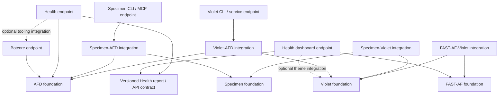

# AFD platform monorepo: foundations and endpoints

| Field | Value |
| --- | --- |
| Status | Proposed; documentation only. Migration has not started. |
| Date | 2026-10-28 |
| Decision owner | Jason |
| Scope | AFD, Specimen, Violet, FAST-AF, Botcore, reusable Health tooling, and selected developer applications |
| Excluded product | Lushly remains in its own repository. |
| Decision record | [Foundations and endpoints](./decision.md) |
| Review history | [Initial review](./review.md); [focused rereview](./rereview.md) of the revisions addressing B1–B2 and I1–I7 |

## Summary

Make AFD the shared development and publishing home for independently adoptable **foundations** and the **endpoints** that compose them. Consolidate dependency coordination, agent tooling, quality infrastructure, and release automation while preserving each foundation's installation and API boundaries.

**Foundations** are libraries someone uses to build or inspect an application: AFD, Specimen, Violet, and FAST-AF. Each family MUST be usable without adopting the other families. Packages within one family MAY depend on each other. Third-party dependencies remain permitted.

**Endpoints** are applications people run: Botcore, Health, dashboards, CLIs, MCP servers, hosted services, and authoring tools. They MAY depend on multiple foundations and reusable endpoint tooling. Here, “endpoint” means a runnable composition of capabilities, not only an HTTP route. An AFD-powered Health service with a FAST-AF dashboard is an intended example; the application it audits needs neither dependency.

The proposal MUST remain in the proposed lifecycle until separately approved for implementation. Writing this document authorizes no imports, package splits, publishing changes, deployments, or repository archival.

## Why consolidate

Cross-repository changes currently require coordinating library releases, consumer upgrades, duplicated agent configuration, and multiple validation environments. A common source tree lets one change update a foundation and its integrations together, with explicit checks for affected consumers.

AFD already has package publishing, Changesets, quality gates, and release workflows. Reusing that infrastructure is a primary benefit: new package families SHOULD join a shared release service instead of each rebuilding the machinery. That service MUST preserve family-specific versions, registry requirements, and deployment boundaries.

The recommendation rests on related development work and shared maintenance costs. It does not require a claim that larger model contexts eliminate the need for boundaries. Repository size, agent task scope, runtime dependency size, and validation scope remain separate concerns.

## Adoption contract

| Consumer choice | Required capability | Dependencies that MUST remain optional |
| --- | --- | --- |
| Build an AFD application | Commands, clients, server libraries, testing, and chosen language implementation | FAST-AF, Violet, Specimen, Botcore, and Health |
| Use Specimen as a library | Describe, observe, and compare components through its native API and data contracts | AFD, FAST-AF, and Violet |
| Use Violet | Resolve/export tokens and consume themes in another component system | AFD, FAST-AF, and Specimen |
| Use FAST-AF | Render components and use their native component APIs | AFD, Violet, and Specimen |
| Run a Specimen CLI or MCP endpoint | Operate the Specimen library through a packaged tool | The user's application adopting any foundation used internally by the tool |
| Run Botcore | Install repository/server development tooling built on AFD | The supported application's runtime depending on AFD or Botcore |
| Run Health | Audit arbitrary repositories/servers using configurable policies; optionally open its dashboard | The audited application's runtime adopting AFD, FAST-AF, Violet, or Botcore |

Independence MUST cover direct and transitive runtime dependencies, required peers, exported type references, installation hooks, and configuration requirements. A foundation's default installation MUST NOT obtain another foundation through an optional integration or endpoint bundled into its package. Tree shaking and separate source folders do not satisfy this contract by themselves.

An optional integration MAY depend on both families it connects. Installing an endpoint MAY install the foundations it uses. Neither operation requires adding those dependencies to the application being built, inspected, or audited.

## Target repository structure

The following is the proposed destination, not a request to move existing directories now. Names describe ownership and capability; existing registry package names SHOULD be preserved unless a separately reviewed compatibility change requires a new name.

```text
afd/
  foundations/
    afd/
      typescript/       # Existing core, server, client, auth, testing, etc.
      python/
      rust/
      cpp/
    specimen/           # Native observation API, schemas, browser execution
    violet/             # Token engine, export, runtime, storage adapters
    fast-af/            # Component runtime and maintained component packages
  integrations/
    specimen-afd/       # AFD command bindings for Specimen
    specimen-violet/    # Optional token evidence integration
    specimen-fast-af/   # Optional component metadata integration
    violet-afd/         # AFD command bindings for Violet
    fast-af-afd/        # Optional AFD component command bridge
    fast-af-violet/     # Optional token/component binding
  endpoints/
    afd-cli/
    specimen-cli/
    specimen-mcp/
    violet-cli/
    violet-service/     # API, web surface, deployable adapters
    violet-figma/
    botcore/            # Python tooling runtime and supported plugins
    alfred/             # Main monorepo bot; shared and area-specific commands
    health/             # Audit application, policies, CLI/API surfaces
    health-dashboard/   # FAST-AF application; optional Violet composition
    creator/            # Developer authoring application, later phase
  examples/
    standalone/         # One-foundation consumer examples
    composed/           # Explicit integration examples
  tests/consumers/      # Isolated package/wheel installation fixtures
  spec/                 # AFD wire contracts and vectors, still AFD-owned
  .claude/skills/        # Canonical shared and family skill sources
  .codex/skills         # Mirror of the shared skill installation
  scripts/              # Shared repository and release orchestration
  docs/                 # Proposal lifecycle, package map, decisions
```

Each family MAY contain several independently packaged units. Each endpoint MAY contain library code shared with other endpoints, provided foundations never depend on it. These directories do not automatically create new public packages or deployments. CLI and MCP surfaces MAY share one distribution when their installation contract is the same.

Existing AFD paths SHOULD remain stable during early phases. The directory transition MUST be a separate, reviewable mechanical step after tooling accepts the new roots. Package discovery, manifests, build paths, fixtures, repository metadata, documentation links, and CI filters MUST be updated together for each moved unit.

Lushly MUST remain outside this tree and consume versioned releases. Its app code, operational configuration, data, and production workflows MUST NOT be imported as part of this migration.

## Dependency boundaries

### Allowed direction

Arrows mean “depends on.” This diagram shows proposed relationships, not current implementation status.



1. A foundation MUST NOT require another foundation family or an endpoint. AFD core MUST NOT acquire browser tooling, component frameworks, token engines, or repository automation through consolidation.
2. Internal packages of a family MAY depend on one another through declared public exports. The AFD server library remains a foundation package; a configured, runnable server is an endpoint.
3. Cross-family integrations MUST live in separately installable packages. Native APIs and types MUST remain usable without those integrations.
4. Endpoints MAY compose multiple foundations, integrations, and reusable tooling. Endpoint dependencies MUST be explicit, acyclic, and accessed through public contracts.
5. Foundation operations MUST remain callable and testable before a UI is added. AFD adapters MUST preserve AFD command naming, validation, and `CommandResult` conventions. Native non-AFD APIs MUST own their data/error contracts rather than requiring AFD envelopes or duplicating AFD under a new name.
6. Cross-package source imports and undeclared dependencies MUST fail boundary checks. TypeScript path aliases or Python editable installs MUST NOT bypass the published interface.
7. Integrations MUST declare supported version ranges for both sides. Missing optional integrations MUST NOT prevent a foundation's native operation; requesting an unavailable integration MUST produce an actionable error.
8. Endpoint services MUST own their credentials, persistence configuration, and deployment lifecycle. Installing a foundation MUST NOT require a hosted account, database, running endpoint, or the monorepo checkout.

### Existing coupling to address

These are migration work items, not changes made by this proposal:

| Observation | Proposed treatment |
| --- | --- |
| The inspected Specimen feasibility package combines its native API, CLI, and AFD command bindings and declares AFD core/server dependencies. | Separate the native library from AFD bindings and tool distributions. Preserve or explicitly migrate existing imports, CLI entry points, and serialized output formats. |
| Violet core declares AFD and re-exports AFD command result types. | Give its token engine/export/runtime native contracts; move AFD command adaptation to an integration used by endpoints. |
| Botcore depends on Python AFD; Alfred depends on Botcore and AFD. | Preserve these allowed tooling relationships. Validate both local-source operation and built distributions to avoid bootstrap/release cycles. |
| FAST-AF contains runtime forks, reusable components, Creator tooling, and legacy/reference components. | Classify and import maintained units separately. Retain upstream provenance and exclude unrelated legacy material from default build/install paths. |
| Health currently combines reusable checks, Botcore integration, and repository-specific inventory/baselines. | Preserve its ability to use AFD/Botcore; separate reusable behavior and configuration from private operational records. |

Moving a package into the workspace MUST NOT silently replace its old AFD requirement with the newest AFD API. Compatibility work and any public API changes MUST be identified and tested separately from source relocation.

## Health as a reusable endpoint

Health SHOULD become an AFD-powered audit application usable against repositories that do not use AFD. It MAY reuse Botcore capabilities or run through a Botcore plugin. Removing those tooling dependencies is not a goal.

Reusability instead requires the following contracts:

- **Targets:** Health MUST accept explicit repository/server targets and configurable discovery. A user's inventory MUST live outside the distributed implementation. The initial target type SHOULD remain the repository checks already implemented; server adapters MAY follow under their own scope.
- **Policies:** Checks, severity, thresholds, tool expectations, exclusions, and remediation policy MUST be configuration-driven. A generic baseline MUST NOT require Lushly naming, a particular GitHub organization, or the author's filesystem layout. Organization-specific profiles MAY extend it explicitly.
- **Results:** Findings MUST include a stable check identifier, target, outcome, evidence, and remediation guidance. Unsupported checks, unavailable tools, skipped checks, errors, and passes MUST remain distinguishable. Reports and API schemas MUST be versioned.
- **Actions:** Audit/report execution MUST be usable without remediation. Remediation MUST be explicitly selected and expose its proposed scope; audit execution MUST NOT silently modify an audited project.
- **Dashboard:** The proposed Health dashboard SHOULD use FAST-AF and MAY use Violet. It MUST consume a versioned Health report/API contract and remain optional for CLI audits and CI. Its frontend dependencies MUST stay out of the audited application's runtime and the headless audit installation.
- **Privacy:** Private inventories, paths, access configuration, reports, and history MUST remain outside the public monorepo and package artifacts. Generic code extraction MUST be reviewed before any private Health source or history is imported.

A logical separation between checks, policies, reporting, and surfaces SHOULD exist inside Health. Separate distributions SHOULD be introduced only for an actual installation or reuse boundary; this proposal does not require turning every check into a package.

## Alfred as the monorepo bot

Alfred SHOULD become the main repository bot for the whole monorepo, built on Botcore. Its unified command catalog MAY contain commands that apply only to AFD, FAST-AF, Violet, Specimen, Health, documentation, or another specific area. Applicability to one area is not a reason to create a separate bot, just as a documentation command need not apply to every source package.

Botcore owns the reusable execution, configuration, skill, CLI, and MCP infrastructure. Alfred owns this repository's command composition and default identity. Specialist command implementations SHOULD remain organized in modules or Botcore plugins according to their maintenance/reuse needs. A plugin package does not imply a separate running bot, MCP connection, persona, or release pipeline.

### What is shared and what is specialized today

The inspected source shows common infrastructure plus meaningful domain-specific commands; it does not support treating every repo bot as an interchangeable configuration copy.

| Existing surface | Observed responsibility | Proposed place |
| --- | --- | --- |
| Botcore common commands | Build/test/lint wrappers, dependency/path/coverage checks, skills, docs, changesets, specifications, workspace information | Shared mechanics through Alfred where applicable; release commands require the protocol routing below before exposure |
| Alfred | AFD architecture lint, cross-language API parity, semantic quality of command descriptions | AFD-specific commands in the main Alfred catalog |
| FAST-AF Fastbot plugin | Ten registered commands covering token/component rules, form parity, story contracts, profiling, and performance baselines; optional shared CDP commands | FAST-AF commands in Alfred; retain reusable plugin code |
| Violet and Creator repository configuration | Tool choices, thresholds, and skill selection; no dedicated Botcore plugin was located in the inspected tracked source | Target configuration initially; add specialized commands only for an actual capability |
| Health plugin | Repository audit, onboarding, and report commands | Health commands exposed through Alfred when configured; Health remains usable as a standalone endpoint |
| Lushly tooling | Product-specific workflows, including an image-tool plugin | Remains with Lushly; shares Botcore improvements through released packages |

The Alfred/Fastbot registrations and Botcore namespace/configuration behavior were also checked on GitHub. Violet, Creator, Health, and Lushly observations are checkout snapshots and MUST be refreshed during Phase 0. This is a capability inventory, not a runtime test of every command.

### Command composition and targeting

- Alfred MUST offer one default repository entry point with a discoverable command catalog and topic documentation. Domain commands MAY remain visible at the root even when they apply to only one area. New AFD-exposed commands MUST follow the repository's command naming conventions; existing public aliases MUST have a compatibility plan.
- Each invocation MUST resolve a workspace/worktree and target scope. An area-specific command MAY default to its documented area; generic commands MUST define whether they operate on a selected package or the whole repository. An unsupported or ambiguous target MUST produce an actionable error instead of silently running against the root or reporting a pass.
- Shared commands SHOULD invoke the package's declared build/test/quality commands and apply its configured toolchain and thresholds. AFD architectural rules MUST NOT automatically be imposed on native non-AFD foundation APIs; they apply to AFD code and AFD integration surfaces.
- The repository host MUST own Alfred's CLI/MCP identity. Command and documentation collisions MUST be detected; plugin load order MUST NOT silently replace behavior or change the host's identity.
- The command catalog MUST describe required dependencies and target applicability. Browser-heavy or service-specific commands MAY require an optional environment or worker process. Their absence MUST NOT prevent unrelated commands from operating. Separate processes MAY provide resource isolation without creating a separate subproject bot.
- Each active worktree MAY run its own Alfred instance using the same shared configuration model. Target paths, configuration, command state, and outputs MUST NOT leak between worktrees through an implicit global current directory or shared mutable singleton.
- Existing Fastbot/Alfred entry points MAY remain as compatibility aliases or scoped launchers for the same implementations. They MUST NOT acquire separately maintained copies of generic commands. Independent external consumers MAY still install a specialist plugin without adopting this monorepo's Alfred composition.

Current Botcore already supplies plugin discovery, language configuration, package-level overrides, and a shared command namespace. It is not sufficient to install every plugin unchanged: `build_namespace()` registers all discovered plugins and assigns commands by name without a collision check; the registry also stores a single mutable CLI/MCP identity. Some specialized checks encode the old repository paths. Phase 2 MUST address these composition and targeting details before treating the unified bot as working. [Namespace construction](https://github.com/lushly-dev/botcore/blob/main/src/botcore/server.py), [plugin registry](https://github.com/lushly-dev/botcore/blob/main/src/botcore/plugin.py), [configuration](https://github.com/lushly-dev/botcore/blob/main/src/botcore/config.py).

Shared mechanics SHOULD be extracted when behavior and tests demonstrate duplication. Specialist policy SHOULD remain owned by its area: for example, browser-capture mechanics can be shared while FAST-AF form rules and AFD cross-language parity remain distinct commands. The proposal does not require building a new bot for each foundation or replacing working specialist commands merely to make their names uniform.

### Quality verdicts and command effects

Successful command execution MUST remain distinct from a passing quality check. Every admitted quality command MUST expose a machine-readable verdict or have a registered interpretation of its existing result: `passed`, `failed`, `skipped`, `unavailable`, or `error`, with target and evidence. Existing Alfred lint's `data.passed`, parity gaps, and quality issue counts MUST retain their meaning across CLI, MCP, worker, and aggregate surfaces; `CommandResult.success` alone MUST NOT count as a quality pass. See the current [lint result](../../../../alfred/src/alfred/commands/lint.py) and [CLI interpretations](../../../../alfred/src/alfred/cli.py).

Each check plan MUST declare required and optional checks before execution. An aggregate MAY report `passed` only when it has at least one required check and every required check passed. A required failure, skip, unavailable tool, or execution error MUST prevent a pass and produce a nonzero CLI result; structured surfaces MUST preserve the specific outcomes. Optional results MUST remain visible with their exclusion reason and MUST NOT silently change requiredness. An empty or wholly inapplicable plan MUST report that condition, not a pass.

Catalog entries MUST declare meaningful effects and capabilities: inspection, source/configuration changes, baseline updates, report/artifact writes with output scope, subprocess/browser launch, and service access where applicable. Mutating operations MUST be explicitly selected within the caller's authorized scope; an inspection command MUST NOT silently become remediation. This is an execution contract, not a requirement for a new confirmation prompt on every invocation.

CLI, MCP, and worker dispatch MUST apply the same relevant target, worktree, effects, and capability policy. Rejected invocations MUST have no command effects. If an inspection-only profile is offered, supported routes MUST reject writers, including baseline/release-fragment writers; a profile allowing report artifacts MUST declare that exception and its output scope. Botcore's existing raw Python MCP execution does not automatically inherit registry middleware. If retained, it MUST be an explicitly selected trusted-local execution mode, unavailable under inspection-only or other restricted profiles. Registered commands called from that mode MUST still use the shared dispatch policy; arbitrary Python itself MUST NOT be described as confined by command metadata. This proposal does not promise an adversarial sandbox. [Current MCP execution](https://github.com/lushly-dev/botcore/blob/40f829cc254ae243fde6cb3852afec1b84b74647/src/botcore/server.py#L158-L184), [registry dispatch](https://github.com/lushly-dev/botcore/blob/40f829cc254ae243fde6cb3852afec1b84b74647/src/botcore/registry.py#L89-L109).

### Release-command ownership

Every Alfred release operation MUST resolve a declared release protocol and release unit before reading or modifying release intent. npm Changesets owns its package-to-semver fragments. Botcore's category-based changelog fragments MUST use separate storage or an explicitly validated adapter; its existing generic changeset commands MUST NOT be exposed unchanged against AFD's `.changeset` directory. Their formats and consumption semantics differ. [Botcore changeset implementation](https://github.com/lushly-dev/botcore/blob/40f829cc254ae243fde6cb3852afec1b84b74647/src/botcore/commands/changeset.py), [configured npm format](https://github.com/changesets/changesets/blob/%40changesets/cli%402.31.1/docs/command-line-options.md#add).

Create, status, consume, and delete operations MUST be scoped to the declared protocol and unit. npm operations MUST use the approved npm Changesets workflow or a compatibility-tested adapter. Unknown or incompatible formats in the selected storage, ambiguous unit ownership, or an incomplete cross-unit selection MUST fail before writes. A fragment intentionally spanning units is coordinated release intent: it MUST be handled as a whole approved batch or explicitly revised through review before selecting a subset. No operation may discard another unit's fragments or advance its changelog accidentally. These routing rules MUST be established before release commands enter Alfred's unified catalog.

## Shared agent and development environment

The platform MUST have one canonical source for each shared skill and workflow. A short root `AGENTS.md` SHOULD route to focused family/endpoint instructions; an agent working on Violet SHOULD NOT need the entire Botcore or native SDK instruction set in context.

Botcore SHOULD continue distributing reusable skills to external repositories, including Lushly. Export manifests and generated package assets MUST identify canonical sources and preserve family/local overrides. Copies installed into consumer repositories MUST NOT become competing authoring sources. Built wheels and source distributions MUST contain their required skill assets without relying on a checkout outside the artifact.

The shared development entry point MUST offer scoped setup/check commands. Working on a TypeScript token export MUST NOT require installing every browser, native compiler, Python plugin, or deployed service. Endpoints MAY define broader development profiles explicitly.

Botcore/Alfred quality tooling MUST have a documented bootstrap path. Building or installing a foundation MUST NOT require first publishing a new tooling endpoint that itself needs that unreleased foundation. Direct language-native commands and tested tool versions MUST remain available for bootstrap and diagnosis.

## Release and publishing strategy

### Reuse AFD's publishing infrastructure

AFD's configured publishing workflow SHOULD be the starting point and shared control point for package releases. Keep its existing review/Changesets/release-PR approach for npm and extend package discovery and release metadata to the admitted families. Each package family SHOULD supply declarative release metadata rather than a copy of the entire pipeline.

The inspected AFD checkout already contains the following starting points. These describe workflow configuration; they do not verify current registry permissions or a new package's publishing readiness.

| Existing workflow | Reusable machinery | Adaptation for the monorepo |
| --- | --- | --- |
| [npm release](../../../../.github/workflows/release.yml) | Main-branch quality gate, Changesets release PR/publish, provenance configuration | Explicit family membership, expanded package discovery, and independent release plans |
| [Python publishing](../../../../.github/workflows/publish-python.yml) | Version/tag validation, Python checks, wheel/sdist build, PyPI trusted publishing | Package-specific paths, artifact names, tag routing, and trusted publishers for Botcore/Health |
| [Rust publishing](../../../../.github/workflows/publish-rust.yml) | Version/tag validation, Rust checks, crates.io trusted publishing | Preserve the existing crate route; update paths during relocation |

Before importing packages, the release inventory MUST confirm package ownership, registry permissions/trusted publishing, tags, and artifact verification for every admitted distribution. Reusing these workflows does not automatically grant publishing rights to a new package. Existing language-specific tag routes MUST remain valid while any new family-specific routes are added.

### Publication admission before source imports

Admission of source into the workspace and admission to publishing MUST be separate decisions. Before the first import or split, Phase 1 MUST establish an explicit release inventory and enforce selection for every distribution and route, including main-branch npm publication, language tags, prereleases, and manual workflows. Existing approved AFD distributions remain eligible under their current gates. Imported or newly split distributions start **quarantined**: they MAY build, pack, and participate in isolated tests but MUST NOT publish from this repository. Absence of a changeset, a registry permission, or a version bump is not an exclusion mechanism.

| Publication state | Meaning |
| --- | --- |
| Quarantined | Source/artifacts may be tested; the AFD repository has no publication authority for this distribution. Any existing publisher retains authority until cutover. |
| Admitted | The distribution has a recorded authoritative publisher and may enter a release plan after its gates and release approval pass. Admission alone never authorizes a version to publish. |
| Held | Publication is suspended for this distribution or specified release candidate; the record names scope, reason, and restoration criteria. Existing immutable versions remain consumable. |

The inventory MUST identify distribution identity, release family/unit, protocol, source revision, publisher authority, routes, state, and applicable gates. Unknown distributions default to quarantine. A source import MUST NOT activate a new route. Selection MUST be checked against the actual candidate manifests and built artifacts before any publish operation; it MUST exclude quarantined/held candidates even when their manifest version is missing from the registry. The currently configured Changesets 2.31.1 `publish` considers versions absent from npm, so adding family-aware versioning alone is insufficient. This proposal requires a verified exclusion mechanism without assuming a newer CLI option exists. [Configured publisher](../../../../package.json), [Changesets 2.31.1 publication behavior](https://github.com/changesets/changesets/blob/%40changesets/cli%402.31.1/docs/command-line-options.md#publish).

Publications MUST select only approved admitted units and their approved prerequisite releases. A dependency on an unreleased quarantined/held artifact holds the dependent too; an already published compatible dependency may satisfy the requirement. Local workspace artifacts MAY support testing but MUST NOT be mistaken for publicly available prerequisites. Admission changes MUST follow the authority-transfer procedure below.

### Version families and independently releasable batches

The existing Changesets configuration fixes all `@lushly-dev/*` packages to one version, and `scripts/check-versions.mjs` assumes a common version among the public packages it discovers. Both MUST become family-aware before new independently versioned packages enter those checks. [Current configuration](../../../../.changeset/config.json), [version checker](../../../../scripts/check-versions.mjs).

| Release unit | Proposed policy |
| --- | --- |
| Existing AFD TypeScript SDK packages | Preserve their current coordinated release group initially, replacing the namespace wildcard with explicit membership. Review extracted CLI membership for compatibility. |
| AFD Python, Rust, and C++ | Preserve their existing language-specific versions and distribution processes; verify shared wire compatibility independently of version-number equality. |
| Specimen, Violet, FAST-AF | Independent semver families by default. Fixed groups within a family require an explicit compatibility reason. |
| Cross-family integrations | Independent versions with tested compatibility ranges for each foundation they use. |
| Botcore, Health, and distributed CLI endpoints | Independent installable-tool releases through the applicable registry workflow. Shared automation, separate package identities. |
| Dashboards and hosted endpoints | Independent build/deployment units. A library release MUST NOT imply deployment or production migration. |
| Lushly | Explicit consumer upgrades in its own repository and release process. |

Independent families MUST also be independently releasable when their dependency and release-intent graphs permit it. A publication hold on one family MUST NOT by itself prevent an unrelated approved family from releasing; this does not waive required shared quality gates or ignore a failure affecting the selected release. Shared workflow code and aggregate release PRs MAY remain, but the release plan MUST support selecting an approved subset without consuming held units' fragments, bumping their versions, changing their changelogs, or publishing their artifacts. An aggregate PR is a convenience, not an indivisible approval boundary. The implementation specification MUST establish how version planning and publication enforce this rule before imports; the current single Changesets action does not prove it. [Existing release workflow](../../../../.github/workflows/release.yml), [Changesets action v1](https://github.com/changesets/action/blob/maintenance/v1/README.md).

The existing AFD fixed group remains one coordinated release unit; this rule does not split its internal versioning. Explicit multi-unit release intent and new prerequisite releases form a coordinated batch until reviewed intent is separated legitimately. Approval MUST bind the selected units, candidate source/manifests, versions, and prerequisite closure; changed inputs require a refreshed plan and approval under the authorized release process.

| Non-publishing plan example | Required selection |
| --- | --- |
| A approved; unrelated B held; separate release fragments | Select A only; retain B's versions, changelogs, and fragments unchanged. |
| A needs a new release of held B | Hold A and B; do not publish an unsatisfied dependency. |
| A works with B's already published compatible version | A may proceed using that version if otherwise approved. |
| One release fragment deliberately spans A and held B | Hold the coordinated batch until B is eligible or reviewed release intent is explicitly separated. |

### Publisher handoff and recovery

Each distribution MUST have one authoritative release source and at most one enabled publication route during cutover. A handoff record MUST name the old/new authority, routes and registry identity, frozen candidate revision/artifact hashes, queued and in-flight releases, verification evidence, and restoration steps. Those steps MUST be written before disabling the old publisher. Source ownership and release authority MUST be explicit during the transition; imported copies remain candidates until ownership changes, and work MUST be reconciled against the authoritative source before cutover.

Cutover MUST freeze new submissions, drain or cancel queued/in-flight releases and reconcile their registry outcomes, disable the old route, then admit/enable the new route for the selected approved release. Publisher settings and repository/package metadata MUST be checked, but saved configuration is not proof that authentication works. Initial authorized publication and registry readback establish the new route's observed operation. [npm trusted publishing](https://docs.npmjs.com/trusted-publishers/), [PyPI publisher identity](https://docs.pypi.org/trusted-publishers/adding-a-publisher/).

If authentication or another handoff step fails, the unit MUST enter `held`. Stop new submissions, disable the candidate route, drain/cancel its work, and reconcile whether any artifact was published before restoration. If none was published and the old source/route still satisfies the selected release contract, its sole authority MAY be restored using the recorded procedure; the imported candidate returns to quarantine. If a publication occurred or outcomes are uncertain, remain held until immutable versions and source ownership are reconciled. Recovery MAY resume verified missing releases or restore an old route only after proving it cannot duplicate or contradict published history. No automatic dual-publisher fallback is allowed.

Phase 1 MUST exercise this state transition with a non-publishing simulated authentication failure. That rehearsal proves a defined recovery decision, not live registry credentials. Each Phase 5 handoff MUST retain its own evidence and recovery record.

### Artifact and compatibility rules

- Existing package names, binaries, import paths, and version progression SHOULD be preserved. A repository move MUST NOT reset versions. Splitting a combined library/endpoint MUST have an explicit compatibility facade, new-package transition, or semver-appropriate breaking release.
- C++ source tags, supported source-subdirectory paths, installed CMake package identity, `afd::afd`, and supported vendoring paths MUST be treated as public distribution contracts. Before relocating `packages/cpp`, choose and document a compatibility path/shim or an explicit breaking transition with upgrade instructions. Existing immutable tags MUST remain unchanged and usable. External `FetchContent` and installed `find_package(afd ...)` consumers MUST both exercise the intended release; registry smoke tests do not cover these contracts. See [current C++ consumption](../../../../packages/cpp/README.md#using-the-package).
- A backwards-compatible umbrella package MAY remain temporarily, but it MUST NOT be presented as the independent foundation installation if it still pulls in other families. The independently installable path MUST be documented and tested.
- TypeScript internal dependencies SHOULD use the workspace protocol during development; packed packages MUST contain registry-resolvable requirements. Python local sources MUST likewise produce portable wheel/sdist metadata. See [pnpm workspace publishing](https://pnpm.io/workspaces) and [uv workspaces](https://docs.astral.sh/uv/concepts/projects/workspaces/).
- Every release unit MUST have a changelog, compatibility range policy, artifact contents check, and isolated installation smoke test. [Changesets fixed groups](https://github.com/changesets/changesets/blob/main/docs/fixed-packages.md) MUST be used only where synchronized versions are intended.
- Publication MUST follow dependency order and record immutable source revision, artifact identity, version, registry outcome, and installation verification. A source commit shared by several packages does not make multi-registry publication atomic.
- If publication partially fails, unreleased dependents MUST remain held. Recovery MUST resume only missing publications after verifying existing artifacts; it MUST NOT overwrite a published version or claim the family is fully released.
- A foundation-only change MUST NOT trigger unrelated family version bumps. Compatible integrations SHOULD remain usable without simultaneous upgrades; incompatible changes MUST identify the affected consumers and transition path.

## Build and validation strategy

The task graph MUST describe package dependencies, integration consumers, generated artifacts, native/wire-contract relationships, and shared configuration inputs. Directory-only filtering is insufficient for changes consumed outside the changed directory.

| Change | Required validation scope |
| --- | --- |
| One foundation | Its own checks, independence fixture, and affected declared integrations/endpoints |
| Optional integration | The integration and compatibility fixtures for both foundations |
| Endpoint UI | Endpoint build/tests and browser behavior; no automatic unrelated native-language matrix |
| AFD wire contracts/vectors | Relevant language implementations and conformance consumers |
| Shared build/release/agent tooling | Affected scopes plus repository contract and distribution checks |
| Root lockfile, toolchain, package graph, or uncertain impact | Conservative broader checks; no silent exclusion when impact cannot be established |

The existing mandatory `pnpm check` and language-specific gates MUST remain in force until an explicitly reviewed replacement has demonstrated equivalent coverage. Focused checks MUST be reported separately from a full gate. Full integration/release checks MUST remain available after affected-task execution is introduced.

The first migration preparation MUST record cold/warm setup time, focused-check time, full-check time, and CI duration for representative changes. Numeric budgets MUST be agreed from those baselines before changing required gates. This proposal makes no measured build-speed claim. Caching SHOULD be added only with declared inputs, tool/runtime versions, environment dependencies, and verified output restoration; live hosted checks MUST NOT be treated as cacheable deterministic tests.

The existing pnpm and language-native tools SHOULD be retained first. A task scheduler MAY be added when the baseline identifies a concrete need. A JavaScript scheduler MUST NOT be assumed to infer Python, Rust, C++, or contract-generation edges automatically. [pnpm filtering](https://pnpm.io/filtering) supports dependency/dependent selection; [Turborepo caching](https://turborepo.dev/docs/crafting-your-repository/caching) is one candidate for reusable deterministic results.

### Required consumer evidence

Consumer fixtures MUST run from built distributions, or the intended source distribution for C++, in a clean project outside the workspace's dependency resolution. Phase 0's inventory MUST map every admitted public distribution and supported export/subpath/condition, including root barrels and declarations, to installation, dependency/peer, type, and import checks in its supported environment. Native/source distributions MUST have equivalent applicable checks. Representative behavior fixtures MAY remain small; a passing example does not establish coverage of untested public exports. Unsupported environments or evidence limits MUST be explicit and MUST NOT be reported as verified; an intended supported entry point without coverage holds that unit's independence acceptance. Development-only tooling does not violate independence if it is absent from the consumer's required installation, types, and runtime closure.

The following matrix is a future acceptance contract, not evidence that these cases have run. Alfred/release-control cases use isolated worktrees and disposable fixture metadata; release-plan and failure rehearsals MUST remain non-publishing. Actual publication readback is separately authorized Phase 5 work.

| Fixture | Acceptance evidence |
| --- | --- |
| AFD only | An application executes an AFD command with no other foundation family installed. |
| Specimen only | A plain web-component fixture is observed/compared without AFD, FAST-AF, or Violet installed. Unsupported evidence channels remain explicit. |
| Violet only | Tokens are exported and applied to ordinary HTML/CSS or another component system with no other foundation family installed. |
| FAST-AF only | A maintained component renders and responds through native APIs without the other foundation families. |
| Distribution/export coverage | Every admitted distribution and supported entry point maps to applicable clean-install, import/type, peer, hook/configuration, and transitive-dependency checks. Foundation distributions have no required cross-family or endpoint dependencies; integrations/endpoints retain their explicitly allowed dependencies. |
| Optional integrations present | Installing an integration enables the composed behavior without changing native APIs; supported version ranges are exercised. |
| Integrations absent | Native imports and representative operations work with integrations and other foundation families absent; generated declarations and root exports introduce no eager dependency. |
| Incompatible or unavailable integration | Unsupported version combinations and explicitly requested missing integrations fail at the documented installation, type, or runtime boundary with useful recovery guidance. A package-manager rejection need not become an application exception. |
| Tooling for a non-AFD app | Botcore and Health operate on a fixture whose application manifest has no platform dependencies; tool installation remains isolated. |
| Unified Alfred | Root discovery includes common and area-specific commands; AFD, component, and docs checks use their declared targets; invalid targets and duplicate registrations fail clearly; two worktrees retain separate context. |
| Alfred verdict parity | The same failing lint/parity/quality fixtures yield equivalent verdicts through every supported surface and aggregates. Required skipped/unavailable/error cases and an empty plan never pass. |
| Alfred effects and dispatch | Discovery identifies writers and browser/service needs. All supported dispatch routes preserve target/worktree policy; rejected calls have no effects. Restricted profiles cannot use raw Python or reach disallowed writers. Any allowed artifact-output exception is scoped and tested. |
| Release-protocol ownership | Mixed npm/category fragments exercise create/status/consume/delete through their declared protocols/units. Incompatible or partial coordinated selections leave all fragments and changelogs unchanged. |
| Health dashboard | A FAST-AF dashboard displays a versioned report; headless audit execution succeeds without the dashboard installed. |
| Private Health configuration | A generic fixture works without the author's inventory; package contents contain no private records or machine-specific paths. |
| Registry installation | Built/published packages resolve declared dependencies without workspace symlinks, editable source leakage, or undeclared checkout files. |
| C++ consumption | External `FetchContent` at the intended source tag/path and installed `find_package` both work; old immutable tags and the documented vendoring transition remain usable. |
| Publication selection and batches | Existing approved AFD releases remain selectable; an imported version absent from the registry stays excluded; cutting over one unit admits only it and approved prerequisites. All four batch examples above pass without publication, including equivalent new language routes. |
| Publisher recovery | Simulated authentication failure follows the recorded hold/reconcile/restore decision; at most one route is enabled and published or uncertain artifacts cannot be overwritten. |

## Phased migration plan

Every phase below is proposed future work. Only this documentation is being produced now. Implementation MUST wait for separate authorization; once authorized, work MUST stay within that scope and satisfy the applicable phase exit criteria before advancing.

### Phase 0 — Review and inventory

**Deliverable:** an accepted boundary/release decision and a source-to-destination inventory.

- Record each source repository revision, maintained package, public API/export/condition, binary, license/upstream lineage, visibility, owner, release channel, deployment, and in-flight change. Map public distributions and supported entry points to the consumer evidence matrix, including C++ source/CMake/vendoring contracts.
- Identify all required cross-family dependencies, including exported types and CLI envelopes; classify foundations, integrations, and endpoints.
- Inventory existing bot commands, aliases, plugins, configuration differences, and hardcoded roots. Record verdict interpretations, required/optional checks, effects, invocation routes, and release-fragment protocols/storage. Classify shared mechanics versus specialist policy before consolidating their registration in Alfred.
- Identify reusable Health code separately from private configuration/history. Resolve overlapping Creator implementations and FAST-AF legacy/fork ownership before selecting imports.
- Inventory the current publishing setup and capture build/check baselines. Define package identities for splits, explicit membership of release groups, current authority and admission state, shared release intent, and the proposed handoff/restoration record for each unit.

**Exit:** the owner approves scope, compatibility transitions, and measurable validation budgets. No code import or publication is needed to complete this phase.

### Phase 1 — Prepare shared infrastructure

**Deliverable:** workspace, release, and validation tooling that recognizes multiple families while preserving current behavior.

- Make package discovery, Changesets membership, version checks, artifact metadata, and workflows accept the target roots and independent release groups. Establish publication admission and independently selectable release batches before importing or splitting source; retain eligibility for existing approved AFD releases.
- Establish protocol/unit routing for release commands and owned fragment storage. Validate mixed-format create/status/consume/delete behavior before exposing those commands in Alfred.
- Establish boundary checks, isolated consumer fixtures, package ownership metadata, and scoped setup/check entry points.
- Inventory and reconcile shared skill sources and export rules. Keep language-specific environments where one shared resolution would break supported versions or extras.

**Exit:** existing packages pass their required gates; publication-selection, all release-batch examples, mixed-protocol ownership, and simulated publisher-recovery fixtures pass without publishing. Imported candidates with missing registry versions remain excluded and existing approved AFD releases remain selectable. Tooling/distribution assets work without external checkout paths. These controls MUST be in force before Phase 2 imports; no migration release is published merely to validate the plan.

### Phase 2 — Consolidate Botcore and endpoint tooling

**Deliverable:** Botcore and its selected reusable plugins developed alongside AFD, with Alfred as the main repository bot using declared workspace sources during development.

- Import approved public source with provenance and preserve distribution identities. Preserve Botcore's dependency on Python AFD. Keep imported/split distributions quarantined through Phases 2–4; source admission does not transfer publication authority.
- Compose existing Alfred and admitted specialist commands into one catalog. Establish host identity, duplicate-command detection, target applicability, root/path configuration, and worktree isolation. Add family commands as their owning code is admitted in later phases.
- Apply the quality-verdict, effects/capability, and shared dispatch contracts across every supported invocation route. Establish the trusted-local raw-execution boundary before offering restricted profiles. Release operations use Phase 1's protocol routing.
- Establish a bootstrap path and test built wheels/sdists with normal registry metadata.
- Consolidate shared skills while retaining export/install support for Lushly and unrelated repositories.

**Exit:** Botcore/Alfred operate against the candidate AFD source and from isolated artifacts; unified-Alfred, verdict-parity, effects/dispatch, and release-protocol fixtures pass for admitted command areas. An external non-AFD fixture can use the tooling without adding application runtime dependencies.

### Phase 3 — Establish independent foundation APIs

**Deliverable:** individually adoptable Specimen, Violet, and maintained FAST-AF libraries, plus explicit integrations/endpoints.

- Separate Specimen's native observation API from its AFD command bindings and packaged CLI/MCP composition. Coordinate with its active implementation rather than copying an obsolete branch snapshot.
- Separate Violet's token contracts from its AFD command surface. Preserve native token exports and storage options without requiring a hosted service.
- Import selected FAST-AF runtime/components with upstream provenance. Make AFD bridges and Violet bindings optional; review every default component's transitive dependencies.
- Stage each family independently and test its compatibility transition before the next import. Keep behavior changes separate from mechanical directory moves.

**Exit:** the distribution/export coverage map and all four foundation-only fixtures pass; integration cases pass when present, absent, incompatible, and explicitly requested but unavailable. Every changed public API/binary/output format has a documented upgrade path. Existing Specimen evidence limitations remain explicit; this phase does not authorize Storybook removal.

### Phase 4 — Generalize Health and compose endpoints

**Deliverable:** reusable Health tooling and an optional FAST-AF dashboard; selected Violet/Creator applications admitted according to their own readiness.

- Extract only reviewed reusable Health source. Externalize inventories and profiles; keep AFD/Botcore dependencies where useful.
- Establish the report/API contract and exercise it against unrelated repository fixtures. Build the dashboard as an endpoint using FAST-AF, with Violet an optional composition choice.
- Bring in selected service, Figma, and authoring endpoints with independent deployment configuration and runtime dependency declarations. Resolve Creator overlap before importing either implementation wholesale.

**Exit:** generic Health audits and the optional dashboard pass their consumer tests. Endpoint builds require no private local configuration. Deployment remains a separate action.

### Phase 5 — Cut over publishing and retire duplicate ownership

**Deliverable:** one authoritative source/release path for each admitted package, with verified external installation.

- Complete remaining mechanical path moves with fixtures, metadata, docs, and CI filters updated together. Before any C++ relocation, approve its compatibility path or breaking transition and pass the external source/install/vendoring acceptance checks.
- Establish a short per-distribution cutover window and complete its handoff/recovery record before disabling the old publisher. Freeze submissions, reconcile queued/in-flight work, and follow the sole-authority transfer procedure; only the selected unit and approved prerequisites may become eligible.
- Run the required full gates and artifact checks, then publish only explicitly authorized releases through the shared infrastructure in dependency order.
- Verify registry readback and isolated installs. Document source redirects, provenance, support locations, and consumer upgrade instructions.
- Archive old public repositories only after their selected scope and history are accounted for and the cutover is verified. The private Health operations repository MAY remain active. Lushly upgrades remain separate work.

**Exit:** package identity/version continuity, applicable registry/source consumption, and authority-transfer evidence are verified. Old/new workflows cannot both publish the same package; held units have a recorded recovery outcome; no private or unported work is lost. This proposal itself grants no publication, deployment, or archival authorization.

## Rollback and stopping conditions

- Before publication, a failed family migration MUST be reverted or held independently; unchanged packages and original repositories MUST remain usable.
- Source ownership MUST remain with the original repository until the documented cutover for that package. Approved imports MUST track subsequent changes until cutover; indefinite dual editing is not allowed.
- Failed publisher handoffs MUST follow the hold/reconcile/restore procedure. Neither a workflow revert nor a source rollback alone transfers publication authority or proves an artifact was not published.
- After publication, recovery MUST use a documented consumer pin, distribution-tag correction where appropriate, or a new corrective version. Published versions MUST NOT be rewritten.
- If a proposed split cannot preserve compatibility within its planned release, the phase MUST stop for a revised transition plan rather than silently broadening dependencies.
- If affected-task selection misses a dependency or cache validity cannot be established, validation MUST fall back to the broader required gate.
- A failed phase MUST NOT automatically advance another family to publication or archive the original repository.

## Trade-offs and unresolved choices

Benefits are coordinated source changes, one maintained agent environment, shared publishing machinery, and integration evidence before release. Costs include shared lockfile contention, broader effects from root configuration changes, migration of historical paths, and stricter package-boundary enforcement.

The proposed principles are settled within this draft; the following choices remain for Phase 0: exact package names for compatibility splits, retained Creator scope, FAST-AF fork/reference scope, the private/public Health extraction boundary, registry permissions, numeric performance budgets, and whether existing tools suffice without an added scheduler. No further framework, registry, or repository renaming is required to accept the architecture.

Future additions SHOULD enter when they provide a reusable foundation or a maintained endpoint built on the platform and have an explicit owner, installation contract, and release scope. Unrelated product applications SHOULD remain external consumers.

## Evidence and references

This proposal was drafted against AFD checkout `bc43019a` on 2026-10-28. Source observations are bounded snapshots, not a compatibility audit or proof of publication readiness. Specimen observations came from the separate `codex/specimens-feasibility` worktree; that package is absent from this proposal's base checkout. All source revisions MUST be refreshed during Phase 0.

- [AFD release workflow](../../../../.github/workflows/release.yml), [workspace configuration](../../../../pnpm-workspace.yaml), and [quality gates](../../../../lefthook.yml): infrastructure to reuse and adapt.
- [Violet core manifest](https://github.com/lushly-dev/violet/blob/main/packages/core/package.json): existing AFD dependency and package surfaces.
- [Botcore manifest](https://github.com/lushly-dev/botcore/blob/main/pyproject.toml) and [Alfred manifest](../../../../alfred/pyproject.toml): allowed AFD/tooling dependency relationships.
- [Alfred plugin](../../../../alfred/src/alfred/plugin.py) and [FAST-AF plugin](https://github.com/lushly-dev/fast-af/blob/main/plugins/fastbot-fast-af/src/fastbot_fast_af/plugin.py): existing specialist commands to retain in the main repo bot.
- [FAST-AF workspace](https://github.com/lushly-dev/fast-af/blob/main/pnpm-workspace.yaml): runtime, component, and Creator scope requiring classification.
- [Creator manifest](https://github.com/lushly-dev/creator/blob/main/package.json): existing application-level composition.
- Health's private source was inspected for coupling and configuration responsibilities. No private inventory, report, or source content is reproduced here.
