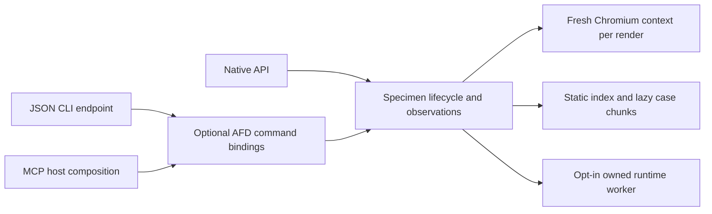

# Specimens implementation plan

| Field | Current value |
| --- | --- |
| State | Active native implementation; complete workstream 0 acceptance remains open |
| Last reconciled | 2026-11-01, main `8001fc74` including [#517](https://github.com/lushly-dev/afd/pull/517), T01 ([#521](https://github.com/lushly-dev/afd/pull/521)), T02 ([#525](https://github.com/lushly-dev/afd/pull/525)) and T03 ([#536](https://github.com/lushly-dev/afd/pull/536)) and T04 round 1 ([#558](https://github.com/lushly-dev/afd/pull/558)); T04 measurements on branch `lush/specimens-t04-pairs` |
| Read first | [STATUS.md](STATUS.md): delivery state, known gaps, evidence and unassigned follow-ups |
| Acceptance contract | [Proposal](../../proposed/specimens/specimens.proposal.md), including its original workstreams 0–6 and cutover/rollback gates |
| Historical milestone | `f1bc4488` on `codex/specimens-feasibility`, base `bc43019a`; later source imported by [#476](https://github.com/lushly-dev/afd/pull/476) as three units |

This plan describes the next implementation work. The status ledger owns current progress; the dated validation documents retain the actual observations and their limits. Native feasibility is implemented. Consumer migration, Storybook retirement and package publication remain open gates.

## Package architecture and current contract

| Unit | Responsibility | Implemented boundary |
| --- | --- | --- |
| [`@lushly-dev/specimen`](../../../../foundations/specimen/README.md), `foundations/specimen` | Native metadata/config, bench lifecycle, observations, diff/normalization, Vite/static tooling and schemas | No AFD, FAST-AF or Violet package dependency or peer; lazy in-process runtime by default, opt-in owned worker |
| [`@lushly-dev/specimen-afd`](../../../../integrations/specimen-afd/README.md), `integrations/specimen-afd` | AFD definitions and validated `CommandResult` adapters over the native operations | list/render/diff/build; composable into an MCP host; not an application-command scenario runner |
| [`@lushly-dev/specimen-cli`](../../../../endpoints/specimen-cli/README.md), `endpoints/specimen-cli` | The `specimen` JSON binary and embedding API | Same four commands through the integration; stdout envelope and exit status contract |

The [split transition](../platform-monorepo/specimen-transition.md) governs moved imports and the CLI. All three units remain quarantined; version 2.2.0 and successful local tarball checks do not admit publication. FAST-AF and Violet source now live in this monorepo, while Lushly remains a separate consumer. Future plugins MUST follow the family boundaries and release inventory; their names alone MUST NOT imply an implemented or published capability.

The worker is an execution choice for the same lifecycle, not a second observation contract. Metadata/listing do not initialize Vite/Playwright. Close drains accepted operations and releases the chosen backend; a closed in-process bench does not unload Node's imported runtime modules.

| Surface | Available now | Remaining proposal behavior |
| --- | --- | --- |
| `specimen-list` / `list` | Explicit metadata index without executing unrelated modules | Discovery/filter/coverage capability metadata and retained-CSF identity/policy inventory |
| `specimen-render` / `render` | Native args/custom renderers; bounded ready/dispose; click/focus/hover/fill and named capture prefixes; context and screenshots | Retained plays/loaders/hooks/mocks, command/expectation steps, schema/slot validation, complete provenance and cross-driver parity |
| `specimen-diff` / `diff` | Compatible observation comparison with scoped differences and insufficient-evidence results | Isolated git-ref builds, cache identity management and optional pixel comparison |
| `specimen-build` / `build` | Metadata index, separate lazy cases, preview controls and 50,000-byte shell ceiling | Complete helper/axe/total budgets, loaded/compressed bytes and qualified human-review parity |
| Other proposed commands | None exported | migrate, validate, inspect, run, a11y, matrix, impact, profile, coverage and suggest; experiments do not substitute for these commands |

## Verified progress

The [status ledger](STATUS.md#current-delivery-state) distinguishes main delivery from branch evidence. The native milestone observes open-shadow DOM, ARIA, actual geometry/scroll, selected CSS, live state and bounded source/context identities. Its regression corpus covers CSS-only padding, clipping, control state, labels/id relationships, interaction checkpoints, viewport versus container, animation/opaque-content limits and readiness/disposal failures. Five anonymized capture-only cases were interpreted independently at the original milestone.

The resource work adds calibrated macOS process-family CPU/footprint recording, lazy initialization, optional process containment, larger reused-worker batches and cached Vite fallback maps. The [current monorepo rerun](monorepo-resource-validation.md) verifies 832 captures; it preserves memory recovery while recording higher CPU and changed historical inputs. It is not a consumer-runner parity result.

T01 [froze the consumer inputs and inventoried every retained story](frozen-inputs-inventory.md): Lushly `b8906b75` and FAST-AF `24e4eb86`, 858 and 407 indexed stories, the operational obligations, and a baseline policy whose tolerances the owner confirmed on 2026-10-31. It also found that the incumbents and the candidate run three different Chromium builds, and that AFD has no runner for the FAST-AF stories it now owns.

T02 [found host contention the best-supported explanation for the CPU increase](cpu-attribution-validation.md). Changing Lushly's inputs made no measurable difference within a session, and quiet-host jobs were 43–51% below the 2026-10-30 rerun on identical native source. A job under external contention reproduced the rerun's Lushly value. A controlled synthetic-load pair on a quiet second host later raised CPU 21–25% for identical work, with the probes in band. The resource runner now records a fixed-work speed probe around every job, and cross-session CPU comparisons need that control.

T03 [compared what each driver gives a specimen](driver-context-validation.md). The bench, the static preview and a reference driver in Vitest browser mode agree on viewport, `innerWidth`, width queries, units, container and theme in three contexts. The static preview cannot emulate media preferences or `navigator.language`; it labels them, and so does every capture taken there. Isolation and failure ownership are tested per driver. Genuine `TrustedHTML` is now readable, so FAST-AF and Lushly pilot captures report complete DOM. The remaining provenance fields are defined, and the owner chose the font and browser condition T04 applies.

T04 [measured the representative incumbent and every budget](resource-budget-validation.md). On one quiet host, both runners used the incumbent's headless Chromium and the same recorded fonts. Specimen used 63–74% less peak memory and passed the per-sample latency guardrails. It used less CPU per verified case for Lushly but more for FAST-AF, where each candidate cold sample starts a process for one case. In both modes it kept more memory after close. Every build budget passes, with prototypes for the helper and axe categories. The predeclared tolerances do not pass as declared. The proposal's stop-or-revise decision is the owner's, and T05 waits for it.

The last native code change (#517) passed 100 native tests, separate integration/CLI suites, 12 packed-artifact checks and all eleven `pnpm check` stages on Node 24.21.0. Older 68/94/108 counts belong to earlier, differently grouped suites and MUST NOT replace the current split-package counts. No retained consumer story suite, axe policy or root Storybook dependency was removed.

## Ordered implementation queue

Each task MUST record state, last verification, completed work, remaining work and follow-ups in [STATUS.md](STATUS.md), with links to its source and receipts. Next-task ownership is unassigned. This queue does not waive proposal exit criteria.

| Task | Depends on | Bounded deliverable and acceptance |
| --- | --- | --- |
| T01. Freeze inputs and refresh inventory | Existing native probe | MUST record accepted FAST-AF/Lushly revisions, installed package/content identities, assets/fonts, browser/Node/hardware, worker/cache settings and numeric resource/latency tolerances before comparison. MUST enumerate retained exports, effective identity/annotations/checks, smoke/skip policies and operational obligations. Unresolved assets and dynamic annotations remain explicit. |
| T02. Attribute the CPU increase | T01 | MUST profile coordinator and warmed isolated worker on the fixed 90/70-capture workloads, with ordinary matched controls kept separate from instrumentation/GC. Any optimization MUST address a confirmed cost and rerun CPU, active/post-close memory, verified-work and cleanup checks with unchanged guards. An unresolved cause MUST stay open; language rewrites require their own measured case. |
| T03. Complete driver/observation feasibility | T01 | MUST prove CLI/static/reference-driver viewport, container, `innerWidth`, `matchMedia`, units, theme/media and lifecycle behavior on common fixtures. MUST test clocks/mocks/reset/disposal/failure ownership and define the remaining provenance fields. TrustedHTML/closed/raster/animation cases MUST either have executable supported scope or retain explicit insufficient evidence. |
| T04. Close workstream 0 resource and budget gate | T01, T03; T02 results inform the resource decision | MUST measure an equivalent representative incumbent path, five cold/five warm representative samples, actual loaded/compressed bytes and every budget category (shell 50,000; helpers 600,000; axe 650,000; total 1,300,000 minified UTF-8 JS bytes). MUST report observations/checks that add different work. MUST record whether the original exit criteria and predeclared tolerances pass or whether an explicit architecture/budget revision is needed. |
| T05. Deliver retained-CSF compatibility slice | Workstream 0 exit; T01 inventory | MUST specify/exercise the four plugin points, FAST-AF theme/schema integration, identity and field-specific annotation precedence. MUST deliver validate/inspect and a preview-first codemod preserving metadata. Both runners MUST agree on representative custom-renderer, named/global-theme, form, responsive, smoke and skipped cases and deliberately failing interaction/a11y/cleanup cases, identity collisions, missing exports and context mismatches. Unsupported active semantics MUST fail validation. |
| T06. Full runner and operational checks | T05 | MUST implement run/a11y/profile, declared event history and required context/matrix behavior over the common lifecycle, retained plays/helpers, axe policy/exceptions and ready-checkpoint metrics. MUST preserve CEM/typechecks, scaffold output, flake identities/retry and worker limits. Exact discovered sets and pass/fail/skip categories MUST agree; index links and budgets MUST be verified. |
| T07. Coverage and rule replacement | T06 | MUST distinguish represented, asserted, verified, missing and unknown obligations; add coverage/suggest and Fastbot adapters. Each existing required rule MUST have positive/failing detection evidence and a retirement record before deletion. Unknown required obligations MUST block acceptance. |
| T08. Qualify consumer cutover and distribution | T05–T07 and proposal resource/review gates | MUST complete three consecutive qualifying full runner pairs on accepted consumer main snapshots with no migration change between runs. MUST pass normal consumer gates, preserve review/scaffold/flake behavior, account for legacy Fluent exceptions and retain exact source/lock/config rollback checkpoints. Package admission and main delivery MUST be resolved through their normal workflows; source import does not authorize publication. Native metadata cleanup remains a separate reversible change. |
| T09. Violet context and observed impact | Exercised plugin/context contracts; consuming fixtures | MUST specify offline snapshots and versioned public/private maps, preserve alias/inheritance/shielding/unresolved effects, and test node matrices, scoped token evidence and candidate versus observed impact. |
| T10. Optional Violet lens | Accepted commands and T09 contracts it uses | MUST present the same identities, context, incomplete states and evidence links as the commands; its iframe MUST pass the common viewport contract. The existing static index remains the review path before a lens exists. |
| T11. Optional application-command runner | Exercised command-runner contract and an application consuming scenario | MUST prove explicit application-command/view-state dispatch, structured results and cancellation. Distribution allocation MUST be settled without conflating the existing `specimen-afd` command bindings with this runner. This task is independent of core Storybook cutover. |

T03/T04 MAY use a bounded reference-driver or retained-CSF prototype to establish feasibility. Such a prototype MUST NOT be reported as the delivered compatibility adapter or full-runner parity. T09–T11 are optional additions to the replacement path; their absence MUST NOT become an invented prerequisite for core cutover. Pixel comparison also remains optional.

## Verification and delivery gates

- A changed native/integration/CLI implementation MUST run `pnpm check` and `pnpm test:specimen`; provenance records MUST cover every changed imported file. The repository gate includes only browser-free native tests, so it cannot replace the Chromium/packed-artifact route.
- Benchmark claims MUST bind input and executable identities, retain raw resource/probe/phase/process evidence, and distinguish ordinary, diagnostic, failed and held runs. The current two-core / 25%-free-memory admission, one-job execution, 2-GiB limit and 120-second timeout MUST remain until a separately specified experiment revises them.
- Compatibility qualification MUST use the existing authoritative consumer validation paths and required checks. Focused native fixtures, package tests and source counts MUST NOT stand in for full consumer parity.
- Completion MUST link verified main content and required check evidence. Publishing MUST separately satisfy the inventory's authority/admission gates. Each cutover MUST retain the proposal's rollback and separate-cleanup safeguards.

## Historical feasibility receipts

At the original pre-split feasibility milestone, the local source passed `fnm exec --using=24 -- pnpm check` (exit 0, 37.75 seconds). Its nine stages passed: lint, build, typecheck, coverage tests, portability, file-size, orphan-files, versions and tooling-tests. This is the TypeScript gate on Node 24, not hosted CI or consumer-migration validation.

That pre-split package contained 68 tests: 36 comparison/normalization tests, 14 command/CLI tests and 18 real-Chromium integration tests, with 29 registered native fixtures plus the isolated streaming-project fixture. Browser-only source runs in Chromium and is deliberately outside the Node-process V8 coverage calculation; the integration assertions exercise it directly.

The compiled CLI at that milestone ran on Node `v24.21.0` with Chromium `156.0.8078.4`. Its `list`, eight `render` calls, four structural `diff` calls, an insufficient-visual-evidence comparison and a static `build` all emitted one successful `CommandResult` JSON value per invocation. The built shell measured **25,569 minified UTF-8 JavaScript bytes against a 50,000-byte ceiling**, including its emitted static dependencies. The screenshot was read back as a valid rendered button; the static output was independently served over HTTP and exercised in Chromium, including the 375px iframe and theme controls.

An independent agent received only anonymized final captures/diffs, without fixture source or screenshots. It correctly identified the padding/geometry change, live checkbox state change, harmless generated-id churn, broken label relationship, and insufficient overall-appearance evidence. This is a five-case native interpretation result, not proof of arbitrary visual review or consumer parity.

Historical local ignored artifacts were retained in the original feasibility checkout under `test-results/specimens-feasibility/`: `pnpm-check.log`, the gate/CLI JSON receipts, captures/diffs, `baseline.png`, the anonymized assessment input, and the static build/report. They are local working-tree evidence, not publication or deployment receipts.

## Independent source review

A bounded read-only reviewer found four issues. All were corrected and closed by source readback; corresponding executable regressions pass in the final gate:

| Finding | Correction and regression |
| --- | --- |
| Never-ending responses blocked provenance | Only finite document/script/stylesheet responses contribute to the loaded-source digest; EventSource readiness succeeds while its response remains open |
| Ancestor animations were omitted | Body/html/ancestor animation evidence marks layout and styles partial; explicit settled mode is stable |
| Declarative closed roots bypassed attachShadow tracking | HTML construction is conservatively observed in the initialized realm; a real nested declarative closed-root fixture returns partial DOM evidence |
| Public and bench input bounds diverged | Both use one request/context schema; oversized timeout/dimension inputs return `VALIDATION_ERROR` before handler execution |

## Historical receipt interpretation

The receipts above describe the original pre-split feasibility milestone. The [consumer](consumer-validation.md), [resource](resource-validation.md), [heap](heap-lifetime-validation.md), [worker-reuse](worker-reuse-validation.md), [CPU](cpu-hotspot-validation.md) and [monorepo](monorepo-resource-validation.md) records preserve later measurements and their separate acceptance boundaries. The latest state and unresolved gaps are in [STATUS.md](STATUS.md); none of these local pilots closes the full replacement contract.
