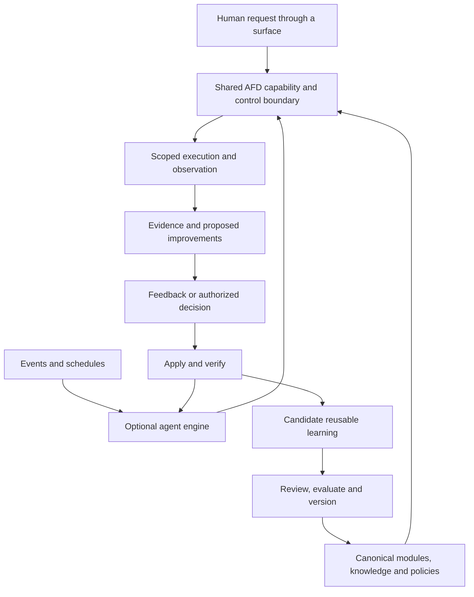

# AFD agent engine: continuous-improvement research

**Research date:** October 28, 2026

**Status:** Research synthesis and proposed architecture, not an implementation,
procurement decision or delivery commitment.

## Executive conclusion

The evidence supports a reusable engine for continuous agentic work rather than
a separate always-on chatbot. Relevant systems combine durable responsibilities
with event/schedule-driven runs, established tools, bounded actions, human
feedback and reusable operational knowledge.

The proposed direction is **new independently consumable package(s) in the AFD
repository**, not extensions of existing packages. The engine consumes AFD
contracts; optional shared modules and consumer-owned modules provide domain
capabilities. Applications and hosted services compose those pieces.

Human-initiated and service-initiated work should consume the same applicable
canonical knowledge, tools, processes and policies. Both produce evidence and
feedback. Reviewed improvements return to those shared inputs, benefiting both
modes without making their identities or permissions interchangeable.

Continuous improvement is a compelling first application, not the engine's limit:

**Observe -> substantiate -> propose -> decide -> apply -> verify -> learn -> reuse.**

Evidence is strongest for bounded automation, durable orchestration and
feedback-informed context. It is weaker for unattended broad UX judgment,
synthetic personas predicting real users, autonomous product prioritization or
unrestricted policy self-modification.

## 1. Relevant systems and their boundaries

These are inspected documentation and published reports, not products exercised
in this research. Availability and maturity remain feature- and host-specific.

| Example | Documented approach | Transferable lesson | Evidence limit |
| --- | --- | --- | --- |
| **GitHub Agentic Workflows / Repo Assist** | Scheduled/event-driven repository work, task memory, investigation, proposed fixes, PR maintenance and activity summaries; separate permission-controlled jobs can execute structured action requests. [S10][S12] | Produce normal work in existing systems. Recheck live state, avoid duplicate work and cap accumulating proposals. | Merged PRs and reported backlog reductions are not causal proof of user value or productivity. Generic safe-output capabilities are broader than Repo Assist's conservative configuration. |
| **Azure SRE Agent** | Incident, scheduled and interactive work share skills, tools, governance and retained operational context; actions may be proposed or executed. [S08][S09] | A strong structural analogue for an ongoing improvement service: investigate, act, verify and retain useful context. | Documentation is not an independent effectiveness study. Approval coverage is action-specific, not implied by the label "Review." |
| **Datadog Bits Investigation** | Supported monitor transitions launch hypothesis-driven investigations; insufficient evidence can yield an inconclusive result. Confirmations and corrections become reviewable memories. [S13][S14] | Investigate with evidence rather than merely summarize alerts. Share useful context across interactive and automatic work. | Available telemetry and maintained context bound the result. Shared knowledge does not guarantee identical retrieval or behavior in chat and investigations. |
| **Copilot Studio** | Published agents react to external events or recurrence triggers using configured actions/topics. Documentation specifies maker authentication and consumption implications. [S07] | Event adapters and bounded action catalogs can remove repeated human initiation without continuous model execution. | Scheduling does not establish reliability or authorize every reachable resource. Its fewer-than-15-consecutive-actions guidance is product-specific, not a universal agent limit. |
| **Atlassian Rovo** | Agents run in automation, including scheduled theme analysis and decision-document review. Custom agents can take configured actions; the documented write toggle is off by default. [S15][S28] | Recurring planning material can go into existing pages, work items and channels. | A generated summary is not an accepted priority decision. Current docs distinguish custom/out-of-box agents and requesting-user/agent-account identity. |
| **Chromatic / axe Monitor** | Established accessibility scanning, component regression testing, baselines, historical reporting and remediation workflows. [S17][S29] | Reuse measurement tools; use agents to interpret deltas, relate findings and prepare fixes. | A clean scan, accepted visual baseline or token-compliant component does not prove accessibility conformance or good UX. [S18] |
| **ChatGPT Pulse** | Its preview announcement describes overnight research, daily curated updates and feedback about relevance, including correction of stale suggestions. [S16] | Bounded digests and relevance feedback can be useful without creating another endless feed. | The announcement is not a current entitlement audit or evidence of autonomous product changes. |
| **Durable/hosted runtimes** | Temporal supports durable workflows and long waits; LangGraph supports persistent state and interrupts; Managed Agents documents hosted sessions and scheduled execution in beta. [S19][S20][S21][S22] | Reuse runtime primitives and separate durable state, reasoning and execution environments. | Runtime survival is not decision correctness or exactly-once external effects. Background response generation alone is not a standing mission or learning system. [S26] |

Linear offers another surface pattern: agents participate through existing issues,
documents, delegation and activity views. Its inspected platform page establishes
assignment/mention entry points, not general scheduled autonomy. [S25]

## 2. What has worked

### Bounded responsibility

**Measuring Agents in Production**, accepted at ICML 2026, combines 20 interviews
with 306 survey responses, filtering its main analysis to **86 production/pilot
systems**. It reports that **68% execute at most 10 steps before human
intervention**, **70% use prompting of off-the-shelf models rather than weight
tuning**, and **74% primarily use human evaluation**. Data were collected in
April-November 2025; item response counts vary. These are descriptive
selected-sample findings, not universal caps or a current market census. [S01]

Make the responsibility persistent while keeping individual executions bounded:
investigate a change, propose a coherent improvement, await a decision when
needed, and resume with the relevant state.

### Accepted work in existing systems

Repo Assist's creator reports using roughly 200 runs across four repositories
to address longstanding issues and release improvements with maintainer
oversight. Its maintained workflow records prior work, revisits it when evidence
changes, and limits scheduled PR accumulation. [S10][S11]

GitHub's continuous-improvement report describes analysis-to-discussion-to-issue-
to-PR chains, including **58 merged of 74 proposed PRs** for a dependency-review
workflow. This is first-party reporting, not an independently replicated result:
merge rate measures acceptance, not correctness, user value or net effort. [S27]

### Feedback-informed context

Datadog documents corrections and confirmations becoming memories that users can
review or delete. Chat and investigations use shared knowledge sources, but its
guidance still requires rerunning a known investigation: successful retrieval in
chat does not prove equivalent investigation behavior. [S14]

**Agentic Context Engineering (ACE)**, listed as ICLR 2026, evaluates evolving
structured playbooks on agent and domain benchmarks. It separates producing work,
reflecting on feedback and curating localized updates. Reported improvements
support context adaptation, not unreviewed enterprise-policy changes or proven
UX benefit. Model retraining is not a prerequisite for useful adaptation. [S05]

### Selective parallelism

Anthropic reports a 90.2% improvement over its single-agent baseline on an
internal research evaluation, alongside approximately **15 times ordinary-chat
token use** for its multi-agent systems. These are vendor-specific observations
with different task/computation budgets, not universal gains or costs. It also
documents duplicate work, excessive delegation, endless searches and coordination
bottlenecks. [S23]

Use specialist workers when they contribute distinct expertise or independent
evidence, not an always-running committee for every event.

## 3. What fails, or remains unproven

| Failure pattern | Evidence | Consequence |
| --- | --- | --- |
| Accuracy mistaken for dependable operation | A 2026 reliability preprint evaluates 14 agentic models on two benchmarks and reports that capability gains do not translate proportionately into consistency, robustness, predictability and bounded failure severity. [S02] | Evaluate repeated runs, changed inputs, uncertainty and consequences, not only average success. |
| Synthetic personas treated as real users | UXAgent's five-researcher evaluation supported piloting study designs but found simulated behavior unlike real people. A separate human comparison on retail tasks found miscalibration and up to nine percentage points' variation across simulators. [S03][S04] | Treat simulations as probes and hypotheses, not participant research or population-level usability evidence. |
| A green scanner treated as conformance | W3C notes that some checks cannot be automated and tool results can be inaccurate. Chromatic baselines can include accepted defects and omit some incomplete checks. [S17][S18] | Report coverage, existing debt, untested states and manual-review needs. |
| Every event becomes an investigation | Datadog warns that enabling every noisy monitor dilutes signal and makes context curation impractical. Repo Assist suppresses repeated self-comments and limits accumulating work. [S10][S14] | Deduplicate, prioritize, batch and allow no-op outcomes. Respect reviewer capacity. |
| Memory amplifies mistakes | Repo Assist rechecks live state. ACE documents context collapse under monolithic rewriting. Memory-poisoning research identifies persistent influence from untrusted input. [S10][S05][S06] | Keep original evidence, versions and applicability; support correction and retirement. Repetition is not corroboration. |
| Checkpointing assumed to prevent duplicate effects | LangGraph re-executes interrupted nodes from the beginning, including earlier side effects. [S22] | Use stable operation identities, appropriate checkpoints and provider-side idempotency/reconciliation. |
| Critical policy enforced only by prompts | Salesforce describes moving load-bearing sequencing and permission behavior into deterministic control points. Azure separates resource permissions from action-specific approval. [S24][S09] | Enforce authority and publication boundaries outside model-generated instructions. |
| Session, reasoning and execution share one fragile process | Anthropic reports losing sessions on container failure before separating the session log, harness and sandbox. [S19] | Durable work state must outlive an individual worker or context window. |

The reviewed evidence does not establish reliable autonomous product-priority
decisions, replacement of specialist judgment, safe arbitrary policy improvement
from thumbs-up/down alone, or the economics of this proposed engine.

## 4. AFD-native engine and replaceable hosts

The engine belongs in **new sibling package(s) in this repository**. Existing AFD
contracts can be dependencies; existing libraries and companion systems are
references, not packages to expand into a mandatory engine. Names, decomposition,
implementation language and first-host selection remain open.

Its control operations should be described, versioned AFD capabilities from the
start. CLI, MCP, a scheduler, an application and an in-process agent are clients
of those capabilities, not independent definitions of their behavior. [S30]

### Invariants

1. **Shared semantics, not identical permissions.** Initiation mode must not
   change what success, failure, uncertainty or a required decision means.
2. **Control is a capability.** Inspecting work, narrowing scope, changing an
   objective, approving/rejecting and requesting cancellation must not require
   private service-console access. A stop request is not rollback.
3. **Hosting is replaceable.** Cloud, local/headless, native and browser/WASM
   components can share contracts where supported. Credentials, storage and
   external resources remain explicit dependencies.
4. **Shared learning is surface-independent.** Both interactive and automatic
   consumers must be able to resolve the applicable accepted revision.

AFD already provides results/recovery information, schemas/exposure, actor kinds,
approval policies/middleware and journals/replay. Do not propose them as missing
features. [S31][S32][S33][S34][S35]

Approval declarations are enforced only where middleware is installed; exposure
and actor labels do not replace authentication or resource authorization.
Journal replay re-executes handlers and restores clock/random observations, not
arbitrary I/O or external state. It is not a durable job engine or exactly-once
guarantee. [S34][S35]

### Native implementation options

| Option | Current evidence | Role to evaluate |
| --- | --- | --- |
| TypeScript/Python | Broader existing client/server and tooling surfaces. [S30][S33] | Domain composition and orchestration where ecosystem reuse dominates local dispatch cost. |
| Rust | Preview registry, batch/pipeline execution, approvals, journal/replay, WASM and an optional MCP server; no Rust MCP client. [S31][S33] | Native workers, collectors, deterministic analysis or a compact host when resource requirements justify it. |
| C++20 | Published-preview, engine/runtime-independent library with registry, middleware, DirectClient, execution, approvals/journal and Emscripten paths. Deadlines are cooperative. [S32][S33] | Existing native applications, specialized scanners or constrained embedding. |

Conformance establishes specific properties, not feature equivalence everywhere.
Package-specific Rust docs establish its optional server despite an older
top-level README summary. [S31][S36]

This research ran no comparative workload. Choose native implementation using
resident memory, cold start, throughput and deployment measurements. Model,
network and browser costs may dominate; fast command dispatch alone does not
establish a cheaper improvement loop.

## 5. Modular contributions without engine special cases

| Layer | Owns | Excludes |
| --- | --- | --- |
| Existing AFD packages | General command/result/control contracts and reusable mechanisms | Mandatory engine, scheduler, database or model-provider dependencies |
| New engine package(s) | Generic composition, run/control lifecycle, event admission, scheduling interfaces, continuation, concurrency, budgets and pluggable host services | Product-specific criteria and mandatory deployment/provider choices |
| Optional shared modules | Reusable capabilities and workflows expressed through the extension contract | Privileged bypasses or consumer-private knowledge |
| Consumer host/adapters | Concrete identity, persistence, integrations, policy, selected modules and output destinations | A fork of shared execution semantics |
| Consumer domain modules | Domain evaluators, guidance, procedures, proposed fixes, learning candidates and acceptance cases | Unrestricted credentials/access or private copies of shared policy |
| Surfaces | Inspection, refinement, reporting and intervention | Separate operational semantics or UI-only authorization |

A contribution contract should identify its owner/version, commands,
input/event/evidence shapes, dependencies, effects and required capabilities,
supported execution modes, output/report contracts and evaluation cases.
These need not all become fields in the existing AFD core.

For example, an accessibility module could invoke a scanner and emit findings;
a planning module could synthesize new evidence into decision options. Neither
should require an `if accessibility` or `if planning` branch in the engine.

Installation may change reviewed composition configuration. It must not grant
authority merely by registering commands. Native modules need explicit adapters
or transport boundaries, not assumptions that they are importable into another
language's runtime.

The early modularity proof is a second, different module added without modifying
dispatcher, scheduling or persistence logic. Exercise each interactively and from
a trigger; disable one without hiding failure or changing the other's semantics.

## 6. Feedback that improves a shared system

Separate three loops:

| Loop | Example | Promotion boundary |
| --- | --- | --- |
| Product improvement | Repair a control or recovery flow | Normal artifact/code review, authorized application and outcome verification |
| Knowledge/practice improvement | Add a pattern or correct a recurring misconception | Source-backed curation, applicability, counterevidence and supersession |
| Engine/tool/policy improvement | Refine a detector, description, workflow or allowed operation | Versioned owning-process change, relevant evaluation and explicit authority for policy/access changes |

Approval of one fix must not silently approve all three. Already-authorized
low-risk routines should not need a new ceremony on every execution.

Feedback should distinguish:

- Is the finding valid?
- Is the proposed fix appropriate?
- Should it be prioritized now?
- Did the applied fix work?
- Is the lesson reusable, and where?

"Not now" is not "false"; a correct finding can have a poor fix; one preference is
not global policy. Retain the source revision, triggering example, scope,
decision rationale, exceptions and proposed behavioral change.

Verify an accepted update through both human-initiated and service-initiated
work. Include a held-out or counterexample case rather than only replaying the
incident that motivated it. Do not let a running agent rewrite its own authority
or success criteria merely to improve its reported score.

## 7. Product-experience improvement as a reference application

The following illustrates consumer modules, not built-in engine vocabulary:

| Responsibility | Useful behavior | Output |
| --- | --- | --- |
| Quality watch | Run scoped accessibility, interaction, visual and design-system checks on relevant changes; investigate deltas | Evidence-linked findings and proposed fixes in existing work surfaces |
| Persona/journey review | Use sourced role goals, expertise, permissions and constraints to probe tasks | Labeled hypotheses and traces, not fabricated user testimony |
| Planning synthesis | Combine new research, confirmed issues, feedback and unresolved decisions | Priority options, trade-offs and next experiments with source windows |
| Shared-system improvement | Propose reusable lessons or tool/procedure changes and verify subsequent use | Reviewed knowledge and ordinary versioned changes to owning components |

These are responsibilities, not necessarily separate deployed agents.

Persona-informed review must preserve four evidence types: **rule violation**,
**observed agent/task failure**, **persona-informed hypothesis**, and **observed
human evidence**. Saving a synthetic result must not promote it into human
research. Privileged DOM/source/API access cannot establish human discoverability.
Environment failure, missing access and absent test data are not automatically UX
defects.

UXAgent evaluated five researchers reviewing traces from 60 simulated agents to
help prepare human studies. Lost in Simulation studied retail conversations with
GPT-4o, not every possible GUI walkthrough. Together they motivate calibration
and explicit limits, not rejection of all simulation. [S03][S04]

## 8. First pilot and expansion criteria

Use one important journey, a small set of sourced role contexts and a known
artifact/build version:

1. Trigger scoped observation on a relevant implementation or guidance change.
2. Produce a small evidence-linked finding set and a concrete proposed fix.
3. Record issue validity, fix acceptance, priority and reusable learning separately.
4. Apply only the agreed change, verify it and promote appropriate shared guidance.
5. Exercise a related task through human and automatic initiation, including a
   counterexample.

Include an intentional visual change, unavailable test environment, duplicated
event, stale source, rejected fix and retired lesson. These probe uncertainty,
noise, recovery and change history.

| Measure | Interpretation |
| --- | --- |
| Confirmed / reviewed findings | Precision on the reviewed population; pending cases remain visible |
| Detected / seeded or independently cataloged issues | Bounded detection coverage, not recall over every possible defect |
| Review/correction effort and time to verified resolution | Include rejected work, setup, waiting and receiving-team effort |
| Repeat notifications and unattended backlog | Whether the service removes or creates attention burden |
| Later recurrence of the targeted problem | Whether learning helps beyond the original example |
| Decisions or experiments informed | Useful planning support, not document count |
| Compute/tool cost per useful outcome | Include unsuccessful attempts and missing usage coverage |
| Correct shared-update use in both initiation modes | Evidence of common-system improvement, not one agent's private adaptation |

Set targets and resource limits after agreeing the task and baseline. There is no
universal UX score, false-positive threshold or autonomy quota established here.

## 9. Shared-package scope and remaining questions

The reusable engine belongs in the new AFD packages. Generic runtime contracts,
module composition, continuation and adapter interfaces can be shared. Concrete
deployment identity, domain criteria, knowledge-publication policy and product
priorities remain consumer responsibilities.

Before proposing changes to existing AFD packages, check their implemented
approval, actor, handoff, journal and execution behavior. Close required parity
gaps through existing work where possible. New generic operation conventions or
behavioral fixtures should be motivated by actual consumers, not speculative
requirements. [S33][S34][S35][S36]

Reuse mature event, storage, browser/check, tracing and publication infrastructure
behind the contracts. A particular cloud service or orchestrator is an
implementation choice, not the product contract.

Package names, decomposition, language, initial host and module scope remain
open. The engine should support autonomous operation without requiring universal
autonomy.

## Research limitations

This is a focused research round, not an exhaustive vendor evaluation. Product
documentation establishes described behavior; vendor/maintainer reports provide
attributed experience; papers support conclusions only within their methods and
populations. None demonstrates that this proposed engine will improve a specific
product.

Search-generated summaries were discovery aids, not evidence. Unsupported metrics,
outdated restrictions and incorrect links were excluded or corrected against the
originals. No external product was installed, configured or benchmarked.

The [source ledger](sources.md) records reading coverage and inference limits.
This publication contains public-source evidence and a generic architecture;
consumer-specific implementation material is outside its scope.

[S01]: https://arxiv.org/html/2512.04123v4
[S02]: https://arxiv.org/html/2602.16666v1
[S03]: https://arxiv.org/html/2502.12561v3
[S04]: https://arxiv.org/html/2601.17087v2
[S05]: https://arxiv.org/html/2510.04618v3
[S06]: https://arxiv.org/abs/2606.04329v2
[S07]: https://learn.microsoft.com/en-us/microsoft-copilot-studio/authoring-triggers-about
[S08]: https://learn.microsoft.com/azure/sre-agent/overview
[S09]: https://learn.microsoft.com/azure/sre-agent/run-modes
[S10]: https://raw.githubusercontent.com/githubnext/agentics/main/docs/repo-assist.md
[S11]: https://dsyme.net/2026/02/25/repo-assist-a-repository-assistant/
[S12]: https://github.github.io/gh-aw/reference/safe-outputs/
[S13]: https://docs.datadoghq.com/bits_ai/bits_investigation/investigate_issues/
[S14]: https://docs.datadoghq.com/bits_ai/bits_investigation/improve_accuracy/
[S15]: https://support.atlassian.com/cloud-automation/docs/tips-to-configure-the-action-use-rovo-agent/
[S16]: https://openai.com/index/introducing-chatgpt-pulse/
[S17]: https://www.chromatic.com/docs/accessibility/
[S18]: https://www.w3.org/WAI/test-evaluate/tools/
[S19]: https://www.anthropic.com/research/managed-agents
[S20]: https://platform.claude.com/docs/en/managed-agents/overview
[S21]: https://docs.temporal.io/ai
[S22]: https://docs.langchain.com/oss/python/langgraph/interrupts
[S23]: https://www.anthropic.com/research/multi-agent-research-system
[S24]: https://engineering.salesforce.com/agentforces-agentscript-building-deterministic-control-for-enterprise-ai-workflows/
[S25]: https://linear.app/docs/agents-in-linear
[S26]: https://developers.openai.com/api/docs/guides/background
[S27]: https://github.github.io/gh-aw/blog/2026-01-13-meet-the-workflows-continuous-improvement/
[S28]: https://support.atlassian.com/rovo/docs/agents-in-automations/
[S29]: https://www.deque.com/axe/monitor/
[S30]: https://github.com/lushly-dev/afd/blob/bc43019a4acd237e5ef3a2bf65f21564900143aa/README.md
[S31]: https://github.com/lushly-dev/afd/blob/bc43019a4acd237e5ef3a2bf65f21564900143aa/packages/rust/README.md
[S32]: https://github.com/lushly-dev/afd/blob/bc43019a4acd237e5ef3a2bf65f21564900143aa/packages/cpp/README.md
[S33]: https://github.com/lushly-dev/afd/blob/bc43019a4acd237e5ef3a2bf65f21564900143aa/docs/language-parity.md
[S34]: https://github.com/lushly-dev/afd/blob/bc43019a4acd237e5ef3a2bf65f21564900143aa/spec/command-metadata.md
[S35]: https://github.com/lushly-dev/afd/blob/bc43019a4acd237e5ef3a2bf65f21564900143aa/spec/journal.md
[S36]: https://github.com/lushly-dev/afd/blob/bc43019a4acd237e5ef3a2bf65f21564900143aa/spec/protocol-conformance.md
