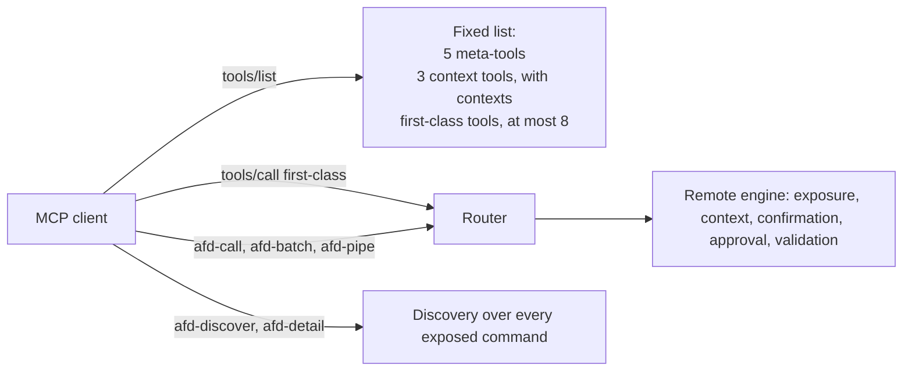

# Hybrid tool strategy

> **Goal**: A fourth MCP tool strategy, `hybrid`: a few first-class tools for a server's hot path,
> listed beside the meta-tools that lazy discovery uses. The tool list stays fixed as the command
> set grows, commands can change without the client reloading tools, and `afd-batch` and
> `afd-pipe` still run combinations in one call. Specified once in `spec/`, then implemented in
> TypeScript, Python, Rust and C++.

| Field | Value |
|---|---|
| Status | Proposed 2026-10-31. Progress and open questions are in [STATUS.md](STATUS.md) |
| Author | jasfalk (drafted with Claude) |
| Requested by | [Umbel](../../../../endpoints/umbel/docs/STATUS.md), decision [D27](../../../../endpoints/umbel/docs/decisions.md): the owner chose the hybrid strategy as Umbel's execution model on 2026-10-31; under [D25](../../../../endpoints/umbel/docs/decisions.md) it lands in AFD, spec first, for every language |
| Packages | `spec/`, `packages/server`, `python/`, `packages/rust`, `packages/cpp` (with the todo backends) |
| Related | [Lazy loading and discovery](../../complete/lazy-loading-discovery/lazy-loading-discovery.spec.md), which deferred this strategy ("Hybrid strategy (lazy + selected individual tools) ... Deferred to avoid complexity"); [Contextual tool loading](../../complete/contextual-tool-loading/); [MCP confirmations](../../active/mcp-confirmations/mcp-confirmations.proposal.md); [Language parity closure](../../active/parity-closure/parity-closure.plan.md) items D1 (Rust server) and D2 (C++ `afd::mcp_stdio`) |

## Problem

AFD servers choose one of three tool strategies. Each fails one of Umbel's three goals:

| Strategy | Fixed list as commands grow | No client reload when commands change | Hot path is one call |
|---|---|---|---|
| `individual` | No: one tool per command | No: every change changes `tools/list` | Yes |
| `grouped` | No: one tool per group, and every group's actions are in its `inputSchema` and `_meta.actions` | No | Mostly: `{ action, params }`, schemas inlined only under 8,192 characters |
| `lazy` | Yes: five meta-tools | Yes | No: `afd-discover`, then `afd-detail`, then `afd-call`, or a blind `afd-call` |
| `hybrid` (this proposal) | Yes: meta-tools plus a capped, configured set | Yes for every command outside the set | Yes for the set; `afd-call`, `afd-batch` and `afd-pipe` for the rest |

The lazy-loading spec deferred the hybrid on purpose. Umbel now needs it in phase 0
([architecture, AFD prerequisites](../../../../endpoints/umbel/docs/architecture.md#afd-prerequisites)),
on the Rust server.

## How the strategies work today

Read from the code on `main` at `cdfbbfb7`, 2026-10-31.

### The spec says almost nothing about strategies

No `spec/` page defines the tool strategies, their tool lists or their order. They appear only in
passing:

- [`spec/command-metadata.md`](../../../../spec/command-metadata.md): "Grouped tools" in
  [Reporting rules](../../../../spec/command-metadata.md#reporting-rules); the
  [Structured results](../../../../spec/command-metadata.md#structured-results) rule that a command
  "listed as its own tool (individual strategy)" advertises a top-level `outputSchema`; the
  [Annotations](../../../../spec/command-metadata.md#annotations) rule that grouped and meta-tools
  carry none; and [Confirmations](../../../../spec/command-metadata.md#confirmations), which names
  where the `confirm` acknowledgement goes for individual tools, `afd-call`, `afd-batch`,
  `afd-pipe` and grouped tools.
- [`spec/error-codes.md`](../../../../spec/error-codes.md): the router layer, D4, and
  [Suggestions name only tools the host provides](../../../../spec/error-codes.md#suggestions-name-only-tools-the-host-provides):
  a suggestion names `afd-discover`, `afd-detail`, `afd-help` or `afd-context-*` only where the
  caller can call that tool.
- [`spec/protocol-conformance.md`](../../../../spec/protocol-conformance.md): the
  [acceptance index](../../../../spec/protocol-conformance.md#acceptance-index) rows for listing
  only MCP-exposed commands, contexts as request input, and `tools/list` cache hints; and the
  [limit](../../../../spec/protocol-conformance.md#limits) that Rust serves the individual strategy
  only.

The strategies themselves are defined by the TypeScript code and copied into Python. This proposal
therefore specifies all four strategies' tool lists in `spec/`, not just the new one, so the hybrid
has something to be defined against.

### TypeScript (`packages/server/src`)

| Concern | Behavior | Where |
|---|---|---|
| Options | `toolStrategy: 'individual' \| 'grouped' \| 'lazy'`, default `grouped`; `groupByFn`; `contexts`; `bootstrap` (default `false`); `toolsListTtlMs`; `confirmations`; `advertiseOutputSchema` | `server-types.ts` |
| Remote commands | Only `expose.mcp` commands reach the remote engine and the tool list; built-in context and bootstrap commands are added as MCP-exposed commands | `server.ts` `createSharedHttpRuntime` |
| `individual` list | `afd-batch`, `afd-pipe`, `afd-call`, then one tool per command filtered by the active context, each with `annotations`, `outputSchema` and `_meta` | `tools.ts` `getToolsList` |
| `grouped` list | `afd-batch`, `afd-pipe`, `afd-call`, `afd-detail`, then one tool per group in first-registration order | `tools.ts` `getToolsList`, `groupedTool` |
| `lazy` list | `afd-discover`, `afd-detail`, `afd-batch`, `afd-pipe`, `afd-call`, and nothing else: not the context tools and not the bootstrap tools, and not filtered by context | `tools.ts` `getToolsList` |
| Routing | `afd-call`, `afd-discover`, `afd-detail`, `afd-batch`, `afd-pipe` are routed in every strategy; then grouped calls; then any other tool name is looked up as a command, so a lazy server runs an unlisted exposed command called by name | `tool-router.ts` `createToolRouter` |
| Contexts | Scoping by `contexts`; outside the active context a call returns `COMMAND_NOT_IN_CONTEXT`; the modern era takes the context from `_meta["dev.afd/context"]` on each request | `command-routing.ts`, `context-scope.ts`, `mcp-modern.ts` |
| Cache hints | `ttlMs` 300,000 with `cacheScope: "public"`, or 0 when `contexts` are configured, because clients cache `tools/list` without its `_meta`; `listChanged: false` on the modern lane | `mcp-modern.ts` `createServerFactory`, `DEFAULT_TOOLS_LIST_TTL_MS` |
| Reserved names | Meta-tools always; bootstrap names with `bootstrap`; context names with `contexts` | `command-names.ts` |
| Instructions | `server/discover` instructions describe the strategy, the meta-tools, bootstrap and contexts | `mcp-modern.ts` `defaultInstructions` |
| `afd-help` | `contractVersion`, `commands` (name, description, `requires`; `full` adds category, tags and trust fields), `total`, `filtered`, `groupedByCategory`; nothing about the strategy | `bootstrap/afd-help.ts` |

### Python (`python/src/afd/server`)

| Concern | Behavior | Where |
|---|---|---|
| Options | `ServerConfig.tool_strategy`, default `individual`; `ToolStrategy = Literal["individual", "grouped", "lazy"]`; `tools_list_ttl_ms`, same defaults as TypeScript | `types.py`, `factory.py` |
| Lists | Every strategy starts with `afd-discover`, `afd-detail`, `afd-batch`, `afd-pipe`, `afd-call`. `lazy` adds the bootstrap-category commands, which include `afd-help`, `afd-docs`, `afd-schema` and the three context tools; `individual` adds every command; `grouped` adds the bootstrap commands and then groups sorted by name | `tools.py` `get_tools_list` |
| Routing | FastMCP's registry holds the listed tools; an unlisted name is routed through AFD, which runs an exposed command or answers D4's `COMMAND_NOT_FOUND`, and answers `COMMAND_NOT_IN_CONTEXT` outside the context | `factory.py` `_install_fastmcp_context_error_translation`, `tool_router.py` |
| Bootstrap | Always registered and MCP-exposed (language parity: "Partial") | `factory.py` `_get_bootstrap_commands` |

### Rust (`packages/rust/src/server.rs`)

The `server` feature serves the individual strategy only: every `expose.mcp` command in
registration order, from `CommandRegistry::get_tool`, with the `confirm` argument under
confirmations; `ttlMs` from `with_tools_list_ttl_ms`, default 300,000, and `cacheScope: "public"`.
An unknown or unexposed tool answers `COMMAND_NOT_FOUND`, "Call tools/list to see the available
tools". There are no meta-tools, grouped or lazy strategies or contexts. These are parity item D1,
being implemented on 2026-10-31 by another session; this proposal does not assume their final API
and names only what it needs from them.

### C++

There is no MCP target in the library. The todo backend hand-rolls stdio in
`packages/examples/todo/backends/cpp/src/mcp_stdio.cpp`, declaring
`capabilities.tools.listChanged: false`. Parity item D2 promotes it to `afd::mcp_stdio` with the
meta-tools and bootstrap commands.

### Differences the spec has to settle

| Difference | TypeScript | Python | Proposal |
|---|---|---|---|
| Meta-tools in `individual` and `grouped` | Three (`grouped` adds `afd-detail`) | All five | Out of scope here; recorded as open question 6 |
| Lazy lists context and bootstrap tools | No | Yes | The spec records both as conforming until open question 6 is settled; the hybrid rule is below |
| Meta-tool order | Varies by strategy | Fixed | The hybrid fixes it |

## Proposal

### H1. Selecting first-class commands: a server option

The server MUST take the first-class set as an ordered list of command names, an option of the
server, not a field of the command definition:

| Language | Option |
|---|---|
| TypeScript | `createMcpServer({ toolStrategy: 'hybrid', firstClassTools: ['knowledge-search', ...] })`, also on `createMcpHandler` |
| Python | `create_server(tool_strategy="hybrid", first_class_tools=[...])` and `ServerConfig.first_class_tools` |
| Rust | `McpServer::with_tool_strategy(ToolStrategy::Hybrid { first_class })` or a `with_first_class_tools` builder, whichever fits the D1 API |
| C++ | The `afd::mcp_stdio` options struct gains `first_class_tools` once D2 lands |

Why an option and not a metadata field such as `firstClass: true`:

1. **It is a property of a deployment, not of a command.** The same command is hot in one server and
   rarely used in another. Umbel loads plugins written by others; a plugin cannot know the host's
   hot path, and two plugins that each mark three commands would break the cap with no owner to
   decide.
2. **Order and the cap need one owner.** A list has an order and a length the server can check. A
   field spread across commands has neither: order would fall back to registration order, and a cap
   violation could only be reported, not chosen.
3. **It keeps command metadata about the command.** Every field in
   [`spec/command-metadata.md`](../../../../spec/command-metadata.md#fields) describes what a
   command is or does. A surface choice is closer to `toolStrategy` and `groupByFn`, which are
   server options.
4. **It stays out of `_meta`.** A metadata field would have to be reported or hidden on every
   surface; a server option is reported once, by `afd-help` (H8).

The cost is that a command author cannot propose a command as first-class. Umbel's plugin manifest
can carry that suggestion as data for the host to accept or refuse; AFD needs nothing for it.

`firstClassTools` with any strategy other than `hybrid`, or `hybrid` without `firstClassTools`,
MUST fail at construction. A hybrid server with an empty list MUST also fail: it is the lazy
strategy, and should say so.

### H2. Validation at construction

The server MUST check the list when it is constructed and refuse to start, with an error naming the
offending entry, when an entry:

| Entry | Why |
|---|---|
| Is not a registered command | A listed tool that cannot run breaks the list's contract |
| Names a command whose `expose.mcp` is not `true` | Listing it would reveal a private command, which D4 forbids |
| Is a meta-tool name, a context tool name, or appears twice | Those tools are already listed, once |
| Is beyond the cap of 8 (H5) | The cap is the point of the strategy |

A bootstrap command (`afd-help`, `afd-docs`, `afd-schema`) MAY be first-class where the server
registers and exposes it.

The set MUST NOT change while the server runs. A server whose command set changes at runtime, as
Python's `register` allows, MUST re-check the list on each change and MUST fail the change that
would remove or unexpose a first-class command. Commands outside the set can come and go freely;
that is what keeps the list fixed.

### H3. The tool list and its order

A hybrid `tools/list` MUST be, in this order:

1. `afd-discover`, `afd-detail`, `afd-call`, `afd-batch`, `afd-pipe`;
2. when contexts are configured, `afd-context-list`, `afd-context-enter`, `afd-context-exit`;
3. the first-class tools, in the configured order.

Nothing else is listed. Bootstrap tools are not listed unless they are first-class: `afd-discover`
already lists them, and `afd-call` runs them.

The fixed part comes first so that it is the same on every hybrid server and survives a change to
the first-class set. Clients that cache prompts by prefix, with tools first, then reuse the whole
fixed block; a change to the set invalidates only the tail. The context tools are listed, unlike in
TypeScript's lazy strategy, because they are the hot path of a server with contexts and because the
`COMMAND_NOT_IN_CONTEXT` suggestion names them.

Each first-class tool MUST be exactly the tool the individual strategy would list for that command:
its `name`, `description`, `inputSchema` with the `confirm` property where
[Confirmations](../../../../spec/command-metadata.md#confirmations) adds it, `annotations`, the
top-level `outputSchema` where the server advertises it, and `_meta`. The meta-tools MUST be the
same tools the lazy strategy lists.

### H4. Contexts: a fixed list, scoped calls

A hybrid `tools/list` MUST NOT vary by the active context. A first-class command outside the active
context stays listed, and a call to it answers `COMMAND_NOT_IN_CONTEXT` with the existing
suggestion, as a call through `afd-call` does today. `afd-discover` and `afd-detail` keep filtering
by context.

This differs from the individual and grouped strategies, which filter the list by context, and it is
deliberate: a list that varies by `_meta["dev.afd/context"]` is why a server with contexts defaults
`ttlMs` to 0 today. A hybrid list depends only on the server's configuration, so it can be cached
(H6).

`afd validate` SHOULD warn when a first-class command declares `contexts`: it is listed everywhere
but callable only in its contexts.

### H5. A cap of 8

A server MUST refuse more than 8 first-class tools. The cap is a constant of the spec, not an
option: a deployment that wants more tools listed wants the individual or grouped strategy.

With 5 meta-tools and 3 context tools the list is at most 16 tools. Umbel's architecture names four
hot-path commands (`knowledge-search`, `knowledge-open`, `context-bundle`, `memory-remember`), so 8
leaves room. The number is open question 1.

### H6. Cache hints and `listChanged`

| Field | Rule |
|---|---|
| `ttlMs` | `toolsListTtlMs` when set; otherwise 300,000 (`DEFAULT_TOOLS_LIST_TTL_MS`) whether or not contexts are configured, because the list does not vary by context (H4) |
| `cacheScope` | `public`, as today |
| `server/discover` | The same hints, as today |
| `capabilities.tools.listChanged` | `false`. A hybrid server MUST NOT send `notifications/tools/list_changed`: its list cannot change while it runs (H2) |

Adding, removing or changing a command outside the first-class set changes what `afd-discover`,
`afd-detail` and `afd-call` see on the next call, and nothing in `tools/list`. That is the goal: the
client never reloads tools. A change to the first-class set is a restart, and a client sees it when
its cached list expires.

### H7. Calls, confirmations, approvals and errors

A call through a first-class tool MUST behave exactly as the same call through the individual
strategy, and a call through a meta-tool exactly as it does under the lazy strategy. In particular:

| Concern | Rule |
|---|---|
| Exposure | Only `expose.mcp` commands are first-class (H2), so D4 is unchanged: an unknown or private name answers `COMMAND_NOT_FOUND`, identical for both |
| Unlisted commands by name | A `tools/call` naming an exposed command that is not first-class MUST run it, as TypeScript's and Python's lazy routers do today. An agent that found a command through `afd-discover` and calls it by name should not fail |
| Contexts | `COMMAND_NOT_IN_CONTEXT`, with "Use afd-context-list to see available contexts, or afd-context-enter to switch."; both tools are listed (H3) |
| Confirmations | First-class tools take the individual tools' `confirm` boolean; `afd-call` its `confirm` boolean; `afd-batch` and `afd-pipe` the `confirm` array; elicitation as today |
| Approvals | A first-class tool is "a call to a single command (its tool ...)" in [Asking the human over MCP](../../../../spec/command-metadata.md#asking-the-human-over-mcp); `afd-batch` and `afd-pipe` keep refusing approval mid-run |
| Unknown-command suggestion | Ends "Use afd-discover to list all commands.", which is valid because `afd-discover` is always listed. Rust's current "Call tools/list to see the available tools" MUST change to it for the hybrid strategy |
| New error codes | None. Configuration mistakes are construction errors, not `CommandResult`s |

### H8. What `afd-help`, `server/discover` and `afd-detail` report

- **`afd-help`** gains two top-level fields on every strategy, so agents and tools can tell how the
  server lists its tools: `toolStrategy` (`individual`, `grouped`, `lazy` or `hybrid`) and, for
  `hybrid` only, `firstClassTools`, the names in list order. A `commands` entry for a first-class
  command carries `firstClass: true`; unset is omitted, following the
  [reporting rules](../../../../spec/command-metadata.md#reporting-rules).
- **`server/discover` instructions** for `hybrid` MUST say that the listed command tools are the
  common ones, and that `afd-discover`, `afd-detail` and `afd-call` reach every other command. For
  example: "The command tools listed are the common ones. Call afd-discover to find others,
  afd-detail for a schema, and afd-call to run one."
- **`afd-discover` and `afd-detail`** do not change. Whether a command is first-class is a property
  of the list, which the agent already has.

## Spec changes, landing before any language

One pull request to `spec/`, reviewed by the owner, before any implementation:

| File | Change |
|---|---|
| New `spec/tool-strategies.md` | Defines all four strategies: their options and defaults per language, the exact `tools/list` of each with its order, routing of meta-tools and unlisted names, context filtering, reserved names, cache hints and `listChanged`, and the `server/discover` instructions. Records the TypeScript and Python lazy and meta-tool differences as current behavior with open question 6. The hybrid section carries H1 to H8 |
| `spec/command-metadata.md` | [Reporting rules](../../../../spec/command-metadata.md#reporting-rules) and [Annotations](../../../../spec/command-metadata.md#annotations): first-class tools are command tools. [Structured results](../../../../spec/command-metadata.md#structured-results): "listed as its own tool (the individual strategy, or first-class in the hybrid strategy)". [Confirmations](../../../../spec/command-metadata.md#confirmations): enforcement and the acknowledgement list include first-class tools. [Surfaces](../../../../spec/command-metadata.md#surfaces): afd-help adds `firstClass`. [Implementation status](../../../../spec/command-metadata.md#implementation-status): a hybrid row |
| `spec/error-codes.md` | [Suggestions name only tools the host provides](../../../../spec/error-codes.md#suggestions-name-only-tools-the-host-provides): a hybrid server lists `afd-discover` and, with contexts, the context tools; Rust's row gains the hybrid suggestion. No new codes, so `spec/vectors/error-codes.json` is unchanged |
| `spec/protocol-conformance.md` | Three acceptance rows: the hybrid list and its order; a hybrid list unchanged by `_meta["dev.afd/context"]`, with `ttlMs` 300,000 under contexts; a first-class call outside the context answering `COMMAND_NOT_IN_CONTEXT`. The [limits](../../../../spec/protocol-conformance.md#limits) note names hybrid with Rust's other strategies |
| New `spec/vectors/tool-strategies.json` and `generate-tool-strategies.mjs` | From the TypeScript reference: a fixed command set (exposed, private, with and without `contexts` and `confirmPrompt`) and server configurations, with the expected tool names in order per strategy and context, and the configurations that must fail construction with the entry they name. Registered in [`spec/vectors/README.md`](../../../../spec/vectors/README.md) with one loader per language |
| `spec/CHANGELOG.md`, `spec/VERSION` | A minor, additive contract change, following the [versioning plan](../../active/versioning/versioning.plan.md) |

The 34-case todo conformance suite does not change: it calls tools by name, which every strategy
serves. A follow-up MAY add a `--strategy hybrid` run once every backend has the strategy.

## Implementation plan

| Step | Language | Work | Size | Depends on |
|---|---|---|---|---|
| 0 | `spec/` | The spec changes above, with the vector generated from a TypeScript prototype kept on the spec branch | M | Owner approval of this proposal |
| 1 | TypeScript | `toolStrategy: 'hybrid'` and `firstClassTools` on server and handler options; construction checks in `command-names.ts` beside the reserved names; the list in `tools.ts` from the existing individual tool builder; TTL default in `mcp-modern.ts`; `defaultInstructions`; `afd-help` fields; `afd validate` warning; vector, `mcp-modern.test.ts` and `tool-surface.test.ts` cases; changeset | M | Step 0 |
| 2 | Python | `"hybrid"` in `ToolStrategy`; `first_class_tools`; checks at construction and in `register`; `get_tools_list`; TTL default; instructions; `afd-help` fields; vector loader and live tests in `test_mcp_modern_live.py` | M | Step 0. Independent of step 1 |
| 3 | Rust | `ToolStrategy::Hybrid` on the D1 strategy API; checks at `McpServer` construction; list from `get_tool` plus the D1 meta-tools and context tools; TTL; the hybrid unknown-command suggestion; `afd-help` fields; vector test and `tests/server_http.rs` cases | S on top of D1, M without it | Step 0 and parity D1 merged. Umbel phase 0 waits on this step |
| 4 | C++ | The same on `afd::mcp_stdio`, stdio only, behind the existing CMake options | S | Step 0 and parity D2 merged |
| 5 | All | Language parity matrix row "Tool strategies" gains hybrid; protocol conformance rows filled; the `afd-typescript`, `afd-python`, `afd-rust` and `afd-cpp` skills document the option | S | Each language's step |

Steps 1 and 2 can run in parallel. Step 3 is the one Umbel needs; it does not wait for steps 1
and 2, only for step 0 and D1.

## Acceptance

- `spec/tool-strategies.md` is merged, and every language loads `spec/vectors/tool-strategies.json`
  and matches it.
- On each language's server, with 100 exposed commands, 3 first-class and contexts configured, a
  modern-era `tools/list` returns 11 tools in the H3 order, identical with and without
  `_meta["dev.afd/context"]`, with `ttlMs` 300,000.
- Registering a 101st command leaves `tools/list` byte-identical and makes the command visible to
  `afd-discover` and callable through `afd-call` and by name.
- Each H2 case fails construction with a message naming the entry.
- A first-class tool's definition equals the individual strategy's tool for the same command.

## Rollback

The strategy is opt-in and additive. Removing it is a minor change per language: servers that set
`toolStrategy: 'hybrid'` move to `lazy` (losing the hot path) or `individual` (losing the fixed
list). No wire shape of results changes.

## Out of scope

- Code mode. Umbel's decision keeps a sandboxed code-mode plugin later and optional; it would run
  against the same registry and needs no change here.
- Aligning the meta-tools of the individual and grouped strategies between TypeScript and Python
  (open question 6).
- Per-tool output budgets and MCP resources, prompts and Skills over MCP, which Umbel's
  prerequisites list as separate AFD proposals.
- Ranking or choosing first-class commands automatically from usage telemetry.

## Open questions for the owner

1. **The cap.** 8 first-class tools, a spec constant. Alternatives: 4, matching Umbel's named hot
   path, or a configurable cap with 8 as the default.
2. **Option or metadata.** This proposal recommends a server option (H1). The alternative is a
   `firstClass` command field, with registration order and a cap error.
3. **Contexts.** H4 keeps the list fixed and refuses out-of-context calls. The alternative filters
   first-class tools by context like the individual strategy, at the cost of `ttlMs` 0 under
   contexts.
4. **Order.** H3 puts the fixed meta-tools first for prefix caching. The alternative puts the hot
   path first.
5. **The `afd-help` fields.** `toolStrategy` on every strategy, and `firstClassTools` and
   `firstClass` for hybrid (H8), or hybrid only.
6. **The lazy and meta-tool differences.** Whether a later change aligns TypeScript and Python: all
   five meta-tools in every strategy, as Python does, and context tools listed by `lazy`, as Python
   and this hybrid do.
