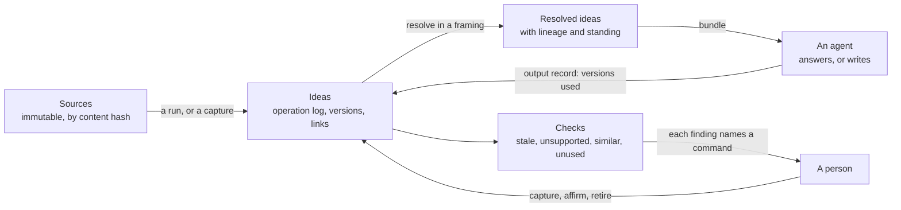

# Ideas: proposal and plan

A store of ideas instead of documents. Each idea is a few sentences, typed, linked to other
ideas, traceable to the sources it came from, and kept current. Agents in any harness reach it
over MCP, answer questions from it and write documents from it on demand. It is an Umbel plugin
with a hierarchy engine shared with Violet. The engine calls no model: models and people extract,
judge and write, and it validates, resolves and records.

Its working name is Ideas, and the plugin id is `ideas` ([section 11](#11-for-the-owner)).

## Status

- **State:** proposed. Written 2026-11-11 against `main` at `8ef7aa68`, from a design discussion
  with the owner on 2026-11-10 and 2026-11-11. Nothing is implemented and nothing is approved.
  The owner agreed one point in that discussion, the standing rule
  ([4.1](#41-decisions-made-in-this-plan), decision 5), and directed that the platform's existing
  plans may change where a change makes the whole stronger.
- **Verified:** the facts in [What exists today](#2-what-exists-today) were read on `main` at
  `8ef7aa68` in the files each row names, and in `lushly-dev/violet` at `c4e8663` for Violet's web
  interface and plans. No Rust, TypeScript or Python was built or run. A status file's "exit
  criterion met" is reported as recorded, not re-run.
- **Not verified:** whether tantivy 0.27, as pinned, offers a more-like-this query
  ([P3](#6-what-ideas-needs-from-the-platform)); whether a managed serverless PostgreSQL can meet
  the phase 6 backend's requirements (P10); how far Violet's engine is generic beyond a
  line-count estimate; every number in [section 7](#7-measurement-and-exit-criteria), which
  phase 0 sets. The external claims in [Evidence](#3-evidence) come from the sources listed
  there, each with its limit.

## 1. Problem and goal

Working knowledge is usually kept as documents, and the document is the wrong unit:

- **Ideas are buried.** One document holds many ideas wrapped in framing, history and
  qualification. Finding the idea means reading the document.
- **Copies drift.** The same idea is restated in several documents and versions. Nothing says
  which wording is current.
- **Overlap is invisible.** Two long documents that share a third of their ideas cannot be merged
  or even compared without reading both.
- **Context has to be carried.** To give an agent the background for a task, a person ports
  documents between tools.
- **Updates are heavy.** Where a knowledge base is curated, a change is a pull request and a
  pipeline, so small corrections are not made.
- **Origins and uses are lost.** It is hard to say where an idea came from, whether it is the
  person's own thinking or a research finding, and which published pieces have used it.

**Goal.** A person, or a team, keeps a body of ideas that grows without duplicating and without
going stale, and works with it through agents:

1. Capture an idea from a conversation in one call. A near-duplicate is refused with the idea it
   resembles.
2. Ask a question from any harness and get an answer built from current ideas, each with its
   sources.
3. Generate an article, a thread, a script or a chapter from a selection of ideas, and keep a
   record of which ideas it used.
4. Keep the source files, and mine them again when better models arrive, reviewing only what is
   new.
5. See what is unsupported, contested, overdue for review or no longer used.
6. Hold one body of ideas in several framings, such as a public one and a book's, without copies.
7. Preview what a change would touch before making it.

**Not goals.** A document repository. A browsing interface as the main way in. A model inside the
request path.

## 2. What exists today

### In this repository

| Need | Existing piece | Where |
| --- | --- | --- |
| A host over MCP and a CLI, with plugins, spaces, a journal and events | Umbel. Phases 0 to 4 record their exit criteria as met; phase 5 (auth and hosted) is mostly built; phase 6 (PostgreSQL) is specified, not built | `endpoints/umbel/docs/STATUS.md` |
| Provenance on every record | The envelope: origin, principal, agent, session, validity, confidence, `sources`, `generated`, `contentHash`, `derivedFrom`, access | `endpoints/umbel/store/src/envelope.rs` |
| A plugin's own data in its own shapes | The `records` grant: any kind, free JSON, compare-and-set. Listed by kind and id only, 2 MiB a record, no field query, no delete | `endpoints/umbel/src/plugins/store_services.rs` |
| Review of proposed changes by a person | `knowledge-propose`, `knowledge-proposal-preview`, `knowledge-approve` with `confirm = "require-human"` and `person = { cli = "terminal", mcp = "verified" }` | `endpoints/umbel/plugins/knowledge/umbel-plugin.toml` |
| A verify-by date | `verified`, `stale_after`, `knowledge-stale`, for documents | `endpoints/umbel/plugins/knowledge` |
| Recorded background runs | The curator: a settling window, candidates, conflict sets, locked runs with reports | `endpoints/umbel/plugins/curator` |
| Source files and their metadata | `sources-sync`, `umbel-scan`, `umbel-okf` and the OKF frontmatter | `endpoints/umbel/plugins/sources-filesystem`, `endpoints/umbel/okf`, `endpoints/umbel/scan` |
| Text search | A tantivy BM25 index with fields, phrases, ranges and filters, one writer | `endpoints/umbel/store/src/index.rs` |
| A graph | A per-space graph with neighbours, related, path and outline. Contributions belong to a stored document, and `knowledge-index` rewrites them with eight fixed edge kinds | `endpoints/umbel/store/src/graph.rs`, `endpoints/umbel/plugins/knowledge/src/graph.rs` |
| Budgeted context for a task | `context-bundle` | `endpoints/umbel/plugins/context` |
| Capture from a harness session | The `umbel-hook` adapter | `endpoints/umbel/adapters/hook` |
| Results that explain themselves | `CommandResult`: `sources`, `reasoning`, `alternatives`, `suggestions`, `plan`, `warnings`, undo; shared codes including `ALREADY_EXISTS` and `CONFLICT` | `spec/error-codes.md`, `packages/rust/src/result.rs` |
| Several commands in one call | The hybrid strategy with `afd-batch` and `afd-pipe`; pipelines shipped as data | `spec/tool-strategies.md`, `spec/pipeline-variables.md`, `spec/plugin-manifest.md` |
| Long jobs, bounded reads | MCP Tasks and output budgets, in Rust | `packages/rust/src/server/tasks.rs`, `packages/rust/src/output_budget.rs` |
| A hierarchy with inheritance | Violet's engine: a tree of nodes, five operations (add, override, subtract, reset, copy), shared sets, an operation log, resolution, lineage, compare, drift, and a dry run over a read-only overlay | `foundations/violet/packages/core/src/engine`, `foundations/violet/packages/core/src/db/overlay.ts`, `integrations/violet-afd/src/commands` |
| A health report shape | Stable check ids, severity, evidence, remediation and a verdict | `endpoints/health/src/lushly_health/schemas/report-1.2.json` |
| A precedent for a further plugin | The `components` plugin: a specification approved before code, then one pull request a step | `endpoints/umbel/docs/plugins/components/spec.md` |
| An interface, later | Loam mounts an Umbel instance and renders its commands as forms. Its agent surface is not started | `endpoints/loam/docs/STATUS.md` |

What no part of the repository has:

- An idea as a unit, with typed many-to-many links between ideas.
- Near-duplicate detection. Duplicate checks are exact hashes and idempotency keys.
- A hierarchy engine in Rust. Violet's is TypeScript, and a plugin must be a compiled crate to
  reach the stores, since a component gets six grants and a mounted server gets none
  (`endpoints/umbel/wit/umbel-plugin-1.0.0/world.wit`, `endpoints/umbel/sdk/src/mounted.rs`).
- Pinned copies or a reading of the hierarchy as it stood at an earlier moment. Violet's copies
  are always live.
- A registry of sources keyed by content hash.
- A record of which ideas an output used.

### Outside it

The practices this draws on are in [Evidence](#3-evidence). The owner's experience with an
earlier, document-based knowledge system set what to keep and what to leave: a graph that
describes the data and composition of several queries in one call were worth keeping; updates by
pull request, documents as the unit, and duplicate avoidance by guideline were not.

## 3. Evidence

Read on 2026-11-10. Each row says what the source supports and where it stops.

| Source | What it supports | Limit |
| --- | --- | --- |
| Evergreen notes | One idea a note, organised by concept and not by source, titled as a claim, densely linked | A practice described by its author. No single right size for a note |
| Discourse graphs | Questions, claims, evidence and sources as separate nodes joined by supports and opposes, so a claim and its evidence are judged apart | Developed for research synthesis. Read from an interview and a paper abstract |
| The LLM wiki pattern | Immutable raw sources, a maintained layer of pages, a schema file; ingest, query and lint; an agent does the upkeep. Reported at about 100 sources | An idea file, intentionally abstract. It defines no citation format and does not address duplicates |
| Create once, publish everywhere | A content model kept apart from its presentations | Vendor and practitioner articles |
| Early MCP knowledge servers | Claims with per-claim provenance over a markdown vault | Prereleases, not evaluated here. None describes near-duplicate handling |
| Violet's interface walkthrough | Tracing one value through the hierarchy was the clearest moment; findings were hard to find and could not be acted on | Four model personas, not people (`lushly-dev/violet`, `docs/features/active/violet-ux-sessions.md`) |

Two gaps recur across these: nothing settles how duplicates are kept out, and nothing ties a
generated document back to the ideas it used. Both are central here.

## 4. Design

### 4.1 Decisions made in this plan

Each can be revisited by the owner. The first eleven shape the model; the last three shape the
work.

1. **The idea is the unit.** A document is either a source that ideas came from or an output
   made from ideas. Neither is stored as knowledge.
2. **Sources are kept and never changed**, so they can be mined again.
3. **The record is an operation log.** Current state is computed from it. History, and the reason
   for each change, come with it.
4. **One body of ideas, several framings.** A framing inherits from its parent and may state,
   reframe, omit, restore or borrow ideas. Nothing is copied to make a variant.
5. **Capture is immediate; standing is earned.** A captured idea is durable at once and is a
   *seed*. Only a person affirms it. Agreed by the owner on 2026-11-11.
6. **Standing belongs to a wording.** Affirmation attaches to the version of an idea that a
   framing resolves to, not to the idea in general. A reframed wording starts as a seed.
7. **Links are authored.** A link is stated when the idea is, by whoever states it, and is
   inherited through framings as ideas are. Nothing extracts a graph afterwards.
8. **A near-duplicate is refused at capture.** The caller then records another sighting of the
   existing idea, reframes it, or declares the new one distinct with a reason.
9. **A source is identified by its content hash**, so a second copy is recognised.
10. **Extraction is a recorded run.** A run names its sources and its extractor. What it captures
    are seeds, and it cannot change an affirmed version.
11. **Outputs are not stored; their use of ideas is.** An output record pins the versions it
    drew on.
12. **No model in the plugin, and no vocabulary in its code.** Types, link kinds, review
    intervals, thresholds and output formats are a pack.
13. **The hierarchy engine is shared with Violet** through one written semantics and one set of
    vectors ([P7](#6-what-ideas-needs-from-the-platform)).
14. **Every finding names the command that acts on it.**

### 4.2 Shape

Three kinds of thing, and only the middle one is curated:

- **Sources** come in: notes, transcripts, research reports, readings.
- **Ideas** are what is kept.
- **Outputs** go out: answers, articles, threads, scripts, chapters, briefs. They are made when
  asked for and can be made again.

### 4.3 Ideas, versions and standing

An idea has an id, a type and one or more versions. A version has the statement, tags, the
operation that created it, and its standing.

| Standing | Meaning | Set by |
| --- | --- | --- |
| `seed` | Captured, durable, labelled unaffirmed in every answer | Any capture or reframe |
| `affirmed` | A person has said this wording is what they hold. Carries the date and a review-by date from the type's interval | A person only |
| `retired` | No longer held. Stays readable and names what superseded it | A person only |

A caller may ask for affirmed ideas only. An affirmed version is never edited: a change is a new
version, which starts as a seed, and the affirmed one stays resolvable until the new one is
affirmed.

The default pack's types, which an instance replaces with its own: position, principle, model
(a distinction or a named structure), evidence, example, question. A question an agent could not
answer is captured as a question, so gaps in the store are ideas too.

### 4.4 Links

A link is `(from, kind, to)`. The default kinds are supports, challenges, refines, depends-on and
example-of. Supersedes is not a link: it is recorded by retiring. A link is stated in a framing,
inherited by its descendants, and can be withdrawn in one of them. It resolves only where both
ends do.

### 4.5 Framings

A framing is a node in a tree inside one space. The root holds what is held generally. Children
hold what differs for a setting: a public voice, a book, a product.

| Operation | In plain words | Effect in the framing |
| --- | --- | --- |
| state | states | A new idea exists here and in descendants |
| reframe | reframes | The statement or tags differ here; a new version |
| omit | leaves out | The idea does not resolve here or below |
| restore | restores | Local changes are dropped; the ancestor's version resolves again |
| borrow | uses the idea from | An idea from another framing resolves here, following its source |
| include | applies the set | Every idea of a shared set resolves here, by a merge or an override policy |

Three structural kinds of framing: standard, shared set, and pinned. The plain words in the
second column are used in every surface, and the command names keep the precise terms, as
Violet's interface does (`lushly-dev/violet`, `packages/web/src/app/vocabulary.ts`).

Omitting is what keeps material out of a setting by construction. An idea omitted from the public
framing cannot be returned by a call that resolves the public framing, which a note saying "do
not quote this" cannot guarantee.

### 4.6 Sources, runs and outputs

- **Source.** A document in a collection, registered by the SHA-256 of its bytes, with a kind, an
  origin (the person's own thinking, a conversation, research, a reading), and the date the
  thinking happened as distinct from the date it was filed. A second file with the same hash is
  the same source. One that matches after line endings and trailing space are normalised is
  reported as a near copy. An idea cites a source with a locator and the hash of the quoted text.
- **Run.** A record of one extraction: the sources read, a label for the extractor (the model and
  the prompt version, supplied by the caller), and the time. Captures made under a run carry its
  id. A run's report says what was new, what matched an existing idea and was recorded as another
  sighting, and what was refused.
- **Output.** A record with a title, a format, the framing, and the list of idea versions used.
  The drift of an output is the difference between those versions and what the framing resolves
  now.

Mining a source again with the same extractor adds nothing. Mining it with a better one adds
seeds and sightings and changes no affirmed version. How often an idea is sighted across sources
is a signal worth showing.

### 4.7 What is deterministic

| The engine does | The calling model does | A person does |
| --- | --- | --- |
| Identity, hashing, validation | Reads sources and proposes ideas and links | Affirms and retires |
| Resolution, lineage, compare, drift | Judges whether a candidate is the same idea as a near match | Settles contradictions |
| Similarity scores and the refusal | Chooses a selection and an angle for an output | Chooses what to publish |
| Rule checks and the health report | Writes prose | |
| Selection for a bundle from explicit criteria, and its budget | | |
| The preview of a change | | |

### 4.8 The plugin and an instance

| The plugin ships | An instance supplies |
| --- | --- |
| The record shapes, the engine, the commands | Its sources and ideas |
| A default pack: types, link kinds, review intervals, a similarity threshold, a few output formats | Its own pack, replacing the default whole |
| A skill that teaches capture, asking and writing | Its framings |
| | Its backend, chosen by the deployer in `umbel.toml`, and its identity provider |

A plugin cannot choose or contribute a backend (decision D132), which is the separation wanted
here: the same plugin runs on the embedded store on one machine or on PostgreSQL behind an
enterprise identity provider, with no change.

### 4.9 Trust

- Stored text is untrusted input. A statement mined from a source can carry instructions. It is
  labelled content, scanned and flagged, and never placed in a message, warning or log.
- A seed is labelled as unaffirmed wherever it is returned.
- A person-only command uses the host's existing rule for one:
  `confirm = "require-human"` with `person = { cli = "terminal", mcp = "verified" }`.
- Nothing crosses spaces. A framing tree lives in one space.
- An idea whose only sources the caller cannot read is denied, as derived content is today.

### 4.10 Beside memory and knowledge

Umbel has two stores with two write paths (principle 8, decision D9). Ideas is a third. It is not
the knowledge plugin with another schema.

| | memory | knowledge | ideas |
| --- | --- | --- | --- |
| Unit | A record of a session, a fact someone asserted, a note on how something is done | A document | An idea, with versions |
| Who writes | Agents | A proposal that a person or a policy approves | Agents and people, at once |
| Standing | None: nothing in memory is verified | Verified, with a verify-by date | A seed until a person affirms the wording |
| Lifetime | Expires | Durable | Durable |
| Relations | None of its own | Derived from structure: hierarchy, headings, links, tags, owners | Authored and typed: supports, challenges, refines |
| Variation | By scope: space, project, actor, session | By collection and access | By framings that inherit |
| The record | Bitemporal records | The current document and its changes | An operation log; state is computed |
| What it is for | Remembering | Reference that an agent reads | A body of thinking that an agent answers and writes from |

What the three share is the host: the stores behind the traits, the index, the graph, the
envelope, events, sign-in and spaces. Ideas brings no database of its own. It does need the host
to offer more than it does today, which is P1 to P5.

Where they meet:

- A knowledge document, or any file in a collection, can be a source. An idea cites it, and with
  P4 that citation is an edge in the graph.
- Memory that has settled could become seeds, as the curator turns it into knowledge proposals
  today.
- An affirmed idea that an organisation wants as reference is proposed to knowledge like any
  other change.
- With P9 a context bundle can carry ideas beside knowledge and memory.

## 5. Commands (draft)

All in the `ideas` domain. Names and inputs are settled by the plugin's specification.

| Command | Kind | What it does |
| --- | --- | --- |
| `ideas-capture` | write | States a new idea as a seed in a framing, with type, statement, tags, sources and links. Refuses a near-duplicate with `ALREADY_EXISTS`, the matches as alternatives, and the three ways forward |
| `ideas-observe` | write | Records another sighting of an existing idea in a source |
| `ideas-reframe`, `ideas-omit`, `ideas-restore`, `ideas-borrow` | write | The framing operations |
| `ideas-link`, `ideas-unlink` | write | State or withdraw a typed link |
| `ideas-affirm` | write, person only | Affirms the versions a framing resolves, one or many |
| `ideas-retire` | write, person only | Retires an idea, optionally naming its successor |
| `ideas-framing-create`, `ideas-framing-update`, `ideas-framing-list` | write, read | The tree and its shared sets |
| `ideas-source-register`, `ideas-source-list` | write, read | Registers a source by hash and reports copies |
| `ideas-run-open`, `ideas-run-show` | write, read | Opens a run and reports what it produced |
| `ideas-output-record` | write | Records an output and the versions it used |
| `ideas-find` | read | Resolved ideas in a framing by type, standing, tag, text, source, run or link, paged inside a budget |
| `ideas-open` | read | One idea: its resolved version, lineage, links both ways, sources, sightings and the outputs that used it |
| `ideas-related` | read | Neighbours by link kind to a depth, and paths between two ideas |
| `ideas-bundle` | read | A budgeted bundle for a task: the selected ideas, what supports and challenges them, and their sources, as JSON or a text block |
| `ideas-compare` | read | Two framings, or an output against the present |
| `ideas-check` | read | The health report for a framing and its descendants |
| `ideas-preview` | read | What a set of proposed operations would change, where, and which findings it would add or clear, with the commands that apply it |

The plugin contributes one AFD context, so an agent that enters it sees these commands without
competing for the first-class places, which are capped at eight (decision D27). Composable commands need
no approval, confirmation or task, since a gated step cannot run inside `afd-pipe` or
`afd-batch`. It ships pipelines as data for the common sequences, such as capture then link.

Checks in the first report, each with a stable id: an affirmation past its review date, a seed
older than a set age, a position with no supporting evidence, an idea with a standing challenge,
a pair above the similarity threshold with no declared relation, an idea with no link and no use,
a reframe equal to what it inherits, a link whose end no longer resolves, an output that pins a
retired idea, and a framing past its sunset date.

## 6. What Ideas needs from the platform

The owner's direction is to improve the platform where that makes the whole stronger, and not to
work around a limit that a general change would remove. Each row is a change that serves more
than this plugin. The last column says what happens if it is declined.

| | Change | Why it is general | If declined |
| --- | --- | --- | --- |
| P1 | **Standing for durable records.** Amend principles 8 and 9 and decisions D9 and D98: a plugin may hold durable, agent-writable records that are labelled unaffirmed, are left out for a caller that asks for verified content only, and gain standing only from a person or a declared policy | Today there are two stores and two write paths, memory that expires and knowledge that changes by proposal. A third pattern, durable but unaffirmed, is what capture needs, and it keeps the intent of both rules | The plugin cannot offer immediate capture |
| P2 | **Indexed records.** A plugin declares record kinds and fields for the search index, and the host indexes them as it indexes documents | Records are listable by id only. Any plugin with its own shapes needs to find them by field and text | The plugin loads every record and filters in memory |
| P3 | **A similarity query** on the index trait, returning the stored items most like a given text | Proposal validation lists a duplicate check and has only exact hashes. Knowledge proposals, curator candidates and memory would all use it | The plugin scores similarity itself, over its own records only |
| P4 | **A graph with more than one writer.** Contributions are held per contributor and origin; an origin may be a record; a plugin declares its edge kinds | One writer and eight fixed kinds mean no plugin can add meaning to the graph. With this, an idea links to the document it came from, and an output to the ideas it used, in one graph | Links live in plugin records and are invisible to `knowledge-neighbors` and the rest |
| P5 | **Content identity for documents.** Find a document by content hash, and report copies that differ only in line endings and trailing space | Duplicate source files are a problem for knowledge collections too | The plugin keeps its own hash table |
| P6 | **Shared run and proposal shapes** in the SDK | The curator, knowledge proposals, this plugin's runs and the Agent Engine proposal describe the same loop with different records | Each keeps its own |
| P7 | **One hierarchy semantics.** A written specification of the tree, the operations, resolution, lineage and the preview, with vectors, as AFD does for its contract. A Rust engine for it in `foundations/`, with no AFD dependency. Violet's TypeScript engine is held to the same vectors. The semantics gains what both lack: pinned copies, reading the tree as of a moment, changes to one field of a value, and a preview of a batch across nodes | Violet has no pinning, compares values whole, and cannot stage a batch. A second engine written without a shared specification would drift from the first | The plugin ports Violet's engine privately, and the two diverge |
| P8 | **A preview convention in AFD.** A standard way for a write command to answer with what it would do | Violet's `changes.impact`, `knowledge-proposal-preview` and this plugin's preview are three shapes for one thing. Only `plan` is shared today | The plugin defines its own |
| P9 | **Bundle sections from indexed records**, so `context-bundle` can include affirmed ideas without depending on this plugin | A harness asking for context should get relevant ideas with the rest | A caller asks both plugins |
| P10 | **A managed PostgreSQL in phase 6's certification targets** | Phase 6 forbids transaction-pooling proxies, restricts roles and holds a lock connection. Whether a serverless service satisfies that is unknown | A first instance stays on the embedded store |
| P11 | **A lens kit in Loam**: tree, matrix, health and compare views over the hierarchy commands | Violet's interface is outside the repository. Tokens and ideas would both get an interface from one kit | No interface beyond console forms |
| P12 | **A `tokens` plugin**: Violet's tokens served through Umbel on the shared engine | Agents in any harness would reach design tokens as they reach component briefs | Violet stays reachable only through its own server |

P1 to P8 are part of this plan. P9 to P12 follow its exit.

On the word connector: in AFD it wraps a command-line tool, in Botcore it is typed commands over
an external service, and in Umbel it binds a plugin to an external source. The abstraction that
keeps the database out of a plugin is the store traits and their backends. Sources are where a
connector belongs.

## 7. Measurement and exit criteria

Phase 0 sets every threshold. The plan is done when, on the phase 0 corpus and a seeded fixture:

1. Capture refuses the labelled duplicate pairs and admits the labelled distinct pairs at the
   rates phase 0 fixes.
2. Mining a source again with the same extractor creates nothing. Mining it with another changes
   no affirmed version.
3. Every idea resolves to at least one source, or to a capture a person made directly.
4. The Rust engine and Violet's TypeScript engine pass the same vectors.
5. For any set of proposed operations, the preview equals the effect of applying them.
6. For a seeded set of questions, a bundle returns the labelled ideas inside the default budget.
7. The health report finds every seeded fault, and each finding names a command that clears it.
8. Nothing is returned across spaces, and nothing omitted from a framing is returned from it.
9. A harness captures in one call and asks in one call.
10. An instance is exported and imported with no loss, and runs unchanged on the embedded store.

## 8. Phase 0: measure before specifying

No production code. A real corpus chosen by the owner, with a sample labelled by hand.

| Step | Question | Method | Output |
| --- | --- | --- | --- |
| 0.1 | Is the unit right, and are six types enough? | A model extracts ideas from the corpus into a flat file. The owner reviews a sample | Counts, a revised type list, examples of ideas that were too large or too small |
| 0.2 | Does a hierarchy of framings fit ideas? | Load the ideas into Violet as it is, as composite values, with three or four framings. Exercise each operation, lineage, compare and the dry run | What fits, what breaks, which operations are used |
| 0.3 | Can similarity be trusted to refuse? | Label about 200 pairs. Score them with a more-like-this query and with a token-set measure | A method, a threshold, and its error rates |
| 0.4 | Can questions be answered from ideas? | Twenty real questions, answered from bundles | Missing link kinds, a default budget |
| 0.5 | Records or documents? | Compare the two against what 0.1 to 0.4 found | A recommendation for decision 2 of [section 11](#11-for-the-owner) |

If 0.2 shows that framings do not fit, the plan keeps one flat set with tags, and P7 narrows to
what Violet needs.

## 9. Steps

Each step is one pull request unless its specification says otherwise.

| Phase | Work | Needs |
| --- | --- | --- |
| 0. Prove it | [Section 8](#8-phase-0-measure-before-specifying), recorded beside this file | A corpus |
| A. Specify | A1: the hierarchy semantics and its vectors. A2: P1 as amendments to Umbel's architecture and decision log; P2 to P6 as a host specification. A3: the plugin's specification at `endpoints/umbel/docs/plugins/ideas/spec.md`, in the shape decision D150 sets. A4: P8 as an AFD proposal, specification first | Phase 0; the owner's answers |
| B. Engine | The Rust engine and the vectors. Violet's engine run against them, with each difference fixed or recorded | A1 |
| C. Host | P2 to P5 in the store traits, the embedded backend and the conformance suite. P6 in the SDK | A2 |
| D. Plugin | D1: crate, pack, framings, capture, open, find. D2: the framing operations and lineage. D3: the similarity refusal, sightings and sources. D4: links. D5: affirm, retire and the health report. D6: bundle, outputs and compare. D7: preview. D8: runs, the hook capture, the skill | A3, B, C |
| E. First instance | A deployment with its own pack and content, measured against [section 7](#7-measurement-and-exit-criteria) | D |
| F. After the exit | P9 to P12; embeddings if phase 0 shows lexical similarity is not enough; a code mode when Umbel has one | E |

Phases B and C can run side by side.

## 10. Risks and open points

| Risk | Handling |
| --- | --- |
| The unit is wrong: ideas come out as paragraphs or as fragments | Phase 0.1 settles the size before anything is specified. The statement has a length limit |
| Similarity refuses ideas that are distinct, and capture becomes a fight | The caller may declare an idea distinct with a reason, which is recorded. Phase 0.3 sets the threshold from labelled pairs. The health report lists declared-distinct pairs for review |
| Similarity admits duplicates | The health report finds pairs above the threshold after the fact, and merging is a retire with a successor |
| Framings do not fit ideas | Phase 0.2 tests it on real content, with a flat fallback |
| Affirming is a burden, and everything stays a seed | Affirm takes many at once; the report ranks the oldest seeds; a caller can still read seeds, labelled |
| Host changes widen Umbel's surface | Each of P1 to P6 is specified on its own, with its own conformance tests, and each serves a plugin that already exists |
| Two engines drift | P7's vectors, run in both languages on every change |
| A source carries instructions that reach an agent through an idea | Labelled content, scanned and flagged; statements are never used as messages |
| A harness has no verified person channel | Affirming falls back to the terminal, as approving a proposal does |
| Thousands of ideas make record scans slow | P2 puts finding in the index. Without it the plugin checkpoints resolved state |
| The plan leans on phases of Umbel that are not finished | Phase D needs phases 0 to 4 only. Hosted use waits on phase 5, and PostgreSQL on phase 6 |

Open points:

- Whether an idea's type may be reframed, or only its statement and tags.
- Whether a shared set is a framing or a separate thing.
- How the plugin's context relates to the `context` plugin's bundles before P9.
- Whether Violet moves onto the Rust engine later. This plan holds both to one semantics and
  leaves that choice open.

## 11. For the owner

1. **The standing rule (P1).** Agreed on 2026-11-11. It needs recording as an amendment to
   principles 8 and 9 and as a decision. Recommended wording: durable records may be written by
   agents where a plugin declares it; they are labelled unaffirmed; a caller may exclude them;
   only a person, or a policy the deployer declares, gives them standing.
2. **Records or documents.** Recommended: ideas are plugin records, indexed through P2. As
   documents they would gain search and the verify-by date at once, and lose immediate capture,
   typed links and their own shape.
3. **The name for the hierarchy.** "Context" is taken twice: AFD contexts scope visible
   commands, and Umbel has a `context` plugin. Recommended: **framing**. It says what the thing
   is, the same ideas framed for a setting, it gives "reframe" for the override, and it is not
   used as a term anywhere in the repository. Alternatives: *perspective*, which can be read as
   someone's opinion, and *edition*, which suggests a sequence in time and is Cargo's word.
   "Frame" is Loam's word for its editor frame.
4. **The shared engine (P7).** Recommended: yes, as a foundation with its own name, with Violet
   held to the same vectors and not moved onto it yet.
5. **The host changes (P2 to P6).** Recommended: all five as host work. Each has a fallback
   inside the plugin, and each fallback leaves the limit in place for the next plugin.
6. **The plugin id and domain.** Recommended: `ideas`.
7. **The phase 0 corpus**, and who labels the sample.
8. **Scope.** Whether P9 to P12 belong to this plan's later phase or to plans of their own.

## 12. Out of scope

- An interface. Loam is where one would land (P11).
- Choosing or calling a model.
- Publishing an output anywhere.
- Embeddings, which stay with open decision O4 unless phase 0 shows a need.
- Ideas shared between spaces.
- Importing other note-taking formats.

## Sources

- Andy Matuschak, "Evergreen notes should be atomic" and "Evergreen notes should be
  concept-oriented": <https://notes.andymatuschak.org/zNUaiGAXp21eorsER1Jm9yU>,
  <https://notes.andymatuschak.org/Evergreen_notes_should_be_concept-oriented>
- Protocol Labs, "Discourse Graphs and the Future of Science":
  <https://protocol.ai/blog/discourse-graph-qa/>
- Joel Chan and others, "Steps Towards an Infrastructure for Scholarly Synthesis":
  <https://arxiv.org/abs/2407.20666v1>
- Andrej Karpathy, "LLM Wiki", 2026-04-04:
  <https://gist.github.com/karpathy/442a6bf555914893e9891c11519de94f>
- Lullabot, "Understanding Create Once Publish Everywhere":
  <https://lullabot.com/articles/understanding-create-once-publish-everywhere-cope>
