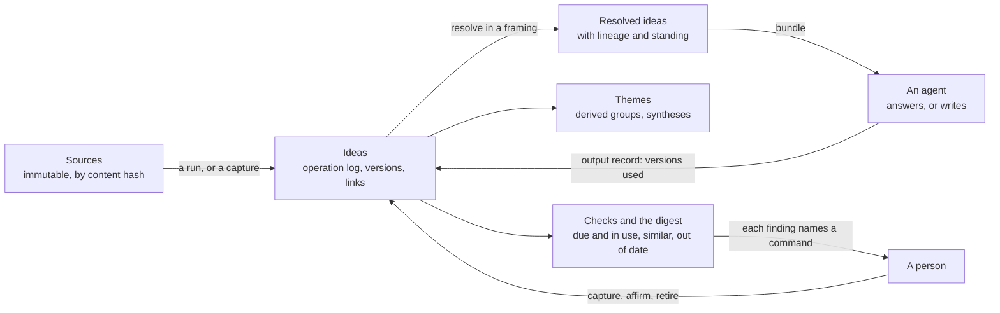

# Ideas: proposal and plan

A store of ideas instead of documents. Each idea is a few sentences, typed, linked to other
ideas, traceable to the sources it came from, and kept current. Agents in any harness reach it
over hosted MCP, answer questions from it and write documents from it on demand. It is an Umbel
plugin, with a hierarchy engine shared with Violet. The engine writes no text and makes no
judgment: models and people extract, judge and write, and it validates, matches, resolves and
records.

Its working name is Ideas, and the plugin id is `ideas` ([section 11](#11-for-the-owner)).

## Status

- **State:** proposed. Written 2026-11-11 against `main` at `8ef7aa68`, from a design discussion
  with the owner on 2026-11-10 and 2026-11-11, and revised the same day
  ([Revision](#revision-of-2026-11-11)). Nothing is implemented and nothing is approved beyond
  the owner's directions listed in [section 11](#11-for-the-owner).
- **Verified:** the facts in [What exists today](#2-what-exists-today) were read on `main` at
  `8ef7aa68` in the files each row names, and in `lushly-dev/violet` at `c4e8663` for Violet's web
  interface and plans. No Rust, TypeScript or Python was built or run. A status file's "exit
  criterion met" is reported as recorded, not re-run.
- **Not verified:** whether tantivy 0.27, as pinned, offers a more-like-this query; which local
  embedding model suits statements of a few sentences
  ([P3](#6-what-ideas-needs-from-the-platform)); whether a managed PostgreSQL reached over direct
  connections can meet the phase 6 backend's requirements (P10); how far Violet's engine is
  generic beyond a line-count estimate; every number in
  [section 7](#7-measurement-and-exit-criteria), which phase 0 sets. The scenario files parse
  and validate with AFD's scenario runner but have never been run, since nothing is built, and
  whether its matchers reach inside the items of a list was not checked. The external claims in
  [Evidence](#3-evidence) come from the sources listed there, each with its limit.

### Revision of 2026-11-11

The first version was rated against one user: someone collecting, organising and using a large
number of ideas that change over time. It was weakest where "large" and "change" bite. The owner
agreed these changes, and said an instance runs as a hosted MCP server on Umbel's stateless MCP:

| Weakness | Change |
| --- | --- |
| Duplicate refusal and retrieval rested on word overlap, and ideas are short and paraphrased | Matching by meaning from the start, measured against word overlap in phase 0 (P3, 4.4) |
| Nothing usable until a new engine and several host changes landed | A thin slice first, on one flat set (decision 19, [section 9](#9-steps)) |
| Review by calendar does not scale to thousands of ideas | Review driven by use, and a standing between seed and affirmed for a person's own words (4.3) |
| Nothing above the single idea | Derived themes, and syntheses that pin what they summarise (4.7) |
| Links stated only at capture | Link candidates at capture and for older ideas (4.5) |
| Merging was a workaround and splitting was missing | Both are operations (4.8) |
| Nothing told the person what needs them | A digest (4.9) |
| Where an instance runs was unstated | Hosted, over stateless MCP (4.11) |

A second pass the same day wrote the plan's jobs as AFD scenario files and used them as a
benchmark ([Jobs to be done](#jobs-to-be-done)). Writing them found what the plan was missing:

| A job could not be written because | Change |
| --- | --- |
| A hosted instance had no way to receive a source's content, and a web page or a book has no bytes to hash | `ideas-source-add`, for content sent over MCP and for reference sources (4.9) |
| Nothing flagged an idea that rests on one that changed | A link remembers the versions it was stated against (4.5) |
| Ideas could not be found by where they had been used | Finding by use, and a channel on an output record (section 5) |
| A book had nowhere to live between a single idea and a one-off output | Works: lasting, ordered arrangements of ideas (4.9) |
| Voice and structure for a format had no home | A format in the pack carries guidance, returned with a bundle (4.11) |
| Keeping material out of public work waited for the whole hierarchy | The thin slice has one level of framings that can only leave ideas out (4.6) |
| Review by use could not be shown without waiting years | Checks and the digest can be read as of a date (4.9) |

## 1. Problem and goal

Working knowledge is usually kept as documents, and the document is the wrong unit:

- **Ideas are buried.** One document holds many ideas wrapped in framing, history and
  qualification. Finding the idea means reading the document.
- **Copies drift.** The same idea is restated in several documents and versions. Nothing says
  which wording is current.
- **Overlap is invisible.** Two long documents that share a third of their ideas cannot be merged
  or even compared without reading both.
- **Context has to be carried.** To give an agent the background for a task, a person ports
  documents between tools.
- **Updates are heavy.** Where a knowledge base is curated, a change is a pull request and a
  pipeline, so small corrections are not made.
- **Origins and uses are lost.** It is hard to say where an idea came from, whether it is the
  person's own thinking or a research finding, and which published pieces have used it.

**Goal.** A person, or a team, keeps a body of ideas that grows without duplicating and without
going stale, and works with it through agents:

1. Capture an idea from a conversation in one call. A near-duplicate is refused with the idea it
   resembles, even when the wording differs.
2. Ask a question from any harness and get an answer built from current ideas, each with its
   sources.
3. Generate an article, a thread, a script or a chapter from a selection of ideas, and keep a
   record of which ideas it used.
4. Keep the source files, and mine them again when better models arrive, reviewing only what is
   new.
5. See the shape of thousands of ideas: the themes they form, and what is thought about each.
6. Be told what needs attention: what is new, what is about to be used and has not been looked
   at, what may be a duplicate, what a change has left out of date.
7. Hold one body of ideas in several framings, such as a public one and a book's, without copies.
8. Preview what a change would touch before making it.

**Not goals.** A document repository. A browsing interface as the main way in. A language model
inside the request path.

### Jobs to be done

The goal is held to twenty jobs. Each is a scenario file for AFD's scenario runner
(`packages/testing`) in [`scenarios/`](scenarios/), written against the draft commands of
[section 5](#5-commands-draft): a `job`, steps that call commands, and what each must return.
They are the plan's benchmark now and its acceptance tests later. They are drafts for the owner
to cut and add to, since only the owner knows which jobs are frequent and which hurt.

| | When | I want | Scenario | In |
| --- | --- | --- | --- | --- |
| 1 | An idea surfaces mid-conversation | It saved in one step and checked against what I have | `01-capture-in-flow` | slice |
| 2 | I finish a brainstorm or a voice memo | The raw session kept and its ideas pulled out | `02-keep-a-brainstorm` | slice |
| 3 | I finish research | Findings stored as evidence with citations, apart from my positions | `03-file-research` | slice |
| 4 | I start with years of my own documents | Them mined once without a mountain of review | `04-mine-an-archive` | slice |
| 5 | I look at an area I have thought about for years | To see what I think now, what is contested and what is unsupported | `05-see-what-i-think` | slice |
| 6 | My view changes | To change it once and see what rested on it | `06-change-my-mind` | slice |
| 7 | Two ideas are one, or one is two | To fix it without losing where they came from | `07-refactor-ideas` | slice |
| 8 | I write an article, a script or a thread | A draft built only from views I hold | `08-draft-from-what-i-hold` | slice |
| 9 | I need something to post today | Ideas I hold and have not used on that channel | `09-find-what-to-share` | slice |
| 10 | I work on a book for months | An outline that lasts, shows thin chapters and what each used | `10-keep-a-long-work` | slice |
| 11 | I have published | To know which pieces no longer match my thinking | `11-spot-stale-outputs` | slice |
| 12 | Weeks pass, or a better model arrives | A briefing, and to review only what is new | `12-catch-up` | slice |
| 13 | I hold material that must never appear publicly | That guaranteed, not remembered | `13-keep-private-out` | slice |
| 14 | I switch harness or device | The same ideas after signing in | `14-reach-from-any-harness` | slice |
| 15 | An agent or a new run touches what I affirmed | My wording to stand until I say otherwise | `15-protect-affirmed` | slice |
| 16 | An idea I affirmed long ago is never used | Not to be asked about it until it is | `16-stay-quiet-about-unused` | slice |
| 17 | I write for a particular audience | My ideas in its wording, with no second copy | `17-frame-for-an-audience` | whole |
| 18 | I am about to retire or rewrite an idea | To see what the change would touch first | `18-preview-a-change` | whole |
| 19 | I explore without a question | To follow what supports what and what leads where | `19-explore-connections` | slice |
| 20 | The store has grown | Older ideas that belong together offered for linking | `20-connect-older-ideas` | slice |

Jobs 15 and 16 are things the store must never do, written as jobs.

**What the files show.** All twenty parse and pass the runner's dry-run validation: 151 steps.
Against the draft command list they exercise 27 of 34 commands. No job uses `ideas-restore`,
`ideas-borrow`, `ideas-unlink`, `ideas-framing-update`, `ideas-framing-list`,
`ideas-source-register` or `ideas-source-list`. Either a job is missing or the command is not
needed ([section 11](#11-for-the-owner), question 11).

**What a scenario cannot show.** A scenario checks what commands return. It cannot judge whether
a model extracted the right ideas or wrote a good draft, so each job splits: the engine's part is
the scenario, with the model's output written into its steps, and the model's part is measured in
phase 0. Three scenarios (1, 12 and 15) expect a paraphrase to be refused; they pass only if matching by
meaning works, which makes them its benchmark. Job 14 is proved by running its file from two harnesses.

**What the runner cannot yet do** (P14):

- Assert anything but `success`, `data`, `reasoning`, `confidence` and an error's code, message
  and suggestion. A refusal's alternatives, a result's warnings and an error's details are out of
  reach, so "the refusal names the idea it resembles" cannot be checked. The plan therefore puts
  whatever a caller must act on in `data` as well.
- Run a step as a different actor. Every step runs as one test actor, so "an agent is refused
  and a person is allowed" cannot be written, and no scenario covers `FORBIDDEN`.
- Move the clock between steps. Job 16 is written with a read as of a date instead.

## 2. What exists today

### In this repository

| Need | Existing piece | Where |
| --- | --- | --- |
| A host over MCP and a CLI, with plugins, spaces, a journal and events | Umbel. Phases 0 to 4 record their exit criteria as met; phase 5 (auth and hosted) is mostly built; phase 6 (PostgreSQL) is specified, not built | `endpoints/umbel/docs/STATUS.md` |
| Stateless MCP | MCP 2026-07-28 over stdio and Streamable HTTP, with no in-memory sessions (principle 11) | `endpoints/umbel/docs/architecture.md` |
| Provenance on every record | The envelope: origin, principal, agent, session, validity, confidence, `sources`, `generated`, `contentHash`, `derivedFrom`, access | `endpoints/umbel/store/src/envelope.rs` |
| A plugin's own data in its own shapes | The `records` grant: any kind, free JSON, compare-and-set. Listed by kind and id only, 2 MiB a record, no field query, no delete | `endpoints/umbel/src/plugins/store_services.rs` |
| A person-only action | `knowledge-approve`, with `confirm = "require-human"` and `person = { cli = "terminal", mcp = "verified" }`, and the host's person page | `endpoints/umbel/plugins/knowledge/umbel-plugin.toml` |
| A verify-by date | `verified`, `stale_after`, `knowledge-stale`, for documents | `endpoints/umbel/plugins/knowledge` |
| Recorded background runs | The curator: a settling window, candidates, conflict sets, locked runs with reports. A schedule is a cron line that runs a command | `endpoints/umbel/plugins/curator`, `endpoints/umbel/docs/phases/4-curator/spec.md` |
| Source files and their metadata | `sources-sync`, `umbel-scan`, `umbel-okf` and the OKF frontmatter | `endpoints/umbel/plugins/sources-filesystem`, `endpoints/umbel/okf`, `endpoints/umbel/scan` |
| Text search | A tantivy BM25 index with fields, phrases, ranges and filters, one writer | `endpoints/umbel/store/src/index.rs` |
| A place for embeddings | Named, not built: an optional lane behind a provider trait, a local model or an endpoint, enabled on an instance only by evidence (decision D65, open decision O4) | `endpoints/umbel/docs/architecture.md`, `endpoints/umbel/docs/decisions.md` |
| A graph | A per-space graph with neighbours, related, path and outline. Contributions belong to a stored document, and `knowledge-index` rewrites them with eight fixed edge kinds | `endpoints/umbel/store/src/graph.rs`, `endpoints/umbel/plugins/knowledge/src/graph.rs` |
| Budgeted context for a task | `context-bundle` | `endpoints/umbel/plugins/context` |
| Capture from a harness session | The `umbel-hook` adapter | `endpoints/umbel/adapters/hook` |
| Results that explain themselves | `CommandResult`: `sources`, `reasoning`, `alternatives`, `suggestions`, `plan`, `warnings`, undo; shared codes including `ALREADY_EXISTS` and `CONFLICT` | `spec/error-codes.md`, `packages/rust/src/result.rs` |
| Several commands in one call | The hybrid strategy with `afd-batch` and `afd-pipe`; pipelines shipped as data | `spec/tool-strategies.md`, `spec/pipeline-variables.md`, `spec/plugin-manifest.md` |
| Long jobs, bounded reads | MCP Tasks and output budgets, in Rust | `packages/rust/src/server/tasks.rs`, `packages/rust/src/output_budget.rs` |
| A hierarchy with inheritance | Violet's engine: a tree of nodes, five operations (add, override, subtract, reset, copy), shared sets, an operation log, resolution, lineage, compare, drift, and a dry run over a read-only overlay | `foundations/violet/packages/core/src/engine`, `foundations/violet/packages/core/src/db/overlay.ts`, `integrations/violet-afd/src/commands` |
| A health report shape | Stable check ids, severity, evidence, remediation and a verdict | `endpoints/health/src/lushly_health/schemas/report-1.2.json` |
| A precedent for a further plugin | The `components` plugin: a specification approved before code, then one pull request a step | `endpoints/umbel/docs/plugins/components/spec.md` |
| An interface, later | Loam mounts an Umbel instance and renders its commands as forms. Its agent surface is not started | `endpoints/loam/docs/STATUS.md` |

What no part of the repository has:

- An idea as a unit, with typed many-to-many links between ideas.
- Near-duplicate detection. Duplicate checks are exact hashes and idempotency keys.
- A built embedding lane.
- A hierarchy engine in Rust. Violet's is TypeScript, and a plugin must be a compiled crate to
  reach the stores, since a component gets six grants and a mounted server gets none
  (`endpoints/umbel/wit/umbel-plugin-1.0.0/world.wit`, `endpoints/umbel/sdk/src/mounted.rs`).
- Pinned copies or a reading of the hierarchy as it stood at an earlier moment. Violet's copies
  are always live.
- A registry of sources keyed by content hash.
- A record of which ideas an output used.
- A way for a plugin to learn what was read or what was asked and not found.

### Outside it

The practices this draws on are in [Evidence](#3-evidence). The owner's experience with an
earlier, document-based knowledge system set what to keep and what to leave: a graph that
describes the data, signals of what is asked for and missing, and composition of several queries
in one call were worth keeping; updates by pull request, documents as the unit, and duplicate
avoidance by guideline were not.

## 3. Evidence

Read on 2026-11-10. Each row says what the source supports and where it stops.

| Source | What it supports | Limit |
| --- | --- | --- |
| Evergreen notes | One idea a note, organised by concept and not by source, titled as a claim, densely linked | A practice described by its author. No single right size for a note |
| Discourse graphs | Questions, claims, evidence and sources as separate nodes joined by supports and opposes, so a claim and its evidence are judged apart | Developed for research synthesis. Read from an interview and a paper abstract |
| The LLM wiki pattern | Immutable raw sources, a maintained layer of pages, a schema file; ingest, query and lint; an agent does the upkeep. Reported at about 100 sources | An idea file, intentionally abstract. It defines no citation format and does not address duplicates |
| Create once, publish everywhere | A content model kept apart from its presentations | Vendor and practitioner articles |
| Early MCP knowledge servers | Claims with per-claim provenance over a markdown vault | Prereleases, not evaluated here. None describes near-duplicate handling |
| Violet's interface walkthrough | Tracing one value through the hierarchy was the clearest moment; findings were hard to find and could not be acted on | Four model personas, not people (`lushly-dev/violet`, `docs/features/active/violet-ux-sessions.md`) |

Two gaps recur across these: nothing settles how duplicates are kept out, and nothing ties a
generated document back to the ideas it used. Both are central here.

## 4. Design

### 4.1 Decisions made in this plan

Each can be revisited by the owner.

1. **The idea is the unit.** A document is either a source that ideas came from or an output
   made from ideas. Neither is stored as knowledge.
2. **Sources are kept and never changed**, so they can be mined again.
3. **The record is an operation log.** Current state is computed from it. History, and the reason
   for each change, come with it.
4. **One body of ideas, several framings.** A framing inherits from its parent and may state,
   reframe, omit, restore or borrow ideas. Nothing is copied to make a variant.
5. **Capture is immediate; standing is earned.** A captured idea is durable at once and is a
   *seed*. Only a person affirms it. Agreed by the owner on 2026-11-11.
6. **Standing belongs to a wording.** It attaches to the version of an idea that a framing
   resolves to, not to the idea in general. A reframed wording starts again.
7. **A person's own words stand between seed and affirmed.** A statement the engine can find
   word for word in a source that is the person's own is *attested*, with no model's judgment
   involved.
8. **Review is driven by use.** An idea is put in front of the person when it is about to be
   used, not because a date passed.
9. **Links are authored, and candidates are offered.** A link is stated by whoever states the
   idea and is inherited through framings. The engine proposes which ideas might be linked; it
   never links them.
10. **A near-duplicate is refused at capture, matched by meaning as well as by words.** The
    caller then records another sighting of the existing idea, reframes it, or declares the new
    one distinct with a reason.
11. **A source is identified by its content hash**, so a second copy is recognised.
12. **Extraction is a recorded run.** A run names its sources and its extractor. What it captures
    are seeds, and it cannot change a version that has standing.
13. **Outputs are not stored; their use of ideas is.** An output record pins the versions it
    drew on.
14. **Themes are derived, and a synthesis is an idea.** Groups of ideas are computed, never
    filed. What is thought about a group is an idea of its own that pins the versions it
    summarises, so it shows when they have moved on.
15. **Merging and splitting are operations**, recorded with their reason like any other.
16. **The plugin's vocabulary is a pack.** Types, link kinds, review intervals, thresholds and
    output formats are not in its code.
17. **The hierarchy engine is shared with Violet** through one written semantics and one set of
    vectors ([P7](#6-what-ideas-needs-from-the-platform)).
18. **Every finding names the command that acts on it.**
19. **A thin slice ships first.** One flat set with capture, matching, links, standing, bundles
    and the digest is useful by itself and needs neither the engine nor most of the host
    changes. It writes the same operation log, so framings arrive later with no migration.
20. **An instance is hosted.** It is reached over Umbel's stateless MCP from every harness the
    person uses. Directed by the owner on 2026-11-11.
21. **Jobs are the benchmark.** The plan serves the [jobs](#jobs-to-be-done), each a scenario
    file. A command that no job uses has to justify itself, and a job that cannot be written as
    steps is a gap in the plan.
22. **A work is a lasting arrangement.** A book, a course or a series is an ordered outline of
    ideas that persists and is edited over months. It holds no prose.
23. **What a caller must act on is in the data.** Counts and lists of what needs attention are
    returned as data, not only as warnings, so an agent and a scenario can both read them.

### 4.2 Shape

Three kinds of thing, and only the middle one is curated:

- **Sources** come in: notes, transcripts, research reports, readings.
- **Ideas** are what is kept.
- **Outputs** go out: answers, articles, threads, scripts, chapters, briefs. They are made when
  asked for and can be made again.

### 4.3 Ideas, versions and standing

An idea has an id, a type and one or more versions. A version has the statement, tags, the
operation that created it, and its standing.

| Standing | Meaning | Set by |
| --- | --- | --- |
| `seed` | Captured, durable, labelled as not yet looked at in every answer | Any capture or reframe |
| `attested` | The statement is found word for word, after whitespace is normalised, in a source that is the person's own. The person wrote it, on that source's date; they have not said they still hold it | The engine, by checking the quoted span against the source. Which collections are the person's own is the deployer's configuration, never a caller's claim |
| `affirmed` | A person has said this wording is what they hold. Carries the date | A person only |
| `retired` | No longer held. Stays readable and names what superseded it | A person only |

A caller may ask for affirmed ideas only, or for attested and affirmed. A version with standing
is never edited: a change is a new version, which starts as a seed, and the earlier one stays
resolvable until the new one has standing.

**Review by use.** A type has a review interval in the pack, and an affirmation older than it is
*due*. Being due costs nothing until the idea is used. `ideas-bundle` marks each idea it returns
as seed, attested, affirmed or due, and `ideas-output-record` warns when an output pins an idea
that is a seed or due. The digest lists what is due and was used since the last digest, most used
first. The person affirms many at once. Ideas nobody reaches for can stay due.

The default pack's types, which an instance replaces with its own: position, principle, model
(a distinction or a named structure), evidence, example, question and synthesis. A question an
agent could not answer is captured as a question, so gaps in the store are ideas too.

### 4.4 Matching

Matching does three jobs with one mechanism: refusing duplicates, offering link candidates, and
finding ideas for a question. It has two lanes, fused as Umbel's retrieval design fuses them:

- **By words.** The lexical index. Always present.
- **By meaning.** An embedding of the statement. Short statements are often paraphrases of one
  another, which words alone miss.

The scores sort candidates into three bands, with thresholds in the pack that phase 0 sets from
labelled pairs: *same*, which refuses a capture; *related*, which is offered as a link candidate;
and *unrelated*. The engine only scores. Whether a candidate in the same band is the same idea is
the calling model's judgment, and the person's when they disagree: a capture can be repeated with
the matches declared distinct and a reason, which is recorded and listed for review.

The embedding lane is the one place a model runs inside a request. It writes no text, it is
pinned by name and version, and vectors are rebuilt when it changes. Umbel's architecture already
names this lane as optional and gated by evidence; this plan builds it and applies that gate to
an instance's own labelled pairs.

### 4.5 Links

A link is `(from, kind, to)`. The default kinds are supports, challenges, refines, depends-on,
example-of and summarises. Supersedes is not a link: it is recorded by retiring. A link is stated
in a framing, inherited by its descendants, and can be withdrawn in one of them. It resolves only
where both ends do. A link carries who stated it, and the version of each end it was stated
against. When an end is reframed or retired, an idea that depends on it, or was supported by it,
is reported as resting on something that changed.

Links are kept up as the store grows:

- **At capture.** The answer to a capture lists the related band, so the caller can state links
  in the same exchange. A shipped pipeline does capture then link in one call.
- **For older ideas.** `ideas-link-candidates` lists pairs in the related band that have no link,
  for a model to judge outside the request path. The digest counts them.

### 4.6 Framings

A framing is a node in a tree inside one space. The root holds what is held generally. Children
hold what differs for a setting: a public voice, a book, a product.

| Operation | In plain words | Effect in the framing |
| --- | --- | --- |
| state | states | A new idea exists here and in descendants |
| reframe | reframes | The statement or tags differ here; a new version |
| omit | leaves out | The idea does not resolve here or below |
| restore | restores | Local changes are dropped; the ancestor's version resolves again |
| borrow | uses the idea from | An idea from another framing resolves here, following its source |
| include | applies the set | Every idea of a shared set resolves here, by a merge or an override policy |

Three structural kinds of framing: standard, shared set, and pinned. The plain words in the
second column are used in every surface, and the command names keep the precise terms, as
Violet's interface does (`lushly-dev/violet`, `packages/web/src/app/vocabulary.ts`).

Omitting is what keeps material out of a setting by construction. An idea omitted from the public
framing cannot be returned by a call that resolves the public framing, which a note saying "do
not quote this" cannot guarantee.

The thin slice has the root and one level of framings beneath it that can only leave ideas
out. That is enough to keep material out of a setting by construction, and it is a strict subset
of the full semantics, so nothing in it is thrown away.

### 4.7 Themes and syntheses

With thousands of ideas, the single idea is too small a unit to think with.

- **A theme is derived.** Ideas are grouped by the links between them and by the related band of
  matching. Themes are computed when asked for and never stored as a filing structure, so they
  follow the ideas. `ideas-themes` lists them with their size, their most central ideas, the tags
  they share, and their synthesis if they have one.
- **A synthesis is an idea.** Its statement says what is thought about a theme. It has
  summarises links to its members and pins their versions, as an output does. A model writes it
  and it starts as a seed. When a member is reframed, retired, or joined by new ideas, the
  synthesis is reported as out of date, with the members that moved.

A synthesis can summarise syntheses, so the store can be read at several heights. A question
about a whole area is answered from the synthesis first, with its members beneath it.

### 4.8 Merging and splitting

Ideas are refactored as thinking matures.

- **Merge.** Several ideas become one. The survivor keeps every source, sighting and link of the
  others, which are retired naming it. Links that would now join an idea to itself are dropped.
- **Split.** One idea becomes several. Each new idea is stated with the sources and links the
  caller assigns it, and the original is retired naming all of them.

Both are single operations with a reason, both can be previewed, and both need a person when any
version involved has standing. An agent may merge seeds.

### 4.9 Sources, runs, outputs and the digest

- **Source.** A document in a collection, registered by the SHA-256 of its bytes, with a kind, an
  origin (the person's own thinking, a conversation, research, a reading), and the date the
  thinking happened as distinct from the date it was filed. A second file with the same hash is
  the same source. One that matches after line endings and trailing space are normalised is
  reported as a near copy. An idea cites a source with a locator and the hash of the quoted text. A hosted instance
  receives a source's content over MCP with `ideas-source-add`, journaled as a digest. A web page
  or a book is a *reference* source: a URI or a citation, the date it was read, and the passages
  relied on, each hashed. A reference source can back evidence and can never attest a statement.
- **Run.** A record of one extraction: the sources read, a label for the extractor (the model and
  the prompt version, supplied by the caller), and the time. Captures made under a run carry its
  id. A run's report says what was new, what matched an existing idea and was recorded as another
  sighting, and what was refused.
- **Output.** A record with a title, a format, the framing, and the list of idea versions used.
  The drift of an output is the difference between those versions and what the framing resolves
  now.
- **Work.** A named, ordered outline of sections, each holding ideas. It lasts and is rearranged
  as the work develops. An output can be recorded against a section, which pins what that draft
  used. The work reports sections with too few ideas or no evidence, ideas of the same themes
  that are not yet placed, and drafted sections whose ideas have since moved.
- **Digest.** One read that says what changed since a cursor and what needs the person: new seeds
  by run and source; ideas due and in use; pairs that may be the same idea; link candidates;
  syntheses out of date; questions still open; outputs that have drifted. The platform has no
  scheduler, so a cron line or a harness's scheduled task runs it, as the curator's runs are
  scheduled. The digest and the health report can be read as of a date, to see what will be due.

Mining a source again with the same extractor adds nothing. Mining it with a better one adds
seeds and sightings and changes no version with standing. How often an idea is sighted across
sources is a signal worth showing.

### 4.10 What is deterministic

| The engine does | The calling model does | A person does |
| --- | --- | --- |
| Identity, hashing, validation | Reads sources and proposes ideas and links | Affirms and retires |
| Checking a quoted span against its source, for attested standing | Judges whether a candidate is the same idea as a match | Settles contradictions |
| Matching scores and bands, and the refusal | Judges link candidates | Merges and splits ideas with standing |
| Resolution, lineage, compare, drift | Writes syntheses and outputs | Chooses what to publish |
| Themes | Chooses a selection and an angle for an output | |
| Rule checks, the health report and the digest | | |
| Selection for a bundle from explicit criteria, and its budget | | |
| The preview of a change | | |

### 4.11 The plugin and an instance

| The plugin ships | An instance supplies |
| --- | --- |
| The record shapes, the engine, the commands | Its sources and ideas |
| A default pack: types, link kinds, review intervals, matching thresholds, and a few output formats, each with guidance on structure | Its own pack, replacing the default whole, with its formats, channels and guidance on voice |
| A skill that teaches capture, asking and writing | Its framings, and which collections are the person's own |
| | Its backend, its embedding model and its identity provider, chosen by the deployer |

A plugin cannot choose or contribute a backend (decision D132), which is the separation wanted
here: the same plugin runs for one person on one machine or behind an enterprise identity
provider on a shared backend, with no change.

**An instance, hosted.** An instance is an Umbel deployment with this plugin, serving MCP
2026-07-28 over Streamable HTTP with no sessions, so any harness that speaks MCP reaches the same
ideas. What that takes:

- **Sign-in.** Phase 5's hosted profile: `auth.mode = "oauth"` behind an authorization server, or
  `gateway`. Person-only commands go through the host's person page.
- **One machine or several.** A `single` deployment keeps the embedded store on that machine's
  disk and needs only phase 5's exit. A `shared` deployment, several machines behind one address
  or a platform that starts a process per request, keeps its state on PostgreSQL with a key
  service and waits for phase 6 (decisions D145 and D149).
- **Direct connections.** Phase 6's doctor fails a transaction-pooling proxy, because rotation
  leases and the index writer hold session locks. A managed PostgreSQL has to be reached over its
  direct endpoint (P10).
- **Backup.** `store-backup` makes a consistent copy of a space's stores today; restoring from
  one arrives with phase 6. An instance is not trusted with a person's thinking until a restore
  has been shown to work.

### 4.12 Trust

- Stored text is untrusted input. A statement mined from a source can carry instructions. It is
  labelled content, scanned and flagged, and never placed in a message, warning or log.
- Standing is shown wherever an idea is returned.
- A person-only command uses the host's existing rule for one:
  `confirm = "require-human"` with `person = { cli = "terminal", mcp = "verified" }`.
- Nothing crosses spaces. A framing tree lives in one space.
- An idea whose only sources the caller cannot read is denied, as derived content is today.

### 4.13 Beside memory and knowledge

Umbel has two stores with two write paths (principle 8, decision D9). Ideas is a third. It is not
the knowledge plugin with another schema.

| | memory | knowledge | ideas |
| --- | --- | --- | --- |
| Unit | A record of a session, a fact someone asserted, a note on how something is done | A document | An idea, with versions |
| Who writes | Agents | A proposal that a person or a policy approves | Agents and people, at once |
| Standing | None: nothing in memory is verified | Verified, with a verify-by date | Seed, attested, or affirmed by a person |
| Lifetime | Expires | Durable | Durable |
| Relations | None of its own | Derived from structure: hierarchy, headings, links, tags, owners | Authored and typed: supports, challenges, refines |
| Variation | By scope: space, project, actor, session | By collection and access | By framings that inherit |
| The record | Bitemporal records | The current document and its changes | An operation log; state is computed |
| What it is for | Remembering | Reference that an agent reads | A body of thinking that an agent answers and writes from |

What the three share is the host: the stores behind the traits, the index, the graph, the
envelope, events, sign-in and spaces. Ideas brings no database of its own. It does need the host
to offer more than it does today, which is P1 to P5 and P13.

Where they meet:

- A knowledge document, or any file in a collection, can be a source. An idea cites it, and with
  P4 that citation is an edge in the graph.
- Memory that has settled could become seeds, as the curator turns it into knowledge proposals
  today.
- An affirmed idea that an organisation wants as reference is proposed to knowledge like any
  other change.
- With P9 a context bundle can carry ideas beside knowledge and memory.

## 5. Commands (draft)

All in the `ideas` domain. Names and inputs are settled by the plugin's specification. The slice
column marks what the thin slice has.

| Command | Kind | Slice | What it does |
| --- | --- | --- | --- |
| `ideas-capture` | write | yes | States a new idea as a seed, with type, statement, tags, sources and links. Refuses a match in the same band with `ALREADY_EXISTS`, the matches as alternatives, and the three ways forward. A capture that succeeds returns the related band as link candidates. A statement quoted from the person's own source is attested |
| `ideas-observe` | write | yes | Records another sighting of an existing idea in a source |
| `ideas-reframe` | write | yes | A new wording or new tags; a new version |
| `ideas-omit` | write | yes | Leaves an idea out of a framing |
| `ideas-restore`, `ideas-borrow` | write | | The other framing operations. No job uses them yet |
| `ideas-link`, `ideas-unlink` | write | yes | State or withdraw a typed link |
| `ideas-affirm` | write, person only | yes | Affirms the versions a framing resolves, one or many |
| `ideas-retire` | write, person only | yes | Retires an idea, optionally naming its successor |
| `ideas-merge`, `ideas-split` | write, person only when standing is involved | yes | [4.8](#48-merging-and-splitting) |
| `ideas-framing-create`, `ideas-framing-list` | write, read | yes | The tree. In the slice, one level beneath the root |
| `ideas-framing-update` | write | | Shared sets, status and sunset. No job uses it yet |
| `ideas-source-add`, `ideas-source-list` | write, read | yes | Adds a source by its content, by a document already in a collection, or as a reference, and reports copies and whether it can attest. `ideas-source-register` is folded into it |
| `ideas-run-open`, `ideas-run-show` | write, read | yes | Opens a run and reports what it produced |
| `ideas-output-record` | write | yes | Records an output, its format and channel, the versions it used, and the work and section it belongs to, and returns the seeds and due ideas among them |
| `ideas-work-create`, `ideas-work-arrange`, `ideas-work-show` | write, read | yes | A lasting outline, and what it says about thin, unplaced and moved ideas |
| `ideas-find` | read | yes | Ideas by meaning and words, and by type, standing, tag, source, run, link, or where they have and have not been used, paged inside a budget |
| `ideas-open` | read | yes | One idea: its version, history, links both ways, sources, sightings and the outputs that used it |
| `ideas-related` | read | yes | Neighbours by link kind to a depth, and paths between two ideas |
| `ideas-themes` | read | yes | The derived themes, each with its synthesis and whether it is out of date |
| `ideas-link-candidates` | read | yes | Pairs in the related band with no link |
| `ideas-bundle` | read | yes | A budgeted bundle for a task: a synthesis where one fits, the selected ideas, what supports and challenges them, their sources and their standing, and the named format's guidance, as JSON or a text block |
| `ideas-digest` | read | yes | [4.9](#49-sources-runs-outputs-and-the-digest) |
| `ideas-check` | read | yes | The health report |
| `ideas-compare` | read | | Two framings, or an output against the present |
| `ideas-preview` | read | | What a set of proposed operations would change, where, and which findings it would add or clear, with the commands that apply it |

The plugin contributes one AFD context, so an agent that enters it sees these commands without
competing for the first-class places, which are capped at eight (decision D27). Composable
commands need no approval, confirmation or task, since a gated step cannot run inside `afd-pipe`
or `afd-batch`. It ships pipelines as data for the common sequences, such as capture then link.

Reads return counts beside their lists. Checks in the report, each with a stable id: an idea due and in use; an idea that
rests on one that changed; a seed older than a set age
that an output has used; a position with no supporting evidence; an idea with a standing
challenge; a pair in the same band with no declared relation; an idea with no link and no use; a
synthesis out of date; a theme above a set size with no synthesis; a link whose end no longer
resolves; an output that pins a retired idea; a section of a work that is thin or has moved; and, with framings, a reframe equal to what it
inherits and a framing past its sunset date.

## 6. What Ideas needs from the platform

The owner's direction is to improve the platform where that makes the whole stronger, and not to
work around a limit that a general change would remove. Each row is a change that serves more
than this plugin. The last column says what happens if it is declined.

| | Change | Why it is general | If declined |
| --- | --- | --- | --- |
| P1 | **Standing for durable records.** Amend principles 8 and 9 and decisions D9 and D98: a plugin may hold durable, agent-writable records that carry their standing, are left out for a caller that asks for verified content only, and gain standing only from a person, a declared policy, or a check against a source | Today there are two stores and two write paths, memory that expires and knowledge that changes by proposal. A third pattern, durable but not yet affirmed, is what capture needs, and it keeps the intent of both rules | The plugin cannot offer immediate capture |
| P2 | **Indexed records.** A plugin declares record kinds and fields for the search index, and the host indexes them as it indexes documents | Records are listable by id only. Any plugin with its own shapes needs to find them by field and text | The plugin loads every record and filters in memory |
| P3 | **Matching, with two lanes.** A query on the index trait that returns the stored items most like a given text, by words and by meaning. This builds the embedding lane the architecture names, behind its provider trait, and applies decision D65's gate to an instance's own labelled pairs. It answers open decision O4 for spaces of short records | Proposal validation lists a duplicate check and has only exact hashes. Knowledge proposals, curator candidates and memory would all use it, and knowledge search gains the lane it was designed to take | The plugin matches by words only, over its own records, and paraphrased duplicates get through |
| P4 | **A graph with more than one writer.** Contributions are held per contributor and origin; an origin may be a record; a plugin declares its edge kinds | One writer and eight fixed kinds mean no plugin can add meaning to the graph. With this, an idea links to the document it came from, and an output to the ideas it used, in one graph | Links live in plugin records and are invisible to `knowledge-neighbors` and the rest |
| P5 | **Content identity for documents.** Find a document by content hash, and report copies that differ only in line endings and trailing space | Duplicate source files are a problem for knowledge collections too | The plugin keeps its own hash table |
| P6 | **Shared run and proposal shapes** in the SDK | The curator, knowledge proposals, this plugin's runs and the Agent Engine proposal describe the same loop with different records | Each keeps its own |
| P7 | **One hierarchy semantics.** A written specification of the tree, the operations, resolution, lineage and the preview, with vectors, as AFD does for its contract. A Rust engine for it in `foundations/`, with no AFD dependency. Violet's TypeScript engine is held to the same vectors. The semantics gains what both lack: pinned copies, reading the tree as of a moment, changes to one field of a value, and a preview of a batch across nodes | Violet has no pinning, compares values whole, and cannot stage a batch. A second engine written without a shared specification would drift from the first | The plugin ports Violet's engine privately, and the two diverge |
| P8 | **A preview convention in AFD.** A standard way for a write command to answer with what it would do | Violet's `changes.impact`, `knowledge-proposal-preview` and this plugin's preview are three shapes for one thing. Only `plan` is shared today | The plugin defines its own |
| P9 | **Bundle sections from indexed records**, so `context-bundle` can include ideas without depending on this plugin | A harness asking for context should get relevant ideas with the rest | A caller asks both plugins |
| P10 | **A managed PostgreSQL, over direct connections, in phase 6's certification targets**, and a decision on the key service a one-person deployment needs | Whether a managed service satisfies phase 6 is unknown, and a hosted instance on several machines depends on it | A hosted instance stays on one machine with the embedded store |
| P11 | **A lens kit in Loam**: tree, matrix, health and compare views over the hierarchy commands | Violet's interface is outside the repository. Tokens and ideas would both get an interface from one kit | No interface beyond console forms |
| P12 | **A `tokens` plugin**: Violet's tokens served through Umbel on the shared engine | Agents in any harness would reach design tokens as they reach component briefs | Violet stays reachable only through its own server |
| P13 | **Demand signals a plugin can read.** Per record, how often it was returned; per command, the queries that returned nothing. Opt-in for a space, with retention, since a query is content | A read cannot write, and a plugin cannot read the journal, so no plugin can learn what is used or what is missing. Knowledge would rank stale documents by use and find its gaps the same way | Use is known only from recorded outputs, and gaps only when an agent captures a question |

| P14 | **A fuller scenario runner.** Expectations on alternatives, warnings, sources and an error's details; an actor for a step; a way to move the clock between steps; fixtures for a plugin's records | The runner can check only part of the result that AFD defines, and cannot script a person-only command. Every command set with refusals and gated steps has the same limit | The scenarios check less than the jobs say, and person-only rules are tested elsewhere |

P1 to P3 come before the thin slice, and P14 beside it. P4 to P8 and P13 come with the rest of
this plan. P9 to P12 follow its exit.

On the word connector: in AFD it wraps a command-line tool, in Botcore it is typed commands over
an external service, and in Umbel it binds a plugin to an external source. The abstraction that
keeps the database out of a plugin is the store traits and their backends. Sources are where a
connector belongs.

## 7. Measurement and exit criteria

The plan is done when every scenario in [`scenarios/`](scenarios/) passes against a hosted
instance, and the measures below hold on the phase 0 corpus and a seeded fixture. Phase 0 sets
every threshold. The scenarios show that each job works once; the measures show that it keeps
working at size.

1. Capture refuses the labelled duplicate pairs, paraphrases among them, and admits the labelled
   distinct pairs, at the rates phase 0 fixes.
2. Mining a source again with the same extractor creates nothing. Mining it with another changes
   no version with standing.
3. Every idea resolves to at least one source, or to a capture a person made directly. Every
   attested statement is found in its source.
4. For a seeded set of questions, a bundle returns the labelled ideas inside the default budget,
   and for a question about a whole area it returns the synthesis.
5. Every seeded change to a member reports its synthesis as out of date.
6. A merge keeps every source, sighting and link of the ideas merged, and a split loses none.
7. The health report and the digest find every seeded fault, and each finding names a command
   that clears it. An idea that is due and unused appears in neither as needing action.
8. The Rust engine and Violet's TypeScript engine pass the same vectors.
9. For any set of proposed operations, the preview equals the effect of applying them.
10. Nothing is returned across spaces, and nothing omitted from a framing is returned from it.
11. Two different harnesses capture and ask against one hosted instance over stateless MCP, each
    in one call, after signing in. Affirming goes through the person page.
12. An instance is backed up and restored with no loss.

The thin slice is done when every scenario marked slice passes, it meets 1 to 7, 11 on one
machine, and 12 as an export and import, and it has been in daily use by the owner.

## 8. Phase 0: measure before specifying

No production code. A real corpus chosen by the owner, with a sample labelled by hand.

| Step | Question | Method | Output |
| --- | --- | --- | --- |
| 0.1 | Is the unit right, and are the types enough? | A model extracts ideas from the corpus into a flat file. The owner reviews a sample | Counts, a revised type list, examples of ideas that were too large or too small |
| 0.2 | Can matching be trusted to refuse? | Label about 200 pairs, with paraphrases and near misses. Score them by words, by meaning with two or three local embedding models, and by both | A method, a model, the same and related thresholds, and their error rates |
| 0.3 | Can questions be answered from ideas? | Twenty real questions, answered from bundles | Missing link kinds, a default budget, what retrieval missed |
| 0.4 | How much review is there? | Count seeds, attested statements and affirmations needed for the corpus; time a sample of affirmations | Review intervals, and whether attested standing carries enough of the load |
| 0.5 | Do derived themes match how the owner groups ideas? | Compute themes two ways and compare with the owner's own grouping of a sample | A grouping method, and a size above which a theme wants a synthesis |
| 0.6 | Does a hierarchy of framings fit ideas? | Load the ideas into Violet as it is, as composite values, with three or four framings. Exercise each operation, lineage, compare and the dry run | What fits, what breaks, which operations are used |
| 0.7 | Records or documents? | Compare the two against what 0.1 to 0.6 found | A recommendation for question 2 of [section 11](#11-for-the-owner) |
| 0.8 | Are these the right jobs? | The owner walks each job on the corpus by hand, with a model doing the model's part | Jobs cut, added and ranked; the model's part of each job judged; the slice's scope confirmed |

If 0.6 shows that framings do not fit, the plan keeps the flat set of the thin slice, and P7
narrows to what Violet needs.

## 9. Steps

Each step is one pull request unless its specification says otherwise.

| Phase | Work | Needs |
| --- | --- | --- |
| 0. Prove it | [Section 8](#8-phase-0-measure-before-specifying), recorded beside this file | A corpus |
| A. Specify the slice | A1: P1 as amendments to Umbel's architecture and decision log. A2: P2 and P3 as a host specification. A3: the plugin's specification for the slice at `endpoints/umbel/docs/plugins/ideas/spec.md`, in the shape decision D150 sets, with the scenarios moved beside it. A4: P14 as an AFD change, specification first | Phase 0; the owner's answers |
| B. Matching in the host | P2 and P3 in the store traits, the embedded backend and the conformance suite | A2 |
| C. The thin slice | C1: crate, pack, records, capture with the refusal and candidates, observe, reframe, open, find. C2: links, link candidates, sources by hash, runs. C3: standing: attested, affirm, retire, merge, split. C4: bundle, output records, works, themes and syntheses, the health report, the digest. C5: the skill, the hook capture, export and import. Each step ends with its scenarios passing | A3, B |
| D. A first instance | The slice hosted over stateless MCP on one machine, with sign-in, in daily use | C; phase 5's exit |
| E. Specify the rest | E1: the hierarchy semantics and its vectors (P7). E2: P4 to P6 and P13 as a host specification. E3: P8 as an AFD proposal, specification first. E4: the plugin's specification amended for framings, compare and preview | 0.6; what the slice taught |
| F. Engine and host | The Rust engine and the vectors, with Violet's engine run against them and each difference fixed or recorded. P4 to P6 and P13 in the host | E1, E2 |
| G. The plugin, whole | The framing operations and lineage on the engine; compare; preview; links and themes on the host graph; demand signals in the digest and the report | E4, F |
| H. After the exit | P9 to P12; a code mode when Umbel has one | G |

Phases B and C1 can overlap once A2 is approved, and E can start while the slice is in use.

## 10. Risks and open points

| Risk | Handling |
| --- | --- |
| The unit is wrong: ideas come out as paragraphs or as fragments | Phase 0.1 settles the size before anything is specified. The statement has a length limit |
| Matching refuses ideas that are distinct, and capture becomes a fight | The caller may declare an idea distinct with a reason, which is recorded. Phase 0.2 sets the thresholds from labelled pairs. The report lists declared-distinct pairs for review |
| Matching admits duplicates | The report and the digest find pairs in the same band after the fact, and merge is one operation |
| An embedding model changes or is withdrawn | It is pinned by name and version, vectors are rebuilt on a change, and the lexical lane works without it |
| An embedding endpoint would send a person's ideas off the machine | A local model is the default. An endpoint is the deployer's choice |
| Everything stays a seed | Attested standing covers a person's own words with no action. Review is asked for at the moment of use, many at once |
| Derived themes do not match how the person thinks | Phase 0.5 compares methods with the owner's own grouping. Themes are never stored, so a better method costs nothing to adopt |
| A synthesis reads as settled when its members have moved | It pins member versions and is reported out of date; a bundle says so when it returns one |
| The digest becomes noise | It lists only what was used or is new since its cursor, ranked, with counts for the rest |
| Framings do not fit ideas | Phase 0.6 tests it on real content, and the slice works without them |
| Host changes widen Umbel's surface | Each is specified on its own, with its own conformance tests, and each serves a plugin that already exists |
| Two engines drift | P7's vectors, run in both languages on every change |
| A source carries instructions that reach an agent through an idea | Labelled content, scanned and flagged; statements are never used as messages |
| A harness has no verified person channel | Affirming falls back to the terminal, as approving a proposal does |
| A hosted instance waits on unfinished phases | One machine needs only phase 5's exit. The slice runs over stdio until then |

Open points:

- Whether an idea's type may be reframed, or only its statement and tags.
- Whether a shared set is a framing or a separate thing.
- Whether a link needs standing of its own, or its author is enough.
- Whose affirmation counts when a space is shared by a team. The jobs assume one person.
- Whether people, organisations and products that ideas are about need to be more than tags.
- How the plugin's context relates to the `context` plugin's bundles before P9.
- Whether Violet moves onto the Rust engine later. This plan holds both to one semantics and
  leaves that choice open.

## 11. For the owner

Directed or agreed on 2026-11-11, to be recorded when this plan is approved:

- The standing rule (decision 5, P1).
- The changes in the [Revision](#revision-of-2026-11-11): matching by meaning, the thin slice,
  review by use, themes and syntheses, link upkeep, merge and split, and the digest.
- Jobs to be done, as AFD scenarios, are the plan's benchmark.
- An instance runs as a hosted MCP server on Umbel's stateless MCP (decision 20).
- The platform's existing plans may change where a change makes the whole stronger.

Questions, each with a recommendation:

1. **The wording of P1.** Recommended: durable records may be written by agents where a plugin
   declares it; they carry their standing; a caller may exclude those without it; only a person,
   a policy the deployer declares, or a check against a source gives standing.
2. **Records or documents.** Recommended: ideas are plugin records, indexed through P2. As
   documents they would gain search and the verify-by date at once, and lose immediate capture,
   typed links and their own shape.
3. **The name for the hierarchy.** "Context" is taken twice: AFD contexts scope visible
   commands, and Umbel has a `context` plugin. Recommended: **framing**. It says what the thing
   is, the same ideas framed for a setting, it gives "reframe" for the override, and it is not
   used as a term anywhere in the repository. Alternatives: *perspective*, which can be read as
   someone's opinion, and *edition*, which suggests a sequence in time and is Cargo's word.
   "Frame" is Loam's word for its editor frame.
4. **The embedding lane (P3).** Whether an embedding of the incoming statement is within
   principle 4, as the architecture's optional lanes imply. Recommended: yes, with a local model
   by default, chosen in phase 0.2.
5. **The shared engine (P7).** Recommended: yes, as a foundation with its own name, with Violet
   held to the same vectors and not moved onto it yet.
6. **The host changes (P2 to P6 and P13).** Recommended: all as host work. Each has a fallback
   inside the plugin, and each fallback leaves the limit in place for the next plugin.
7. **The first instance.** Recommended: one machine with the embedded store and a persistent
   disk, which needs only phase 5's exit. Several machines, or a platform that starts a process
   per request, wait for phase 6 and P10. Also: which authorization server it signs in through.
8. **The plugin id and domain.** Recommended: `ideas`.
9. **The phase 0 corpus**, and who labels the samples.
10. **Scope.** Whether P9 to P12 belong to this plan's last phase or to plans of their own.
11. **The jobs.** Which of the twenty to cut, which are missing, and which matter most. And the
    seven commands no job uses: recommended, drop `ideas-borrow` and `ideas-framing-update` until
    a job needs them, and keep `ideas-restore`, `ideas-unlink` and the two lists as housekeeping.

## 12. Out of scope

- An interface. Loam is where one would land (P11).
- Choosing or calling a language model.
- Publishing an output anywhere.
- A scheduler. A cron line or a harness's scheduled task runs the digest.
- Ideas shared between spaces.
- Importing other note-taking formats.

## Sources

- Andy Matuschak, "Evergreen notes should be atomic" and "Evergreen notes should be
  concept-oriented": <https://notes.andymatuschak.org/zNUaiGAXp21eorsER1Jm9yU>,
  <https://notes.andymatuschak.org/Evergreen_notes_should_be_concept-oriented>
- Protocol Labs, "Discourse Graphs and the Future of Science":
  <https://protocol.ai/blog/discourse-graph-qa/>
- Joel Chan and others, "Steps Towards an Infrastructure for Scholarly Synthesis":
  <https://arxiv.org/abs/2407.20666v1>
- Andrej Karpathy, "LLM Wiki", 2026-04-04:
  <https://gist.github.com/karpathy/442a6bf555914893e9891c11519de94f>
- Lullabot, "Understanding Create Once Publish Everywhere":
  <https://lullabot.com/articles/understanding-create-once-publish-everywhere-cope>
