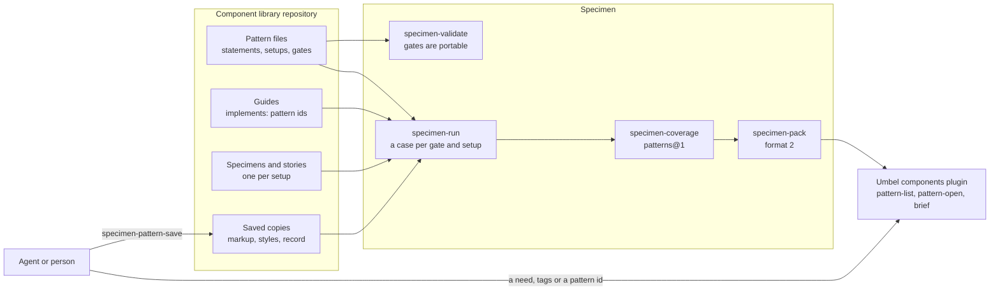

# Patterns: proposal

A pattern says what a recurring piece of interface is for, what every
implementation of it must keep, what may change, and how to test what must be
kept. Components and saved regions of screens are implementations of patterns.
Specimen runs a pattern's tests against each implementation, the component pack
records which hold, and Umbel serves the result.

## Status

- **State:** proposed. Drafted 2026-11-12 against `main` at `d152f3dc`.
  Nothing is implemented and nothing is measured. [STATUS.md](STATUS.md)
  tracks progress.
- **Verified:** the facts in [What exists today](#3-what-exists-today) were
  read on `main` at `d152f3dc`. The nine jobs are written as scenario files
  and pass the checks in [Jobs](#4-jobs).
- **Not verified:** everything in [Design](#5-design). It is a draft to write
  jobs against. The paths have not been walked by readers who did not write
  them, and the owner has not cut, added or ranked the jobs.
- **Evidence this rests on:** thin. [Component Briefs](../../active/component-briefs/prototype.md)
  found that better context made an agent's pages cheaper and not measurably
  more correct. [Phase 0](#phase-0-prove-it) tests this proposal's claims
  before any format is written.

| Field | Value |
| --- | --- |
| Epic | [#1073](https://github.com/lushly-dev/afd/issues/1073) |
| Units touched | `foundations/specimen`, `integrations/specimen-afd`, `endpoints/specimen-cli`, `integrations/specimen-fast-af`, `foundations/fast-af/packages/violet-elements`, `endpoints/umbel` (its `components` plugin), `endpoints/loam` (its specimens and design record) |
| Related | [Specimens status](../../active/specimens/STATUS.md), [Component Briefs status](../../active/component-briefs/STATUS.md), [pack format](../../../../foundations/specimen/docs/pack-format.md), [`components` plugin specification](../../../../endpoints/umbel/docs/plugins/components/spec.md), [Loam design skill](../../../../.claude/skills/loam-design/SKILL.md) |

## 1. Problem and goal

Four things are hard today.

1. **Guidance is tied to one implementation.** A guide file is keyed by a
   tag. Its statements mix what any implementation needs ("unchosen text is
   discarded on Tab, Escape or an outside press") with one implementation's
   API ("call `selectValue(optionValue)`"), both in
   `violet-elements/src/combobox/violet-combobox.guide.json`. The checks
   reach inside the implementation: the button's plays find the inner
   `button` through `shadowRoot` (`violet-button.stories.ts`, lines 95 and
   146). A second implementation, in another library, another framework or
   for another device, starts with nothing that says what it must keep and
   nothing that can test it.
2. **A region that works cannot become a reference.** The only saved markup
   is a pack's examples: at most three per component, 4 000 characters each,
   taken from that component's own stories. Loam's screen specimens
   (`endpoints/loam/packages/chrome/specimens/`) are written by hand.
3. **Reuse has one mode.** A maintained component earns its upkeep when
   central updates and verified behaviour matter. Most compositions do not
   need that. An agent can copy and adapt one cheaply, but nothing records
   where the copy came from or what must survive the adaptation.
4. **Nothing answers "what should I use here".** Component Briefs left it
   out of scope: `components-list` filters by tag and summary text.

**Goal.** A person or an agent can:

- find a pattern by what a region must do, and be told plainly when nothing
  fits;
- get what must be kept and what may change, stated once per pattern;
- build a new implementation and hold it to the same tests as the original;
- save a working region of a screen as a reference, told what could not be
  saved;
- learn which saved references a component change has made stale.

**Non-goals.** Removing components. Inserting a pattern into a page: an agent
writes the code and Git keeps the history. Pattern inheritance or nesting.
Ranked search (the knowledge plugin's job, as Component Briefs decided).
Replacing a component's own stories. Changing how tokens are named or scaled.
A review surface for people: commands come first.

## 2. Terms

| Term | Meaning |
| --- | --- |
| Pattern | An implementation-independent description of a recurring piece of interface: a control (a select, a modal dialog) or a composition (an empty collection, a grouped settings form). It has an id, statements, setups and gates |
| Statement | One sentence with a stable id, of four kinds. `useWhen` and `avoidWhen` are for choosing. `keep` is a requirement on every implementation. `customize` is what an implementation or a copy may change |
| Gate | An executable test of one `keep` statement, written only against roles, accessible names, focus, standard form behaviour and geometry, so it runs unchanged on any implementation |
| Setup | A named arrangement a gate starts from, described in a sentence, such as "three options, none chosen, labelled Fruit". Each implementation supplies its own way to mount it |
| Implementation | Something that realises a pattern: a **component** (a custom element in a library) or a **copy** (the saved markup and styles of a region) |
| Linkage | How an implementation is reused. A component is used by **instance**: a consumer imports it and takes its updates. A copy is used by **copying**: the consumer owns the result and nothing updates it |
| Revision | The digest of a copy's saved bytes |
| Fingerprint | A digest of the manifest's declarations of the components a copy uses. It changes when one of their APIs does |
| Provenance marker | A short text on a copied region's root naming the copy it came from and that copy's revision |

The word follows the WAI-ARIA Authoring Practices, where a pattern states
roles, states and keyboard behaviour and example implementations follow it.
The pack format already uses "pattern" for an identifier's regular
expression; this proposal calls those "identifier forms".

## 3. What exists today

Specimen (`foundations/specimen`):

- **Guides.** The `guides` key finds one file per component (`tag`,
  `summary`, `status`, `usage`, `a11y`, `roles`, `detail`) and rules files
  whose rules say what they apply to (`tags`, `attributes`). A guide source,
  a Node module, adds rules from data a library already keeps.
- **Guide obligations.** `specimen-coverage` reports each statement in its
  own set, `guides@1`: `verified` when a claim's check ran and held,
  `authored` otherwise. It changes nothing in `schema-partitions@1`.
- **Native specimens.** A target is `{ role, name }`, found through
  Chromium's accessibility tree across open shadow roots, or a selector.
  Actions are click, focus, hover and fill. An `expect` step checks an
  event, a property or attribute, a `FormData` entry or `checkValidity()`
  (`src/types.ts`, lines 43 to 106). There is no keyboard action, and no
  expectation on a role, a name, focus or geometry.
- **Captures.** Each element carries its box, scroll and client extents,
  selected computed styles, live state, and its computed role and accessible
  name (`ElementObservation`, `src/types.ts` line 572; capture 0.9). ARIA
  states such as expanded are in the snapshot's text, not on the element.
- **Remounting.** An entry can carry `remount`, markup the page mounts after
  loading a module. A pack's examples use it: one is kept only when it is
  the same in both passes and, mounted on its own, shows the same elements,
  states and roles.
- **Declared limits.** An entry declares the themes it supports with a
  reason, and `specimen-themes` reports `declared` or `contradicted`.
- **Suggestions.** `specimen-suggest` proposes native specimens and claims,
  all unverified. What only a person knows is a placeholder that fails
  until replaced.
- **Pack format, version 1, fixed** on 2026-11-12. A reader refuses a key it
  does not know, so any addition is a new version.
- **Drift.** `specimen-pack-check` rebuilds the records and names the
  committed files that differ.

FAST-AF (`foundations/fast-af/packages/violet-elements`): 77 elements, 407
stories, 46 guides, and a committed pack of 77 records and 153 rules.
`pack/GAPS.md` is the backlog.

A second library exists in this repository. `foundations/specimen/fixtures/pack-library`
is the format's example library: `example-field`, `example-option`,
`example-select` and a deprecated `example-dropdown`.

Umbel (`endpoints/umbel`, the `components` plugin):

- `components-brief`, `components-list` and `components-open` read a space's
  pack and answer inside an output budget. A shared rule is sent once, and
  `known` lets a caller skip rule text it already holds. `source` finds tags
  in a page's markup.
- **Briefs are already over their size target.** Step C4 found the whole
  brief for Loam's `chrome` at 88 400 bytes, 89 % of the declarations, of
  which shared rule text is 18 964. The owner has not yet decided that
  criterion.

Loam (`endpoints/loam`): native specimens of whole screens and their states
(`Shell`, `ListEmpty`, `ListFailed`, `Modal`), each mounted with a stub
client written by hand. Its design skill holds a checklist of eight things a
component's pull request must show.

Violet (`foundations/violet`): constraints on token values (`enum`, `range`,
`pattern`, `scale`, `contrast`, `reference`). This proposal does not use them
in its first version; see [Later](#later).

## 4. Jobs

Each job is a scenario file in [`scenarios/`](scenarios/), written against
the drafted commands in [section 6](#6-drafted-commands). The data is
invented, on the format's `example` library. The owner cuts, adds and ranks
them ([For the owner](#12-for-the-owner)).

| # | Job | Sentence | Slice |
| --- | --- | --- | --- |
| 1 | `find-by-need` | When I know what a region must do but not what it is called, I want the patterns that fit and what implements each, so that I reuse what exists and am told plainly when nothing fits | yes |
| 2 | `brief-with-patterns` | When I write a page with a library's components, I want what each must keep and what I may change, stated once per pattern, so that I adapt freely without breaking a requirement | yes |
| 3 | `derive-an-implementation` | When no implementation suits my framework or device, I want the pattern's requirements, its gates and a reference to port, so that what I build is held to the same tests as the original | yes |
| 4 | `hold-to-its-pattern` | When I change a component, I want its patterns' gates run against it, so that a broken requirement fails before anyone reviews it | yes |
| 5 | `refuse-an-unportable-gate` | When I write a gate that names one implementation's tag, attribute or structure, I want it refused, so that a gate stays a test any implementation can take | yes |
| 6 | `save-a-working-region` | When a region of a screen works well, I want to save it as a reference and be told what could not be saved, so that the next screen starts from it and nothing about it is invented | no |
| 7 | `see-what-went-stale` | When a component's API changes, I want the saved references that depend on it named, so that I re-check those and no others | no |
| 8 | `find-outdated-copies` | When a page holds regions copied from references, I want each copy's source named and whether it still matches, so that a fixed defect can be repaired where it was copied | no |
| 9 | `stay-out-of-context` | When an implementation is for some devices only, I want its gates elsewhere reported as out of context with the reason, so that a skipped test is never read as a pass | no |

**What writing them changed.**

- A conformance command was drafted and cut. Gates run as ordinary cases
  under `specimen-run`, and `specimen-coverage` reports them as a third
  obligation set, the way `guides@1` was added.
- A command to find every copy in a codebase was drafted and cut. The
  provenance marker is plain text, so a text search finds copies, and
  `components-brief` reports the ones in the source it is given.
- `specimen-pattern-save` gained `status: draft`. Job 6 could not be written
  honestly with a save that either succeeds whole or fails.
- A no-fit answer is a success with an empty list, kept apart from an
  unreadable pack, which stays a failure.

**Checks,** run 2026-11-12 with the tools built at `d152f3dc`
([output](STATUS.md#how-the-jobs-were-checked)). `afd scenario validate`
parses all nine, and the dry-run check reports no errors in their 28 steps.
Coverage reports:

- **Nine of the eleven drafted commands are used.** No job calls
  `specimen-pack` or `specimen-pack-export`. They stay because they write the
  format that jobs 2, 3, 7 and 8 read.
- **Three of the five drafted error codes are shown.** `TARGET_NOT_FOUND`
  and `PATTERN_AMBIGUOUS` are not. Each is the sibling of a refusal a job
  does show (`TARGET_AMBIGUOUS`, `PATTERN_NOT_FOUND`).
- **No scenario calls a command the proposal does not draft.**

**What a scenario cannot show here.** Whether a gate catches a real fault,
whether a saved region looks right, and whether any of this makes an agent's
work better. Those need the measures in [section 10](#10-measurement-and-exit-criteria).
Job 8's warning text and job 9's reason are in fields `expect` cannot reach;
each file says so at its top.

## 5. Design



### 5.1 A pattern file

A new key, `"patterns": ["patterns/*/pattern.json"]`, beside `guides`. A
pattern file is data, as a guide is, so it is checked without running a
module and each statement has an address.

```jsonc
{
  "pattern": "select",
  "summary": "Pick one value from a short, fixed list that opens as a popup.",
  "scope": "control",                       // control | composition
  "facets": { "purpose": ["choose-one"], "structure": ["popup-list"],
              "context": ["form"], "behavior": ["selection"] },
  "useWhen":   [{ "id": "select.use.short-list", "text": "…" }],
  "avoidWhen": [{ "id": "select.avoid.search", "text": "…" }],
  "keep": [
    { "id": "select.keep.named", "gate": "named",
      "text": "The control has an accessible name that is not its value." },
    { "id": "select.keep.escape-closes", "gate": "escape-closes",
      "text": "Escape closes the popup and returns focus to the control." }
  ],
  "customize": [{ "id": "select.customize.options", "text": "…" }],
  "setups": {
    "three-options": {
      "text": "Three options, none chosen, labelled Fruit.",
      "targets": { "control": { "role": "combobox", "name": "Fruit" } }
    }
  },
  "gates": {
    "escape-closes": { "setup": "three-options", "scenario": [
      { "id": "open",   "action": { "click": "control" } },
      { "id": "escape", "action": { "press": "Escape" } },
      { "id": "closed", "expect": { "target": "control", "a11y": { "expanded": false } } },
      { "id": "back",   "expect": { "target": "control", "focus": true } }
    ] }
  }
}
```

Statements keep the pack's limits (240 characters, one line) and its
statement-id form. A statement lives in a pattern or in a guide, never both:
`specimen-validate` refuses an id stated twice.

### 5.2 Gates

A gate is a native scenario with a narrower vocabulary. It may use:

| Kind | Allowed | Exists today |
| --- | --- | --- |
| Target | `{ role, name }` only | Yes |
| Action | click, focus, hover, fill | Yes |
| Action | `press`: a key or chord | No. The host already drives a real keyboard for retained plays |
| Expectation | `form`, `validity` | Yes |
| Expectation | `event`, for `input`, `change`, `submit` and `reset` only | Yes, for any event |
| Expectation | `a11y`: the target's role, name, and states such as expanded, selected, checked, disabled and invalid | Role and name are in a capture. States need a capture change |
| Expectation | `focus`: the target holds focus | To confirm in phase 0 |
| Expectation | `layout`: a least size, no overflow, no outer margin | The box, extents and styles are in a capture |

A gate may not use a selector, a `state` expectation on an attribute or
property, a custom event or a `command` step through a plugin runner. Each
names one implementation. `specimen-validate` reports `GATE_NOT_PORTABLE`.

Two rules follow from Specimen's own:

- **A failing gate is a failing case.** It fails `specimen-run`, and
  `specimen-pack` writes nothing from a run with a failed case. There is no
  "implements the pattern, but not this part" state.
- **Layout ownership is a gate.** A composition's first `keep` statement
  says the page owns the space around it, and its gate checks that the root
  has no outer margin.

A gate may name the contexts it runs in (`viewport`, `container`, `theme`,
`locale`, `reducedMotion`), from the context Specimen already has. Pointer
type is not in it; see [Risks](#11-risks-and-open-points).

### 5.3 Implementations and setups

- **A component claims a pattern in its guide:** `"implements": ["select"]`,
  or `{ "library": "example", "pattern": "select" }` for a pattern another
  library owns. Ids stay unique within a library, as the pack format has
  them.
- **A setup is a case.** A native specimen or a story with no play declares
  `{ "pattern": "select", "setup": "three-options" }`. Its render builds the
  arrangement with this implementation; the pattern's targets must resolve
  in it, by role and name.
- **Specimen runs one case per gate and setup,** each in a fresh browser
  context like any case, with the id `<case>::<gate>`. `specimen-list` shows
  them, and `specimen-run` and its filters select them.
- **`specimen-suggest` proposes the setups** an implementation lacks, with
  the same rule as today: what it cannot know is a placeholder that fails.
- **An implementation may declare the contexts it is for,** with a reason,
  as entries declare themes now. A gate outside them is reported
  `out-of-context` and never as passed.

### 5.4 Copies: saving, revision, fingerprint, provenance

`specimen-pattern-save` saves a region of a rendered case as a copy. It
extends what a pack's examples already do.

1. Render the case at the named checkpoint and resolve the target to one
   element.
2. Take its light DOM, with attributes in name order, as examples are taken,
   and the style rules that match inside it.
3. Remove what cannot travel: scripts, inline handlers, data a page bound to
   it, and elements whose component is not in the manifest. List each kind
   and count in `stripped`.
4. Mount the result on its own and compare elements, states and roles with
   the original.
5. Write `patterns/<pattern>/copies/<name>.html`, `.css` and `.json`. The
   record holds the origin case, the tags it depends on, `stripped`, the
   setup it stands for, and its fingerprint.

The copy is `complete` when nothing was stripped and the remount shows the
same. Otherwise it is a `draft`: kept, listed, and not served by Umbel.

**Save never writes guidance.** A new pattern gets its id and nothing else,
and the report's `gaps` lists every statement kind it lacks. A person or an
agent writes them, and they stay `authored` until a gate verifies them.

**Revision and fingerprint** reuse the pack format's digest (`sha256:` over
canonical bytes). The fingerprint covers the manifest's declaration of each
tag the copy uses, so it can be recomputed with no browser. It is committed
in the record. A pull request that changes a component's API then also
changes the record of every copy that uses it, which `specimen-pack-check`
reports as `stale`.

**Provenance.** A copy's root carries
`data-pattern-copy="<library>/<pattern>/<name> <revision>"`, or a comment
with the same text where a framework drops unknown attributes. It is a
record, not a link: nothing reads it at run time.

### 5.5 Coverage: `patterns@1`

A third obligation set in `specimen-coverage`, under `patterns`, beside
`schema-partitions@1` and `guides@1`. It changes neither. An obligation is
`pattern:` and a `keep` statement's id, for one implementation.

| Level | Meaning |
| --- | --- |
| `verified` | The statement's gate ran on this implementation and held |
| `missing` | The statement has a gate, and this implementation has no case for its setup |
| `ungated` | The statement has no gate. Only a person says so |
| `out-of-context` | The implementation declares it is not for the gate's context |

In a pack the basis stays the format's two words for a statement: `verified`
for the first level and `authored` for the rest.

### 5.6 Pack format 2

Version 1 is fixed, so every addition below is version 2. A reader names the
versions it reads; Umbel's plugin would read 1 and 2.

| Addition | Holds |
| --- | --- |
| `data/<library>/patterns/<pattern>.json` | What the pattern file states, and the implementations by reference |
| `data/<library>/patterns/<pattern>/<name>.json` | A complete copy: markup, styles, dependencies, setup, fingerprint, and each `keep` statement's basis. Its file digest is its revision |
| A component record's `patterns` | Each pattern it implements and each `keep` statement's basis |
| The catalog | Each pattern and copy with its digest |

A statement that is true of every implementation moves from the guides to
the pattern, so a brief states it once. That is the only way this proposal
may change a brief's size, and phase 0 measures it.

### 5.7 Serving: Umbel

The `components` plugin gains two read commands and one extension.

- `components-pattern-list` filters patterns by facet and by text, as
  `components-list` filters components. It does not rank.
- `components-pattern-open` returns one pattern: its statements, its gates,
  its implementations with each `keep` statement's basis, and a copy's
  markup when asked.
- `components-brief` adds each served component's patterns, sends each
  pattern's `keep` and `customize` statements once, honours `known` for
  them, and reports the provenance markers it finds in `source`.

Everything read from a pack stays inside the answer's content part, as the
plugin specification requires.

## 6. Drafted commands

Names, inputs and results are a draft to write jobs against. The exact
contracts follow approval.

| Command | Unit | New | Input | Result |
| --- | --- | --- | --- | --- |
| `specimen-pattern-save` | Specimen | Yes, mutation | `id`, `target`, `pattern`, `name`, optional `checkpoint`, `replace` | `status` (`complete` or `draft`), `revision`, `fingerprint`, `written`, `created`, `stripped`, `remount`, `gaps` |
| `specimen-validate` | Specimen | Extended | As today | Issues for pattern files: `GATE_NOT_PORTABLE`, `PATTERN_UNKNOWN`, `SETUP_UNKNOWN`, `DUPLICATE_ID` |
| `specimen-run` | Specimen | Extended | As today | Gate cases run and report like any case |
| `specimen-coverage` | Specimen | Extended | As today | `patterns`: the `patterns@1` set |
| `specimen-suggest` | Specimen | Extended | As today; `gaps` also takes `pattern:<statement id>` | Proposed setups, unverified |
| `specimen-pack`, `-pack-check`, `-pack-export` | Specimen | Extended | As today | Format 2; `pack-check` adds `stale` |
| `components-pattern-list` | Umbel | Yes, read | `space`, `library`, `facets`, `contains`, `after` | `content.patterns`, `next` |
| `components-pattern-open` | Umbel | Yes, read | `space`, `pattern`, `library`, `sections`, `implementation` | `content.pattern`, `omitted` |
| `components-brief` | Umbel | Extended | As today | A `patterns` section per entry, `content.patterns`, `copies` |

| Error | From | Recovery the suggestion names |
| --- | --- | --- |
| `TARGET_NOT_FOUND`, `TARGET_AMBIGUOUS` | `specimen-pattern-save` | Name the region by a role and name that resolve to one element |
| `ALREADY_EXISTS` | `specimen-pattern-save` | Choose another name, or pass `replace` |
| `PATTERN_NOT_FOUND`, `PATTERN_AMBIGUOUS` | `components-pattern-open` | `components-pattern-list`; name the library |

## 7. What each library contributes

| Library | Already has | This adds |
| --- | --- | --- |
| AFD core and `afd-testing` | Commands, `CommandResult`, scenario files | Nothing. The jobs run as its scenarios once the commands exist |
| Specimen | Guides, role targets, native scenarios, captures, remounting, coverage sets, the pack | Pattern files, a `press` action, three expectations, a case per gate, save, `patterns@1`, format 2 |
| `specimen-afd`, `specimen-cli` | The `specimen-*` commands and verbs | `specimen-pattern-save`, and the extended results |
| `specimen-fast-af` | The Definition Schema and the taxonomy guide source | Nothing required. The taxonomy's rules stay shared rules |
| `violet-elements` | 46 guides, 407 stories, a pack | Its first patterns, and guides split into what the pattern states and what the component adds |
| Umbel's `components` plugin | Brief, list and open inside a budget | Two read commands, patterns in a brief, format 2 |
| Loam | Screen specimens and a component checklist | Its screen states as setups, its first saved compositions, and checklist items as `keep` statements with gates |
| Violet | Constraints on token values | Nothing in this version |

## 8. Decisions made in this draft

| # | Decision | Instead of | Why |
| --- | --- | --- | --- |
| 1 | Components stay, and a pattern sits above them | Replacing components with guidance | A rich component is hard to rebuild, and a first implementation becomes the reference in any case |
| 2 | Linkage separates a component from a copy | Size or component count | A dialog with fixed content can be either. What differs is whether updates reach the consumer |
| 3 | Gates are data in the pattern file, in Specimen's native scenario form | Test functions each implementation's story calls | Only native role targets find an element across shadow roots, and data can be checked for portability without running it |
| 4 | A gate that names a tag, attribute or selector is refused | Allowing them with a warning | One implementation-specific line makes the gate useless to the next implementation |
| 5 | A failing gate fails the case | A "partly conforms" level | Specimen has no such level, and an agent told that a component implements a pattern should be able to rely on it |
| 6 | `patterns@1` is its own obligation set | Adding to `guides@1` | A component's existing coverage must not change because a pattern was written, as decision 12 of Component Briefs held for guides |
| 7 | Save extends the pack's example mechanism | A new serializer | Attribute order, remounting and the two-pass rule are already solved there |
| 8 | Save writes no guidance | Drafting statements from the markup | An invented `keep` statement would read as a requirement |
| 9 | The fingerprint is committed | Computing it at export | A component's API change should show the copies it touches in the same pull request |
| 10 | Provenance is text on the copy | A registry of copies | A search finds it, in any repository, with no service |
| 11 | Discovery is a filter | Ranked search | Component Briefs gave ranking to the knowledge plugin |
| 12 | A prototype is measured before a format is written | Specifying first | Component Briefs' decision 11, and its result |

## 9. Phases

### Phase 0. Prove it

Throwaway scripts; only the record is merged. Each step fixes its rule for
"go" before it runs.

| Step | Question | How |
| --- | --- | --- |
| 0.1 | Can a gate written once test two implementations and catch faults in both? | Write the `keep` statements and gates for `select` and `field`. Run them on `example-select` and `violet-select`, and on `example-field` and `violet-text-field`, then on five seeded faults in each. Record which statements could not be written portably, and which step kinds were needed |
| 0.2 | Does a saved region reproduce? | Save twenty regions from Loam's chrome specimens and `violet-elements`' stories. Record the share that remount the same and what was stripped. Whole stories reproduced in 77 % of cases in Component Briefs' step 0.3 |
| 0.3 | Does a pattern help a builder? | An agent builds a second implementation of `select` from the component's source alone, from the pattern and a reference, and from both with gates it can run. Score against gates held back from the first two arms, with tokens and cost |
| 0.4 | Does a brief grow? | Move the statements `violet-elements`' field components share into a `field` pattern and rebuild the brief for Loam's `chrome`. It must not be larger than step C4's 88 400 bytes |
| 0.5 | Decision | The owner: go, go with changes, or stop |

### Phase A. Specify

The pattern file and gate vocabulary in Specimen's documentation, pack format
2, and amendments to the `components` plugin specification. The scenarios are
revised to the exact contracts.

### Phase B. Specimen

| Step | What |
| --- | --- |
| B1 | Pattern files, their schema and `specimen-validate`'s checks, with no browser |
| B2 | The `press` action; the `a11y`, `focus` and `layout` expectations; ARIA states in a capture |
| B3 | Setups, a case per gate, and `patterns@1` |
| B4 | `specimen-pattern-save` |
| B5 | Pack format 2, fingerprints, and `stale` in `specimen-pack-check` |

### Phase C. Umbel

| Step | What |
| --- | --- |
| C1 | The reader accepts format 2 and still reads format 1 |
| C2 | `components-pattern-list` and `components-pattern-open` |
| C3 | Patterns and copies in `components-brief` |

### Phase D. First consumers

| Step | What |
| --- | --- |
| D1 | `violet-elements`: the first patterns, chosen by the owner, with guides split |
| D2 | Loam: two or three compositions saved from its screen specimens, and checklist items as gated `keep` statements |
| D3 | A second library beside FAST-AF's, when Lushly's components run on Specimen |

### Later

Each is its own decision.

- A shared rule that carries a gate, the way a `keep` statement does.
- `specimen-matrix` with implementations as an axis, so a person compares
  two implementations of one pattern in the same setup.
- Gates chosen for a token change, on Specimen's planned token impact (T09).
- Setups that need an application's commands, on Specimen's planned
  application-command runner (T11). Until then a setup uses a stub client,
  as Loam's specimens do.
- Implementations Specimen cannot run, listed with no evidence.

## 10. Measurement and exit criteria

Exit starts from the jobs: **every scenario tagged `slice` passes** against
the built commands. Then:

1. One gate file, unchanged, passes on two implementations in two libraries
   and fails on each of phase 0's seeded faults in both.
2. No gate in the first pattern set names a tag, an attribute or a selector,
   which `specimen-validate` enforces.
3. A brief with patterns is no larger than the same brief without them.
4. Changing a component's declared API makes `specimen-pack-check` name
   every copy that uses it, and no other.
5. A saved copy either remounts the same or is a draft that Umbel does not
   serve.
6. `schema-partitions@1` and `guides@1` report the same results with and
   without pattern files.

Scenarios cannot show whether patterns improve an agent's work. Step 0.3
measures it once, before the exit, and step D1 measures it again on real
patterns.

## 11. Risks and open points

| Risk or open point | Response |
| --- | --- |
| Portable gates are too weak to be worth having | Step 0.1 counts what could not be written. A component keeps its own stories for the rest |
| Patterns become a second description kept by hand | A statement lives in one place; `specimen-validate` refuses a repeated id. It cannot see a paraphrase |
| The format changes the day after version 1 was fixed | Nothing is added before phase A, and Component Briefs' step C5 and its open size criterion come first |
| A copy depends on a theme the saved styles do not carry | Step 0.2 records it. The record may need the tokens a copy reads |
| Gates read Chromium's accessibility tree only | Stated on every result, as captures state it now |
| Pointer type is not part of Specimen's context | Open. A touch layout can be tested by viewport alone until it is |
| Who owns a pattern that two libraries implement | Open; [For the owner](#12-for-the-owner) |
| 64 of `violet-elements`' 77 records have no role | A role target reads the tree, not the record, so gates are not blocked. The pack's gap remains Specimen's follow-up |
| The evidence for all of this is thin | Phase 0, with rules fixed beforehand |

## 12. For the owner

1. **The name.** "Pattern", with "implementation" and "copy". The pack
   format's regular expressions become "identifier forms" in prose.
2. **The jobs.** Cut, add and rank the nine. The ranking decides the slice.
3. **Phase 0.** Whether to run it, and step 0.3's budget. Component Briefs'
   75 sessions cost $18.91.
4. **Who owns a pattern.** A library owns its patterns and another library
   names them as `<library>/<pattern>`; or AFD ships a neutral set that
   every library names.
5. **The first patterns.** A proposal: `select` and `field`, since the
   example library already implements both, then `dialog.modal`.
6. **Timing against Component Briefs.** Format 2 after step C5 and the
   decision on its size criterion, or with them.
7. **Whether Umbel serves copies,** or they stay in the library's
   repository for Specimen alone.

## 13. Out of scope

Publishing any unit. Token names, scales or derived values. A person's review
surface. Non-web implementations. Ranked search. Automatic repair of a copy
whose source changed: the marker makes it findable, and the repair is a
person's or an agent's explicit edit.
