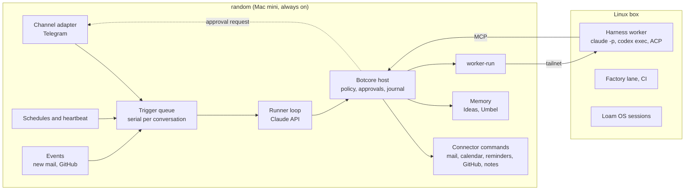

# Personal agent: an always-on agent for the owner, built on AFD

An always-on agent that works for one person, the owner, on hardware the owner runs. It talks to
the owner through one chat channel, reads mail, calendar and repositories, does background work on
a schedule, and acts only through AFD commands, so every action passes the same validation,
approvals and journal as any other caller. It replaces dependence on proprietary assistants (Dot,
Duet, Grokbot and the like) with a small runner that composes what this repository already has.
"Personal agent" is a working name; the owner names it.

## Status

- **State:** proposed. Drafted 2026-11-27 against `main` at `d7a10be3c`, from a feasibility review
  with the owner the same day. Nothing is built.
- **Origin:** the owner's wish not to depend on a proprietary always-on assistant, and to finish the
  agent work that stopped at Botcore's "Phase 1" (`botcore-agents`, `botcore-llm`,
  `botcore-memory`, `botcore-teams`, `botcore-connectors`).
- **Relation to the [Agent engine](../agent-engine/proposal.md) proposal:** this is that proposal's
  "first proof": one bounded workflow started by a person and by a schedule, with interruption, a
  rejected proposal, uncertain completion and an accepted learning, then a second module added
  without changing the runner. Its invariants hold here unchanged.
- **Verified:** the facts in [What exists today](#what-exists-today) were read on `main` at
  `d7a10be3c`. Prices and terms in [Cost](#cost) and [Terms of use](#terms-of-use) were read on
  2026-11-27 from the pages linked there.
- **Not verified:** how `botcore-llm`'s policy path behaves with a Claude API backend; whether macOS
  grants EventKit and Messages access to a process started by `launchd` without a person signed in;
  how much of a Max plan's limits a month of worker jobs uses; OpenAI's terms for running `codex exec`
  from a script. Phase 0 settles these.
- **Jobs:** the thirteen in [Jobs](#jobs), not yet written as `.scenario.yaml` files. Writing them is
  phase 0's first step.

## Decisions taken

The owner's answers of 2026-11-27.

| Question | Decision | What it changes |
| --- | --- | --- |
| Build or adopt | Build on AFD, borrowing ideas from Hermes Agent and OpenClaw but not their code | One new runner; connectors only for what the owner uses; no skill market, no 20 channel adapters |
| Memory | Praxis (Umbel `ideas`, MCP server `ideas`) for professional ideas, Brain for personal records, the Umbel knowledge base for reference, from phase 1 (owner, 2026-11-27) | No new memory store; `botcore-memory` is not used. Only the owner's own messages create or change memory, each linked to its source message (the rule borrowed from Nod). Each store keeps its own rules: material Praxis marks as never to quote stays out of the agent's replies and drafts. |
| Nod | Reference material, not a base (owner, 2026-11-27) | Its trust check, memory rule and test bar are borrowed; it runs for a day in phase 0 as a benchmark |
| Where it runs | `random`, the Mac mini, becomes the agent host once the new Linux box takes over its CI runner role | The runner is a macOS service. The Linux box runs the factory lane, heavy worker jobs and Loam OS sessions |
| Where the runner lives | A new, independently consumable agent package (owner, 2026-11-27), as the [Agent engine](../agent-engine/proposal.md) proposal asks: not an expansion of Botcore and not an endpoint. It depends on Botcore's host and `botcore-llm` as a consumer | Its folder and its layer in `architecture.json` are settled in phase 0. Kept outside `endpoints/botcore/`, it needs no provenance record; placed under it, every file needs an entry in Botcore's `provenance/adaptations.json` under [gates.md](../../../../.claude/skills/prepare-pr/references/gates.md) |
| Which connectors | iCloud and Gmail mail, calendar and reminders, GitHub and the factory, Vercel, Neon, and other engineering systems the owner names, each added only when used | Gmail leaves the mail engine's deferral for this agent; engineering connectors share one read-first pattern ([Commands](#commands)) |
| How models are reached | Hybrid: the runner's own loop on the Claude API for conversation, triage and the heartbeat; installed CLI harnesses (Claude Code, Codex, any ACP agent) as workers for long jobs, as T3 Code drives them | Two model routes behind one adapter; every job can fall back to an API key |

## The problem

Proprietary assistants keep the owner's memory, connectors and rules inside a product the owner
cannot inspect, move or keep. The open source options run, but Hermes Agent and OpenClaw each
replace AFD's command contract with their own, and most of their size goes to platforms and a skill
market the owner does not need. OpenClaw's record shows the cost of that breadth: a one-click remote
code execution bug (CVE-2026-25253), credentials in plain files, and audits that found 12 to 20% of
its shared skills carrying malicious instructions.

[Nod](https://github.com/n8n-io/nod), from n8n Labs, is the closest open source match: an Apache 2.0
personal agent with a sandbox and browser container, Telegram, and a Mac mini as its suggested
always-on host. It is a research preview, routes app connections through a service n8n hosts by
default (n8n and Composio), sends usage data to n8n by default, and does not use AFD commands. Its
ideas are borrowed below; it runs for a day in phase 0 as a benchmark, not as the base.

Meanwhile the parts of an agent already exist here, in separate places, and nothing runs them
together continuously.

## What exists today

| Piece | Where | State on `d7a10be3c` | Use here |
| --- | --- | --- | --- |
| Orchestrator | `endpoints/botcore/packages/botcore-agents` | Phase 1: agent lifecycle, heartbeat, task assign, resume, cancel, streaming, saved state | Task model and state store; the runner replaces its loop |
| LLM runtime | `endpoints/botcore/packages/botcore-llm` | Copilot SDK sessions; every tool call enters `host.execute` as an agent, with policy and path confinement | Keep the policy path; add a Claude API backend |
| Memory | `endpoints/botcore/packages/botcore-memory` | JSON store, agent, team and task scopes, caller identity from the host | Not used for the agent's memory |
| Channel pattern | `endpoints/botcore/plugins/botcore-teams` | Teams bot, regex intents, Adaptive Cards | Shape of a channel adapter |
| Connectors | `endpoints/botcore/botcore-connectors` | GitHub, with audit, auth and validation | Base class, audit log, GitHub tools |
| Knowledge and memory | `endpoints/umbel` | Phases 0 to 4 done: stores, search, memory, context, curator | Knowledge base and memory from phase 1 |
| Ideas | `endpoints/umbel/plugins/ideas` | Umbel's `ideas` plugin, built and complete ([status](../../complete/ideas/STATUS.md)): typed ideas, matching, asking, affirmation by the person, bulk review | Praxis, the owner's live instance, reached as the MCP server `ideas`: professional ideas the agent reads and adds to |
| Personal records | Brain, the owner's store for finance, health and home | In use; format not yet read for this plan | Where personal facts the agent learns go, not the idea base |
| Mail engine | `endpoints/loam/plugins/mail` | iCloud IMAP engine built step by step; Gmail deferred 2026-11-14 | First connector |
| Copilot, inbox, approvals | `endpoints/loam` phases 4 and 5 | Desktop copilot reached 2026-11-26; inbox, autonomy rows, confirmations, labels, taint | Second surface; approval display |
| Sandboxed sessions | `endpoints/loam-os` | M0 merged; agent sessions are M3, unspecified | Risky worker jobs, later |
| Idempotency keys | `docs/features/active/idempotency-keys` | Approved 2026-11-26, no code | No repeated side effects after a restart |
| Journal seams | `docs/features/active/journal-seams` | Approved 2026-11-26, dispatch id and approval hook | Write-ahead record of the runner's actions |
| Factory gateway | `docs/features/active/factory-gateway` | Proposal active; heartbeat route live 2026-11-24 | Status of the factory as a tool; moves with the lane |

AFD itself supplies `CommandResult` with recovery advice, approvals and `confirmPrompt`, host-verified
confirmation, the journal and replay, MCP tasks, output budgets and OAuth. A connector written as
AFD commands is already safe for a model to call; the runner adds no second permission system.

## The idea

1. **Everything is a job.** A message from the owner, a schedule firing, and an event all become the
   same job record: who started it, what it may do (an autonomy profile), its budget, its state.
   Jobs in one conversation run one at a time; background jobs have their own lane.
2. **The loop calls only AFD commands.** The runner's model sees tools that are commands served by a
   Botcore host. Policy, approvals, path confinement and the journal apply to every call. Content
   from outside (mail bodies, web pages) is labelled as such, using Loam's taint rules. Memory learns
   only from the owner's own messages, never from mail or pages the agent reads, and each memory
   links to the message it came from (as Nod does). Beside declared approvals, a model check asks
   whether each outside action matches what the owner asked; it is a second layer, never the only
   one.
3. **Proactive work is cheap or absent.** The heartbeat reads a checklist file on Claude Haiku 5.5
   and usually ends with nothing to do. Digests are scheduled jobs. Nothing runs a frontier model
   on a timer.
4. **Long work goes to a worker.** `worker-run` starts an installed harness on the Linux box with
   this host's commands as its MCP tools, a working folder, a budget and a permission mode, and
   returns its result to the job. The harness is the unmodified binary, signed in by the owner.
5. **Control is a capability.** Listing, approving, cancelling and inspecting jobs are commands,
   reachable from the channel, the CLI, MCP and Loam. A stop is not a rollback.

## Jobs

Written as scenarios in phase 0, before any command exists. Each names the phase that must pass it.

| # | Job | Phase |
| --- | --- | --- |
| 1 | The owner asks a question in the channel and gets an answer that cites what it read | 1 |
| 2 | The owner asks what changed in the factory today and gets the lane's merges and failures | 1 |
| 3 | The owner cancels a running job from the channel and is told what had already happened | 1 |
| 4 | Each morning the owner gets one digest: mail that needs them, today's calendar, open approvals, yesterday's cost | 2 |
| 5 | A mail from a stranger asks the agent to forward something; the agent does not, and says why | 2 |
| 6 | The heartbeat finds nothing to do for a day and costs under five cents | 2 |
| 7 | The owner asks for a reply to a mail; the agent drafts it and sends only after the owner approves the exact text | 3 |
| 8 | The owner asks for a meeting next week; the agent proposes times and creates the event once approved | 3 |
| 9 | `random` restarts during a send; after restart the mail is sent once or the job is marked uncertain, never sent twice | 3 |
| 10 | The owner asks for a research report; a worker on the Linux box writes it and the agent posts the link | 3 |
| 11 | The owner corrects a fact the agent keeps getting wrong; the correction is used from then on and can be listed and removed | 4 |
| 12 | A second connector (notes) is added without changing the runner | 4 |
| 13 | A Vercel production deploy fails; the agent tells the owner which commit, the build error and a link to the logs, without being asked | 2 |

## Commands

Names follow `domain-action`. Each returns a `CommandResult` whose errors carry a `suggestion`.
Mutations that reach outside the house (send, create, delete) declare approval.

| Command | Effect | Approval |
| --- | --- | --- |
| `job-submit` | Queue a job with a description, autonomy profile and budget | No |
| `job-list`, `job-status` | Read jobs and their steps | No |
| `job-cancel` | Request a stop; report what already happened | No |
| `job-resume` | Resume a job left uncertain after a restart, with the owner's choice | Yes |
| `schedule-list`, `schedule-set`, `schedule-remove` | Manage scheduled jobs and the heartbeat checklist | `schedule-set` yes |
| `digest-run` | Build and send the digest now | No |
| `channel-send` | Send a message to the owner on the channel | No (owner only) |
| `mail-search`, `mail-read` | From the mail engine, iCloud and Gmail accounts alike | No |
| `mail-draft` | Make a draft in the mailbox | No |
| `mail-send` | Send a draft | Yes, showing the full text and recipients |
| `calendar-list`, `calendar-propose` | Read events, propose free times | No |
| `calendar-create`, `calendar-update` | Write events | Yes |
| `reminder-list`, `reminder-create` | Apple Reminders | `reminder-create` no, within profile |
| `deploy-list`, `deploy-logs` | Vercel deployments, status and build logs | No |
| `deploy-redeploy`, `deploy-rollback` | Vercel writes | Yes |
| `db-branch-list`, `db-usage` | Neon projects, branches, compute and storage use | No |
| `db-branch-create`, `db-branch-delete` | Neon branch writes; never the production branch | Yes |
| `factory-status` | The gateway's status and the lane's recent merges | No |
| `worker-run` | Start a harness job on the Linux box | Yes above a budget, or with a write profile |
| `worker-status`, `worker-cancel` | Follow or stop it | No |
| `cost-report` | Tokens and dollars by day, route and job | No |

Engineering connectors follow one pattern: commands over the service's API, a read-only token
for reads, a separate write token used only by approved commands, both in the Keychain, and every
result tagged with its source. A webhook or a poll turns a failed deploy or a usage spike into an
event job. Further systems join the same way, one at a time.

The GitHub commands come from `botcore-connectors`; memory from Praxis (Umbel's `ideas`), Brain,
and Umbel's knowledge and memory plugins.

## Hosting

| Machine | Role | Notes |
| --- | --- | --- |
| `random` (Mac mini, arm64) | Runner, connectors, memory, channel adapter | A `launchd` LaunchAgent in the owner's signed-in session, so macOS can grant Calendar, Reminders and Contacts (EventKit) access; secrets in the macOS Keychain; logs and state under `~/Library/Application Support/<name>/` |
| New Linux box | CI runner and factory lane (taking over from `random`), worker jobs, Loam OS sessions | Claude Code and Codex installed and signed in by the owner; reached over the tailnet with a token per caller |

The factory gateway moves with the lane, so the GitHub App key leaves `random` when the lane does.
The runner then holds only its own connector credentials. If the Linux box is down, the runner
keeps working and `worker-run` answers with a `retry` recovery.

## Model routes

| Route | Model | Used for | Fallback |
| --- | --- | --- | --- |
| Conversation | Claude Sonnet 5.5 through the Claude API | The owner's messages, drafting | Claude Opus 5.5 for jobs the owner marks hard |
| Background | Claude Haiku 5.5 | Heartbeat, mail triage, digest assembly; never the action safety check, which runs on Claude Sonnet 5.5 or better (Nod measured Claude Haiku 5.5 letting 8 unsafe actions through in 240 decisions) | None needed |
| Worker | Claude Code (`claude -p`) signed in with the owner's plan; Codex; any ACP agent | Coding, research, long multi-step jobs | The same harness with a Console API key |
| Existing | GitHub Copilot SDK in `botcore-llm` | Kept as a second backend | — |

The adapter is one interface in `botcore-llm`: create a session with tools, send, stream, stop,
report usage. The runner never parses a provider's wire format.

Prompt caching is designed in: a frozen system prompt and tool list first, the date and volatile
state after the last cache breakpoint. Each job carries a task budget; the API key carries a monthly
spend limit.

## Cost

Estimated for 30 conversations a day of about 20,000 input tokens (80% from cache) and 1,500
output tokens, list prices read 2026-11-27.

| Item | Monthly |
| --- | --- |
| Conversation on Claude Sonnet 5.5 ($2 / $10 per million, cache reads $0.10) | about $22 |
| Background on Claude Haiku 5.5 ($0.10 / $0.50 per million) | about $2 |
| Workers on the owner's Max plan | $0 until plan limits |
| Hosting | $0 extra; both machines are owned |
| Build | 6 to 9 focused weeks over phases 0 to 3, with Gmail, Vercel and Neon |
| Upkeep | 2 to 4 hours a week |

`cost-report` makes the real figures visible from phase 1, and the digest carries yesterday's.

## Terms of use

- Claude Code's [legal and compliance page](https://code.claude.com/docs/en/legal-and-compliance)
  allows the owner to run the unmodified binary signed in with their own plan. It forbids storing or
  reusing claude.ai credentials in another application and routing other people's requests through
  plan credentials, and says plan limits assume ordinary, individual use. The runner therefore
  always invokes the `claude` binary, never reads its token, and serves only the owner.
- Anthropic's [support article](https://support.claude.com/en/articles/15036540-use-the-claude-agent-sdk-with-your-plan)
  says that signed in with a plan, the Agent SDK and `claude -p` draw from subscription limits; the
  separate programmatic budget announced for 2026-06-15 is paused; Max, Ultra and Team plans include
  monthly API credits for those tools run with a Console API key (2026-10-07).
- These rules changed twice in 2026. Every worker job can switch to an API key by configuration, and
  the heartbeat never depends on a plan login.
- OpenAI's terms for `codex exec` from a script are not yet read (phase 0).

## Phases

Each phase ends with something the owner uses daily. The next starts only when its gate passes.

### Phase 0: decide and write the jobs (2 to 3 days)

1. Write jobs 1 to 13 as `.scenario.yaml` files under this folder's `scenarios/`.
2. Confirm the channel (Telegram recommended; Signal the private alternative), and choose the agent
   package's folder, name and `architecture.json` layer.
3. Spike: a Claude API backend in `botcore-llm` running one tool call through `host.execute`.
4. Spike: a `launchd` LaunchAgent on `random` reading one calendar event through EventKit.
5. Read OpenAI's Codex terms; measure one `claude -p` worker run's share of plan limits.
6. Run Nod on `random` for a day against jobs 1, 4 and 7; keep its published bar (98% of 226
   errands, 0 unsafe actions in 678 runs, 93% memory recall, vendor-run) as the one this agent must
   meet.
7. Record answers in a `decisions.md` beside this file and open the epic.

**Gate:** thirteen scenarios the owner would use; both spikes pass or have a fallback named.

### Phase 1: talk to it (1 to 2 weeks)

1. The agent package with the job store, the trigger queue and serial lanes.
2. The Claude API backend in `botcore-llm` behind the adapter, with prompt caching and task budgets.
3. The channel adapter, owner-only by account id, with approvals as buttons.
4. `job-*`, `channel-send`, `factory-status`, `cost-report`; web search and fetch as server tools.
5. Praxis (`ideas`), Brain and Umbel knowledge reached as MCP tools, under the runner's agent
   identity, with the owner-messages-only rule.
6. The LaunchAgent, Keychain secrets, a health route the gateway's heartbeat can watch.

**Gate:** jobs 1 to 3 pass; the owner uses it daily for a week; cost per day is visible.

### Phase 2: it reads (1 to 2 weeks)

1. `mail-search` and `mail-read` over the mail engine for iCloud, then Gmail (Google OAuth), with
   taint labels on bodies.
2. `calendar-list`, `calendar-propose`, `reminder-list` through EventKit, CalDAV as the fallback.
3. Mail triage on Claude Haiku 5.5; the heartbeat checklist; `digest-run` on a schedule.
4. `schedule-*` commands.
5. Vercel and Neon read commands with read-only tokens; deploy failures as event jobs.

**Gate:** jobs 4 to 6 and 13 pass; the digest is worth reading most mornings; a week with no false urgent
alert.

### Phase 3: it acts (2 to 3 weeks)

1. `mail-draft`, `mail-send`, `calendar-create`, `calendar-update`, `reminder-create`,
   `deploy-redeploy`, `deploy-rollback`, `db-branch-create`, `db-branch-delete`, each with its
   approval shown in full on the channel and in Loam's inbox.
2. Idempotency keys on every outside mutation; the write-ahead record from journal seams;
   `job-resume` for uncertain jobs.
3. `worker-run` to the Linux box: Claude Code first, Codex second, an ACP agent third, each with
   this host's commands as MCP tools, a budget and a permission mode.
4. Restart tests on `random` in CI's mock integration lane.

**Gate:** jobs 7 to 10 pass; two weeks with no duplicate or lost action across restarts.

### Phase 4: it remembers and grows (ongoing)

1. Umbel's curator drafts knowledge from settled Ideas entries for the owner to approve.
2. Corrections as reviewable memory, listable and removable.
3. A notes connector through Umbel's `sources-filesystem`, added without runner changes.
4. Skills the agent may draft and the owner accepts, never installed from outside.
5. Risky worker jobs move into Loam OS sessions once M3 exists.
6. iMessage as a second channel, if the owner wants it (needs Full Disk Access on `random`).

**Gate:** jobs 11 and 12 pass.

## Risks

| Risk | Mitigation |
| --- | --- |
| Becomes a fifth large platform beside Loam, Umbel, Loam OS and the factory | One runner package; phase gates; no new interface; stop at a failed gate |
| Prompt injection through mail and web | Taint labels; outside mutations always ask; job 5 in CI |
| Duplicate or lost actions | Idempotency keys, write-ahead record, uncertain state, job 9 |
| `random` is off and nobody notices | Gateway heartbeat on the health route; alert from the Linux box |
| Connector rot (iCloud already withholds 8,259 listed messages) | Few connectors, each with scenarios in CI |
| Subscription terms change again | API-key fallback by configuration on every worker |
| Cost runaway | Task budgets, monthly key limit, `cost-report` in the digest |

## Open questions

1. **Package folder.** Decided: a new agent package. Open: its folder and `architecture.json` layer.
   A folder outside `endpoints/botcore/` avoids provenance records; the changes it needs inside
   Botcore (the Claude API backend in `botcore-llm`) still need them.
2. **Channel.** Telegram (recommended) or Signal.
3. **Name.** The owner's to choose.
4. **Loam's role.** Loam's copilot as a second surface from phase 3, or only the inbox for approvals.
5. **Other engineering systems.** Which ones beyond GitHub, Vercel and Neon, and in what order.
6. **Brain.** How the agent reaches Brain (a folder, a repository or a server) and which parts it may write.

## Sources

- [Hermes Agent documentation](https://hermes-agent.nousresearch.com/docs)
- [Nod](https://github.com/n8n-io/nod) and [its site](https://nod.n8n.io/)
- [Lessons from OpenClaw's architecture](https://dev.to/ialijr/lessons-from-openclaws-architecture-for-agent-builders-1j93)
- [How much does OpenClaw cost to run](https://findstack.com/resources/how-much-does-openclaw-cost-to-run)
- [T3 Code](https://github.com/pingdotgg/t3code)
- [Claude Code legal and compliance](https://code.claude.com/docs/en/legal-and-compliance)
- [Use the Claude Agent SDK with your plan](https://support.claude.com/en/articles/15036540-use-the-claude-agent-sdk-with-your-plan)
- [The Register, 2026-05-14](https://www.theregister.com/ai-ml/2026/05/14/anthropic-tosses-agents-into-the-api-billing-pool/5240748)
