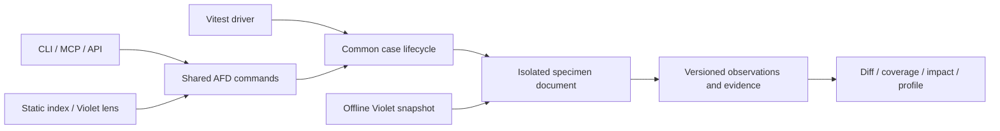

# Specimens: an agent-first component bench to replace Storybook

> **Status:** Proposed — revised after review; executable acceptance gates remain open
> **Last Updated:** 2026-10-28
> **Tracking Area:** `docs/features/proposed/specimens`
> **Origin:** Moved from Violet on 2026-10-28; source commit `2b1f94321a1ef458c1364a91ad63f29b304266e4`. See [detailed review](review.md).
> **Builds on:** FAST-AF [Definition Schema](https://github.com/lushly-dev/fast-af/blob/main/docs/features/complete/definition-schema/definition-schema.proposal.md), [`@command` decorator](https://github.com/lushly-dev/fast-af/tree/main/docs/features/complete/command-decorator) and [trust events](https://github.com/lushly-dev/fast-af/blob/main/docs/features/complete/trust-events-v2/trust-events-v2.proposal.md); `@lushly-dev/afd-testing` scenario runner; Violet [lens plan](https://github.com/lushly-dev/violet/blob/2b1f94321a1ef458c1364a91ad63f29b304266e4/docs/features/active/violet-ux-lenses.plan.md) workstream 4 (visual specimens) and workstream 2 (`changes.impact`)
> **Scope:** Any web component. A project needs nothing from the Ultraviolet stack to use it; FAST-AF, Violet and AFD support are optional plugins (see *Compatibility scope*). The first consumers are the Ultraviolet stack: fast-af, Lushly and Violet. The brainstorm started in Violet; this proposal now lives in AFD, the proposed home of the core package. Violet web remains the proposed first consumer of the agent-facing commands.

## Summary

Specimens is a proposed component bench built on AFD: commands list, validate, render, inspect, run, diff and profile component states; a minimal human index and an optional Violet lens consume the same operations. Projects need no AFD, FAST-AF or Violet integration to use it. Stack-specific behavior belongs in optional plugins.

The opportunity is a shared observation contract for web components, schema-backed coverage, and token impact with provenance. Storybook already provides an interaction-test harness and agent-facing tools. Replacing it must earn its cost through capabilities and measured operation, rather than an assumption that all of its static bundles load in every test.

The first deliverable is a feasibility experiment with a real bench page and commands. It must detect defined CSS, accessibility and state changes, expose unsupported observations, and establish runtime cost. Then a compatibility runner must preserve the existing suites and gates. **Storybook removal is conditional on full parity and operational replacement checks.** The optional catalog lens follows those proofs.

This revision addresses the design findings in [the review](review.md). Requirements below describe proposed behavior. The initial native feasibility implementation and its acceptance boundary are tracked in the [implementation plan](../../active/specimens/implementation.md); the complete workstream and migration gates remain open.

## Problem and existing capabilities

The source inventory checked on 2026-10-28 contains 67 FAST-AF `violet-elements` story files with 143 play declarations, and 116 Lushly story files with 614 play declarations. Plays occur in all 67 FAST-AF files and 111 Lushly files. These are source counts, not test counts: individual exports without plays still require smoke coverage. FAST-AF also has a separate 44-file legacy Fluent catalog. Violet web has eight components and no Storybook catalog in the inspected snapshot.

| Evidence | What it establishes |
| --- | --- |
| Lushly caps the preview, docs and axe chunks at 850 kB, 1.12 MB and 600 kB | Static-build maintenance and upper limits; not actual suite downloads, heap or execution cost |
| The Storybook Vitest addon transforms stories into browser tests without a running Storybook instance | The replacement must be compared with this actual path, not with the full manager UI. See [Vitest addon](https://storybook.js.org/docs/writing-tests/integrations/vitest-addon). |
| Storybook 10.6 documents MCP development/testing tools across frameworks; its component-docs manifest excludes the web-components renderer | Agent access exists. Web-component schema inspection, scoped token observations and the proposed diff contract remain the differentiators. The AI APIs are preview. See [Storybook MCP](https://storybook.js.org/docs/ai/mcp/overview). |
| Neither inspected consumer uses visual snapshots or MDX pages beyond autodocs | Migration need not preserve a snapshot suite, but human visual review must remain available |
| An isolated review probe changed button padding while DOM and ARIA output stayed identical | DOM plus accessibility cannot establish visual equivalence; layout/style observations and a visual-review path are required |

Workstream 0 MUST prioritize host CPU/memory capacity for concurrent agent sessions. It MUST record cold/warm startup, representative render latency, loaded JavaScript bytes, the resource measures below, and the consumer's available suite timings. Comparison runs MUST bind source, installed versions, hardware, browser, worker count and cache condition. Five cold and five warm representative renders establish medians and observed ranges; full-suite measurements MUST reuse the required parity runs. Numeric host headroom, resource budgets and elapsed-time tolerances MUST be fixed before evaluating the candidate. No CPU, memory, speed or total-size reduction is claimed until measured.

### Host resource acceptance

The primary outcome MUST be lower resource cost for equivalent verified work while preserving capacity for the agent runtime and other active sessions. Wall-clock latency MUST remain a guardrail alongside CPU and memory, rather than substituting for either measure. Language/runtime choices, including Rust, MUST be evaluated against this resource profile; the current native pilot's elapsed-time figures MUST NOT settle that decision.

| Measure | Required scope and interpretation |
| --- | --- |
| Memory during work | Reports MUST include baseline, sampled peak and sustained active memory for the complete attributable process family: coordinator, Vite/build workers, Chromium browser, renderer, GPU and utility subprocesses, and helpers. They MUST name the OS metric and sampling interval. JS heap or Node RSS alone MUST NOT stand in for total memory. Aggregate RSS MUST disclose shared-page double counting; a physical-memory reduction claim MUST use an appropriate supported accounting method. |
| Idle and cleanup | Reports MUST measure retained memory/CPU between cases and after bench closure over fixed recorded windows. They MUST identify surviving owned processes and distinguish intentional reuse from incomplete cleanup or growth across repeated batches. |
| CPU | Reports MUST include aggregate user/system CPU time in core-seconds per completed verified case and suite, plus peak and sustained utilization with the core normalization stated. Node's process-only CPU counter MUST NOT stand in for Chromium or the complete process family. |
| Host pressure | Reports MUST record concurrent workload, available headroom, memory pressure and swap/compression changes where supported. Host-wide changes MUST NOT be attributed exclusively to the bench. Missing metrics MUST remain unavailable rather than zero. |
| Concurrent capacity | Experiments MUST start with one admitted job and increase concurrency only within the recorded host CPU/memory budgets. Reports MUST state the tested concurrency, completed verified work, latency, and pressure/resource limits; they MUST NOT extrapolate a safe agent-session count from a single job or unrelated workload. |
| Measurement integrity | Instrumentation MUST account for subprocess lifetimes, exited children, PID reuse, detached helpers and sampler overhead. Incomplete attribution or missed lifetime accounting MUST mark the affected totals partial. Memory peaks MUST be labeled sampled unless an exact OS high-water measure is available. |

The baseline MUST use the actual consumer Storybook/Vitest execution path and equivalent selected cases, assertions, readiness and asset conditions. Required browser isolation and correctness checks MUST remain enabled. Differences in observation work MUST be reported separately. Process-tree breakdowns MUST identify whether costs come from the Node/Vite coordinator, browser, observation processing, or retained idle services before selecting an optimization. Full-suite resource comparison MUST wait for retained-CSF parity; the native wrappers alone MUST NOT establish that equivalence.

The first resource milestone MUST calibrate whole-process measurement on a controlled parent/child workload, establish its completeness and overhead, and then profile the native consumer pilot with one job. Matched incumbent baselines and bounded concurrency follow only after the required consumer conditions and host budgets are recorded. Sources for memory-accounting scope include [Chromium's memory tooling guide](https://chromium.googlesource.com/chromium/src/+/main/docs/memory/tools.md) and [Apple's memory-use guidance](https://developer.apple.com/documentation/xcode/gathering-information-about-memory-use).

| Existing primitive | Reuse and new work |
| --- | --- |
| FAST-AF Definition Schema and Custom Elements Manifest conversion | Reuse schema discovery; build observation and coverage evidence on top |
| FAST-AF `@command` and trust events | Reuse when a component adopts them; none of the inspected `violet-elements` components did |
| Violet themes, nodes, token export and `changes.impact` | Reuse resolution semantics; add an offline snapshot/name-map export and scoped render evidence |
| Vitest browser mode, Playwright, Testing Library and axe | Reuse browser testing; prove lifecycle and identity compatibility with the existing addon |
| `afd-testing` command scenario executor | Reuse orchestration through a new browser-step adapter; DOM action/expectation steps are not native to its current schema |
| AFD commands and optional `afd-view-state` integration | Reuse the result contract and transports; keep application commands optional |

## Goals and boundaries

- The bench MUST expose each capability as an AFD command before adding its UI. CLI, MCP and programmatic adapters MUST share command behavior.
- The migration MUST preserve discovery, identities, assertions, accessibility policy, flake handling, worker limits, profiling, typechecks, scaffolding and human review before removing Storybook.
- A project MUST be able to install the core without declaring any AFD, FAST-AF or Violet package itself. AFD remains a transitive bench dependency.
- Tests MUST NOT require a live Violet service. Node context and hypothetical token changes MUST use a versioned local snapshot.
- Observations MUST state their channels, checkpoint, provenance and completeness. An empty structural diff MUST NOT be presented as visual equivalence.
- Coverage MUST distinguish a represented state, an executed assertion and a verified behavior. Unknown evidence MUST NOT count as covered.
- The bench MUST ship a static index and individually loadable specimens with the budgets below.

The proposal does not port the legacy Fluent catalog, implement Violet governance or Figma integration, or drive component adoption of `@command`/trust events. Pixel comparison is optional; screenshot capture and a human review surface are required. First-class framework renderers and UI-panel plugins are out of scope. Custom renderers MAY mount framework roots but MUST provide readiness and disposal when element removal is insufficient.

## Compatibility and ownership

| Tier | Available capability |
| --- | --- |
| Any DOM-rendering component | Plays, action scenarios, axe, render/diff/profile and the index; unsupported observation channels are explicitly partial or unsupported |
| Web component with a Custom Elements Manifest | Property/attribute and slot validation, schema partitions, generated arg types, coverage claims |
| CSS-variable token system | Scoped variable observations and conservative dependencies; optional name maps associate variables with token ids |
| FAST-AF plugin | Definition Schema, theme presets, token aliases, component commands and trust events when available |
| Violet plugin | Offline node context, token provenance, node matrices, candidate and observed impact, token specimens |
| AFD plugin | Explicit scenario steps against application commands, view-state commands and `CommandResult` assertions |

Vitest 4 and a Playwright browser are required for the test driver. Consumer code MUST be buildable by the bench's Vite configuration; “any app bundler” does not promise automatic compatibility with arbitrary app transforms. Chromium is the first supported browser and the only profiler target. Firefox/WebKit support MUST be advertised only after their driver acceptance fixtures pass.

Four plugin points remain. Their contracts MUST be exercised by a plain custom-element fixture and the first consumers before they are frozen in workstream 1.

| Plugin point | Contract and ownership |
| --- | --- |
| Schema source | Tag to properties, attributes, slots, events, commands and finite value partitions. Core reads CEM; FAST-AF enriches it. Missing schema knowledge MUST remain unknown. |
| Context provider | Resolve configuration into browser emulation, styles and a mount wrapper. Core owns viewport, container, locale, media preferences and the lifecycle. FAST-AF supplies theme presets; Violet supplies offline node sheets. |
| Token map | Associate public variable names with token ids, and private aliases with public variables. Violet owns export names/provenance; FAST-AF owns its private alias registry. Maps MUST be versioned and validated together. |
| Command runner | A named runner handles explicit command steps and declared structured events. `fast-af` and `afd` are distinct runner ids; duplicate registrations or missing runners MUST fail validation. DOM actions are built-in steps, not an implicit command runner. |

Plugins MAY register commands. They MUST NOT add UI panels. There is no renderer-plugin API; custom rendering uses the lifecycle contract below.

## Specimen format

The format retains CSF's default meta object and named exports. During migration, the **CSF compatibility mode** retains original metadata; the native shape below is used for new fixtures or after cutover. A codemod MUST NOT silently infer a component from a wrapper or ambiguous render function.

```ts
export default {
  title: 'Components/Button',
  component: 'violet-button',
  description: 'Primary action control.',
};

export const Primary = {
  name: 'Primary action',
  args: { appearance: 'primary' },
  slots: { default: 'Save' },
  context: { theme: 'dark', viewport: '375x812' },
  targets: { control: { role: 'button', name: 'Save' } },
  events: [{ type: 'click', target: 'control' }],
  scenario: [
    { id: 'activate', action: { click: 'control' } },
    { id: 'clicked', expect: { event: 'click', since: 'activate' } },
    { capture: 'after-click' },
  ],
};
```

| Field | Contract |
| --- | --- |
| `title`, `name`, identity | Existing files MUST retain their effective title, explicit story display name, export name and any explicit CSF id. The compatibility manifest MUST preserve the original file/title-path/story-id mapping. New files MAY derive title from component. Duplicate effective identities MUST fail discovery. |
| `component` | The tag described by the specimen. Explicit `null` opts a composition out of component-schema checks, not out of smoke/a11y tests. Ambiguous codemod inference MUST produce a manual task. |
| `description` | Native documentation text. The original `parameters.docs.description` MUST remain during compatibility mode. |
| `render` | Optional custom renderer returning an element or a mount handle with `element`, `ready` and `dispose`. When absent, the bench creates `component` and applies schema-validated args/slots. |
| `args` | Meta defaults and specimen overrides MUST resolve before mounting. Schema-created specimens MUST reject unknown names/invalid finite values. Custom render args MUST use their declared type/schema; they MUST NOT automatically receive component-state coverage credit. |
| `slots` | Text or element factories by slot name; schema validation MUST distinguish an empty slot from an unknown slot. Factories MUST participate in disposal. |
| `context` | Core fields: `theme`, `viewport`, `container`, `locale`, `reducedMotion`, `motion`. Violet adds `node` and snapshot identity. Unknown fields MUST fail validation. Actual resolved context MUST be returned. |
| `targets` | Stable names for role/name or explicit selector locators. Built-in actions MUST resolve exactly one target, pierce open shadow roots under the declared locator rules, and fail on ambiguity. Closed-root targets require explicit support. |
| `scenario` | TypeScript objects validated by Zod and serializable to JSON. Steps support `action`, explicit `command`, `expect` or named `capture`; ids MUST be unique. |
| `play` | Existing async `{ canvasElement, args, step }` plays MUST retain behavior. Native plays run after the scenario. Legacy context extensions remain available through compatibility mode until ported. |
| `ready`, `dispose` | Optional hooks for element-returning renderers; equivalent handle hooks MUST NOT also be supplied. Readiness, failure cleanup and disposal MUST follow the common runtime contract. |
| `events` | Declared event types, targets/roots and observation phases. Schema/plugin event declarations MAY supplement these. There is no promise to capture every possible event. |
| `coverage` | Explicit target/state/checkpoint/expectation claims validated against runtime evidence; see Coverage and generation. |
| `a11y` | Native exceptions/disabled checks MUST include reasons and target scope, and MUST appear in reports. Compatibility mode MUST preserve the effective original policy without broadening exclusions. |
| `tags`, `budgets` | Tags MAY select smoke/performance/skip behavior; skipped specimens MUST remain visible in reports. Budgets override only the named specimen baseline and MUST be recorded in the capture manifest. |

### Scenario execution

The core MUST translate actions, expectations and captures into internal command steps accepted by `afd-testing`, preserving public step ids and typed failures. Host-side orchestration owns the deadline, abort signal and result aggregation; browser operations MUST execute in the specimen's browsing context. Node fixture loading MUST NOT be bundled into the page.

A command step MUST name its runner, for example `{ command: { runner: 'fast-af', name: 'activate', target: 'control', input: {} } }`. AFD steps MUST use `runner: 'afd'`; there is no “first plugin wins” dispatch. Unsupported commands, unavailable targets or missing capabilities MUST fail before execution when knowable.

Expectations MUST use a recorded step/capture boundary, bounded waiting and explicit evidence. Event checks MUST state the interval they inspect; an earlier unrelated event cannot satisfy a later action. Cancellation or timeout MUST stop further steps, dispose the case and prevent background work from mutating a subsequent case. Migration parity MUST retain Testing Library input semantics; real Playwright input MAY be an explicit native action mode, recorded in provenance.

## Command surface

Commands MUST use AFD `domain-action` names and return `CommandResult` with reasoning, typed errors with recovery suggestions, and applicable warnings. The `specimen` CLI drops the prefix. Violet MAY provide dotted aliases, but the canonical names remain the contract. Successful capture does not imply complete observation or passing checks.

| Command | Input | Result |
| --- | --- | --- |
| `specimen-build` | configuration and output directory | Static output, discovery manifest, chunk accounting and validation results; CLI `specimen build` |
| `specimen-migrate` | files, compatibility mode, preview/apply choice | Codemod plan, applied edits when requested, and unresolved manual tasks; MUST default to preview and preserve original metadata during overlap |
| `specimen-list` | component/title/tag/package/node/coverage filters | Manifest identities, metadata, available checkpoints, capability and coverage status; MUST NOT eagerly execute every story |
| `specimen-validate` | file or id | Format, identity, schema, context, target, runner and coverage-claim errors; dynamic unknowns explicitly deferred to runtime |
| `specimen-inspect` | id, optional checkpoint/context | Schema and resolved args/claims; live availability/token values require an explicit capture and return its manifest |
| `specimen-render` | id, context, checkpoint (default `mount`), screenshot flag | Observation envelope below; named checkpoints execute the required scenario prefix; `after-run` executes scenario and play |
| `specimen-run` | id/filter, context | Scenario then play, required captures and axe; per-step assertions, coverage evidence, outcome and disposal result |
| `specimen-a11y` | id/filter, checkpoint/context | Axe and available schema checks on that capture; violations, incomplete checks and scoped exceptions |
| `specimen-diff` | two captures or id/context/ref pairs | Comparison validity plus per-channel differences; no claim of total visual equivalence; optional pixel comparison |
| `specimen-matrix` | id, explicit context axes/checkpoint | One isolated capture per cell; comparable cells diff against the first; unavailable cells remain visible |
| `specimen-impact` | offline snapshot plus `changes.impact` input | Violet resolution effects, dependency candidates and observed render effects per node/state, with unknowns and completeness |
| `specimen-profile` | id, runs, viewport/checkpoint | Browser metrics and ready/capture timing, baseline comparison and provenance; Chromium only |
| `specimen-coverage` | component/package, evidence run | Finite schema partitions and required obligations: represented, asserted, verified, missing or unknown |
| `specimen-suggest` | component, gaps | Proposed specimen/claim content with unverified status; generation MUST NOT mark coverage complete |

### Observation envelope

The result contract is versioned data. `data.manifest` MUST identify the observation; `data.channels` MUST state what was measured. Unknown MUST be distinct from an empty collection or a zero value.

| Field | Required content |
| --- | --- |
| `manifest` | Capture/schema/normalization versions; specimen identity; source revision plus dirty-tree/content digest; dependency lock/build identity; browser version/platform; installed bench/plugin versions; capture timestamp |
| `manifest.context` | Resolved viewport/container, theme, locale, media preferences, motion policy, pixel ratio, font/resource identity, and Violet snapshot/name-map ids where used |
| `manifest.checkpoint` | Mount, named capture or after-run; action mode, readiness condition and outcome, relevant clock/random/fixture identity |
| `channels.dom` | Original and normalized markup with supported shadow roots; live properties such as value, checked, selected and focus state for declared targets |
| `channels.a11y` | ARIA snapshot, axe outcome including incomplete checks, and exceptions with scope/reason |
| `channels.layout` | Stable element references and bounding boxes, scroll/client extents, overflow/clipping evidence and active/focused target at the checkpoint |
| `channels.styles` | Versioned selected computed properties for observed elements: display/visibility, positioning, sizing, spacing, typography, colors/backgrounds, borders, transform, opacity and stacking; pseudo-element observations where supported |
| `channels.tokens` | Scoped observations with variable, optional token id, element/root reference, checkpoint, computed value, dependencies and optional Violet provenance; MUST NOT flatten distinct scopes into one token-keyed value |
| `channels.events` | Ordered declared events with type, target/root, step interval and observed payload; console entries/counts captured over the same lifecycle |
| `channels.visual` | Optional screenshot and comparison metadata; MUST be `not-requested` or unavailable explicitly when absent |
| `completeness` | Per-channel `complete`, `partial`, `unsupported` or `not-requested`, plus reasons and declared element/state/property scope. “Complete” applies only to that declared scope. |

The default structured capture MUST include DOM, accessibility, layout, selected computed styles and live target state. Tokens are complete only for the supported detector scope; screenshots remain optional for structured comparisons. Images, canvas content, rasterization, unobserved animation frames and other appearance details MUST NOT be inferred from these channels. A request to establish overall appearance equivalence MUST require visual evidence or return `insufficient-evidence`.

### Comparison and normalization

`specimen-diff` MUST first validate capture compatibility. Browser, viewport, media, motion, capture/normalization versions and checkpoint MUST agree unless a difference is an explicitly requested comparison axis. Source/build revisions are expected to differ in code comparisons; dependency changes MUST be declared, reported and prevent an unqualified attribution to source changes alone. Missing specimens and incompatible captures MUST return typed failures with recovery suggestions.

Each changed channel MUST carry evidence. No detected differences yields `no-change-observed` within the declared scope; incomplete relevant channels also yield `insufficient-evidence`. An unobserved channel MUST NOT be reported as unchanged. Pixel comparison MUST require compatible screenshots from both sides.

Time-dependent or unstable channels MUST record that limitation and the sampled clock/frame condition. A natural-motion sample MUST NOT be treated as a stable regression baseline without a reproducible checkpoint. The caller MAY request an explicit settled capture or a controlled animation checkpoint; the tool MUST NOT silently alter motion to obtain equality.

Normalization MUST sort attributes and remove only documented nonsemantic framework markers. It MUST consistently remap generated ids and all references to them, preserving broken links. Text whitespace and live control values MUST be preserved; any narrower whitespace normalization needs a proven semantic rule. Original captures MUST remain available for diagnosis. Different normalization versions MUST not compare silently.

Comparing git refs MUST build each revision with its recorded dependency state in isolated directories and independent browser documents/registries. Cached captures MUST be keyed by the manifest's content identities and context, not only the specimen id. The tool MUST NOT switch a developer's active checkout to obtain a comparison.

## Runtime



### Bench and discovery

`specimen build` MUST produce an index, `/specimen.html`, a metadata manifest and lazy specimen chunks. URLs MUST encode id, resolved context reference and checkpoint so a review can be reopened. The index MUST list cases without importing their executable story modules; dynamic metadata MUST be resolved by explicit scoped discovery or reported unknown. A case MUST load only its module and required dependencies, not all registered stories. Build/test transforms MUST keep test registration out of the ordinary static page.

All drivers MUST use the same mount, readiness, observation and disposal protocol. A bare page-global API MAY expose that protocol for automation, but the command outputs remain the public contract. The index MUST provide theme and viewport controls and use the same context resolution as the CLI. The Violet lens remains optional.

### Context and lifecycle

| Concern | Required behavior |
| --- | --- |
| Viewport | `viewport` MUST set the specimen browsing context. CLI/Playwright resize the viewport; the index/lens uses a sized iframe; Vitest MUST use a fixture/provider that gives the specimen equivalent dimensions. `matchMedia`, viewport units and `innerWidth` MUST agree across drivers. |
| Container | `container` MAY constrain a wrapper inside that viewport. It MUST NOT be substituted for browser viewport sizing. |
| Locale and media | Drivers MUST apply locale and media emulation consistently. `reducedMotion` MUST control the browser preference; `motion: 'settled'` MAY additionally suppress animation for capture. These are separate settings. |
| Motion | Native default is `motion: 'natural'`. Compatibility mode MUST preserve each consumer's existing policy. The manifest MUST record suppression; natural-motion assertions MUST reject a settled capture. A `navigator.webdriver` shortcut MUST NOT silently override requested context. |
| Mount | Install declared event/console listeners before insertion, apply context, mount the element and wait for custom-element upgrade and the declared readiness condition. |
| Ready | Plain synchronous elements default to upgrade, fonts-ready and the next render frame. Async/framework specimens MUST declare a bounded ready hook. The default deadline is 10 seconds and MAY be configured explicitly. Readiness MUST NOT mean universal network-idle or merely finding `#specimen-root`. |
| Checkpoints | `mount` captures after ready without running interactions. Named scenario captures execute the prefix through that capture. `after-run` executes scenario and play, then required checks. Captures MUST state which path ran. |
| Isolation | Each case MUST receive a fresh specimen document/registry and declared baseline for storage, clocks, randomness and fixtures. Rendering and play MUST execute in that document. No prior case's registrations, mocks, listeners or portals may satisfy the next case. |
| Disposal | Registered disposers MUST run in reverse order on success, failure, timeout and cancellation, then remove portals/roots and restore fixture state. Framework renderers MUST unmount explicitly. Cleanup failure MUST fail the run and discard its environment. |
| Profiling | Metrics MUST stop at the named ready/capture checkpoint. Browser paints/load timings MAY be reported separately; they MUST NOT substitute for readiness. Repeated runs MUST start from the same recorded baseline. |

Open roots MUST be passed explicitly to `getHTML` or a tested fallback serializer. A supplied closed-root reference MAY be serialized; otherwise the channel MUST report inaccessible content. Declared events MUST be observed at their relevant roots/targets; non-composed events cannot be inferred from a document listener. Missing observation support MUST be surfaced before an event expectation is credited.

### Static build and budgets

The 50 kB goal applies to the catalog/dispatch shell, not to a hidden exclusion of heavy dependencies. Workstream 0 MUST enforce these proposed ceilings on minified UTF-8 JavaScript bytes, summing emitted chunks once per category, including deferred chunks and transitive dependencies. Compression and runtime-loaded bytes MUST also be reported, separately.

| Category | Proposed ceiling | Accounting |
| --- | --- | --- |
| Index, dispatch and observation shell | 50,000 bytes | All bench-owned code needed to list and mount a plain fixture; reusable capture code included |
| Interaction/testing support | 600,000 bytes | Vitest helpers, Testing Library, jest-dom and scenario support; loaded only for cases/actions that need them |
| Accessibility engine/integration | 650,000 bytes | Axe and bench integration; separate loading does not remove it from accounting |
| Total bench JavaScript | 1,300,000 bytes | Sum of the above, including shared helpers exactly once; no unclassified bench chunks |
| Consumer code/assets | Reported separately, no core-wide ceiling | Components, stories and opted-in consumer integrations; built-in bench dependencies MUST NOT be relabeled consumer code. Per-consumer budgets remain required. |

These are proposed limits, not demonstrated sizes. The review's minimal Vitest-helper probe emitted 276,426 bytes; it was not a complete Specimens build. Workstream 0 MUST prove the ceilings with plain and representative consumer fixtures. If they cannot be met, the design/budgets MUST be explicitly revised before migration; dependency exclusions or deletion of required capabilities are not passing results. Lazy loading MUST also be verified by asserting that unrelated story modules never execute in a selected-case render.

## Violet context and token impact

The Violet plugin MUST export a versioned local snapshot containing configured nodes, effective values, inheritance/include/copy and alias relationships, export options, name maps and content identities sufficient to reproduce hypothetical resolution. Per-node CSS sheets alone are insufficient for `changes.impact`. Token-only specimens use bench-provided swatch, spacing, radius, typography and shadow elements; their dependencies count in the build report.

Violet owns public CSS-name to token-id mapping and resolution provenance. FAST-AF owns private-to-public aliases beside its token registry. The plugin MUST compose the maps, validate unresolved names/cycles, and distinguish the node declaring an alias from the nodes providing its dependencies. CSS overrides at a rendered descendant MUST remain visible separately from Violet's exported provenance.

### Consumption and dependencies

The core MUST inspect accessible document stylesheets, ordinary shadow stylesheets and adopted stylesheets. The detector MUST distinguish conservative variable dependencies from declarations observed to affect a selected element/property at a checkpoint. It MUST record aliases/fallbacks, host/slotted/pseudo-element scopes and conditional rules where supported, preserving per-element values and interaction checkpoints.

Unreadable cross-origin sheets, inaccessible roots, unsupported selector/condition handling, or truncated traversal MUST produce partial observations with reasons. They MUST NOT imply that a specimen has no token dependencies. Native CSS without a name map MUST remain useful through variable names; it cannot receive invented token ids or `resolvedOn` values.

### Impact algorithm and result

1. The plugin MUST evaluate the proposed change against the immutable offline snapshot using Violet's resolution semantics, including indirect aliases, shielded values, includes/copies, removals and unresolved nodes. It MUST NOT apply the change to live Violet state.
2. It MUST select candidate specimen/context/checkpoint combinations conservatively from those resolved token effects and the dependency inventory. If that inventory is incomplete, it MUST broaden to all configured combinations for the affected nodes, or return unknown for omitted combinations. It MUST NOT prune them as unaffected.
3. It MUST render candidates against before/after sheets in isolated contexts and compare compatible observations. A dependency match alone MUST NOT be labeled a rendered change.
4. It MUST return both `tokenEffect` (Violet's resolution classification) and `renderEffect` (`changed`, `no-change-observed`, `unknown`), with candidates, scoped evidence, completeness and unexecuted cells. “No change observed” is limited to the inspected channels/states and is not a pixel-equivalence claim.

`specimen-impact` MUST remain gated until fixtures prove ordinary/adopted/document styles, aliases/fallbacks, overridden descendants, host/slotted/pseudo-element scopes, conditional rules, hover/focus states and inaccessible-source handling. The Matrix/Tree lenses MAY link candidate specimens before this gate, but MUST label candidate relationships as unverified impact.

## Test harness migration

The existing suite remains authoritative during the overlap. Compatibility work MUST preserve its meaning before native metadata cleanup.

### What Storybook does for testing today

| Job | Lushly | fast-af `violet-elements` |
| --- | --- | --- |
| Interaction tests: play functions run in Chromium by the Storybook Vitest addon | 614 play functions; 111 of 116 story files have at least one | 143 play functions in 67 story files; plus 54 `*.spec.ts` files in a separate Vitest browser project |
| Helpers imported from `storybook/test` | `expect`, `waitFor`, `userEvent`, `fn`, `within`, which wrap Testing Library's `user-event`, `dom` and `jest-dom`; 6 files use jest-dom matchers | the same five; no jest-dom matchers |
| Files with no play declaration | 5 files; individual exports also require inventory | 0 files; individual exports without plays still exist |
| Axe on every story, failing on violations | `a11y.test = 'error'` in the preview | same; Fastbot fails if the policy is missing or a per-story exception is undocumented |
| Story contract lint on pre-commit | none | Fastbot `fastaf_validate_story_contract`: co-located story per component, `autodocs`, a play function, a baseline `Overview` or `Default` story, state stories for `disabled`, `invalid`, `readonly`, `checked`, `selected`, `busy`, formdata and validity assertions for form controls, a docs description |
| Performance profiling and budgets | none | Fastbot `fastaf_profile_story`, `fastaf_record_story_baseline`, `fastaf_validate_story_performance[_suite]` drive the story iframe over CDP: 3-run medians of first contentful paint, DOMContentLoaded, load, DOM and shadow-host counts, request count, transfer size, JS heap, console counts; compared to `packages/violet-elements/story-performance-baselines.jsonc` |
| Build and bundle gates | `check:storybook` runs the CEM check, story typecheck, browser tests, build and the bundle budget | `build-storybook` on pre-push |
| Final validation | Storybook is an exclusive `storybook` stage in `scripts/final-validation-plan.mjs`, run by `scripts/run-final-storybook.mjs`, with a once-only retry and a flake protocol keyed `storybook:<file>::<titles>`; `.storybook/` paths drive CI selection; a test asserts the two-worker cap | hooks only |
| Component scaffold | `scripts/create-lushly-component.mjs` emits a story with a play assertion | Fastbot requires the story |
| Human review | the Storybook dev server | `AGENTS.md` requires co-located stories for reusable components and names "the root Storybook workspace" for component review |

The inspected source has no visual-snapshot suite or CI/e2e dependency on `storybook-static`, and one recorded performance baseline. This snapshot MUST be refreshed at migration start. Discovery MUST enumerate exports and effective policies, not derive test totals from file/play counts.

### CSF compatibility contract

Workstream 1 MUST provide a compatibility adapter that consumes retained project, meta and story annotations into one normalized case definition. Its supported subset MUST cover the refreshed consumers. Unsupported active behavior MUST fail migration validation rather than disappear silently. Storybook continues using its original configuration; the adapter's effective values MUST match it.

| Concern | During overlap | After removal gate |
| --- | --- | --- |
| Imports/types | Codemod MAY switch helper/type imports where compatible; all plays and metadata MUST remain semantically equivalent | Native `Meta`/`Specimen` types and helpers |
| Title/export/name/id | MUST retain the original effective identity and report paths, including explicit story names and ids | Existing identities MUST remain stable unless flake records are deliberately migrated |
| Args and metadata precedence | Project defaults, meta, story, then explicit run overrides; field-specific CSF merge rules MUST be reproduced, not replaced by a generic object merge | Same resolved values unless an intentional specimen change is reviewed |
| Globals, themes and decorators | MUST preserve global as well as file/story behavior, initialization order and cleanup. Lushly's global theme/canvas/motion setup MUST be included. | Native context and render wrappers MAY replace them after parity proves equivalence |
| Docs, `argTypes`, `autodocs` | MUST retain original metadata needed by Storybook and Fastbot | Codemod MAY remove redundant fields only after replacement documentation/contract checks pass |
| Accessibility | MUST preserve effective `parameters.a11y`, target scope, enabled checks and reasons. Native `a11y` MUST NOT silently override compatibility policy. | Native policy plus audited exceptions |
| Viewport and action mode | MUST reproduce actual browser dimensions and existing Testing Library input behavior | Native options MAY add explicit modes; comparison manifests record them |
| Lifecycle | MUST preserve mount, plays, step labels, hooks, mocks and reset behavior used by the consumers | Common native readiness/disposal contract |
| Tags and no-play exports | MUST reproduce include/exclude/skip semantics; every discovered export MUST be accounted for | Smoke/skip policies remain visible and enforceable |

Native fields and translated CSF values that conflict MUST fail validation in compatibility mode. New native scenarios/checkpoints MAY be evaluated in separate feasibility fixtures; they MUST NOT be counted as evidence of legacy runner parity unless the reference runner executes an equivalent case.

The codemod MUST emit a file-by-file report: helper/type edits, retained metadata, proposed component identity and manual exceptions. The previous “one import change” claim is limited to the helper swap. Porting global setup, ambiguous components and native metadata remains explicit work. Documentation fields, `argTypes` and `autodocs` MUST NOT be removed early.

### Replacement checks and retirement

| Existing job | Replacement required before deletion |
| --- | --- |
| Plays and smoke cases | Vite/Vitest adapter over the common lifecycle; exact export inventory, legacy identity mapping and outcomes |
| Accessibility | Axe after scenario and play plus selected checkpoints, equivalent effective policy, scoped exceptions and failure fixtures |
| Fastbot contract | Operational `specimen-list`, `specimen-inspect` and evidence-backed `specimen-coverage`; default/state, FormData, validity, docs and a11y obligations preserved |
| Profile/baseline | `specimen-profile` using CDP and the explicit ready checkpoint; metric compatibility checked, new baselines dated and attributable to the page cutover |
| Build/typecheck/CEM | `specimen build`, complete dependency-budget manifest, story/arg typechecks and manifest checks |
| Final validation/flake ledger | Existing exclusive stage, worker caps, once-only retry policy and exact file/title identities; naming retained until records are migrated |
| Scaffold | Emits supported specimens with meaningful assertions and required coverage claims |
| Human review | Index, reproducible links, real viewport/theme controls and screenshots; reusable-component guidance updated |

Fastbot MUST run its existing rules alongside their proposed replacements throughout parity qualification. Each rule MUST have a retirement record showing its replacement and positive/failing examples. The `autodocs` requirement MAY retire only once inspection/docs are operational; form/state requirements MUST NOT retire just because they lack an implementation. Any required obligation still unknown MUST block cutover. This moves list/inspect/coverage before Storybook removal.

### Parity and rollback gates

Before a full rollout, a representative slice MUST cover a custom renderer, explicit display name, global theme, form-associated element, responsive component, smoke-only export, skipped case and cleanup after failure. Both runners MUST detect deliberately seeded interaction and accessibility failures; fixtures MUST also verify identity collisions, missing exports, context mismatch and cleanup failure. Expected failures belong in a dedicated harness, not as permanently red consumer tests.

Full qualification MUST compare the exact discovered set and file/title/story identities, resolved contexts, enabled checks, pass/fail/skip outcomes and failure categories. Missing, duplicated or unexpectedly skipped cases MUST fail parity. Three consecutive qualifying full runs on accepted `main` snapshots in each consumer MUST meet these criteria; each runner pair MUST use the same source/dependencies, and no migration code may change between qualifying runs. Relevant consumer changes MUST invalidate affected evidence. These runs MUST use the existing authoritative validation path and resource limits; duplicate local/CI work is not required solely for this proposal.

Removal MUST occur only after the observation, budget, parity, replacement-gate and human-review checkpoints pass. The legacy Fluent package remains separately pinned or retired. Consumer full gates MUST pass with no root Storybook dependency; legacy exceptions MUST be explicit in the dependency report.

Each cutover MUST retain an exact pre-removal source/lockfile/configuration checkpoint and its reports. A migration-caused loss of discovery, assertion/a11y enforcement, identity or review capability MUST stop further removals and revert that consumer's cutover through its normal change workflow. Native metadata cleanup MUST be a separate reversible change after cutover acceptance. An archive of the old static catalog MAY be retained for reference; the new runtime need not rebuild Storybook after uninstalling it.

## Coverage and generation

A schema describes possible states, not proof that arbitrary rendering or assertions exercised them. The coverage contract MUST preserve these levels:

| Level | Evidence |
| --- | --- |
| Required partition | Boolean states, each finite enum value, default state, slot empty/filled, declared open-ended boundaries, and adopted commands/events; form-associated components additionally require participation and validity obligations |
| Represented | A named target is observed in the claimed state at a recorded checkpoint |
| Asserted | The referenced expectation executes in that case; assertion presence elsewhere in the file is insufficient |
| Verified | That expectation passes and its recorded evidence satisfies the named behavior obligation |
| Missing/unknown | No specimen or insufficient observable/linked evidence; MUST NOT count toward completion |

A coverage claim MUST bind `target`, schema member/partition, `checkpoint`, and expectation ids. Declarative expectations MUST supply those evidence links. Imperative plays MAY use an opt-in assertion-evidence helper; legacy plays without it retain test results but MUST report unproven coverage as unknown. Custom render args MUST NOT be interpreted as component properties without observing the target. `component: null` cannot satisfy a component gate.

“Disabled represented” MUST NOT imply “activation suppressed”; form participation MUST use actual FormData/validity evidence. Slots MUST be inspected at their targets, not inferred from arg names. Open-ended strings/numbers require declared representative partitions, not an impossible “every value” promise. Required obligations and waivers MUST be versioned and included in the report; no automatic waivers for migration gaps.

`specimen-suggest` MUST propose cases and claims as unverified, leaving the agent to run and correct them. Fastbot replacement is accepted only when required existing obligations have equivalent executable evidence and deliberately failing fixtures are detected. Stronger new coverage rules MAY be introduced separately from migration parity, with their scope stated explicitly.

## Packages and surfaces

| Piece | Proposed home |
| --- | --- |
| Core format, compatibility adapter, Vite plugin, lifecycle, observations, test helpers, commands, profiler, CLI/MCP, static index | `@lushly-dev/specimen` in AFD; accept fixed versioning initially |
| Definition Schema, theme context, component-command runner, trust events, private token aliases | `@lushly-dev/specimen-fast-af` in FAST-AF |
| Offline snapshot/name-map export, node context, impact, node matrix and token specimens | `@lushly-dev/specimen-violet` in Violet |
| Application-command/view-state runner and assertions | `@lushly-dev/specimen-afd` in AFD |
| Contract/profile adapter | Existing Fastbot plugin; consumes core commands |
| Optional Specimens lens | Violet web; consumes core commands and Violet plugin |

Core publishing does not depend on FAST-AF publishing. The FAST-AF plugin MUST obtain a supported package distribution before consumer cutover; [Violet #42](https://github.com/lushly-dev/violet/issues/42) is the recorded publishing dependency and MUST be rechecked. Vendoring costs remain documented in Violet's vendor README. A no-stack consumer fixture MUST prove core install, render and run without explicit AFD/FAST-AF/Violet packages in its manifest.

The bench configuration and static output live at each consumer's repository root, matching the current test-tooling boundary; source stories stay co-located. The core lives in AFD; implementation issues belong to the repository owning each change. An app-command consumer is the technical checkpoint for the optional AFD plugin; it is not a prerequisite for the Storybook replacement.

Violet's optional lens MUST show the command-provided identities, observations, incomplete states and evidence links. Its iframe MUST use the common viewport/context contract. It MAY provide Tree/Matrix token links, labeled as candidates until impact is observed. Arg editing remains in source in the first lens; screenshots and the index provide human review before that lens exists.

## Sequencing and acceptance

Each workstream MUST expose commands and pass its stated checks before dependent surfaces ship. Sizes are estimates, not permission to omit a gate.

| Order | Workstream | Size | Acceptance gate |
| --- | --- | --- | --- |
| 0 | **Feasibility and observation.** Minimal core CLI, page, list/render/diff, common lifecycle, context and capture manifest; native plain-element and representative consumer fixtures. | M | The honesty-check cases below pass; known unavailable evidence is labeled; cross-driver viewport probe and build budgets pass; whole-process CPU/memory baseline and host headroom recorded |
| 1 | **Compatibility slice.** Freeze exercised plugin contracts, add the FAST-AF theme/schema plugin, CSF adapter and codemod; list/validate/inspect and minimal index available. | M | Representative positive and deliberately failing fixtures agree in identities, resolved context, checks and outcomes across the two runners; reset/disposal proven |
| 2 | **Full runner and operational checks.** Port all existing cases without deleting metadata; axe, profiling, CEM/typechecks, scaffold, validation and flake integrations. | L | Exact full discovery and outcomes agree; required a11y/interaction failure fixtures detected; profiler uses ready checkpoints; budgets and index verified |
| 3 | **Coverage and replacement gates.** Evidence claims, coverage/suggest and Fastbot adapters; retain old rules while proving their replacements. | M | Every existing required rule has passing/failing proof and a retirement record; unknown required obligations block completion; no gate silently removed |
| 4 | **Qualified cutover.** Complete three qualifying full runner pairs in each consumer; remove root Storybook and update guidance; retain rollback checkpoint. | S | All prior gates and consumer full gates pass; dependency report accounts for legacy exceptions; human review works. Native cleanup follows separately. |
| 5 | **Violet context and observed impact.** Offline snapshots, composed token maps, dependency detector, node matrices and token specimens. | L | Detector/impact fixture matrix passes; inherited/aliased/shielded/unresolved effects retained; unobserved combinations cannot become “unaffected” |
| 6 | **Optional Violet lens.** UI over accepted commands. | M | Results, incomplete states and screenshots match CLI output; developer view names the commands it calls |

Workstreams 0–4 deliver the replacement with observable evidence and preserved checks. Workstream 5 adds Violet-specific impact; its uncertainty MUST NOT be hidden by earlier structural captures. The AFD application-command plugin lands only with a consuming scenario that proves its dispatch and cancellation behavior.

### The honesty check

Workstream 0 MUST use a versioned fixture manifest with exact baseline, faulty and corrected revisions or deliberately seeded mutations. It MUST include:

| Case | Required result |
| --- | --- |
| Adopted-stylesheet padding change with identical markup/ARIA | Layout/style diff identifies the change |
| Overflow/clipping and selected live-control state | Correct target/checkpoint evidence changes; DOM equality cannot suppress it |
| Accessible name/relationship regression | Accessibility/live-reference evidence identifies the regression |
| Hover or focus-only change | Named interaction checkpoint detects it; mount-only output states its narrower scope |
| Same observation repeated; generated-id-only churn | Stable equivalent evidence without erasing broken id relationships or whitespace-sensitive changes |
| Mobile viewport versus narrow container | All drivers agree on viewport/media/units; container-only input remains distinguishable |
| Image/canvas or unavailable-root evidence withheld | Tool/agent returns insufficient evidence and requests the missing channel, rather than asserting equivalence |

An agent MUST receive only the captures/diffs for the supported structured cases and identify the seeded change and affected target. Every seeded case MUST satisfy its declared expected result; unsupported cases pass only by correctly exposing insufficient evidence. Real component PRs MAY supplement this corpus using the actual faulty/corrected revisions; merged final states alone are not regression ground truth. Screenshot capture MUST also be demonstrated before migration, even though the structured-case exercise withholds screenshots.

## Remaining risks and decisions

| Risk | Required response |
| --- | --- |
| Compatibility scope is larger than the inventory | Refresh source usage before migration; fail on unsupported active annotations and expand the adapter before cutover |
| Budgets or measured costs do not justify replacement | Stop at workstream 0; revise the architecture/limits or retain the existing harness with the useful observation tooling |
| Observation normalization hides behavior | Retain raw evidence and run relationship, whitespace and live-state regression fixtures |
| CSS dependency analysis is incomplete | Preserve partial status, broaden candidate runs, and return unknown for unobserved combinations |
| Components do not adopt commands/trust events | Continue actions/DOM checks; expose absent capability, never claim command coverage |
| Baselines lose comparability | Record the exact environment and cutover; separate runner changes from component changes |
| Cross-repo package/release timing diverges | Require published compatible plugin artifacts and consumer full gates before each cutover |
| Human review depends on unavailable generated assets | Build and reopen the static index/screenshots as a required cutover check |

Decisions made in this revision: core home is AFD; name is Specimens; files retain `.stories.ts`; scenarios are validated TypeScript objects exportable to JSON; render defaults to mount with explicit state checkpoints; public token maps belong to Violet and private aliases to FAST-AF; screenshot capture is required and pixel comparison optional. Remaining work is executable evidence and repository-owned implementation issues.

## References

- fast-af: [Definition Schema](https://github.com/lushly-dev/fast-af/blob/main/docs/features/complete/definition-schema/definition-schema.proposal.md), [`@command`](https://github.com/lushly-dev/fast-af/tree/main/docs/features/complete/command-decorator), [trust events v2](https://github.com/lushly-dev/fast-af/blob/main/docs/features/complete/trust-events-v2/trust-events-v2.proposal.md), [practical test bench proposal](https://github.com/lushly-dev/fast-af/blob/main/docs/features/proposed/practical-testbench.md), [CEM integration proposal](https://github.com/lushly-dev/fast-af/blob/main/docs/features/proposed/cem-integration.md), [Fastbot commands](https://github.com/lushly-dev/fast-af/blob/main/plugins/fastbot-fast-af/src/fastbot_fast_af/commands.py), [story performance baselines](https://github.com/lushly-dev/fast-af/blob/main/packages/violet-elements/story-performance-baselines.jsonc), [semantic token registry](https://github.com/lushly-dev/fast-af/blob/main/packages/violet-elements/tokens/master-semantic.tokens.jsonc), [repo rules](https://github.com/lushly-dev/fast-af/blob/main/AGENTS.md)
- AFD: [`@lushly-dev/afd-testing`](https://github.com/lushly-dev/afd/tree/main/packages/testing), [`@lushly-dev/afd-view-state`](https://github.com/lushly-dev/afd/tree/main/packages/view-state)
- Lushly (in the Lushly repo): `.storybook/main.ts`, `.storybook/preview.ts`, `apps/web/src/components/foundations/lushly-storybook-frame.ts`, `scripts/check-storybook-bundle.mjs`, `scripts/run-final-storybook.mjs`, `scripts/final-validation-plan.mjs`, `scripts/final-validation-flakes.mjs`, `scripts/ci-selection.mjs`, `scripts/create-lushly-component.mjs`, `vitest.storybook.config.ts`
- Violet: [lens plan](https://github.com/lushly-dev/violet/blob/2b1f94321a1ef458c1364a91ad63f29b304266e4/docs/features/active/violet-ux-lenses.plan.md), [vendored packages](https://github.com/lushly-dev/violet/blob/2b1f94321a1ef458c1364a91ad63f29b304266e4/vendor/README.md), [web UI README](https://github.com/lushly-dev/violet/blob/2b1f94321a1ef458c1364a91ad63f29b304266e4/packages/web/README.md)

- Review evidence and primary references: [detailed review](review.md), [Storybook portable stories](https://storybook.js.org/docs/api/portable-stories/portable-stories-vitest), [HTML serialization](https://developer.mozilla.org/en-US/docs/Web/API/Element/getHTML), [Playwright ARIA snapshots](https://playwright.dev/docs/aria-snapshots).
