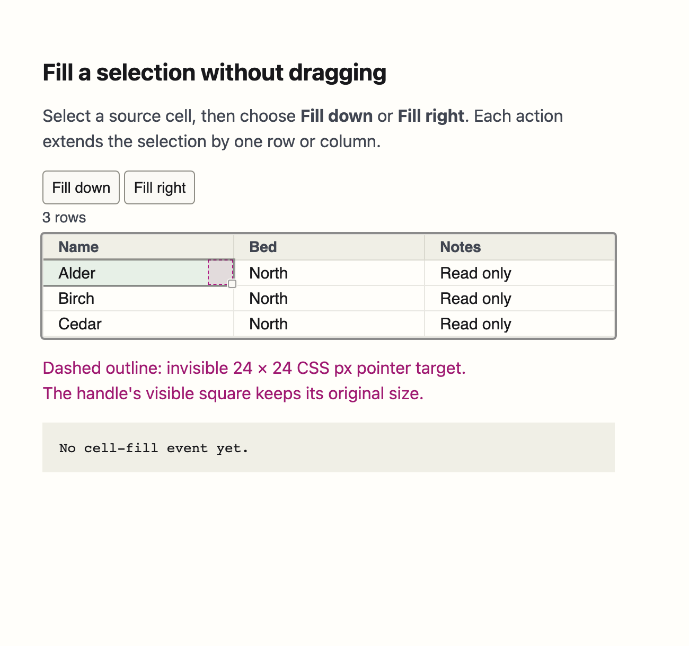
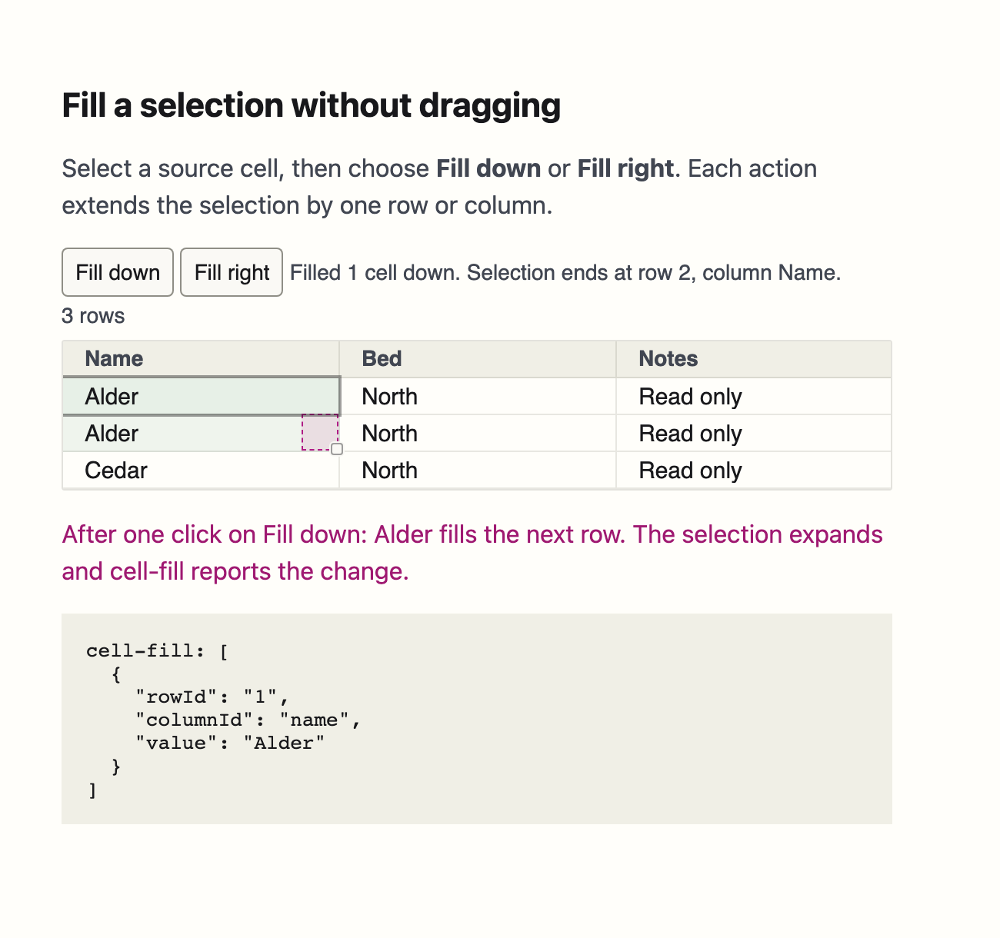

# Data grid fill interaction (#506)

Chromium screenshots of the component in compact density, captured on 2026-11-17.
The dashed magenta annotation shows the otherwise transparent pointer target;
it is an evidence overlay, not part of the component.

Select a source cell, then click or tap the built-in **Fill down** action. The
component emits `cell-fill`; the fixture applies its changes to show the result.

The browser regression file alongside `violet-data-grid-fill-selection.spec.ts`,
`violet-data-grid-fill-pointer.spec.ts`, uses real mouse drag/click and trusted CDP
touch input (`pointerType: "touch"`). It compares drag/button details in both
supported action directions and checks the target, keyboard flow, read-only
boundaries and edit state. Screenshots illustrate the flow; the test assertions
provide the behavior proof.
