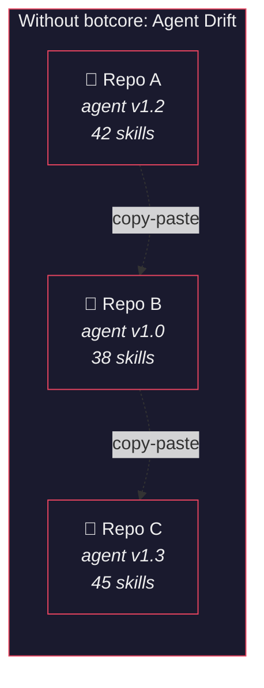
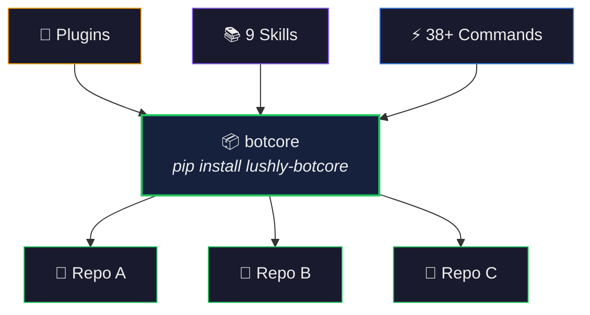
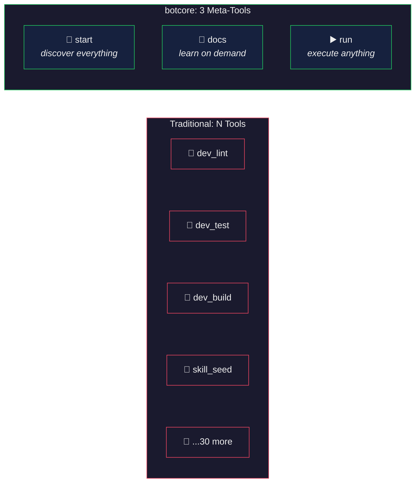
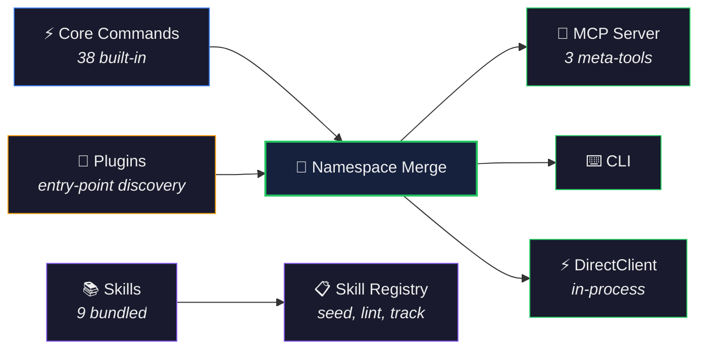

# botcore — Shared Bot Infrastructure

[](LICENSE)
[](#)
[](https://pypi.org/project/lushly-botcore/)
[](#)
[](#)
[](https://github.com/lushly-dev/afd)
[](https://github.com/sponsors/Falkicon)

> 🟢 **Beta** · Stable and in active use across multiple repositories. APIs are mostly stable; expect targeted iterative improvements. Feedback welcome!

> **Reference pair:** botcore delivers shared command/skill infrastructure; AFD provides the command-first architecture contract those commands are designed to follow. botcore is developed and released from the [AFD repository](https://github.com/lushly-dev/afd/tree/main/endpoints/botcore).

**What happens when every repo needs great agent tooling?**

You build it in one project, copy it to the next. Maybe you symlink. Maybe you create junctions. The skills diverge. The commands drift. A fix in one repo never reaches the others. Before long, you're maintaining five slightly different agents across five repositories — same tools, different versions, different bugs.

botcore ends the drift. Shared bot infrastructure — commands, skills, configuration, and plugins — delivered as a single `pip install`. Plugins extend it per-project. Skill ownership tiers let central updates flow without overwriting local customizations. One package, every repo, always in sync.

---

## The Problem: Agent Drift

When you work across multiple repositories, each one needs capable agent tooling — linters, test runners, quality gates, skill libraries. The natural solution is copy-paste. And copy-paste creates drift.



But the problem isn't just organizational. When these tools are exposed to AI agents via MCP, there's a second issue: **token overload**. An MCP server with 30+ commands means the agent loads 30+ tool schemas into its context window before doing any real work. Some models silently fail when the tool list gets too large.

## The Solution: Shared Infrastructure

botcore solves both problems at once. Centralize the infrastructure, then deliver it efficiently.



Install once. Every repo gets the same commands, the same skills, the same quality gates. Plugins add project-specific extensions without touching the core. Skill ownership tiers (`botcore`, `plugin`, `local`) ensure updates propagate cleanly — central skills update automatically, local customizations are never overwritten.

## Token-Efficient by Design

Most MCP servers expose one tool per command. 30 commands = 30 tool schemas in the agent's context. botcore uses the **meta-tool pattern** to collapse everything into just 3 MCP tools, regardless of how many commands exist:



> **The meta-tool insight:** *Token cost should be O(1), not O(n). The agent discovers what's available, reads docs for what it needs, then executes — all through 3 stable tools, whether you have 10 commands or 100.*

The agent workflow becomes:

1. **`start`** — Returns version, available functions, and doc topics. The agent orients itself.
2. **`docs`** — Retrieves topic-based reference docs on demand. No upfront cost.
3. **`run`** — Executes any command. Runs any Python its client sends, with your permissions; its input is AST-checked and its output truncated (head + tail preserved within 8KB).

One line creates the server:

```python
from botcore.server import create_mcp_server

server = create_mcp_server("mybot", version="1.0.0")
server.run(transport="stdio")
```

Adding a command to botcore or a plugin automatically makes it available — no hardcoded tool lists, no schema updates, no context window bloat.

## How It Works



Core commands and plugin commands merge into a single namespace. That namespace powers three surfaces — MCP, CLI, and DirectClient — from the same source. Skills are managed separately through the skill registry, which handles seeding, version tracking, linting, and ownership.

Language detection is automatic. botcore inspects workspace markers (`Cargo.toml`, `pyproject.toml`, `package.json`) and dispatches to the right tools — ruff for Python, biome for TypeScript, clippy for Rust. No configuration required for the common case.

## What's Included

### Commands (38+)

| Domain | Commands | What they do |
|--------|----------|-------------|
| **Dev** | `dev_lint`, `dev_test`, `dev_build` + 9 more | Language-aware linting, testing, building, quality gates, static analysis |
| **Skills** | `skill_seed`, `skill_list`, `skill_status`, `skill_lint`, `skill_adopt`, `skill_index`, `skill_usage_collect`, `skill_usage_report`, `skill_usage_triggers` | Seed, track, lint, and manage skill ownership across repos; report which skills agents load |
| **Gate outcomes** | `gate_outcome_collect`, `gate_outcome_report` | Read a repository's workflow runs, attempts, jobs, steps and hook group summaries from GitHub; report each workflow's or each check's runs by event, how they ended and what they cost, with quiet and never-observed checks |
| **CDP** | 33 `cdp_*` functions | Browser automation from Python (`botcore.commands.cdp`; not registered on the MCP server or CLI): launch, navigate, click, screenshot, forms, console, traces |
| **Docs** | `docs_lint`, `docs_check_changelog`, `docs_check_agents` | Documentation quality checks |
| **Info** | `info_workspace`, `info_env`, `info_scripts` | Workspace discovery and environment inspection |
| **Spec** | `spec_create`, `spec_status`, `spec_validate` | Spec lifecycle management |
| **Research** | `research_query`, `research_stream` | GPT web research with streamed output |
| **Undo** | `undo_status`, `undo_clear` | Command history and rollback |

### Bundled Skills (11)

Skills are markdown knowledge packs for agents. botcore bundles only skills whose content is
specific to botcore or its ecosystem; general engineering guidance that current models already
know was retired. `skill_seed` removes botcore-managed copies of retired skills and reports
locally owned ones.

| Category | Skills |
|----------|--------|
| **botcore** | `agent-config`, `botcore-config`, `browser-automation`, `mcp-builder`, `plugin-builder` |
| **Review and security** | `code-reviewer`, `security-auditor` |
| **Quality gates** | `bloat-sweeper`, `gate-discipline` (each with Node scripts, shipped in the wheel) |
| **Documentation** | `docs-manager`, `skill-manager` |

## Plugin System

Plugins extend botcore without modifying the core. The contract is a Python Protocol — no base class, no inheritance:

```python
class MyPlugin:
    def register(self, registry: PluginRegistry) -> None:
        registry.add_commands([my_command])
        registry.add_docs("myplugin", DOCS_STRING)
        registry.set_mcp_name("myplugin")
        registry.add_skills_dir(Path(__file__).parent / "skills")

    def config_schema(self):
        return MyPluginConfig  # Pydantic model or None
```

Register via entry point in `pyproject.toml`:

```toml
[project.entry-points."botcore.plugins"]
myplugin = "myplugin.plugin:MyPlugin"
```

The plugin's commands, docs, and skills automatically appear in MCP, CLI, and DirectClient surfaces. No wiring. No hardcoded lists. Add a command to a plugin, and every bot that uses it gains the capability immediately.

## Skill Ownership

Skills track ownership under the open standard's `metadata:` map in YAML frontmatter:

```yaml
---
name: security
description: Audits code for vulnerabilities. Use when reviewing a change for security.
metadata:
  source: botcore
  version: 3.0.0
  portable: true
---
```

Three tiers:
- **`metadata.source: botcore`** — Bundled universal skills, updated by `skill_seed --update`
- **`metadata.source: <plugin>`** — Plugin-provided skills
- **No source / `metadata.source: local`** — Project-specific skills, never overwritten by seed

A top-level `source:` (older copies) is still read; seed and adopt move it under `metadata:`.

This solves the customization problem: central skills stay in sync across repos, while project-specific skills remain untouched.

## Configuration

Convention over configuration. An empty config is valid — language detection and tool defaults handle the common case. When you need control:

```toml
# botcore.toml or pyproject.toml [tool.botcore]

[skills]
include = ["security", "testing"]  # Only seed these (omit for all)
skip = ["i18n"]                    # Exclude these
source_dir = ".claude/skills"      # Target directory
listing_budget = 8000              # skill_lint's SK019 cap on listed description characters

[[skills.required]]                # skill-usage-triggers: a change to these paths needs this skill
skill = "gate-discipline"
paths = ["lefthook.yml", ".github/workflows/*.yml"]

[languages.python]
root = "python/"
linter = "ruff"
test_runner = "pytest"

[languages.typescript]
root = "packages/"
linter = "biome"
test_runner = "vitest"
```

Language resolution follows a 5-step priority chain: explicit override → root prefix match → per-package override → marker walk-up → primary fallback. Multi-language monorepos work out of the box.

## Getting Started

### Installation

```bash
# From PyPI
pip install lushly-botcore

# From source (with dev + MCP extras)
pip install -e ".[dev,mcp]"
```

### Quick Setup

```bash
# Interactive — detects language, prompts for preferences
botcore init

# Non-interactive (agent-safe) — accepts all defaults
botcore init --non-interactive

# Start the MCP server over stdio
botcore serve
```

`botcore serve` is a trusted-local server: its `botcore-run` tool executes any Python its client sends, with your permissions. It serves only the client that started it, over stdio, and refuses `--transport sse`. To serve commands over HTTP, serve a managed host with `botcore.host_http` (`create_host_http_app`, run with `serve_hosts`), which checks bearer tokens from `botcore host-token issue`; see [Serving hosts over HTTP](docs/host-composition.md#serving-hosts-over-http).

For agentic setup with structured output:

```bash
pip install lushly-botcore
botcore init --non-interactive --json
# Returns: {config_path, language, skills_seeded, extensions_available}
```

### Create a Custom MCP Server

```python
from botcore.server import create_mcp_server

# One line — all commands, docs, and discovery wired automatically
server = create_mcp_server("mybot", version="1.0.0")
server.run(transport="stdio")
```

### Use Commands Directly

```python
from botcore import get_client

client = get_client()

# Language-aware — dispatches to ruff, biome, or clippy automatically
result = await client.call("dev_lint")

# Seed skills into the current repo
result = await client.call("skill_seed", {"update": True})
```

### Manage Skills

```bash
# Copy the 9 bundled skills into .claude/skills/
botcore skill-seed

# Check for version drift
botcore skill-status

# List all skills
botcore skill-list
```

### Measure Skill Use

```bash
# Add the skill loads the harnesses recorded to this machine's record
botcore skill-usage-collect

# Which skills were used in the last 30 days, by which harness, model and agent
botcore skill-usage-report --days 30 --project my-repo

# The 30 days before that, to compare
botcore skill-usage-report --days 30 --ending-days-ago 30 --skill my-skill

# The merged changes that needed a skill the session that opened them had not loaded
botcore skill-usage-triggers --days 30
```

The loads are read from T3 Code's store and, for sessions it did not run, from Claude Code's
transcripts, so nothing is added to a skill and no agent reports anything. The record never
holds a prompt, a command or file contents.

The hourly job that `botcore disk-setup` installs collects on its own. To read several
machines as one, name each machine and one folder they all see (a synced drive, kept private)
in each machine's settings, `disk.toml`:

```toml
skill_usage_machine = "laptop"
skill_usage_shared = "~/Shared/skill-usage"
```

Every machine then reports the same, once each runs the same botcore and their records have
synced. A project's skills, their sizes and their names are read at collection from the tip
of its default branch and kept in the record, so a report does not depend on what the
machine that reads it has checked out.

On macOS the system asks, once and at the screen, before the hourly job reads a folder in a
cloud drive that fetches files on demand. After a run that waited for that answer,
`botcore disk-status` says the shared folder did not answer, and what to allow.

### Measure Workflow Runs

```bash
# Read this checkout's repository's Actions runs of the last 7 days into the record
botcore gate-outcome-collect --since-days 7

# Each workflow on pull requests over the 7 days that ended 2 days ago: how runs ended, wall hours
botcore gate-outcome-report --days 7 --ending-days-ago 2 --where pull_request

# The merge queue's groups and how many had a failure
botcore gate-outcome-report --days 7 --where merge_group

# Each check on pull requests, the costliest first: a step of a job, or a command of a hook group
botcore gate-outcome-report --days 7 --by check --where pull_request

# One check, with the runs it failed in
botcore gate-outcome-report --by check --check "ci.yml / TypeScript (Node 26.x) / Quality gate / test"
```

A collection reads GitHub through `gh` within its own `--requests` limit and stops when the
account's hourly allowance is down to half; the next one goes on from where it stopped. The
record holds paths, digests, names, durations and counts only, and is shared with other machines
through the same shared folder as skill usage. The checks known are read from the default
branch's tip, and where a hook group step failed, the job's log is read once for the hook
runner's summary, of which only each command's name, result and seconds are kept. A repository
names the workflows that judge the others in `botcore.toml` (`[gate_outcome] verdict_workflows`),
so the totals do not count one failure twice. The hourly job collects for the checkouts a
machine's settings name in `gate_outcome_checkouts` (none by default: GitHub's allowance is the
account's), and days more than 180 days old are folded into one line for each workflow and each
check, which the reports read as they read the runs. Every input and field is in the
`gate-outcome` topic of the MCP server's docs tool.

## Development

```bash
# Install with dev dependencies
pip install -e ".[dev,mcp]"

# Run all tests (172+)
pytest tests/ -v

# Lint
ruff check src/

# Lint with auto-fix
ruff check src/ --fix
```

> Git hooks are managed by [Lefthook](https://github.com/evilmartians/lefthook). Run `lefthook install` to enable pre-commit and pre-push checks.

## Roadmap

- [x] Shared config system (Pydantic models, multi-language)
- [x] Plugin contract (Protocol-based, entry-point discovery)
- [x] Command extraction (38+ commands across 8 domains)
- [x] CDP browser automation (33 functions)
- [x] Skill registry (seed, lint, track, adopt, index)
- [x] 9 bundled skills
- [x] MCP server factory (meta-tool pattern)
- [x] Multi-language dispatch (Python, TypeScript, Rust)
- [x] Skill ownership tiers (botcore, plugin, local)
- [x] Action skills (commit, PR, release, review, hotfix)
- [x] Typed connectors plugin — Phase 1: GitHub (8 commands, 248 tests)
- [x] Teams Interface plugin — Phase 1 (intent parsing, Adaptive Cards, tenant auth, stub dispatch)
- [x] LLM runtime plugin (`botcore-llm` — Copilot SDK sessions)
- [x] Agent orchestration Phase 1 (`botcore-agents` — single-agent lifecycle)
- [x] Agent state serialization (`OrchestratorSnapshot`, pluggable backends, JSON file backend)
- [x] Per-agent permission profiles (`AgentPermissionsConfig` — shell/filesystem allowlists, agent-scoped gates)
- [x] Memory system (`botcore-memory` — local JSON store, 5 CRUD commands, scope-based access)
- [ ] Foundation: agent capability declarations, state serialization, per-agent permissions
- [ ] Async task execution, cost-aware routing
- [ ] SQLite memory backend
- [ ] Typed connectors — Phase 2: Azure DevOps, ARM, Key Vault
- [ ] Typed connectors — Phase 3: Microsoft Graph (Email, Calendar, Teams)
- [ ] Agent orchestration Phase 2 (multi-agent routing)

See [ROADMAP.md](ROADMAP.md) for the full feature trajectory.

## Community

- Read [CONTRIBUTING.md](./CONTRIBUTING.md) before opening a PR
- Review [CODE_OF_CONDUCT.md](./CODE_OF_CONDUCT.md) for community expectations
- Report vulnerabilities via [SECURITY.md](./SECURITY.md)

For AI agents contributing to this repo, see [AGENTS.md](AGENTS.md).

## Author

**Jason Falk** · [GitHub](https://github.com/Falkicon) · [Sponsor](https://github.com/sponsors/Falkicon)

Co-creator of [FAST](https://github.com/microsoft/fast) (7,400+ GitHub stars), an open-source web component system used in Edge, Windows, VS Code, and .NET.

botcore grew from managing AI agents across dozens of repositories — and the realization that shared infrastructure shouldn't live in clipboard history.


## Managed repository hosts

For explicit per-worktree context, host-owned identity, effects policy and
quality verdicts shared by CLI/MCP/DirectClient, see
[host composition](docs/host-composition.md). `create_host_mcp_server(host)`
serves managed hosts through `afd.server.create_server` (requires the `mcp`
extra: `afd[server]>=0.13.0`, `mcp>=2.3,<3`), exposing dual-era MCP
`2026-07-28` `server/discover` and `2025` `initialize`, AFD meta-tools
(`afd-discover`, `afd-detail`, `afd-call`, `afd-batch`, `afd-pipe`), AFD tool
strategies, Skills (`io.modelcontextprotocol/skills`), resources, OAuth bearer
auth, `context_hook` and `context_fields`. Host policy and execution profiles
run as AFD middleware (`create_host_policy_middleware`), `default_timeout_ms`
defaults to `None` (no cutoff unless configured), `command_tools=True` maps to
AFD's `"individual"` tool strategy (`"lazy"` by default), and `{name}-start`,
`{name}-call` and `{name}-docs` remain available as deprecated compatibility
aliases. Legacy trusted-local `create_mcp_server` and `botcore.host_http` keep
their existing behavior. This opt-in API does not transfer package publication
authority.
