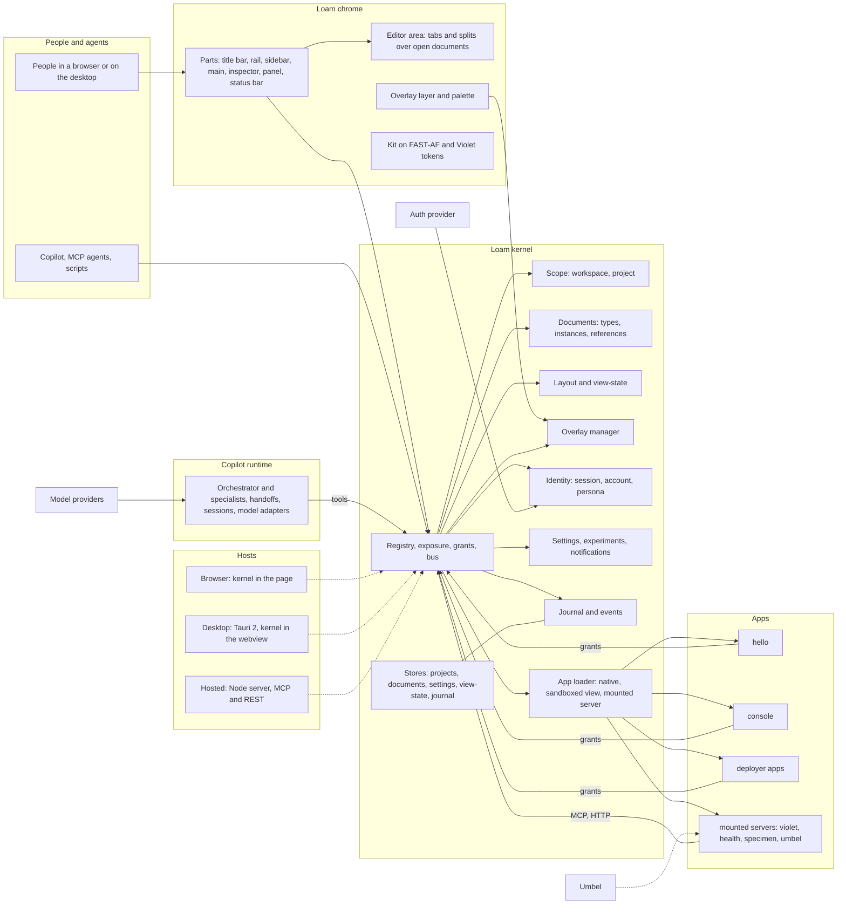
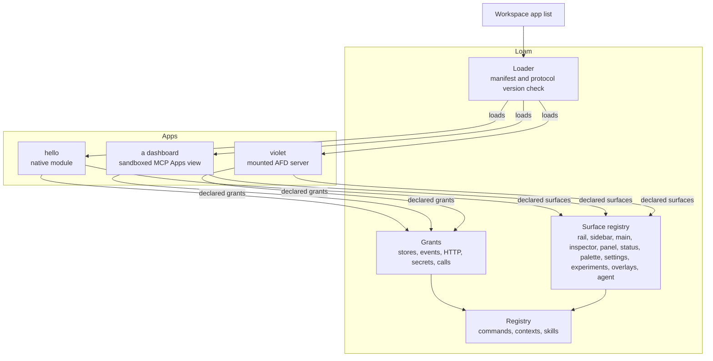
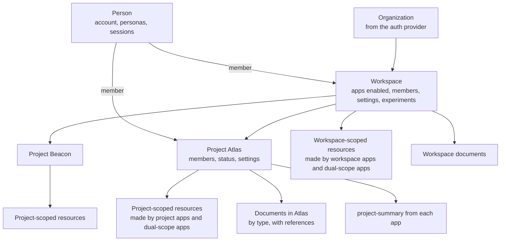
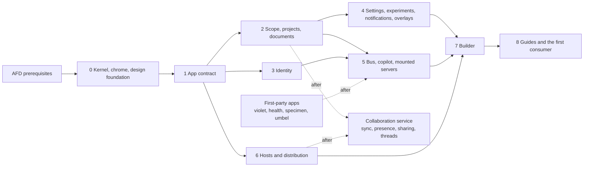

# Loam architecture

| Field | Value |
| --- | --- |
| Status | Living document; the through line every phase implements against. Drafted 2026-10-30, awaiting the owner's review |
| Owner | Repository owner; each phase's owning agent proposes amendments by pull request |
| Elevation | Infrastructure, libraries, interfaces, principles and phases. No code. Interfaces are described by their invariants and minimum contents; each phase's specification settles the exact shapes |
| Read first | [STATUS.md](STATUS.md) for what is done; then this document; then the [decision log](decisions.md) |
| Companion documents | [Proposal](proposal.md) (rationale), [Trajectory watch](trajectory.md), [Research](research.md), [Sources](sources.md) |

Where this document and the proposal differ, this document is current and the
proposal is corrected. Terms are defined in the [glossary](#12-glossary).

## 1. Vision

Loam is an application shell for AFD applications: one chrome that holds
many apps as plugins and provides everything every app would otherwise
build again. Sign-in, account and persona; workspaces, projects and documents;
settings, experiments and notifications; the palette, the copilot and the
status bar; overlays that stay with their app; a layout engine and shared UX
compositions; and one component library. It ships empty. Capability arrives
as apps, some built here as examples and first-party defaults, most built by
the people who deploy it, without touching this codebase. Its state is
commands, so agents and people drive it the same way.

Every phase should be able to answer one question: does this bring a
deployment closer to running Loam with its own apps, its own identity
provider and its own hosts, on its own terms, with no app leaking into
another?

## 2. Principles

1. **Empty shell.** Loam owns the chrome and its parts, the surface
   catalog, the layout engine, scope, documents and the editor area,
   identity, overlays, settings, experiments, notifications, the palette,
   the copilot, the bus, the journal, the app loader and the kit. It owns no app and no domain. If a
   feature could be an app, it is an app; if it aggregates across apps, it
   is a shell section.
2. **Apps are the unit.** An app contributes commands, surfaces, a layout
   preset, settings, experiments, skills and AFD contexts under a manifest
   and declared grants. Apps do not depend on each other; the shell provides
   shared services through grants listed in the
   [host services catalog](#host-services-catalog).
3. **Everything is a command.** One registry serves the palette, the in-app
   agent, MCP, the CLI and other apps. Layout, scope, overlays, settings,
   experiments, identity and navigation are commands. No surface defines
   behavior the others lack. Command names follow AFD's `domain-action` rule,
   which the registry enforces.
4. **Opt-in surfaces, nothing inherited.** The shell renders only what a
   manifest declares. No app receives another app's views, inspector,
   panel, status items, overlays or settings. Shared behavior arrives only
   through named compositions an app opts into.
5. **Scope is shell-level.** A workspace, optionally narrowed to a project,
   is the context every command runs in. Apps declare the scopes they
   support. The active project narrows, never grants; it is explicit per
   request, never connection state.
6. **Overlays have owners.** Every toast, dialog, modal, popover and prompt
   belongs to the shell or to an app session, is opened through a shell
   command, and follows a lifetime policy when the app changes. One modal
   at a time, shell-wide.
7. **Identity once.** Sign-in, account, persona, sessions and memberships
   live in the shell on the AFD auth adapter. Apps receive the actor and the
   scope, never credentials. Persona is a lens, never a grant.
8. **Agents are first-class users of the shell.** The copilot and MCP agents
   use the registry people use, with AFD contexts that follow the active
   app, document and scope, confirmations and approvals from AFD, and MCP
   Apps views rendered as an app kind. Agents, handoffs and sessions are
   AFD records; the model SDK is an adapter the copilot runtime can replace.
9. **Layout is data.** A parts model, constraints and persisted view-state;
   apps request parts and compositions, the shell decides positions and
   sizes. No app positions chrome.
10. **One library, scoped registries.** The kit is built on the FAST-AF
    component set with Violet tokens; apps get all of it and may bring their
    own elements under a scoped custom element registry. Tokens flow through;
    inherited styles do not.
11. **One kernel, three hosts, TypeScript first.** One TypeScript kernel
    runs in the browser, in Tauri's webview on the desktop and in a Node
    process on the hosted server. Rust enters only where a measurement shows
    it pays, as WebAssembly behind a TypeScript interface, and in Umbel,
    which Loam mounts. Nothing organization-specific in the kernel.
12. **Apps are web components, and the SDK is the whole contract.** An app
    author writes TypeScript, HTML and CSS as web components against the
    SDK and calls commands through its client. Transports, in-process,
    IPC, HTTP or MCP, and the kernel are the shell's concern and
    never appear in an app; nothing in an app changes between hosts.
13. **Deterministic core, judgment at the edges.** Layout, scope, policy,
    grants, search over the palette and replay are deterministic. Drafting,
    suggestion and review belong to models and people, outside the core.
14. **Every mutation is an event.** Shell and app mutations are journaled
    commands; the event stream is a projection of the journal with resource
    references and per-app cursors, in the shape Umbel's event log takes.
15. **AFD first.** Where AFD has or proposes a mechanism, Loam uses or
    extends it and records any divergence as a decision.
    [Section 6](#6-built-on-afd) is the map.
16. **Same shell for every consumer.** The Lushly support application is
    the first consumer; nothing Lushly-specific lives in Loam, and a need it
    surfaces is recorded as a generic shell need.
17. **Documents are shell resources; types are contributions.** Any plugin
    may contribute document types; an instance is a shell resource in a
    scope with one model and any number of editors in the editor area; New,
    tabs, recents, search, trash and references are the shell's; documents
    reference each other through resource links and commands, never through
    each other's code.
18. **Design foundation before UI, one component set for many design
    systems.** Violet is the token engine; the shared FAST-AF components
    consume Violet themes, so Loam's theme and a consumer's theme feed the
    same components and nothing is forked. Loam's semantic layer, its
    themes, the components' move onto Violet, the design document and its
    skill come first, in phase 0. Components are built as they are needed,
    under a checklist, and consume semantic tokens only.
19. **Multiplayer is a shell service.** Sync, presence, sharing and threads
    are the shell's, bound by a contract every document type and run
    declares; the command journal is the system of record, a CRDT merges
    fine-grained content inside commands, share links carry generations,
    and live sessions revalidate authorization when membership changes.
20. **The shell builds its own apps.** A draft app is a workspace artifact;
    the console is its first stage; the builder agent works only through
    `app-*` commands and the store, never a terminal; drafts run
    sandboxed; publication is a versioned lifecycle with an owner's
    approval for the team; a repository is optional.

## 3. System shape



Responsibilities, not deployment topology. The browser runs the kernel in
the page beside the chrome; the desktop runs it in Tauri's webview; the
hosted server runs it in a Node process and serves the chrome, MCP and REST.

## 4. Components

| Component | Responsibility | Not its job |
| --- | --- | --- |
| Chrome and parts | Title bar, rail, sidebar, main, inspector, panel, status bar, the overlay layer, the palette and the agent panel, as FAST-AF elements; collapse, resize and responsive rules | Rendering anything an app did not declare |
| Surface registry | The [surface catalog](#surface-catalog): each surface's contract, ownership rule and lifecycle on app switch; validation of manifests against it | Inventing a surface per app |
| Layout engine | The parts model, constraints, layout presets, the composition library, persisted state per app and scope through the view-state commands, keybindings | Positioning decided by apps |
| Scope | The active workspace and project on every command; the project store; the projects section with `project-summary` contributions; the URL scheme | Granting access; that is membership and the provider |
| Documents | The document type registry, the instance store, the editor area (tabs, splits, pinned and preview tabs, dirty state, restore), the New menu, the documents section, the references index with backlinks, trash with undo | Reading a document's content; only the type's editor and commands do that |
| Collaboration | The sync endpoint on the hosted server; the presence channel per document and run; CRDT merge for bound models, carried as `document-apply-update`; per-property last-writer-wins for unbound fields; the share store with link generations; the threads store; authorization revalidation on membership change | Deciding a type's conflict semantics for it; that is the type's binding |
| Builder | The in-shell development environment: draft apps as workspace artifacts, the console as a draft's first stage, the builder agent with the SDK and design skills, `app check` in the shell, sandboxed preview with the kit delivered inside, the publish lifecycle with versions, changelogs and review, the usage view, export to a package | A terminal or file system for the agent; running an unreviewed draft as a native app |
| Identity | Sign-in, account, persona, sessions and memberships on `@lushly-dev/afd-auth`; the actor on every command; Better Auth, Convex and Mock adapters; the Rust token-verification layer on the hosted server | Owning an identity provider; using persona as authorization |
| Overlay manager | Toasts, popovers, dialogs, modals, prompts and global overlays as owned resources with lifetimes; the top layer, inert and focus rules; the toast region and the inbox hand-off | Letting an app render its own overlay region |
| Settings | Sections with schemas at user, workspace and project scope; `settings-*` commands; search; persistence through the kernel store | Business configuration inside apps |
| Experiments | Flags with a lifecycle; per-person opt-in and workspace-wide enablement; gating of apps and surfaces; `experiment-*` commands | A/B measurement; that is telemetry's job if ever |
| Notifications | The persistent inbox with resource links and read state; sticky toasts land here | Push delivery to a disconnected person; consumers resume by cursor |
| Palette and copilot panel | All commands exposed to the palette, filtered by active app, document and scope; quick picks; the copilot panel: chat, interrupts, the handoff trail, session history | Defining commands of its own beyond the shell's |
| Copilot runtime | The orchestrator and contributed specialists as agent records, handoffs, sessions and turns; tools through the registry under `expose.agent`; confirmations and approvals mapped to interrupts; the AG-UI stream to the panel; a model adapter per provider; a worker in the browser and in the desktop webview, in-process on the hosted server | Owning any app's prompt, model or policy; durable state outside the shell's stores |
| Registry, bus and grants | One registry; AFD exposure per interface; app-to-app calls under manifest grants; `shell-open` deep links; `shell-events` by cursor; batch and pipe | Apps calling apps outside the registry |
| App loader | Three kinds: native ES modules under scoped registries, sandboxed views on the MCP Apps profile, mounted AFD servers rendered by the console; the Plugin Discovery protocol version, conflict policy, command origin and diagnostics | Discovery by scanning |
| Kit | Shell components on the FAST-AF component set: rail, sidebar, navigation, inspector, status items, empty states, command list, forms from schemas | A second design system; Violet is the token source |
| Design foundation | Loam's semantic token layer as a Violet theme (color roles, type ramp, spacing, radii, elevation, motion, density, focus and state) in light, dark and high contrast; the shared FAST-AF components fed by Violet themes through the runtime in place of their local theme registries, with baked-in defaults; the design document and its authoring skill; the component checklist and the token-only lint | A second token engine; a forked component set; components built ahead of need |
| Journal and events | AFD's journal for every command; the event projection with resource references and per-app cursors | Guaranteeing delivery |
| Stores | Store traits for projects, settings, view-state, notifications and the journal with an embedded reference backend and a conformance suite; `@lushly-dev/local-db` on the TypeScript side | Choosing a vendor for the deployer |
| Hosts | Browser, Tauri desktop, hosted server; the same chrome and the same kernel | Separate shells per host |
| Distribution | Static site, desktop installers, an OCI image, an MCP registry entry for the hosted server | A hosted service; deployers host it |

### Surface catalog

Every surface has a contract an app's manifest fills, an owner, and a rule
for what happens when the active app changes.

| Surface | Contract, at least | Owner | On app switch |
| --- | --- | --- | --- |
| rail | id, label, icon, badge source, supported scopes, order hint | Shell | Stays; the active item changes |
| sidebar | Views: `list`, `tree` or `custom` with a mount; a project section when project-scoped; width preset | App | Parked and restored |
| header | Title, breadcrumbs, primary actions as commands | App | Replaced |
| main | The stage: routes under the app's base; a mount | App | Replaced |
| documents | Document types: id, title, icon, templates, content schema and version, editor kind, scopes, optional surfaces, instance commands | Shell | Stays |
| new | Creators beyond document types: title, icon, command | Shell | Filtered by scope |
| editor | The editor frame for an open document: mount, instance id, selection model, dirty, save and dispose hooks | The document's plugin | Tabs stay; the active editor changes |
| embed | A read-only preview of one document rendered inside another, access re-checked | The embedding document | Follows its editor |
| inspector | Selection model and a properties view | App | Cleared |
| panel | Views such as results, logs, terminal; height preset | App | Parked and restored |
| status | Left items (workspace and project) and right items (app and active item): text, icon, command, priority | Left: shell. Right: app | Right items removed |
| palette | Commands with `expose.palette`; quick picks with a schema | Shell | Filtered by active app and scope |
| settings | Sections: id, title, JSON Schema, scope | Shell | Stays |
| experiments | Flags: id, title, what may change, graduation date, audience | Shell | Stays |
| notifications | Items: source, resource link, read state, action | Shell | Stays |
| overlays | Opened through `toast-show`, `dialog-open`, `modal-open`, `popover-open`, `prompt-open` | App session or shell | Per the [overlay policy](#overlay-policy) |
| agent | AFD contexts, skills, prompts, specialist agent records | Shell | Contexts follow the active app and document |
| keybindings | Chords and two-key sequences bound to commands; `when` conditions | Shell | App-local bindings deactivate |
| menus | Context-menu entries bound to commands; `when` conditions | Shell | App entries deactivate |
| project-summary | A command returning counts, recent items and links for a project | Shell, rendered in the projects section | Stays |
| account | Sections in the account area, as settings | Shell | Stays |

### Overlay policy

| Kind | Lifetime | On app switch | Placement | Limit |
| --- | --- | --- | --- | --- |
| toast | transient, timed | dismissed; `sticky` moves it to the inbox | the shell's toast region | stack cap, oldest collapses |
| popover | transient, light-dismiss | closed | anchored to the invoker, top layer | one per invoker |
| dialog | session | parked and restored; `cancel-on-leave` cancels | top layer, non-modal | per app |
| modal | session | cancelled, result reported to the owner | top layer, rest of the shell inert | one shell-wide |
| prompt | session | cancelled | the agent's confirmation and input-required flow | one per agent turn |
| global | shell | survives | top layer | shell only |

Focus returns to the invoker; modals trap focus; every overlay carries its
owner id, and the overlay manager refuses an open from an app that is not
active unless the kind is `toast` or the call is a `global` from the shell.

How an app reaches the registry and the surfaces. Every edge goes to the
shell; there is no edge between apps.



### Host services catalog

Every grant is scoped to the workspaces and projects the app is enabled for
and the caller may read; isolation is enforced here, not by apps.

| Grant | The shell provides | Rule |
| --- | --- | --- |
| store | A namespaced key-value and document store per app, scoped by workspace and project | Writes carry the scope; reads are filtered by it |
| projects | Read the project list and the active project | Apps never create or delete projects; people do, through the shell |
| documents | Read metadata, references and backlinks of documents the caller may read; open one | Content is read only through the type's editor and commands, under `store` |
| settings | Read the app's own settings | Other apps' settings are not readable |
| collaboration | Presence, threads and share state of documents and runs the caller may read; the binding for the caller's own document types | Sync writes go through journaled commands, never through this grant |
| events | Read the event stream by cursor and pattern | Events are appended by journaled commands, never through this grant |
| calls | Call named commands of named apps | Both the caller's grant and the callee's exposure must allow it |
| http | Outbound HTTP to hosts the manifest declares, through the kernel | No caller credentials are attached |
| secrets | Named deployer secrets on the hosted server | Never the person's tokens |
| clock, random | Time and randomness from the command context | Required so the journal can replay a call |

Each command also declares its effects and capabilities in the shape of
Botcore's command policy, so a deployer can see what an app may do before
enabling it.

## 5. Interfaces

Described by invariants and minimum contents; each phase specifies the exact
shapes. One command end to end, the same whether a person, the agent panel
or an MCP agent issued it:

```mermaid
sequenceDiagram
    participant C as Caller (palette, agent, MCP, app)
    participant R as Registry
    participant K as Kernel (scope, grants, policy)
    participant A as App command or shell command
    participant S as Stores
    participant J as Journal and events
    participant U as Chrome
    C->>R: notes-create, with scope and actor
    R->>K: validate input, exposure for this interface, grant for this caller
    K-->>R: allowed, or COMMAND_NOT_FOUND
    R->>A: execute with the command context
    A->>S: write, scoped by workspace and project
    A-->>R: CommandResult with reasoning, warnings, undo
    R->>J: journal entry; an event for a mutation
    R-->>C: CommandResult
    J-->>U: event; the chrome re-renders the affected surfaces
```

- **Command names.** Every command follows AFD's `domain-action` rule. Shell
  domains include `shell`, `app`, `project`, `scope`, `document`,
  `copilot`, `view-state`, `layout`, `toast`, `dialog`, `modal`, `popover`, `prompt`, `settings`,
  `experiment`, `notification`, `account`, `persona`, `session` and the
  `auth-*` commands from the auth adapter. An app's domain is its id. A
  mounted server's tools are renamed into the rule under the mount's prefix,
  with the original name kept in `_meta`.
- **Shell commands, minimum.** `app-list`, `app-open`; `project-create`,
  `project-list`, `project-get`, `project-update`, `project-archive`;
  `scope-get`, `scope-set`; `view-state-get`, `view-state-set`,
  `view-state-list`; `layout-get`, `layout-set`, `layout-reset`;
  `toast-show`, `dialog-open`, `modal-open`, `popover-open`, `prompt-open`,
  `overlay-list`, `overlay-dismiss`; `settings-get`, `settings-set`,
  `settings-list`, `settings-schema`; `experiment-list`,
  `experiment-enable`, `experiment-disable`, `experiment-check`;
  `notification-list`, `notification-push`, `notification-read`;
  `account-get`; `persona-list`, `persona-set`; `session-list`,
  `session-revoke`; `shell-open`, `shell-events`; `document-create`,
  `document-open`, `document-list`, `document-get`, `document-rename`,
  `document-move`, `document-trash`, `document-restore`,
  `document-link-add`, `document-links`, `document-export`,
  `document-import`, `document-apply-update`, `document-share`,
  `document-share-revoke`; `presence-get`; `thread-create`,
  `thread-reply`, `thread-resolve`; `copilot-ask`, `copilot-handoff`,
  `copilot-session-list`, `copilot-session-open`,
  `copilot-session-resume`; `app-create`, `app-draft-write`, `app-check`,
  `app-preview`, `app-publish`, `app-version-list`, `app-export`,
  `app-usage`. Mutations declare
  `mutation`, `undo` and, where consequential, an approval policy.
- **Scope.** Every command carries the scope: the workspace and, when one is
  active, the project. In-process it is a field on the command context's
  extension; over MCP it is explicit per-request input in `_meta`, because
  `tools/list` must not vary per connection; in the URL it is the path.
  The field is a Loam extension first (D31).
- **App manifest.** At least identity, version, protocol version,
  contributions (commands, surfaces, a layout preset, compositions used,
  settings sections, experiments, skills, AFD contexts), supported scopes,
  required grants with declared effects, exposure defaults, and a
  configuration schema. It follows the
  [Plugin Discovery](../../../docs/features/proposed/plugin-discovery/plugin-discovery.spec.md)
  fields where they apply and Umbel's manifest for everything that is not
  UI; the UI contributions are an extension (D10).
- **Surface contracts.** Each surface in the catalog has a schema the
  manifest is validated against; a mount is a shell-provided element the
  app renders into, under its scoped registry; views declare their kind and
  their selection model so the inspector can follow it.
- **Layout preset and compositions.** A preset names the parts used, their
  default sizes and collapse rules; a composition is a named shape (list and
  detail, split, board, document, dashboard, wizard, console) with the parts
  it needs and the selection model it exposes. Persisted state is view-state
  keyed by app and scope.
- **Overlay commands.** Each returns an overlay id, records the owner, the
  kind and the lifetime, and resolves with the result when the overlay
  closes; the policy table above is enforced by the manager.
- **Settings and experiments records.** A setting has an id, a scope, a
  schema and a value; an experiment has an id, an owner app, a state
  (hidden, visible, enabled, graduated, removed), an audience (person,
  workspace), what may change, and a graduation date. A surface or an app
  may `require` an experiment.
- **Identity.** The session and the actor come from the auth adapter; the
  account is a record with profile, credentials inventory, sessions,
  memberships and agent credentials; a persona is a record with
  presentation, defaults and emphasis, selected per person, never consulted
  by authorization. The command context carries the actor from AFD and, in
  its extension, the scope, the persona id and the hosted principal fields
  MCP Authorization proposes.
- **Grants and calls.** A call from app A to app B's command succeeds only
  when A's manifest grants `calls` to that command or pattern and B's
  command carries the `apps` exposure flag (D30); the kernel checks both before
  execution and records the calling app on the journal entry.
- **Events and cursors.** Each mutation's event carries at least an id, the
  journal entry it came from, a per-app cursor, the resource reference, the
  scope and the actor; apps read by cursor and pattern through
  `shell-events`.
- **Resource link.** A link that names an app, a resource and a scope, used
  by `shell-open`, notifications, the projects section and the agent;
  rendered as a navigation, never executed as a command.
- **Document type contribution.** At least id, title, icon, templates for
  New, the content schema and its version, the editor kind (native view or
  `ui://` resource), supported scopes, the optional surfaces used
  (inspector, panel, embed), the commands that take an instance id, and
  export and import handlers.
- **Document record and editor contract.** A record carries at least id,
  type, title, scope, owner, timestamps, tags, status (active, archived,
  trashed) and content version; content lives under the `store` grant with
  the type's schema. One model per instance, any number of editors. The
  editor contract gives a view a mount, the instance id, a selection model
  to report, and dirty, save and dispose hooks; the shell owns tabs, splits,
  pinning, restore and the dirty indicator.
- **References.** A resource link from one document to another, recorded by
  `document-link-add` with the linking document, the target, an anchor and a
  kind; the shell keeps the index and serves backlinks; `embed` renders a
  target read-only with the reader's access re-checked at render time.
- **Collaboration binding.** A document type declares its binding: the
  model (`command`, or `crdt` with the library behind the trait), the
  selection model presence is expressed in, the locator form threads
  anchor to, and conflict semantics for structured fields, per-property
  last-writer-wins by default. Runs declare the same with a fixed model. A
  share link carries a generation; a session is bound to a membership
  epoch or a link generation and is revalidated when either changes.
- **App artifact and lifecycle.** A draft app is a record with id, version,
  state (draft, checked, published to self, published to the team), the
  manifest, files, the latest `app check` result, a changelog, the
  publisher and the approver. A draft runs as a sandboxed view with the
  kit delivered inside and tokens as custom properties, under a content
  security policy the shell sets and the grants the manifest declares;
  promotion to the native kind is a reviewed state change. `app-export`
  writes the artifact as a package; `app-usage` reports calls per command
  per interface.
- **Agent record and handoff.** An agent carries at least id, title,
  instructions, the AFD contexts it may enter, skills, a tools filter, a
  model preference, an owner and budget defaults. `copilot-handoff` hands a
  turn to a named agent with typed input, a budget and a timeout; sessions
  are records with turns; every tool call is a journaled command carrying
  the session and turn on its entry.
- **Copilot runtime boundary.** One adapter interface: a model call with
  streaming, the tool loop, interrupts for confirmations and approvals,
  subagent runs with budgets, and session persistence hooks. The shell owns
  agent records, handoffs, tools, approvals and sessions; the SDK behind the
  adapter owns nothing durable. The stream to the panel is AG-UI events.
- **SDK and kernel boundary.** The TypeScript SDK is the public contract for
  app authors: manifest types, surface contracts, the kit, a client for the
  registry, and the test kit. The kernel exposes one versioned interface
  the SDK wraps, in process in the browser and the desktop webview and over
  HTTP from the hosted server; apps never bind to the kernel directly. An app
  never sees a transport either: the SDK's client is the only way an app
  calls a command, and the shell chooses the transport per host. An app
  is TypeScript, HTML and CSS as web components, and its author needs no
  Rust, REST or MCP knowledge.
- **MCP Apps profile.** A sandboxed view is a `ui://` resource with the MCP
  Apps HTML profile rendered in a sandboxed iframe; the shell is the host,
  withholds data until the view reports ready, pushes tool input and
  results, and brokers the view's tool calls through the registry under the
  app's grants. A native Loam view may be exported as the same resource.
- **CLI.** The hosted server's registry as commands and subcommands, JSON
  out, the AFD CLI's exit codes, the workspace doctor, `app new` and
  `app check`.
- **Telemetry.** AFD telemetry with the actor's kind only; usage events for
  metering, if ever, are a separate stream in the journal.

A person's session end to end, with the agent panel beside them:

```mermaid
sequenceDiagram
    participant U as Person
    participant L as Loam chrome
    participant K as Kernel
    participant A as Active app
    participant M as Copilot
    U->>L: sign in
    L->>K: auth-sign-in through the adapter
    K-->>L: session, actor, persona defaults, landing scope
    U->>L: pick project Atlas, open the notes app
    L->>K: scope-set, app-open
    K->>A: mount with scope and grants
    U->>M: "summarize what changed in Atlas this week"
    M->>K: afd-context-enter notes; shell-events since cursor; notes-list
    K-->>M: events and results, filtered by scope
    M-->>U: summary with sources and a toast through toast-show
    U->>L: switch to the health app
    K->>K: park notes' sidebar and panel, dismiss its toast, clear the inspector
    Note over U,M: Nothing of notes remains on screen; its state returns when it is reopened
```

## 6. Built on AFD

| Loam needs | AFD mechanism | State on 2026-10-30 |
| --- | --- | --- |
| Command identity | `domain-action` names, validated at registration | Exists |
| Results, reasoning, degradation, undo | `CommandResult`: `reasoning`, `warnings`, `confidence`, `undoCommand`, `undoArgs` | Exists |
| Per-interface exposure | `expose`: palette, agent, MCP, CLI | Exists; the `apps` flag is D30, a new AFD feature |
| Caller identity | `actor` with `onBehalfOf`; `credentials` | `actor` exists; `credentials` proposed in MCP Authorization |
| Context extension for scope and persona | `CommandContext` module augmentation | Exists; Lushly uses it for tier and surface |
| Human confirmation | `confirmPrompt` under `enforce` or `require-human` | Exists |
| Approval of consequential commands | Approval policies and tokens | Exists in TypeScript |
| Layout state | `view-state-get`, `view-state-set`, `view-state-list` on `ViewStateRegistry` | Exists |
| Persistence on the TypeScript side | `@lushly-dev/local-db` `DataAdapter` | Exists |
| Sign-in and sessions | `@lushly-dev/afd-auth`: adapter, middleware, multi-tab sync, Better Auth and Convex adapters, auth commands | Exists |
| Rendering results generically | `@lushly-dev/afd-adapters` | Exists; the console extends it with forms from input schemas |
| Record of calls and replay | Journal with `seq`, actor, context digest, clock and random tape, replay | Exists |
| Composition | `afd-batch`, `afd-pipe`, pipeline variables | Exists |
| Discovery for the agent | Bootstrap commands; lazy meta-tools; AFD contexts as explicit per-request input | Exists |
| Plugin contract | Plugin Discovery: protocol version, conflict policy, command origin, diagnostics | Proposed; shared with Umbel |
| Grants and effects | Botcore command policy: declared effects and capabilities | Exists in Botcore |
| App check | Surface validation, including `afd validate --surface` against a server | Exists |
| Test kit | Scenario runner in `@lushly-dev/afd-testing`; journal replay; Specimen for the chrome | Exists |
| In-process agent | `DirectClient` and `createDirectRegistry` | Exists |
| Copilot confirmations and approvals | `confirmPrompt` and approval tokens, mapped to the runtime's interrupts | Exists; the mapping is Loam's |
| Agents, handoffs and sessions as records | Agent Engine proposal | Proposed; the copilot is its first host |
| Document undo | `undoCommand`, `undoArgs` and the journal | Exists |
| Hosted MCP | `createMcpHandler` on the official TypeScript SDK; 2026-07-28 served dual-era | Exists |
| Hosted authorization | The token-verification layer, `scopes`, `credentials` | Proposed in MCP Authorization |
| Agent UI | Serving `ui://` resources from AFD servers | New AFD feature, with resources support |
| Chrome observation | Specimen | Exists, quarantined |
| Tokens and components | Violet and FAST-AF foundations | Exist, quarantined |

### Libraries and infrastructure

| Need | Choice, as of 2026-10-31 | Why | Constraint |
| --- | --- | --- | --- |
| Commands, registry, exposure, contexts, journal, confirmations, approvals | `@lushly-dev/afd-core` and `@lushly-dev/afd-server`: `createDirectRegistry` in the browser and the desktop webview, `createMcpHandler` hosted | One contract across surfaces; everything the kernel needs exists in TypeScript | Node 24 on the hosted server |
| Layout state | `@lushly-dev/afd-view-state` | The contract and the implementation | |
| Identity | `@lushly-dev/afd-auth` with Better Auth | Exists | |
| Stores | Store traits over IndexedDB in the browser and SQLite or Postgres hosted; `@lushly-dev/local-db` as the adapter shape | Offline in the browser; one trait set | Chosen in phase 0 |
| Hosted server | One Node process on Hono: the SPA, MCP through the SDK's Hono package, REST, the auth layer, the copilot runtime | Web-standard Request and Response; the owner's other applications already use it (D36) | Revisited only if libraries extracted from Lushly assume another host |
| Desktop | Tauri 2.10 or later: Rust host process, TypeScript kernel in the webview, native plugins for menus, files, notifications, updates | Native integration and small installers without Rust for logic | Mobile is younger than desktop; responsive chrome first, Tauri mobile reserved (D33) |
| Measured accelerators | Rust compiled to WebAssembly through wasm-bindgen behind a TypeScript interface | Palette and reference index, journal replay and diff, content indexing, tree-sitter, when a measurement on a real workspace shows a need | Admitted only by the rule in D37; the TypeScript implementation ships first; `afd-loam` is reserved for such a unit |
| Chrome | `@lushly-dev/fast-element` 3 and `@lushly-dev/violet-elements` from `foundations/fast-af` | The platform's component runtime and set; scoped-registry aware | Both quarantined; nothing publishes from here yet |
| Tokens and the design foundation | Violet core and runtime, with Loam's semantic layer as a Violet theme | The platform's token engine | `violet-elements` keeps local theme registries today; phase 0 moves it onto Violet themes so one component set serves Loam, Lushly and others (D28) |
| Element isolation | Scoped custom element registries with the polyfill FAST-AF already depends on | Tag names never collide | Not in Firefox; polyfilled until it ships (D34) |
| Overlays | `<dialog>`, the popover attribute, `inert`, CSS anchor positioning | Top layer without z-index management | Anchor positioning fallback where missing |
| Routing | Navigation API with URLPattern; view transitions where present | Baseline since 2026-01; same-document transitions in all engines | Cross-document transitions not in Firefox |
| Palette index | A small in-kernel fuzzy index over commands and resources | Deterministic, no model | A WebAssembly module if measured |
| Copilot runtime | TanStack AI 1.0 behind the runtime adapter (D27) | 23 provider adapters, a headless client for any framework, isomorphic tools, subagents with budgets, approvals as interrupts, durable sessions, AG-UI stream, MIT | Released 2026-10-23; the harness is experimental; web components verified by the phase 5 spike |
| Copilot stream | AG-UI events | TanStack AI emits them natively and a dozen agent frameworks integrate, so another runtime can attach | No version or license stated on its introduction page |
| Schemas | JSON Schema 2020-12 through Zod | Matches the MCP revision | |
| Chrome observation | Specimen, with axe in light, dark and high contrast | The bench for the kit and the checklist | Quarantined |
| Observability | OpenTelemetry GenAI conventions for agent turns; trace context in `_meta` | Debuggable beside harness traces | Conventions in development |

Deliberately absent from the kernel: any language-model client, any cloud
vendor SDK, any DOM dependency, in-memory sessions on the hosted server. The
model client lives only in the copilot runtime, behind its adapter.

## 7. Data and scope

The scope model and what each level owns:



- **Workspace.** Bound to an organization from the auth provider when one
  exists, otherwise personal. Holds the enabled app list, members, settings
  and experiments at workspace scope, and the projects.
- **Project.** A shell resource with id, slug, name, icon, status (active or
  archived), members, timestamps and settings at project scope. Apps attach
  resources by project id through the `store` grant; the shell never reads
  those resources, only the `project-summary` each app returns.
- **Resources.** Belong to exactly one scope. A dual-scope app keeps
  workspace resources and project resources apart; moving one is an app
  command with undo.
- **Documents.** A document belongs to exactly one scope like any resource;
  its record is the shell's, its content the type's under `store`; the
  references index is per workspace and never crosses workspaces; trash
  keeps a document restorable for a period the workspace sets.
- **Membership.** Project membership inherits from the workspace unless the
  project restricts it. The active project narrows what a member sees and
  may change, never widens it; a mutation naming a resource in another
  project is refused after the access decision, with a suggestion naming the
  right project.
- **URL scheme.** `/<workspace>/<app>/<route>` for workspace scope and
  `/<workspace>/p/<project>/<app>/<route>` for project scope; shell sections
  under `/<workspace>/~/<section>`; deep links are resource links.
- **Persistence.** Projects, settings, experiments, notifications,
  view-state and the journal go through store traits with an embedded
  reference backend and a conformance suite; the browser backs them with
  IndexedDB, the desktop and server with an embedded store, and a hosted
  deployment may choose a shared backend. App resources use the `store`
  grant over the same traits.
- **Every record carries** its scope, the actor that wrote it, timestamps
  and, for app resources, the app id; the kernel refuses a write without
  them.

## 8. Cross-cutting rules

- **Building inside the shell.** The builder agent's capability is the
  registry and the grants, never a terminal; every build step is a
  journaled command under the autonomy policy; drafts run sandboxed until a
  person promotes them; team publication needs an owner's approval; a
  published artifact is versioned and revocable.
- **Security.** Apps run under grants; no token forwarding to apps, sandboxed
  views or mounted servers; a sandboxed view gets only the data pushed to it
  and calls tools only through the registry under its grants; untrusted
  content from mounted servers is labeled; audit records both the agent and
  the person on whose behalf it acted. Over MCP, approval evidence comes
  from trusted shell code, never from tool arguments.
- **Isolation.** Each app renders under its scoped registry and a root that
  resets inherited styles; tokens pass as custom properties; nothing else
  crosses. An overlay belongs to its owner. The `calls` grant is the only
  path between apps.
- **Accessibility.** Every part and overlay carries its role and name; focus
  order follows the parts model; modals trap and return focus; every command
  in the palette is reachable from the keyboard; the chrome passes axe WCAG
  2.2 AA checks in light and dark in its Chromium suite, as the Health
  dashboard does, and Specimen captures its geometry and ARIA snapshots.
- **Determinism and replay.** Every command journaled; layout and scope
  changes are commands; apps read time and randomness from the command
  context; a journal replays against a seeded store to reproduce a session.
  Calls to mounted servers are recorded but cannot be replayed, and are
  marked so.
- **Compatibility.** The hosted server serves MCP 2026-07-28 and, through
  the SDK, 2025-11-25 and earlier. The browser targets current Chromium,
  Safari and Firefox with polyfills for scoped registries and anchor
  positioning until the watchlist retires them.
- **Versioning.** The manifest protocol version, the surface catalog, the
  SDK, the kernel interface, the store traits and the event shape are
  versioned under `endpoints/loam/`, independently of AFD's contract version;
  the shell refuses what it cannot serve and names the upgrade.
- **Repository placement.** Loam lives in `endpoints/loam/`, following
  Botcore's layout: the kernel, the hosted server, the desktop app, the
  chrome, the SDK, the kit and the first-party apps are endpoint units beside
  these documents. A layout engine or overlay manager with no AFD dependency,
  if one emerges, goes under `foundations/`. `loam` joins the families in
  `architecture.json` and the release inventory when the first manifest
  lands, and every unit starts quarantined under the
  [platform migration](../../../docs/features/active/platform-monorepo/)
  rules. Generic features land in AFD first; section 9 lists them.
  Authoring skills are declared in `skills/exports.json`.
- **Decisions.** Architecture decisions are dated entries in the
  [decision log](decisions.md); a phase specification cites the entries it
  depends on.

## 9. Phases

Each phase has one owning agent. Before implementation, the agent writes the
phase specification at `endpoints/loam/docs/phases/<n>-<slug>/spec.md`. It
opens with the status block from [STATUS.md](STATUS.md), cites the
principles and decisions it serves, refreshes the [trajectory](trajectory.md)
rows it depends on, and is approved by the owner by pull request. A phase may
amend this document by pull request; it may not silently diverge from it.
Order and parallelism:



| Phase | Goal | Exit criterion | The specification must settle |
| --- | --- | --- | --- |
| 0. Kernel, chrome and design foundation | The empty shell in the browser: every part, the palette, view-state and layout commands, the journal, sign-in through the Mock adapter; the design foundation: Loam's semantic token layer on Violet in light, dark and high contrast, the shared FAST-AF components fed by Violet themes, the design document and its authoring skill, the kit's first components under the checklist | With no app installed, every layout change is a journaled command; a replayed journal reproduces the layout; the chrome references semantic tokens only, verified by a lint; Specimen captures the chrome and axe passes in light and dark | Parts model and constraints; kernel interface version 0; store trait version 0; the token layer's names and the components' token mapping; the packages' dependencies on the AFD workspace units, CI workflow and inventory placement; the bundle budget; the accelerator admission rule's operations and budgets (D37) |
| 1. App contract | Manifest, the surface catalog, grants, the three loader kinds, scoped registries, compositions, `app new`, `app check`, the test kit, the hello app | hello loads native, as a sandboxed view and mounted; a second app lands with no shell change; a toast and a modal opened in hello leave nothing on screen after a switch; a manifest that declares an unknown surface is refused with a suggestion | Manifest format and its relation to Umbel's; surface schemas; mount contract; composition library version 1; the MCP Apps host profile; conflict policy |
| 2. Scope, projects and documents | Workspace and project scope, the project store, the projects section, rail bands, the URL scheme, scope on every command, `project-summary`; the document type registry, the instance store, the editor area, New, the documents section, references and the `notes` type | Two projects, a project-scoped app, a workspace-only app and a dual-scope app behave as the proposal describes; a cross-project mutation is refused after the access decision; the scope travels in `_meta` over MCP; two `notes` documents open side by side, link to each other, show backlinks and restore after reload; a second document type lands with no shell change | The scope field as a Loam context extension (D31); the rail rule (D29); project record; membership inheritance; URL scheme; the store grant's scoping; the document record with its collaboration binding (D46), editor contract and reference index, in their own specification beside scope and projects (D35) |
| 3. Identity | Better Auth adapter in production, the account section, persona, sessions, memberships, the workspace bound to an organization, the hosted token layer | A person signs in with a passkey, switches persona and sees emphasis change with no change in what they may do; a revoked session signs out every tab; the hosted server refuses a token for the wrong audience | Account record; persona record; the context extension's fields; organization-to-workspace binding; hosted principal mapping |
| 4. Settings, experiments, notifications, overlays | Settings sections with schemas at three scopes, experiments with a lifecycle, the inbox, the overlay manager complete | An app's setting is searchable from the palette and scoped per project; an experiment gates a surface until a person opts in and a workspace owner can enable it for all; every overlay kind follows the policy table under test | Settings storage and precedence; experiment states and audiences; inbox record; overlay manager state machine |
| 5. Bus, copilot and mounted servers | `calls` grants, `shell-open`, `shell-events`; the copilot panel with agent records, handoffs, sessions and the runtime adapter (O9); shell commands over MCP on the hosted server; the console; Violet and Health as apps | The copilot drives the shell, an app and a document through commands alone; a specialist contributed by an app takes a handoff under a budget; a provider is swapped by configuration; a call from one app to another is refused without a grant and journaled with it; Violet and Health appear through the console with no Loam code of their own | The `apps` exposure flag landed in AFD (D30); event shape; resource-link form; agent, handoff and session record shapes with the Agent Engine proposal; the runtime adapter interface; where model keys live per host; console rendering rules |
| 6. Hosts and distribution | Tauri desktop with native integrations, the hosted Node server with MCP, REST and the copilot runtime, static deployment, installers, an image, a registry entry | The same build runs in the browser, on the desktop and hosted; the hosted server serves the shell's exposed commands over MCP 2026-07-28 and the copilot from one process | The Hono host (D36); Tauri native integrations and updates; hosted profile; artifact set |
| 7. Builder | App from New, the console as the first stage, the builder agent with the SDK and design skills, `app check` in the shell, sandboxed preview, the publish lifecycle with versions, changelogs and owner approval, the usage view, export to a package, the document type kit, app-declared triggers and actions, affordance tests | A person with no repository describes an app to the copilot; the agent builds a draft that passes `app check` and runs sandboxed on the console; an owner approves it for the team and a second person installs it; `app-export` yields a package the repository workflow accepts; an affordance test grades the app's commands | The artifact record and states; the sandbox policy and kit delivery into it; the builder agent's tools and skills; the publish approval policy; promotion rules to native; the document type kit's editors; the triggers and actions contract; the affordance test harness |
| 8. Guides and the first consumer | Authoring skills and guides; the Lushly support application on the shell | A newcomer builds and loads an app from the guide alone and from the builder alone; the Lushly support application runs with its own apps and no change to Loam | Guide structure; which skills the shell emits; the generic needs the first consumer surfaced, recorded in the status |

Sequencing: phases 0 and 1 are the core and come first. Scope and identity
can proceed in parallel after the contract; the hosts lane can start after
phase 1 because it changes nothing in the contract. First-party apps beyond
hello attach after phase 5, each small; the Umbel app waits for Umbel's
phase 2. The collaboration service, sync, presence, sharing and threads for
every document type and run, has its own specification after phases 2 and 6
(D46); the binding it needs is on the document record from phase 2.

### AFD prerequisites

| Prerequisite | Needed by | Tracked in |
| --- | --- | --- |
| A shared plugin manifest schema reconciled with Umbel and Plugin Discovery, UI contributions as an extension | Phase 1 | New AFD feature proposal, spec first |
| An `apps` exposure flag, specified for every language | Phase 5 | D30; new AFD feature proposal |
| Serving MCP resources and `ui://` resources from AFD servers, reconciled with Umbel's resources prerequisite | Phase 1 for the sandboxed view | New AFD feature proposal, shared with Umbel |
| The TypeScript token-verification layer, `scopes` and `credentials` for `createMcpHandler` | Phase 3, hosted | MCP Authorization proposal |
| Agent, handoff and session record shapes, shared with the Agent Engine proposal | Phase 5 | Agent Engine proposal |
| A CRDT library behind the document store trait, Yjs first for its deployment base with Automerge's Rust core considered | Collaboration specification | D46; watchlist W28 |
| FAST-AF and Violet unit cutover, or a path to consume them from the workspace | Phase 0 | Platform migration |
| `violet-elements` consuming Violet themes through the runtime in place of its local theme registries, so one component set serves every design system (D28); each edit recorded in `foundations/fast-af/provenance/adaptations.json` | Phase 0 | FAST-AF and Violet foundations; a Loam follow-up until an issue owns it |

Progress is recorded in [STATUS.md](STATUS.md), not inferred from the
codebase. A session that changes Loam updates the status before it ends.

## 10. Open decisions

No decision is open on 2026-10-31. The
[decision log](decisions.md#open-decisions) keeps the closed questions O1
to O9 with the decisions that closed them; a new open decision is numbered
there and moves into the log, dated, when it closes.

## 11. Trajectory watch

The movements this design anticipates, what is reserved for each, the dated
watchlist and what is deliberately not chased are in the
[trajectory watch](trajectory.md), and the AI-first shells and platforms of
2026 with their gaps are in the [landscape](landscape.md). A phase's owning
agent refreshes the rows it depends on before writing its specification, and
records any change this document needs as an amendment.

## 12. Glossary

| Term | Meaning |
| --- | --- |
| App | A plugin with a user interface: the unit that lands in the shell. Umbel calls the same unit, without UI, a plugin |
| Command | AFD's unit of capability, exposed to every interface from one registry |
| Interface | Who is calling, in AFD's `expose` sense: palette, agent, MCP, CLI, and the proposed `apps` flag |
| Surface | A shell-owned region or section an app subscribes to through its manifest; the catalog is in section 4. Umbel uses the word for a transport |
| Part | A region of the layout engine's grid: title bar, rail, sidebar, main, inspector, panel, status bar |
| Section | A shell-owned area that aggregates across apps: projects, settings, experiments, account, notifications, the agent panel |
| Composition | A named UX shape an app opts into: list and detail, split, board, document, dashboard, wizard, console |
| Layout preset | An app's declaration of the parts it uses and their defaults |
| Scope | The context a command runs in: a workspace, optionally narrowed to a project |
| Workspace | The top level of scope, bound to an organization when one exists |
| Project | A shell resource inside a workspace that groups resources apps make |
| Document | A shell resource with one model and any number of editors, in exactly one scope |
| Document type | A contribution that gives documents of that type a schema, an editor and instance commands |
| Editor area | The main part when documents are open: tabs, splits, pinned and preview editors |
| Editor | One view of a document's model, rendered by the type's plugin inside the shell's frame |
| New | The shell-owned menu of document types and creators the active scope allows |
| Reference, embed | A recorded resource link between documents, and a read-only rendering of one document inside another |
| Collaboration service | The shell's sync, presence, sharing and threads for every document type and run, bound by a declared contract |
| Binding | A document type's declaration of its model, selection model, locator form and conflict semantics for collaboration |
| Presence | The ephemeral record of who is in a document or run, with selections in the type's selection model |
| Share link generation | The version of a share link; revoking it ends every session bound to it |
| Thread | A comment thread anchored to a locator in a document or to a run |
| Resource link | A link naming an app, a resource and a scope; navigation, never execution |
| Overlay | A toast, popover, dialog, modal, prompt or global overlay, owned by the shell or an app session |
| Owner | The shell or the app session that opened an overlay or holds a parked surface |
| Experiment | A flag with a lifecycle a person opts into; a workspace owner may enable it for all |
| Persona | A person's presentation, defaults and emphasis in the shell; a lens, never a grant |
| Account | The person's identity record: profile, credentials, sessions, memberships |
| Actor | AFD's principal on every command: human, agent, service, script or test, with `onBehalfOf` |
| Grant | A host service an app declared and the shell allowed |
| Kit | The shell's own components, built on the FAST-AF component set |
| Design foundation | Loam's semantic token layer as a Violet theme, its themes, the shared components fed by Violet, the design document, its authoring skill and the component checklist |
| Kernel | The TypeScript package that owns shell state, policy and persistence in every host |
| SDK | The TypeScript contract app authors build against |
| Console | The first-party app that renders any mounted AFD server, and every new app's first stage |
| Builder | The shell section where an app is created, built by the copilot, checked, previewed, published and exported |
| App artifact | A draft or published app stored in the workspace with its manifest, files, check result, versions and approvals |
| Builder agent | The first-party specialist that builds apps through `app-*` commands with the SDK and design skills, never a terminal |
| Copilot | The shell's chat panel and its TypeScript runtime: agents, handoffs, sessions, tools through the registry |
| Agent record | The shell's description of an agent: instructions, AFD contexts, skills, tools filter, model preference, owner, budgets |
| Handoff | A journaled command that hands a turn to a named agent with typed input, a budget and a timeout |
| Runtime adapter | The interface behind which a model SDK does model calls, streaming, the tool loop and interrupts |
| Measured accelerator | A Rust WebAssembly module behind a TypeScript interface, added only when a measurement on a real workspace shows the need |
| Journal | AFD's append-only record of command calls, with replay |
| Events | The projection of mutation entries in the journal, read by cursor |
| AFD context | A named scope that changes which commands the agent sees, through `afd-context-*` |
| Command context | The per-call context AFD passes to a command: actor, trace, clock, random, and the extension with scope and persona |
| Extension | Only in MCP's sense: an optional protocol extension such as Apps or Tasks |
