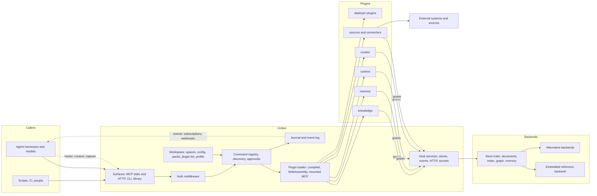
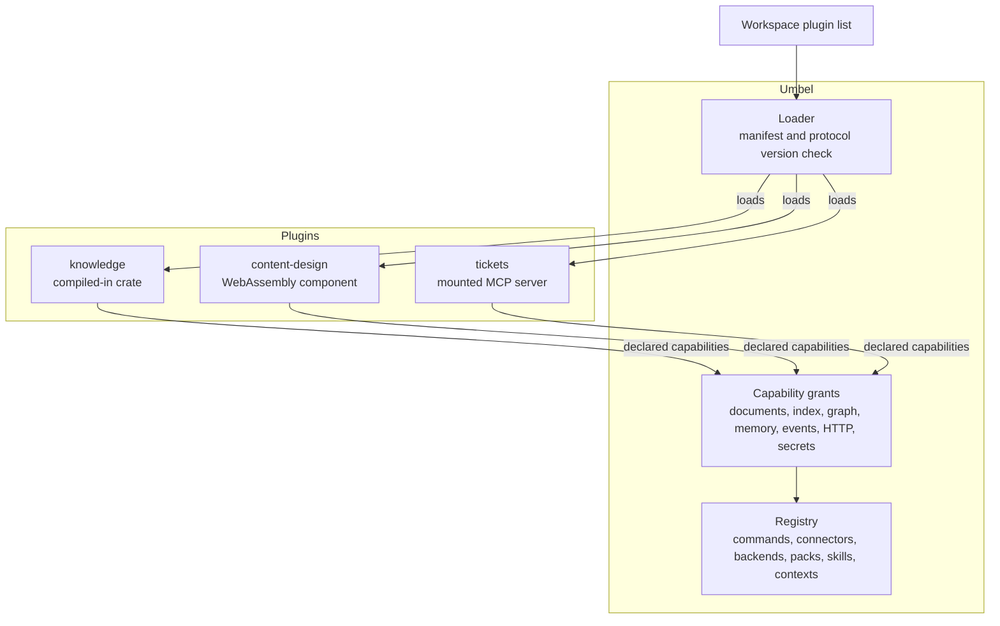
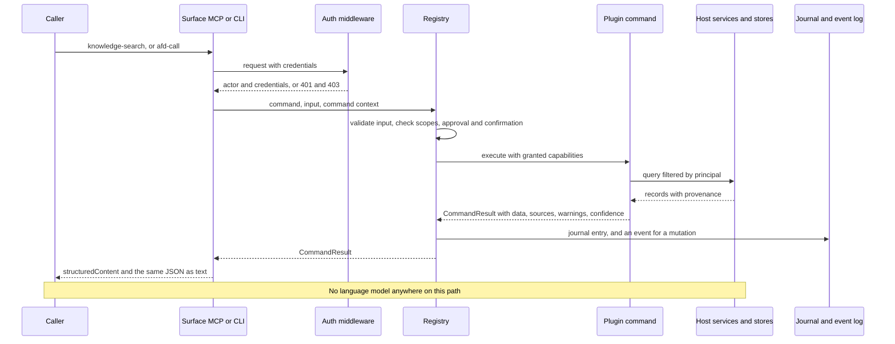
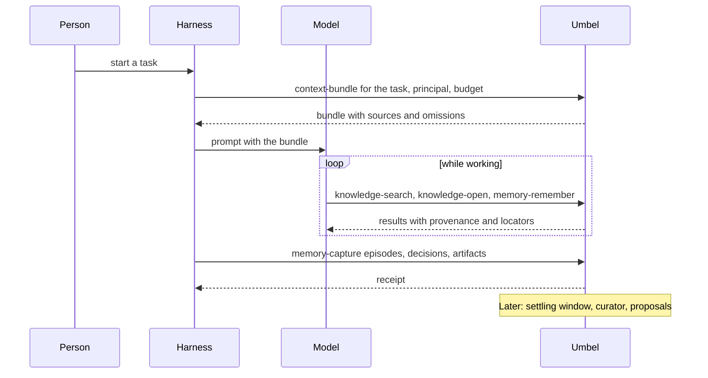
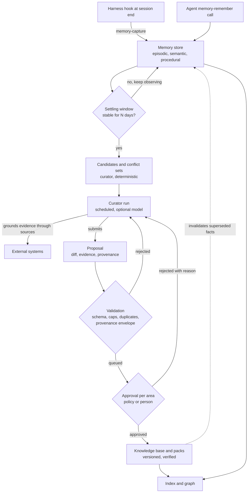
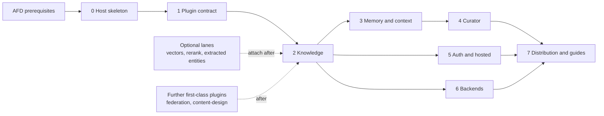

# Umbel architecture

| Field | Value |
| --- | --- |
| Status | Living document; the through line every phase implements against |
| Owner | Repository owner; each phase's owning agent proposes amendments by pull request |
| Elevation | Infrastructure, libraries, interfaces, principles and phases. No code. Interfaces are described by their invariants and minimum contents; each phase's specification settles the exact shapes |
| Read first | [STATUS.md](STATUS.md) for what is done; then this document; then the [decision log](decisions.md) |
| Companion documents | [Proposal](proposal.md) (approved rationale), [Trajectory watch](trajectory.md), [Research](research.md), [Sources](sources.md) |

Where this document and the proposal differ, this document is current and the
proposal is corrected. Terms are defined in the [glossary](#12-glossary).

## 1. Vision

Umbel is a shared system, reachable over MCP and as a CLI, that augments a
team's environments and agent harnesses with the team's own knowledge,
memory, context, tools and connections into its systems. It ships empty.
Capability arrives as plugins: some built here as examples and first-party
defaults, most built by the people who deploy it, for their own stack,
without touching this codebase. The frontier model calling it does the
reasoning; Umbel makes that model better informed, better remembered and
better connected, and keeps every answer traceable to its source.

Every phase should be able to answer one question: does this bring a
deployment closer to running Umbel with its own plugins, its own content and
its own backends, on its own terms?

## 2. Principles

1. **Empty host.** Umbel owns transport, discovery, auth, approvals, the
   journal and its event log, the plugin loader, the workspace, and brokered
   access to the stores. It owns nothing domain-specific. If a feature could
   be a plugin, it is a plugin.
2. **Plugins are the unit.** A plugin contributes commands, connectors,
   backends, packs, skills and AFD contexts under a manifest and declared
   capabilities. Plugins do not depend on each other; the host provides shared
   services through capability grants, listed in the
   [host services catalog](#host-services-catalog).
3. **Everything is a command.** One registry serves MCP, the CLI and
   in-process callers. No surface defines behavior the others lack. Command
   names follow AFD's `domain-action` rule, which the registry enforces.
4. **No model in the request path.** The host never calls a language model to
   answer a request. A curator process may use a configured model for
   background extraction and consolidation, and the calling model may be
   handed a prompt and a schema to do extraction itself.
5. **Content lives in the workspace.** Configuration, content roots, schema,
   packs, the plugin list and backend choice belong to the deployer. The
   binary ships defaults for all of them and bakes in none of a particular
   organization.
6. **Deterministic core, judgment at the edges.** Search, graph, validation,
   hygiene, consolidation candidates and replay are deterministic. Drafting,
   extraction and review belong to models and people, outside the core.
7. **Provenance on everything.** Every stored record carries the
   [provenance envelope](#5-interfaces). Facts are invalidated, never
   overwritten. The host refuses a store write that drops the envelope.
8. **Durable knowledge changes by proposal.** Memory is agent-writable and
   expiring. The knowledge base changes only through a proposal that a policy
   or a person approves, per area.
9. **Stored content is untrusted input.** Results carry provenance labels,
   writes are scanned against a policy, plugins are sandboxed, raw tokens are
   never forwarded, and agent output is never auto-promoted.
10. **Permission-aware from the first plugin.** From phase 2, every document
    and chunk carries an access field; the caller's principal reaches the
    store; the store filters inside the query, before ranking.
11. **Stateless and horizontal.** No in-memory sessions, handles as
    arguments, integrity-checked request state, scale behind gateways.
    Instances behind one URL share the confirmation key and the approval
    nonce store.
12. **Small surfaces, measured.** A few first-class tools with lazy discovery
    for the rest, the hybrid strategy decided in [D27](decisions.md);
    concise and detailed result formats;
    an evaluation harness runs on every ranking or surface change.
13. **Same interface at every scale.** A profile switches lanes and backends;
    the tool surface, the eval harness and the plugin contract do not change.
14. **Every mutation is an event.** Knowledge and memory writes are commands,
    so the AFD journal records them. The event log is a projection of those
    journal entries with record references, provenance and per-principal
    cursors; subscriptions, webhooks, harness channels and audit read it.
15. **AFD first.** Where AFD has or proposes a mechanism, Umbel uses or
    extends it and records any divergence as a decision.
    [Section 6](#6-built-on-afd) is the map.
16. **Spaces do not mix.** A deployment holds one or more spaces, each an
    isolated knowledge base with its own content, stores, memory, events,
    packs, curator policy and permissions. Every read and write names its
    space; nothing crosses spaces unless a caller explicitly asks for several
    it can read, and results stay labeled by space.

## 3. System shape

Responsibilities, not deployment topology. A single binary runs all of it for
a team; the same binary runs behind a gateway with shared backends for an
organization.

## 4. Components

| Component | Responsibility | Not its job |
| --- | --- | --- |
| Surfaces | MCP 2026-07-28 over stdio and Streamable HTTP, and 2025-11-25 clients through the SDK; the CLI with JSON envelopes and the AFD CLI's exit codes; in-process library use | Defining behavior a sibling surface lacks |
| Registry and discovery | One command registry; bootstrap help, docs and schema; lazy discover, detail and call; batch and pipe; AFD contexts; docs generated from the live registry | Advertising anything that cannot be called |
| Auth middleware | The tower layer from [MCP Authorization](../../../docs/features/proposed/mcp-authorization/mcp-authorization.proposal.md): token verification, protected-resource metadata, per-command scopes, then the principal projected onto the command context; modes from none to gateway-trusted | Owning any identity provider |
| Approvals, confirmations, journal, telemetry | From the `afd` crate: approval policies and tokens, confirmation prompts, the append-only journal with replay, telemetry events | Business policy about what needs approval; that is per command and per workspace |
| Event log | A journal projection: each mutation command's entry becomes an event with a record reference, the provenance envelope and per-principal cursors, in one stream per space; replay by cursor; the store behind subscriptions, webhooks, harness channels and audit | Guaranteeing delivery to a disconnected consumer; consumers resume by cursor |
| Plugin loader | Three kinds: compiled-in crates, WebAssembly components against the host WIT world, mounted external MCP servers; the [Plugin Discovery](../../../docs/features/proposed/plugin-discovery/plugin-discovery.spec.md) protocol version, conflict policy, command origin and diagnostics; capability grants | Plugin discovery by scanning; plugins calling plugins |
| Host services | The grants in the catalog below; provenance enforcement on every store write; permission filtering on every store read | Domain logic |
| Workspace | Deployer-owned directory: configuration; spaces, each with its content roots, schema, packs, plugin settings and backend; the plugin list; the scale profile | Anything company-specific inside the binary |
| Store traits | Document store, search index, graph, memory store, instantiated per space; a conformance suite every backend passes | Choosing a vendor for the deployer |
| Embedded reference backend | Fielded lexical index, embedded key-value store, in-memory graph loaded from it, optional local embeddings | Multi-instance hosting; that is an alternative backend's job |
| knowledge plugin | Ingest, chunk, index, structural graph, search, open, find, metadata, citations; the proposal, approve and reject commands for the knowledge base; the eval harness | Writing to the knowledge base outside a proposal |
| memory plugin | Scoped, bitemporal, expiring memory in three classes; capture from harness hooks; recall | Promoting anything to the knowledge base |
| context plugin | Budgeted context bundles assembled from the stores through host grants | Calling the knowledge or memory plugins |
| curator plugin | Settling window, deterministic candidates and conflict sets, drafting proposals with evidence, rejection feedback; runs on a schedule with an optional configured model | Running in the request path; approving its own proposals |
| sources and connectors | Change detection, permission mirroring, indexed-copy and live modes; mounted external MCP servers as the federation path across vendor systems | Copying content the caller is not allowed to see |
| Evaluation harness | Seeded queries with unanswerables, recall and ranking metrics, logged result ids, a calibrated judge | Replacing human review of content |
| Distribution | Per-platform binaries, a bundle for desktop hosts, an OCI image, a registry entry, a server card | A hosted service; deployers host it |

### Host services catalog

Every grant is scoped to the spaces a plugin is enabled for and the caller
may read; isolation between spaces is enforced here, not by plugins.

| Grant | The host provides | Rule |
| --- | --- | --- |
| config | The plugin instance's validated configuration | Read-only; phase 1 ([D42](decisions.md)) |
| log | Lines into the host log, tagged with the instance | Capped per call; never into the journal; phase 1 |
| packs | The plugin's own packs, the call's space's effective copy | Only its own packs; phase 1 |
| documents | Read and write the document store | Writes without the provenance envelope are refused |
| index | Query and update the search index | Queries are filtered by the caller's principal |
| graph | Query and update the graph | Traversal returns only nodes the caller may read |
| memory | Read and append memory records | Scoped by the caller's tuple |
| events | Read the event log by cursor | Events are appended by journaled commands, never through this grant |
| http | Outbound HTTP to hosts the manifest declares | No caller credentials are attached |
| secrets | Named deployer secrets | Never the caller's tokens |
| clock, random | Time and randomness from the command context | Required so the journal can replay a call |

Phase 1 provides config, log, packs, events, clock and random; the others are
named and refused until their phase. The journal is not a grant: the host
journals every call itself. Enabling a plugin instance consents to its
declared grants, minus those the deployer denies ([D42](decisions.md)).

Each command also declares its effects and capabilities in the shape of
Botcore's command policy, so a deployer can see what a plugin may do before
enabling it. Phase 1 fixes the effects as `inspect`, `plugin-state` and
`external`, with the grants as the capabilities ([D42](decisions.md)).

How a plugin reaches the registry. Every edge goes to the host; there is no
edge between plugins.

## 5. Interfaces

Described by invariants and minimum contents; each phase specifies the exact
shapes. One request end to end, the same across every surface:

- **Command names.** Every command follows AFD's `domain-action` rule, for
  example `knowledge-search`, `knowledge-open`, `context-bundle` and
  `memory-remember`. A mounted server's tools are renamed into the rule under
  the mount's prefix, and the original tool name is kept in `_meta`.
- **Spaces.** Every command that reads or writes content takes a space, or
  the default space a session or AFD context binds. A query may name several
  spaces only when the caller can read each; results are labeled by space,
  fused for display and never written back across spaces. Proposals, memory
  records, events and cursors each belong to exactly one space.
- **MCP surface.** A small fixed set of first-class tools for the hot path,
  such as the four above, with lazy discovery for the rest; this hybrid
  strategy is decision [D27](decisions.md) and an AFD feature for every
  language before Umbel uses it, in the
  [hybrid tool strategy proposal](../../../docs/features/active/hybrid-tool-strategy/hybrid-tool-strategy.proposal.md).
  Documents are also resources; workflows are prompts. Tool lists carry cache hints and a stable
  order.
- **Skills.** Plugins contribute skills, and the host delivers them three
  ways: through the Skills over MCP extension where the client supports it,
  as resources, and exported by the CLI into harness skill directories.
  Skills over MCP is not yet supported by Claude, Claude Code, Cursor or
  VS Code, so the other two paths are not optional.
- **Results.** Every result is an AFD `CommandResult`. Its `structuredContent`
  is the whole result and its text is the same JSON, as the spec requires.
  Hits are AFD sources with a location and relevance; stale, unverified or
  omitted material appears as warnings; the index version and content hashes
  go in the result metadata. Audience tags, for the assistant, the user or a
  program, are carried inside the result. Resources are content-addressed,
  with digest, size and cache hints.
- **CLI.** The same registry as commands and subcommands, JSON out, the AFD
  CLI's exit codes, the workspace doctor, reindex, backup and restore, plugin
  new and plugin check. Harness adapters are thin scripts over the CLI; they
  run while a server serves the same workspace ([D29](decisions.md)).
- **Plugin manifest.** At least identity, version, protocol version,
  contributions (commands, connectors, backends, packs, skills, AFD contexts),
  required grants with declared effects, and a configuration schema. It
  follows the [Plugin Discovery](../../../docs/features/proposed/plugin-discovery/plugin-discovery.spec.md)
  fields where they apply. Settled as `umbel-plugin.toml`, manifest version 1
  ([D37](decisions.md)); connectors and backends are reserved keys until
  their phases.
- **Host WIT world.** The imports a component may use, each gated by a grant,
  including clock and random from the command context, and the exports a
  component provides. Versioned with the manifest. Settled as
  `umbel:plugin/plugin@1.0.0` on WASI 0.2, with WASI 0.3 reserved for world
  2.0.0 ([D38](decisions.md)).
- **Store traits.** Document store, index, graph, memory store, each with a
  conformance suite; the embedded backend is the reference implementation.
- **Principal.** Projected onto AFD's command context: the `actor`, with the
  agent and the person it acts for as `onBehalfOf`, and the verified
  `credentials` that MCP Authorization proposes. Umbel's additions travel in
  an extension of the context and include at least the delegation chain,
  token binding, the human-presence flag and the policy decision with its
  version. A command that needs a present human uses AFD's confirmation
  prompt under the `require-human` mode. Enterprise-managed authorization is
  accepted on connections, as an extension of MCP Authorization.
- **Provenance envelope.** The one list of fields every stored record carries,
  at least: origin kind (user-stated, agent-inferred, document-derived), the
  principal and agent, the session, validity from and until, observation
  time, confidence and authority.
- **Event and cursor.** Each mutation's event carries at least an id, the
  journal entry it came from, a per-principal cursor, the record reference and
  the provenance envelope; consumers poll, stream or receive signed webhooks.
- **Proposal record.** A proposal is a domain record owned by the knowledge
  plugin, not an AFD approval. It carries at least the diff, evidence with
  content hashes, provenance, rationale, target area, the policy applied and
  its version, any exception, state, approver, proposing agent and run,
  resulting state and any rejection reason, which makes it a decision trace
  about the knowledge itself. AFD approval gates only the command that applies
  it.
- **Context bundle.** A budgeted, deterministic assembly for a task from the
  stores, with a list of what was left out and why.
- **Capture and harness adapters.** What a harness hook sends at session end:
  episodes, decisions, artifacts, with scope and principal. Adapters share one
  JSON contract: session start returns a context bundle under the harness's
  injection cap, written as facts rather than instructions; tool-use and stop
  events capture; pre-compaction snapshots. Import and export cover the
  harness memory directories, so memory moves between harnesses.
- **Usage event.** Tool, principal, bytes and tokens served, per request, kept
  in the event log for metering. AFD telemetry records only the actor's kind,
  never its id, so metering is not telemetry.
- **Pack.** A directory with a manifest, data, reference material and
  declarative rules, selected per instance, overriding a plugin's default.
  Overrides are per space and replace a pack whole ([D46](decisions.md)).

A harness session end to end, with Umbel on the push side as well as the
pull side:

## 6. Built on AFD

| Umbel needs | AFD mechanism | State on 2026-10-30 |
| --- | --- | --- |
| Command identity | `domain-action` names, validated at registration | Exists |
| Results, citations, degradation | `CommandResult`: `sources` (with location and relevance), `warnings`, `confidence`, `metadata` | Exists |
| Caller identity | `actor` with `onBehalfOf`; `credentials` | `actor` exists; `credentials` proposed in MCP Authorization |
| Per-command scopes | `scopes` command field | Proposed in MCP Authorization |
| Human confirmation | `confirmPrompt` under `enforce` or `require-human` | Exists in the Rust server |
| Approval of consequential commands | Approval policies and signed, short-lived, single-use tokens | Exists in Rust, with the private in-process exchange (#460, closed by #518); the MCP approval relay is parity work |
| Record of calls and replay | Journal with `seq`, actor, context digest, clock and random tape, replay | Exists |
| Event log | A journal sink projecting mutation commands | New, built on the journal |
| Composition | `afd-batch`, `afd-pipe`, pipeline variables | Exists; Rust rejects parallel pipelines and streaming steps |
| Discovery | Bootstrap commands; lazy meta-tools; AFD contexts | Exist in Rust: bootstrap, and the strategies, meta-tools and contexts of parity D1 (#526) |
| Plugin contract | Plugin Discovery: protocol version, conflict policy, command origin, diagnostics | Proposed |
| Grants and effects | Botcore command policy: declared effects and capabilities | Exists in Botcore |
| Plugin check | Surface validation, including `afd validate --surface` against a server | Exists |
| Test kit | Scenario runner in `@lushly-dev/afd-testing`; journal replay | Exists |
| CLI exit codes | 0, 1, 2 and 130, as the AFD CLI defines them | Exists |
| Telemetry | `TelemetryEvent` and sinks, actor kind only | Exists |
| Long jobs | MCP Tasks; MCP Progress; handoff | Tasks and Progress proposed; handoff exists |
| Plugins in other languages | AFD's TypeScript, Python and C++ servers, mounted | Exists |
| Distribution and authoring | `cargo-dist` and an `#[afd_command]` macro | Planned in Rust Support |
| Prior art for scoped memory | Botcore's memory store | Exists, in Python |

### Libraries and infrastructure

| Need | Choice, as of 2026-10-30 | Why | Constraint |
| --- | --- | --- | --- |
| Commands, results, approvals, journal, MCP server | the `afd` crate with its `server` feature on rmcp | One contract across four languages; stateless MCP implemented | `server` needs Rust 1.88; the crate requires rmcp 3.7, which admits the current 3.8.0, and commits no lock. A phase that needs something new in 3.8 raises the floor |
| HTTP | the SDK's tower service, mounted in an HTTP server | The auth layer composes there | |
| Lexical index | tantivy 0.27 | Fielded BM25 with boolean, phrase, field, boost and range syntax, embedded | Rust 1.88 |
| Embedded storage | an embedded key-value store | Single-directory deployments, transactions, no service | Chosen in phase 2 ([D28](decisions.md)); phase 0 stores only files. It must let several host processes open one workspace (for example SQLite in WAL mode, or LMDB), as phase 0's files do ([D29](decisions.md)); no single-writer daemon |
| Graph traversal | petgraph over the stored graph | Rebuildable from content; traversal in memory | |
| Embeddings and rerank, optional | fastembed 7.5 for local models, or an HTTP endpoint, behind a provider trait | Hybrid retrieval and cross-encoder rerank without a mandatory model | Rust 1.88; pins a pre-release ONNX runtime exactly; some models run on candle rather than ONNX |
| Plugin sandbox | wasmtime's 48 long-term line with the component model and WASI 0.2 ([D39](decisions.md)); wit-bindgen 0.63 for Rust guests | Language-agnostic plugins with fuel, epoch and memory limits | Rust 1.95 for wasmtime 48; amended 2026-11-01 from "50.0.1 or later with WASI 0.3": WASI 0.3 waits for world 2.0.0 and the `wasm32-wasip3` target on stable Rust ([D38](decisions.md)) |
| MCP client for mounted plugins | `rmcp`'s client role with its child-process and Streamable HTTP client transports ([D43](decisions.md)) | The `afd` crate has no Rust MCP client | Brings `reqwest` and `rustls` into Umbel's lock |
| Code structure | tree-sitter | Deterministic symbol graph for repositories | |
| Schemas | JSON Schema 2020-12 through serde and schemars | Matches the MCP revision | |
| Observability | OpenTelemetry GenAI semantic conventions: tool-execution spans, trace context from request metadata, agent and session baggage carried into stored records | Debuggable inside harness traces | The conventions are in development; the schema is pinned |

The Umbel workspace therefore declares Rust 1.97, above the `afd` crate's
1.82 (1.88 with `server`); the repository's pinned toolchain, 1.98, covers
both.

Deliberately absent from the host: any language-model client, any cloud
vendor SDK, any dynamic-library plugin loading, in-memory sessions.

## 7. Data and content

The two stores and the only path between them:

The diagram runs inside one space. Three levels of coupling separate
material, from loosest to strongest:

| Level | What is separate | When |
| --- | --- | --- |
| Collections in one space | Nothing: they share the space's index and graph and are filtered by metadata | Material that may mix |
| Spaces in one deployment | Content roots, stores, graph, memory, event stream, packs, curator policy and permissions; the host, plugin set and sign-in are shared | One owner, domains that must not mix by default |
| Separate deployments | Processes, stores, keys and sign-in, possibly machines; a harness connects to each as its own MCP server, and one deployment may mount another read-only through federation | Different owners, or content that must never share a process |

- The workspace holds content roots of markdown with frontmatter under a
  schema the workspace declares; a default schema ships. The on-disk container
  is compatible with the [Open Knowledge Format](https://github.com/GoogleCloudPlatform/knowledge-catalog/blob/main/okf/SPEC.md)
  v0.2: one concept per file, path as identity, `type` required, `title`,
  `description`, `resource` and `tags` recommended, provenance in `sources`
  and `generated`, and optional reserved `index.md` and `log.md` files.
- Knowledge entries carry a verification lifecycle in OKF's terms: an
  approved entry is `stable`; `verified` records each verification with who
  and when, and a person's verification is the owner tier; `stale_after` is
  the verify-by date, past which the curator schedules re-verification;
  `deprecated` entries stay readable and say what replaced them. The curator
  raises inconsistency proposals rather than choosing silently.
- Documents are chunked structure-aware; chunks carry title, heading path and
  metadata as context; hits are presented per document.
- The graph is built deterministically from hierarchy, headings, links, tags,
  owners, timestamps, code symbols and co-citation; model-extracted entities
  are a per-collection opt-in with a budget and their own provenance layer.
  No edge crosses spaces.
- Memory records carry a class label: episodic records of runs and sessions,
  semantic facts that people or agents asserted, and procedural notes on how
  something is done. Nothing in memory is verified knowledge. Records are
  scoped by space, project, actor and session, bitemporal and expiring, and
  indexed by the same search and graph with provenance labels. The curator
  proposes stable semantic memory as knowledge entries and stable procedural
  memory as skills in a pack, always through proposals.
- Every concept and chunk carries a reference to its source's access control
  and a sensitivity label; derived content whose source the reader cannot
  open is denied by default.
- Proposals, approvals and artifacts are records with idempotency keys and
  content hashes; every mutation appears in the event log.
- Every hit carries a stable locator: document id, section or line range,
  content hash and index version.

## 8. Cross-cutting rules

- **Security.** Sandboxed plugins; no token forwarding to plugins or mounted
  servers; untrusted content labeled on read and scanned on write; rate limits
  and size caps per agent; audit on every write, recording both the agent and
  the person on whose behalf it acted. Over MCP, a held result never carries
  an approval token: approval evidence comes from trusted application code,
  so the host turns token inclusion off on the MCP path, where the Rust
  default includes it.
- **Compatibility.** The host serves MCP 2026-07-28 and, through the SDK,
  2025-11-25 and earlier. Push paths keep the older revision while hosts such
  as Claude Code's channels require it.
- **Determinism and replay.** Every command journaled; results stamped with
  index version and content hash; evaluation replays a journal against a
  pinned index. WebAssembly plugins read time and randomness only from the
  command context, so replay restores them. Calls to mounted servers are
  recorded but cannot be replayed, and are marked so. Captured transcripts are
  redacted in the journal.
- **Scale profiles.** team, org, enterprise and beyond switch lanes and
  backends; nothing else changes.
- **Versioning.** The plugin protocol version, the plugin manifest, the WIT
  world, the pack schema, the store traits, the workspace configuration, the
  principal projection, the provenance envelope and the event shape are
  versioned under
  `endpoints/umbel/`, independently of the binary and of AFD's contract
  version; the host refuses what it cannot serve and names the upgrade. The
  shapes are closed JSON Schemas in `endpoints/umbel/schemas/`, with reserved
  fields named in advance ([D36](decisions.md)).
- **Repository placement.** Umbel lives in `endpoints/umbel/`, following
  Botcore's layout: the host runtime, plugin SDK, first-party plugins and
  binary are endpoint units, beside these documents. An engine with no AFD
  dependency, if one emerges, goes under `foundations/umbel/`. When the
  first manifest lands, its units join the release inventory
  (`scripts/release/inventory.json`) and every unit starts quarantined under
  the [platform migration](../../../docs/features/active/platform-monorepo/)
  rules. Its `families` list in `architecture.json` does not change: it names
  foundation families only, and the boundary check classifies any manifest
  under `endpoints/umbel/`, `Cargo.toml` included, as an endpoint unit of the
  `umbel` family by its path. Each manifest still gets an explicit unit there
  with its `publicSurfaces`, as Botcore's and Health's do, so the coverage map
  names its surfaces ([D35](decisions.md)). Generic server features land in the `afd` crate first; section 9
  lists them. Authoring skills are declared in `skills/exports.json` and
  follow the repository's projection pipeline.
- **Decisions.** Architecture decisions are dated entries in the
  [decision log](decisions.md); a phase specification cites the entries it
  depends on.

## 9. Phases

Each phase has one owning agent. Before implementation, the agent writes the
phase specification at `endpoints/umbel/docs/phases/<n>-<slug>/spec.md`. It
opens with the status block from [STATUS.md](STATUS.md), cites the principles
and decisions it serves, refreshes the [trajectory](trajectory.md) rows it
depends on, and is approved by the owner by pull request. A phase may amend
this document by pull request; it may not silently diverge from it. Order
and parallelism:

| Phase | Goal | Exit criterion | The specification must settle |
| --- | --- | --- | --- |
| 0. Host skeleton | The empty host serves MCP and CLI from one registry with bootstrap discovery, the journal and its event log, and approvals, from a workspace with defaults | With zero plugins, the host's built-in commands pass the Rust server's protocol tests in both MCP eras, and the workspace doctor reports the workspace | Workspace layout and config schema, including spaces and the default space; CLI envelope; event and cursor shape; version 0 of the principal projection and the provenance envelope, with reserved fields; the Cargo workspace's dependency on `packages/rust`, its MSRV, CI workflow and inventory placement |
| 1. Plugin contract | Manifest, grants and the host services catalog, the WIT world, three loader kinds, skills on all three delivery paths, plugin new and plugin check, the test kit, the hello plugin | hello loads compiled, as a component and mounted; a second plugin lands with no host change; the 34-case todo conformance suite passes in legacy and modern modes with the todo example loaded as a plugin | Manifest format; WIT world v1 with clock and random; grant semantics; protocol versioning; mounted-tool renaming |
| 2. Knowledge | Sources from the filesystem, chunking, per-space lexical indexes and structural graphs, search, open, find, metadata, citations as AFD sources, the access field on every document and chunk, the eval harness | A thousand documents indexed across two spaces; no result crosses spaces without an explicit multi-space query; results filtered by principal; recall and ranking reported on a seeded query set | Frontmatter schema and the on-disk container; access field; chunking rules; query syntax; locator format; eval set shape |
| 3. Memory and context | Memory with class labels, scoped by space and bitemporal; capture through harness adapters on the shared contract; import and export of harness memory; context bundles; the provenance envelope enforced | A harness hook captures a session; a context call returns a budgeted bundle with omissions listed | Scope tuple; envelope version 1; adapter contract; bundle budget rules; hygiene and redaction policy |
| 4. Curator | Settling window, candidates and conflict sets per space, proposals as decision traces, approvals per area, the verification lifecycle and inconsistency proposals, rejection feedback, scheduled runs | One proposal approved from the CLI lands in the knowledge base with full provenance | Proposal record; approval policy and the AFD approval on the apply command; settling and re-verification defaults; the optional model configuration |
| 5. Auth and hosted | The MCP Authorization layer, the principal projected onto actor and credentials, enterprise-managed authorization, protected-resource metadata, gateway-trusted mode, the shared confirmation key and approval nonce store, Tasks for long jobs, usage events | A hosted deployment behind an external identity provider returns results filtered for its users | Trait shapes; the principal's extension fields; scope mapping, including per-space scopes; audience rules; hosted profile |
| 6. Backends | Store traits finalized, conformance suite, embedded reference backend certified, a second backend selectable per space | The second backend passes the suite; a workspace moves one space to it by configuration while another stays embedded | Trait boundaries; suite contents; migration between backends |
| 7. Distribution and guides | Binaries, bundle, image, registry entry, server card and the well-known catalog file; authoring skills and guides for plugins, connectors and packs | A newcomer builds and loads a plugin from the guide alone | Artifact set; guide structure; which skills the host emits |

Phase specifications: [phase 0, host skeleton](phases/0-host-skeleton/spec.md)
(approved 2026-10-31 under the owner's delegation, after review; merged in #564);
[phase 1, plugin contract](phases/1-plugin-contract/spec.md) (in review).

Sequencing: phases 0 and 1 are the core and come first. The knowledge plugin,
phase 2, is the first plugin, because every deployment needs it first and it
exercises every host service; phases 3 and 4 complete the first-party set.
Further first-class plugins, among them federation through mounted MCP
servers with indexed and live modes and the content-design pack exemplar,
come after phase 2, unnumbered, each with its own specification. Optional
lanes such as vectors, rerankers and model-extracted entities attach after
phase 2 as opt-ins gated by the eval harness; they never block an exit
criterion.

### AFD prerequisites

| Prerequisite | Needed by | Tracked in |
| --- | --- | --- |
| Rust lazy and grouped strategies, meta-tools and AFD contexts | Phase 0 | [Language parity](../../../docs/language-parity.md), D1; done in #526 |
| Rust `structuredContent` and top-level `outputSchema` | Phase 0 | #465; Rust done in #523 |
| A per-request context hook on the Rust MCP server, so middleware can set the actor and credentials | Phase 0, version 0; phase 5 | MCP Authorization's Rust layer; the hook landed in #523, and binding confirmations to the actor is #532 |
| The hybrid tool strategy, a few first-class tools plus lazy discovery, for every language | Phase 0 (D27) | [Hybrid tool strategy proposal](../../../docs/features/active/hybrid-tool-strategy/hybrid-tool-strategy.proposal.md); spec in #538; TypeScript #556, Python #555 and Rust #560 done; C++ waits on parity D2 and does not block Umbel |
| A process-shared mode for the Rust `FileJournalSink`, so several host processes append to one journal under one lock ([D29](decisions.md)) | Phase 0 | Step 0 of the [phase 0 plan](phases/0-host-skeleton/spec.md#step-0-the-afd-pull-request); not started |
| Interface selection on the Rust `DirectClient`, as TypeScript and Python have ([D34](decisions.md)) | Phase 0 | Step 0 of the phase 0 plan; not started |
| MCP resources, the Skills extension and per-command tool `_meta` in AFD servers, reconciled with the Skill Knowledge Layer ([D47](decisions.md)) | Phase 1 | Step 0 of the [phase 1 plan](phases/1-plugin-contract/spec.md#step-0-afd-first): a new AFD feature proposal, spec first, then Rust; shared with Loam, which also needs `ui://` resources for MCP Apps views. Prompts follow when a phase needs them |
| Output budgets per tool | Phase 2 | New AFD feature proposal |
| The Rust telemetry middleware; phase 0 has none, because its journal records command, timing, outcome and actor kind ([D33](decisions.md), dropped 2026-10-31) | Phase 2 | [Language parity](../../../docs/language-parity.md), telemetry middleware; no issue yet |
| The MCP approval relay in Rust | Phase 4 | [Language parity](../../../docs/language-parity.md); no issue yet |
| The Rust token-verification layer, the `scopes` field and the `credentials` context field | Phase 5 | MCP Authorization proposal |
| The MCP Tasks runtime in Rust | Phase 5 | MCP Tasks proposal; Umbel's ingestion and curator jobs are a natural Rust pilot |

Progress is recorded in [STATUS.md](STATUS.md), not inferred from the
codebase. A session that changes Umbel updates the status before it ends.

## 10. Open decisions

Open decisions are numbered O1 to O5 in the
[decision log](decisions.md#open-decisions), and move into the log as dated
decisions when they close. O2, the execution model, closed as D27 on
2026-10-31.

## 11. Trajectory watch

The movements this design anticipates, what is reserved for each, the dated
watchlist and what is deliberately not chased are in the
[trajectory watch](trajectory.md). A phase's owning agent refreshes the rows
it depends on before writing its specification, and records any change this
document needs as an amendment.

## 12. Glossary

| Term | Meaning |
| --- | --- |
| Plugin | The unit that lands in the host. Plugin Discovery's term; the Agent Engine proposal calls the same idea a module |
| Manifest | A plugin's `umbel-plugin.toml`: identity, version, protocol version, contributions, grants and configuration schema |
| Plugin kind | How a plugin's code runs: `compiled`, `component`, `mounted` or `pack` (no code) |
| Plugin instance | One entry of `plugins.enabled`: a plugin, its source, configuration and spaces |
| Plugin protocol version | The manifest version, the WIT world's major version and the grant semantics, as one compatible set |
| Host domain | A first name segment the host owns and no plugin command may use: `workspace`, `space`, `event`, `plugin`, `skill`, `afd` |
| Effect | What a command may change, declared per command: `inspect`, `plugin-state` or `external` in phase 1 |
| Mount | A mounted plugin's connection to its MCP server, and the prefix its tools are renamed under |
| Pack override | A pack directory in a space that replaces a plugin's default pack of the same id there |
| Command | AFD's unit of capability, exposed to every surface from one registry |
| Surface | A way callers reach the registry: MCP over stdio or Streamable HTTP, the CLI, or in-process. Loam (`endpoints/loam/`) uses "surface" for a region of its shell UI; its glossary records the difference |
| Connector | A plugin's binding to an external system or source |
| Backend | A swappable implementation behind a store trait |
| Adapter | An infrastructure binding, such as auth or a harness adapter |
| Workspace | The deployer-owned directory for one deployment: configuration, spaces, plugin list, profile. Always Umbel's; the Rust one is the "Cargo workspace" |
| State directory | The workspace's `state/` directory, which only the host writes: the journal, event streams, cursors, keys and the workspace lock |
| Workspace lock | The file lock every host process of a workspace holds across one append to the journal and its event; any number of processes share a workspace ([D29](decisions.md)) |
| Built-in command | A command the host registers itself, such as `workspace-doctor` or `event-list` |
| Cursor | An opaque, versioned position in one space's event stream; each principal stores its own |
| Space | An isolated knowledge base inside a deployment; nothing crosses spaces by default |
| Collection | A content root inside a space; collections in one space share its index and graph |
| Pack | Content a plugin ships by default and an instance overrides |
| Skill | A guidance document a plugin contributes, in the Agent Skills format |
| AFD context | A named scope that changes which commands are visible, through `afd-context-*` |
| Command context | The per-call context AFD passes to a command: actor, credentials, trace, clock, random |
| context plugin, context bundle | The plugin that assembles a budgeted bundle for a task, and that bundle |
| Journal | AFD's append-only record of command calls, with replay |
| Event log | Umbel's projection of mutation entries in the journal, read by cursor |
| Grant | A host service a plugin declared and the host allowed |
| Proposal | A knowledge-plugin record that proposes a change to the knowledge base and, once decided, is its decision trace |
| Principal | The caller as the host sees it: AFD actor and credentials plus Umbel's extension fields |
| Provenance envelope | The fields every stored record carries, listed in section 5 |
| Extension | Only in MCP's sense: an optional protocol extension such as Skills over MCP or Tasks |
