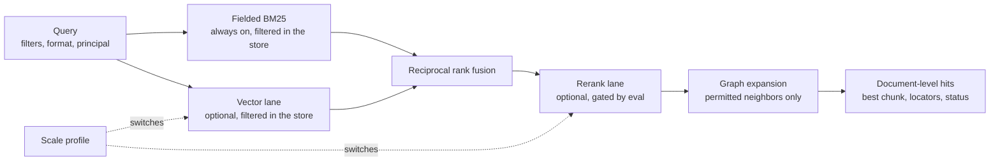

# Umbel

> This proposal is the approved rationale for Umbel. The
> [architecture](architecture.md) is authoritative for anything current: where
> the two differ, the architecture wins and this document is corrected.
> Progress is in [STATUS.md](STATUS.md).

| Field | Value |
| --- | --- |
| Status | Proposed; direction approved by the owner on 2026-10-30, implementation not started |
| Date | 2026-10-30 |
| Package boundary | New Rust units under `endpoints/umbel/`, as the architecture's repository placement describes |
| Implementation | Not started by this proposal |
| Name | Umbel, decided 2026-10-30; "AFD Umbel" in full |

## Purpose

Umbel is a shared system, reachable over MCP and as a CLI, that augments a
team's environments and agent harnesses and can be customized to mesh with
that team's systems, sources and knowledge. It starts with no capability of
its own: it is a host into which plugins land. Knowledge, memory and context
are the first plugins, built in this repository as working examples, but a
deployment may run the host with any set of plugins, including none of them.
One deployment can hold several isolated knowledge bases, called spaces.

The host contains no language model. The frontier model calling it does the
reasoning. A separate curator process may use a configured model for
background extraction and consolidation, never in the request path.

Everything organization-specific lives in a deployer-owned workspace:
configuration, content roots, the content schema, content packs, the list of
installed plugins and their settings. The binary ships defaults for all of
these and bakes none of a particular organization into code.

## Positioning

Memory in today's harnesses is first-party, machine-local and consolidated
offline on each vendor's own store; nothing is shared across harnesses. Every
enterprise platform now exposes its context over remote MCP behind its own
small facade. Umbel takes the position nobody holds: a deployer-owned layer of
knowledge, memory and context shared across harnesses and agents, with
provenance and approval, that joins across vendor systems by mounting their
MCP servers and by indexing what they permit. The dated reasoning is in the
[trajectory watch](trajectory.md).

## Why a host built on AFD

AFD already provides most of what a host needs: one command registry for MCP,
CLI and in-process callers; `CommandResult` with sources, warnings and
confidence; the actor on the command context; confirmations and approvals;
the journal and its replay; batch and pipeline composition; bootstrap
discovery; and servers in TypeScript, Python, Rust and C++. Umbel builds on
those and adds only what a host of plugins needs: the plugin loader and
grants, the workspace, the event log as a journal projection, and the store
traits. The architecture's [Built on AFD](architecture.md#6-built-on-afd)
table is the map, and its prerequisites table lists the AFD features that
land first.

## Vocabulary

AFD already names most of these extension points, so the host reuses them;
the full glossary is in the [architecture](architecture.md#12-glossary).

| Word | Meaning here | Precedent |
| --- | --- | --- |
| Plugin | The unit that lands in the host | [Plugin Discovery](../../../docs/features/proposed/plugin-discovery/plugin-discovery.proposal.md); Botcore's `BotCorePlugin` and entry points |
| Command | The unit of capability inside a plugin, exposed to MCP, CLI and in-process callers | AFD core |
| Connector | A plugin's binding to an external system or source | `connectors` in `packages/rust` |
| Backend | A swappable implementation behind a store interface | `@lushly-dev/local-db` |
| Adapter | An infrastructure binding such as auth, a frontend or a harness | `@lushly-dev/afd-auth`, `@lushly-dev/afd-adapters` |
| Pack | Content a plugin ships by default and an instance overrides | New |
| Skill, AFD context | Guidance documents, and named scopes of visible commands, that a plugin contributes | [Skill Knowledge Layer](../../../docs/features/proposed/skill-knowledge-layer/skill-knowledge-layer.proposal.md); `afd-context-*` commands |

"Module" is avoided because it collides with Rust modules. "Extension" keeps
only MCP's meaning, a protocol extension.

Plugins carry plain semantic names for what they do, such as `knowledge`,
`memory`, `context` and `content-design`, and their commands follow AFD's
`domain-action` rule, such as `knowledge-search`. Only the host carries a
botanical name, in the register of Violet and Specimen: an umbel is an
inflorescence in which every stalk rises from one point and none depends on
another.

## The empty host

With zero plugins installed the host provides MCP over stdio and Streamable
HTTP, the CLI projection of the same registry, and in-process use; bootstrap
discovery; authentication built on MCP Authorization's Rust layer; approvals,
confirmations, the journal and telemetry from the `afd` crate; the event log;
the plugin loader; host services for the stores; and the workspace with its
doctor. The architecture's [components](architecture.md#4-components) table
says what each owns and what it does not.

## Plugin contract

- A plugin declares a manifest: identity, version, protocol version, what it
  contributes, the grants it needs with its declared effects, and its
  configuration. The manifest follows the Plugin Discovery fields where they
  apply. The host grants or refuses each capability; a plugin never reaches a
  service it did not declare.
- Plugins do not depend on other plugins. Shared services come from the host
  through grants. Composition across plugins happens at the call site through
  `afd-batch` and `afd-pipe`, or through pipelines a plugin ships as data.
  This keeps every plugin independently testable.
- The core is Rust; plugins need not be. WebAssembly components can be built
  from Rust, Python and JavaScript, and a mounted MCP server can be written
  with any of AFD's TypeScript, Python or C++ servers.
- Rules, vocabularies and reference material belong in packs, not code, so an
  instance can replace a plugin's default content with its own.

## First-party plugins

Each is small enough to read as a tutorial and real enough to deploy.
Phases 0 and 1 are the core and come first. The knowledge plugin is the first
plugin, because every deployment needs it first and it exercises every host
service; memory, context and the curator complete the first-party set.
Further first-class plugins come after phase 2, unnumbered, each with its own
specification.

| Plugin | Purpose | When |
| --- | --- | --- |
| hello | One command, one pack, one skill; the reference for the contract and test kit | Phase 1 |
| sources-filesystem | Markdown with frontmatter from a directory, change detection by content hash | Phase 2 |
| knowledge | Fielded lexical search, structural graph, open and find, proposals for the knowledge base, the eval harness | Phase 2 |
| memory | Scoped, bitemporal, expiring memory with class labels; capture and recall | Phase 3 |
| context | Budgeted context bundles assembled from the stores | Phase 3 |
| curator | Settling window, candidates, proposals, run on a schedule | Phase 4 |
| content-design | The pack exemplar: seeded with a public style manual, overridden per instance, rules declared in the pack | After phase 2 |
| federation | External MCP servers mounted as sources and tool providers, with indexed-copy and live modes: the path across vendor systems | After phase 2; its contract depends on open decision O1 |

## Knowledge, memory and context

The retrieval lanes, and what a profile switches. The path from memory to the
knowledge base is drawn in the [architecture](architecture.md#7-data-and-content).

- **Retrieval.** A fielded BM25 index with boolean, phrase, field and boost
  syntax is the core lane: always available without a model, and the
  low-cost anchor in the largest published comparison. Embeddings are an
  optional lane fused by reciprocal rank, through a local model or an HTTP
  endpoint the deployer names. A cross-encoder rerank is a third optional
  lane. Each optional lane is enabled only when the instance's eval shows a
  gain, because published results differ by domain: in one, a dense model
  alone beat the fusion. Permission filtering happens inside each lane's store
  query, before fusion. Chunks are structure-aware; hits are presented per
  document with the best chunk and opened in windows.
- **Graph.** Built deterministically from structure: hierarchy, headings,
  links and backlinks, tags, owners, timestamps, code symbols through
  tree-sitter, co-citation. Model-extracted entities are a per-collection
  opt-in with a budget. The graph is exposed as neighbors, related, path and
  outline commands and as a rank-expansion signal.
- **Spaces.** Content, stores, memory, events, packs and curator policy are
  kept per space, and nothing mixes unless a caller explicitly queries
  several spaces it can read. Separate deployments are the stronger boundary.
  The architecture's [data and content](architecture.md#7-data-and-content)
  section has the three levels of coupling.
- **Two stores, two write paths.** Memory is agent-writable, scoped, bitemporal
  and expiring, with episodic, semantic and procedural class labels; nothing
  in memory is verified knowledge. The knowledge base changes only through a
  proposal that a policy or a person approves per area. Every write is an
  event. Facts are invalidated, never overwritten.
- **Consolidation.** The curator computes candidates deterministically: memory
  stable for a settling window, seen across sessions, above a confidence
  floor; and conflicts between stable memory and the knowledge base. It
  grounds candidates where it can and drafts proposals, of knowledge entries
  from semantic memory and of skills from procedural memory. Rejections carry
  a reason the curator sees next run.
- **Provenance and verification.** Every record carries the provenance
  envelope; every hit carries a verification status; an instance may run
  agents verified-only.
- **Push, not only pull.** `context-bundle` returns a budgeted bundle for a
  task; `memory-capture` accepts transcripts and decisions from a harness
  hook. Thin adapters over the CLI connect harness hooks and CI.
- **Sources.** A connector contract with change detection, permission
  mirroring, and two modes: indexed copy for speed, live pass-through for
  freshness. Low-relevance and unanswered queries become content candidates
  through the same proposal queue.
- **Pluggable backends.** Document store, search index, graph and memory store
  are traits with an embedded reference backend and a conformance suite, in
  the pattern of the shared todo conformance suite. A git-backed knowledge
  store is the second backend, where a proposal becomes a pull request.

## Scale profiles

The interface, tool surface and eval harness are the same at every size; a
profile switches lanes and backends. Figures are order-of-magnitude estimates
assuming about eight 300-token chunks per document.

| Profile | Documents | Lanes | Embeddings | Hosting |
| --- | --- | --- | --- | --- |
| team | up to 1k | BM25 | optional, minutes locally | single binary, embedded store, full reindex |
| org | about 10k | BM25 plus vectors when eval shows a gain | under an hour locally or a few dollars hosted | single binary, incremental indexing |
| enterprise | about 100k | BM25, vectors, gated rerank | GPU or hosted; index 0.6 to 2.4 GB | shared backend, permission filters in the index, jobs as MCP tasks |
| beyond | 1M plus | same | hosted | dedicated search engines as backends, sharded by collection |

Multi-pass model-built graphs are not viable past the org profile; the
structural graph is linear at every size.

## Execution model

Decided on 2026-10-31 as [D27](decisions.md), closing open decision O2: the
hybrid strategy, a few first-class tools for the hot path, with lazy
discovery, `afd-call`, `afd-batch` and `afd-pipe` for everything else. It
keeps the tool list fixed as plugins grow, lets commands change without the
client reloading tools, and runs combinations in one call. AFD's lazy
strategy today lists only the meta-tools; the hybrid is a deferred AFD
feature, so it is specified for every language before Umbel uses it, in the
[hybrid tool strategy proposal](../../../docs/features/proposed/hybrid-tool-strategy/hybrid-tool-strategy.proposal.md).
A later optional plugin may accept model-written code against the same
registry inside a WebAssembly sandbox, journaled as one command with the
script as its input.

## Guides and tools for building your own

- A plugin SDK crate and the WIT world as the versioned public contract, kept
  under `endpoints/umbel/`; AFD's `spec/` stays the four-language contract.
- `plugin new` scaffolding by kind: Rust crate, WebAssembly component, mounted
  MCP server, pack only.
- `plugin check`: the manifest, the grants against what the host allows, the
  pack schema, and AFD's surface validation run against a host with only the
  plugin loaded, which also checks mounted servers' tool descriptions.
- A test kit that boots an in-process host with only the plugin under test,
  runs AFD scenarios through MCP and the CLI, and replays the journal.
- Authoring skills for plugins, connectors and packs, modeled on the Botcore
  plugin skill, declared in `skills/exports.json`; the host emits skills for
  installed plugins.

## Relationship to other proposals

- [Agent Engine](../../../docs/features/proposed/agent-engine/proposal.md):
  Umbel is a candidate first host. Its "modules" are Umbel's plugins, and its
  observe, propose, decide, promote loop overlaps the curator; the two share
  vocabulary and should share the proposal record.
- [MCP Authorization](../../../docs/features/proposed/mcp-authorization/mcp-authorization.proposal.md):
  Umbel builds on its Rust layer, `scopes` and `credentials`, and adds
  enterprise-managed authorization as an extension.
- [MCP Tasks](../../../docs/features/proposed/mcp-tasks/mcp-tasks.proposal.md)
  and [MCP Progress](../../../docs/features/proposed/mcp-progress/mcp-progress.proposal.md):
  ingestion and curator jobs are long-running; Umbel is a natural Rust pilot
  for Tasks.
- [Plugin Discovery](../../../docs/features/proposed/plugin-discovery/plugin-discovery.proposal.md):
  Umbel's manifest follows its fields; Umbel loads explicitly declared
  plugins rather than scanning.
- [Skill Knowledge Layer](../../../docs/features/proposed/skill-knowledge-layer/skill-knowledge-layer.proposal.md):
  serving skills from AFD servers is reconciled with it before Umbel uses it.
- [Rust Support](../../../docs/features/proposed/rust-support/00-overview.md):
  Umbel completes its MCP transport goals and would use its planned
  `cargo-dist` distribution and `#[afd_command]` macro.
- Botcore's memory store is prior art for scoped memory, in Python.

## Decisions

Closed decisions are in the [decision log](decisions.md); open decisions are
O1 and O3 to O5 there. O2 closed as D27.

## First proof

1. The empty host serves MCP and CLI with zero plugins and passes the Rust
   server's protocol tests in both MCP eras.
2. The hello plugin loads three ways: compiled in, as a component, mounted;
   and the todo conformance suite passes with the todo example as a plugin.
3. The knowledge plugin indexes a thousand markdown documents and the eval
   harness reports recall and nDCG on a seeded query set.
4. A harness hook captures a session into memory; the curator run produces one
   proposal; it is approved from the CLI and lands in the knowledge base.
5. A second plugin is added without changing the host.

## Research and evidence

- [Status](STATUS.md), what is done, what is not, and follow-ups; read it first
- [Architecture](architecture.md), the through line each phase implements against
- [Decision log](decisions.md)
- [Trajectory watch](trajectory.md), the movements anticipated and the dated watchlist
- [Research synthesis](research.md)
- [Annotated source ledger](sources.md)

The research distinguishes documented features from vendor claims and marks
what could not be verified. Neither this proposal nor its merge establishes
implemented capability or a delivery commitment.
