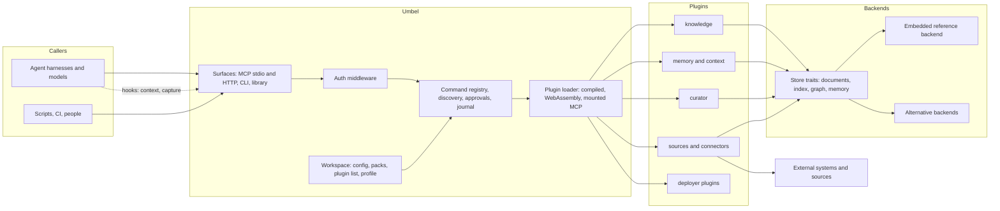
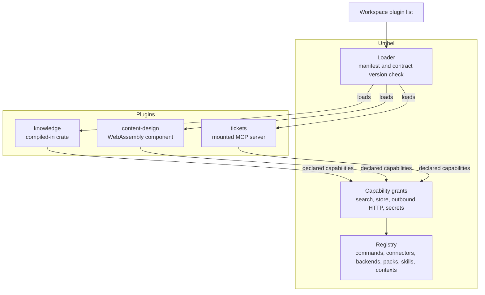
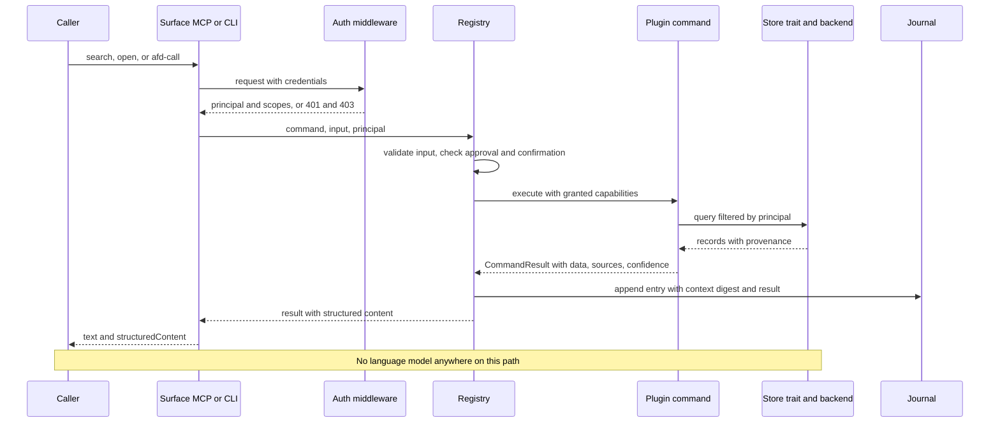
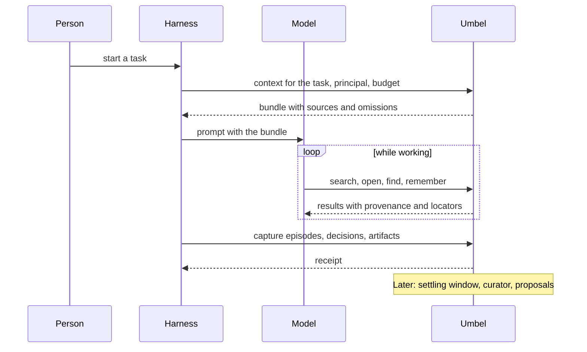
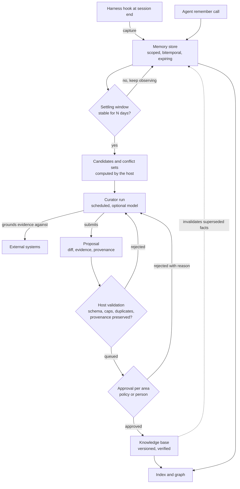
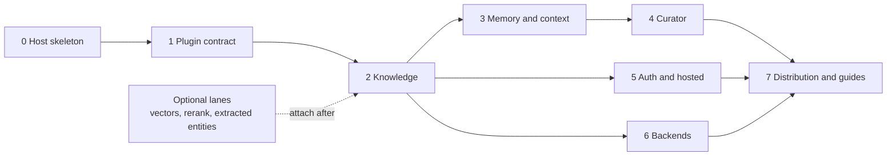

# Umbel architecture

| Field | Value |
| --- | --- |
| Status | Living document; the through line every phase implements against |
| Owner | Repository owner; each phase's owning agent proposes amendments by pull request |
| Elevation | Infrastructure, libraries, interfaces, principles and phases. No code. Each phase writes its own detailed specification under its folder and cites the principles and [decisions](decisions.md) it serves |
| Companion documents | [Proposal](proposal.md), [Decision log](decisions.md), [Research](research.md), [Sources](sources.md) |

## 1. Vision

Umbel is a shared system, reachable over MCP and as a CLI, that augments a
team's environments and agent harnesses with the team's own knowledge,
memory, context, tools and connections into its systems. It ships empty.
Capability arrives as plugins: some built here as examples and first-party
defaults, most built by the people who deploy it, for their own stack,
without touching this codebase. The frontier model calling it does the
reasoning; Umbel makes that model better informed, better remembered and
better connected, and keeps every answer traceable to its source.

Every phase should be able to answer one question: does this bring a
deployment closer to running Umbel with its own plugins, its own content and
its own backends, on its own terms?

## 2. Principles

1. **Empty host.** Umbel owns transport, discovery, auth, approvals, the
   journal, the plugin loader and the workspace, and nothing domain-specific.
   If a feature could be a plugin, it is a plugin.
2. **Plugins are the unit.** A plugin contributes commands, connectors,
   backends, packs, skills and contexts under a manifest and declared
   capabilities. Plugins do not depend on each other; the host provides
   shared services through capability grants.
3. **Everything is a command.** One registry serves MCP, the CLI and
   in-process callers. No surface defines behavior the others lack.
4. **No model in the request path.** The host never calls a language model to
   answer a request. A curator process may use a configured model for
   background extraction and consolidation, and the calling model may be
   handed a prompt and a schema to do extraction itself.
5. **Content lives in the workspace.** Configuration, content roots, schema,
   packs, the plugin list and backend choice belong to the deployer. The
   binary ships defaults for all of them and bakes in none of a particular
   organization.
6. **Deterministic core, judgment at the edges.** Search, graph, validation,
   hygiene, candidates and replay are deterministic. Drafting, extraction and
   review belong to models and people, outside the core.
7. **Provenance on everything.** Every record carries origin kind, principal,
   session, validity interval, observation time, confidence and authority.
   Facts are invalidated, never overwritten. Consolidation that drops any of
   it is rejected.
8. **Durable knowledge changes by proposal.** Memory is agent-writable and
   expiring. The knowledge base changes only through a proposal that a policy
   or a person approves, per area.
9. **Stored content is untrusted input.** Results carry provenance labels,
   writes are scanned against a policy, plugins are sandboxed, raw tokens are
   never forwarded, and agent output is never auto-promoted.
10. **Permission-aware from the first version.** Every document and chunk
    carries an access field; the caller's principal reaches the store; the
    store filters.
11. **Stateless and horizontal.** No in-memory sessions, handles as
    arguments, integrity-checked request state, scale behind gateways.
12. **Small surfaces, measured.** A handful of first-class tools plus lazy
    discovery; concise and detailed result formats; an evaluation harness
    runs on every ranking or surface change.
13. **Same interface at every scale.** A profile switches lanes and backends;
    the tool surface, the eval harness and the plugin contract do not change.

## 3. System shape

Responsibilities, not deployment topology. A single binary runs all of it for
a team; the same binary runs behind a gateway with shared backends for an
organization.

## 4. Components

| Component | Responsibility | Not its job |
| --- | --- | --- |
| Surfaces | MCP on the current stateless revision over stdio and Streamable HTTP; the CLI with JSON envelopes and exit codes; in-process library use | Defining behavior a sibling surface lacks |
| Registry and discovery | One command registry; bootstrap help, docs and schema; lazy discover, detail and call; batch and pipe; docs generated from the live registry | Advertising anything that cannot be called |
| Auth middleware | Authenticator, protected-resource metadata, per-command scope resolution, principal injection; modes from none to gateway-trusted | Owning any identity provider |
| Approvals, confirmations, journal, telemetry | From the AFD crate: approval tokens bound to command and input, confirmation prompts, an append-only journal with replay, trace context | Business policy about what needs approval; that is per command and per workspace |
| Plugin loader | Three kinds: compiled-in crates, WebAssembly components against the host WIT world, mounted external MCP servers with prefixed names; capability grants; contract version checks; doctor report | Plugin discovery by scanning; plugins calling plugins |
| Workspace | Deployer-owned directory: configuration, content roots, schema, packs, plugin list and settings, scale profile, store location | Anything company-specific inside the binary |
| Store traits | Document store, search index, graph, memory store; a conformance suite every backend passes | Choosing a vendor for the deployer |
| Embedded reference backend | Fielded lexical index, embedded key-value store, in-memory graph loaded from it, optional local embeddings | Multi-instance hosting; that is an alternative backend's job |
| knowledge plugin | Ingest, chunk, index, structural graph, search, open, find, metadata, citations, the eval harness | Writing to the knowledge base directly |
| memory and context plugins | Scoped, bitemporal, expiring memory; capture from harness hooks; budgeted context bundles | Promoting anything to the knowledge base |
| curator plugin | Settling window, candidates, conflict sets, proposals with evidence, approval flow, rejection feedback; runs on a schedule with an optional configured model | Running in the request path |
| sources and connectors | Change detection, permission mirroring, indexed-copy and live modes, mounted MCP servers as sources | Copying content the caller is not allowed to see |
| Evaluation harness | Seeded queries with unanswerables, recall and ranking metrics, logged result ids, a calibrated judge | Replacing human review of content |
| Distribution | Per-platform binaries, a bundle for desktop hosts, an OCI image, a registry entry, a server card | A hosted service; deployers host it |

How a plugin reaches the registry. Every edge goes to the host; there is no
edge between plugins.

## 5. Interfaces

Described at contract level; each phase specifies the exact shapes. One
request end to end, the same across every surface:

- **MCP surface.** A small fixed set of first-class tools for the hot path,
  such as search, open, context and remember, plus the lazy strategy for the
  long tail. Documents are also resources; workflows are prompts. Tool lists
  carry cache hints and a stable order. Results carry structured content with
  an output schema and the same as text.
- **CLI.** The same registry as commands and subcommands, JSON out, stable
  exit codes, a doctor command, reindex, backup and restore, plugin new and
  plugin check. Harness adapters are thin scripts over the CLI.
- **Plugin manifest.** Identity, version, contract version, contributions
  (commands, connectors, backends, packs, skills, contexts), required
  capabilities (search, store, outbound HTTP, secrets), configuration schema.
- **Host WIT world.** The imports a component may use, each gated by a grant,
  and the exports a component provides. Versioned with the manifest.
- **Store traits.** Document store, index, graph, memory store, each with a
  conformance suite; the embedded backend is the reference implementation.
- **Auth traits.** Authenticator, protected-resource metadata provider,
  required-scope resolver, principal.
- **Provenance envelope.** The fields every stored record carries, and the
  rule that writes which drop them are rejected.
- **Proposal record.** A diff against the knowledge base, evidence, provenance,
  rationale, target area, state, approver, rejection reason.
- **Context bundle.** A budgeted, deterministic assembly for a task from
  knowledge, memory and graph, with a list of what was left out and why.
- **Capture.** What a harness hook sends at session end: episodes, decisions,
  artifacts, with scope and principal.
- **Pack.** A directory with a manifest, data, reference material and
  declarative rules, selected per instance, overriding a plugin's default.

A harness session end to end, with Umbel on the push side as well as the
pull side:

## 6. Libraries and infrastructure

| Need | Choice | Why |
| --- | --- | --- |
| Commands, results, approvals, journal, MCP server | the `afd` crate with its `server` feature on the official Rust MCP SDK | One contract across TypeScript, Python, Rust and C++; stateless MCP already implemented |
| HTTP | the SDK's tower service, mounted in an HTTP server | Middleware for auth and limits composes there |
| Lexical index | tantivy | Fielded BM25 with query syntax, embedded, fast |
| Embedded storage | an embedded key-value store | Single-directory deployments, transactions, no service |
| Graph traversal | petgraph over the stored graph | Rebuildable from content; traversal in memory |
| Embeddings (optional) | local ONNX models or an HTTP endpoint behind a provider trait | Hybrid retrieval without a mandatory model |
| Plugin sandbox | wasmtime with the component model and wit-bindgen | Language-agnostic plugins, fuel and memory limits |
| Code structure | tree-sitter | Deterministic symbol graph for repositories |
| Schemas | JSON Schema 2020-12 through serde and schemars | Matches the MCP revision |
| Observability | OpenTelemetry trace context in request metadata, stderr logs | No deprecated protocol logging |

Deliberately absent from the host: any language-model client, any cloud
vendor SDK, any dynamic-library plugin loading, in-memory sessions.

## 7. Data and content

The two stores and the only path between them:

- The workspace holds content roots of markdown with frontmatter under a
  schema the workspace declares; a default schema ships.
- Documents are chunked structure-aware; chunks carry title, heading path and
  metadata as context; hits are presented per document.
- The graph is built deterministically from hierarchy, headings, links, tags,
  owners, timestamps, code symbols and co-citation; model-extracted entities
  are a per-collection opt-in with a budget and their own provenance layer.
- Memory records are scoped by org, project, actor and session, bitemporal
  and expiring; they are indexed by the same search and graph with provenance
  labels.
- Proposals, approvals, ledger events and artifacts are records with
  idempotency keys and content hashes.
- Every search hit carries a stable locator: document id, section or line
  range, content hash, index version.

## 8. Cross-cutting rules

- **Security.** Sandboxed plugins; no token forwarding to plugins or mounted
  servers; untrusted content labeled on read and scanned on write; rate limits
  and size caps per agent; audit log on every write.
- **Determinism and replay.** Every command journaled; results stamped with
  index version and content hash; evaluation replays a journal against a
  pinned index.
- **Scale profiles.** team, org, enterprise and beyond switch lanes and
  backends; nothing else changes.
- **Versioning.** The plugin contract, the WIT world, the pack schema, the
  store traits and the provenance envelope are versioned independently of the
  binary; the host refuses what it cannot serve and names the upgrade.
- **Repository placement.** Generic server features land in the AFD crate so
  every Rust server inherits them. The `umbel/` area holds the host runtime,
  the plugin SDK, the first-party plugins and the binary as a Cargo workspace;
  each crate is classified by layer under the platform migration's rules and
  starts quarantined.
- **Decisions.** Architecture decisions are dated entries in the
  [decision log](decisions.md); a phase specification cites the entries it
  depends on.

## 9. Phases

Each phase has one owning agent, produces a specification under its own
folder before implementation, and ends with a demonstrable exit criterion.
A phase may amend this document by pull request; it may not silently diverge
from it. Order and parallelism:

| Phase | Goal | Exit criterion | The specification must settle |
| --- | --- | --- | --- |
| 0. Host skeleton | The empty host serves MCP and CLI from one registry with discovery, journal and approvals, from a workspace with defaults | Zero plugins, protocol conformance passes, doctor reports the workspace | Workspace layout and config schema; CLI envelope; profile names |
| 1. Plugin contract | Manifest, capability grants, the WIT world, three loader kinds, plugin new and plugin check, the test kit, the hello plugin | hello loads compiled, as a component and mounted, and a second plugin lands with no host change | Manifest format; WIT world v1; grant semantics; contract versioning |
| 2. Knowledge | Sources from the filesystem, chunking, lexical index, structural graph, search, open, find, metadata, citations, the eval harness | A thousand documents indexed; recall and ranking reported on a seeded query set | Frontmatter schema; chunking rules; query syntax; locator format; eval set shape |
| 3. Memory and context | Scoped bitemporal memory, capture from harness hooks, context bundles, provenance envelope enforced | A harness hook captures a session; a context call returns a budgeted bundle with omissions listed | Scope tuple; envelope fields; bundle budget rules; hygiene policy |
| 4. Curator | Settling window, candidates, conflict sets, proposals, approvals per area, rejection feedback, scheduled runs | One proposal approved from the CLI lands in the knowledge base with full provenance | Proposal record; approval policy; settling defaults; the optional model configuration |
| 5. Auth and hosted | Auth traits and middleware, protected-resource metadata, gateway-trusted mode, Tasks for long jobs, permission-aware retrieval | A hosted deployment behind an external identity provider with filtered results | Trait shapes; scope mapping; audience rules; hosted profile |
| 6. Backends | Store traits finalized, conformance suite, embedded reference backend certified, a second backend | The second backend passes the suite; a workspace switches backends by configuration | Trait boundaries; suite contents; migration between backends |
| 7. Distribution and guides | Binaries, bundle, image, registry entry, server card; authoring skills and guides for plugins, connectors and packs | A newcomer builds and loads a plugin from the guide alone | Artifact set; guide structure; what the host emits as skills |

Optional lanes such as vectors, rerankers and model-extracted entities attach
to phase 2 and later phases as opt-ins gated by the eval harness; they never
block an exit criterion.

## 10. Open decisions

Recorded in the [proposal](proposal.md) and moved into the decision log as
they close: the first external integration, the execution model beyond the
lazy strategy, the manifest format and WIT world shape, the default embedding
model per profile, tenancy.
